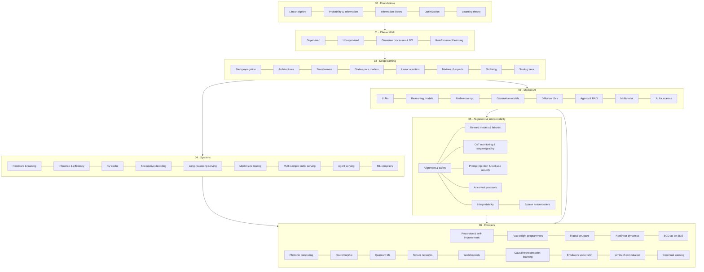

# Understanding AI

**A living, sourced map of artificial intelligence, from the first artificial neuron to the frontiers of self-improving, photonic, and self-similar intelligence.**

[Start reading](#learning-path) · [Field map](#the-field-at-a-glance) · [Frontiers](docs/06-frontiers/README.md) · [What's new](#whats-new) · [Glossary](GLOSSARY.md) · [References](REFERENCES.md)

---

Understanding AI explains the field the way a good textbook would: plainly first, then precisely, with equations, diagrams, and a citation for every claim. It currently has 65+ topic pages and 1,300+ references, organized in seven sections that run from linear algebra to photonic computing, and it is extended daily.

It is written for engineers, researchers, students, and anyone who wants more than the headlines.

## Principles

- **Sourced.** Every result links to a real paper with an arXiv ID or DOI. See [REFERENCES.md](REFERENCES.md).
- **Honest about uncertainty.** Established results, active research, and speculation are kept clearly apart. Speculative sections carry a warning callout.
- **Intuition, then formalism.** Each idea is explained in words before it is written in mathematics.
- **Connected.** Pages link to each other, because the deepest ideas in AI recur at every level.

## The field at a glance

## Contents

| Section | Pages |
|---|---|
| [**00 · Foundations**](docs/00-foundations/README.md) | [History](docs/00-foundations/history.md) · [Linear algebra](docs/00-foundations/linear-algebra.md) · [Probability & information](docs/00-foundations/probability-and-information.md) · [Information theory](docs/00-foundations/information-theory-for-ml.md) · [Optimization](docs/00-foundations/optimization.md) · [Information geometry](docs/00-foundations/information-geometry-natural-gradient.md) · [Learning theory](docs/00-foundations/learning-theory.md) |
| [**01 · Classical ML**](docs/01-classical-ml/README.md) | [Supervised](docs/01-classical-ml/supervised-learning.md) · [Unsupervised](docs/01-classical-ml/unsupervised-learning.md) · [Gaussian processes & Bayesian optimization](docs/01-classical-ml/gaussian-processes-bayesian-optimization.md) · [Reinforcement learning](docs/01-classical-ml/reinforcement-learning.md) |
| [**02 · Deep learning**](docs/02-deep-learning/README.md) | [Backpropagation](docs/02-deep-learning/neural-networks-and-backprop.md) · [Architectures](docs/02-deep-learning/architectures.md) · [Transformers](docs/02-deep-learning/transformers.md) · [Attention gradients](docs/02-deep-learning/attention-gradients.md) · [State-space models](docs/02-deep-learning/state-space-models.md) · [Linear attention](docs/02-deep-learning/linear-attention.md) · [Mixture of experts](docs/02-deep-learning/mixture-of-experts.md) · [Grokking](docs/02-deep-learning/grokking-and-delayed-generalization.md) · [Scaling laws](docs/02-deep-learning/scaling-laws.md) |
| [**03 · Modern AI**](docs/03-modern-ai/README.md) | [Large language models](docs/03-modern-ai/large-language-models.md) · [Reasoning models & test-time compute](docs/03-modern-ai/reasoning-models-and-test-time-compute.md) · [Preference optimization beyond DPO](docs/03-modern-ai/preference-optimization-beyond-dpo.md) · [Generative models](docs/03-modern-ai/generative-models.md) · [Diffusion language models](docs/03-modern-ai/diffusion-language-models.md) · [Retrieval, tools & agents](docs/03-modern-ai/retrieval-tools-and-agents.md) · [Multimodal](docs/03-modern-ai/multimodal-models.md) · [Evaluation & benchmarks](docs/03-modern-ai/evaluation-and-benchmarks.md) · [Code generation](docs/03-modern-ai/code-generation-and-program-synthesis.md) · [AI for science](docs/03-modern-ai/ai-for-science.md) |
| [**04 · Systems**](docs/04-systems/README.md) | [Hardware & training](docs/04-systems/hardware-and-training.md) · [Inference & efficiency](docs/04-systems/inference-and-efficiency.md) · [KV cache](docs/04-systems/kv-cache.md) · [Speculative decoding](docs/04-systems/speculative-decoding.md) · [Serving long-reasoning models](docs/04-systems/serving-long-reasoning-models.md) · [Inference-time routing](docs/04-systems/inference-time-routing.md) · [Prefix-aware multi-sample serving](docs/04-systems/prefix-aware-multi-sample-serving.md) · [Serving tool-augmented agents](docs/04-systems/serving-tool-augmented-agents.md) · [ML compilers](docs/04-systems/ml-compilers.md) |
| [**05 · Alignment, safety & interpretability**](docs/05-alignment-safety-interpretability/README.md) | [Alignment & safety](docs/05-alignment-safety-interpretability/alignment.md) · [Reward models & failures](docs/05-alignment-safety-interpretability/reward-model-failure-modes.md) · [CoT monitoring & steganography](docs/05-alignment-safety-interpretability/chain-of-thought-monitoring-and-steganography.md) · [Prompt injection & tool-use security](docs/05-alignment-safety-interpretability/prompt-injection-and-tool-use-security.md) · [Multimodal prompt injection](docs/05-alignment-safety-interpretability/multimodal-prompt-injection-computer-use-agents.md) · [AI control protocols](docs/05-alignment-safety-interpretability/ai-control-protocols.md) · [Interpretability](docs/05-alignment-safety-interpretability/interpretability.md) · [Sparse autoencoders](docs/05-alignment-safety-interpretability/sparse-autoencoders.md) |
| [**06 · Frontiers**](docs/06-frontiers/README.md) | [Recursion & self-improvement](docs/06-frontiers/recursion-and-self-improvement.md) · [Fast-weight programmers](docs/06-frontiers/fast-weight-programmers.md) · [Fractal & self-similar structure](docs/06-frontiers/fractal-and-self-similar-structure.md) · [Heavy-tailed weight spectra](docs/06-frontiers/heavy-tailed-weight-spectra.md) · [Non-linearity & dynamical systems](docs/06-frontiers/nonlinearity-and-dynamical-systems.md) · [SGD as an SDE](docs/06-frontiers/sgd-as-a-stochastic-differential-equation.md) · [Photonic computing](docs/06-frontiers/photonic-computing.md) · [Optical energy & nonlinearity](docs/06-frontiers/optical-energy-and-nonlinearity.md) · [Neuromorphic computing](docs/06-frontiers/neuromorphic-computing.md) · [Memristive crossbars](docs/06-frontiers/memristive-crossbars-in-memory-computing.md) · [Quantum ML](docs/06-frontiers/quantum-machine-learning.md) · [Tensor networks](docs/06-frontiers/tensor-networks-as-ml-models.md) · [What transformers can compute](docs/06-frontiers/what-transformers-can-and-cannot-compute.md) · [Continual learning](docs/06-frontiers/continual-learning-and-catastrophic-forgetting.md) · [World models](docs/06-frontiers/world-models.md) · [Model-based RL & compounding error](docs/06-frontiers/model-based-rl-compounding-error.md) · [Judging video world models](docs/06-frontiers/evaluating-video-world-models-closed-loop.md) · [Causal representation learning](docs/06-frontiers/causal-representation-learning.md) · [Emulators under distribution shift](docs/06-frontiers/distribution-shift-in-scientific-emulators.md) |

## Learning path

Pick the route that fits you. Each is a short first pass; the [contents](#contents) table has everything.

| If you are… | Start here | Then |
|---|---|---|
| **New to AI** | [History](docs/00-foundations/history.md) → [Supervised learning](docs/01-classical-ml/supervised-learning.md) | [Backpropagation](docs/02-deep-learning/neural-networks-and-backprop.md) → [Transformers](docs/02-deep-learning/transformers.md) → [LLMs](docs/03-modern-ai/large-language-models.md) |
| **A software engineer** | [Transformers](docs/02-deep-learning/transformers.md) → [LLMs](docs/03-modern-ai/large-language-models.md) | [Agents & RAG](docs/03-modern-ai/retrieval-tools-and-agents.md) → [Inference & efficiency](docs/04-systems/inference-and-efficiency.md) → [KV cache](docs/04-systems/kv-cache.md) → [Prompt injection & tool-use security](docs/05-alignment-safety-interpretability/prompt-injection-and-tool-use-security.md) |
| **Mathematically minded** | [Probability & information](docs/00-foundations/probability-and-information.md) → [Information theory](docs/00-foundations/information-theory-for-ml.md) → [Learning theory](docs/00-foundations/learning-theory.md) | [Grokking](docs/02-deep-learning/grokking-and-delayed-generalization.md) → [Scaling laws](docs/02-deep-learning/scaling-laws.md) → [What transformers can compute](docs/06-frontiers/what-transformers-can-and-cannot-compute.md) → [Tensor networks](docs/06-frontiers/tensor-networks-as-ml-models.md) |
| **A physicist or hardware engineer** | [Linear algebra](docs/00-foundations/linear-algebra.md) → [Hardware & training](docs/04-systems/hardware-and-training.md) | [AI for science](docs/03-modern-ai/ai-for-science.md) → [Photonic computing](docs/06-frontiers/photonic-computing.md) → [Neuromorphic](docs/06-frontiers/neuromorphic-computing.md) → [Quantum ML](docs/06-frontiers/quantum-machine-learning.md) |
| **Focused on safety** | [LLMs](docs/03-modern-ai/large-language-models.md) → [Alignment & safety](docs/05-alignment-safety-interpretability/alignment.md) | [CoT monitoring](docs/05-alignment-safety-interpretability/chain-of-thought-monitoring-and-steganography.md) → [Prompt injection](docs/05-alignment-safety-interpretability/prompt-injection-and-tool-use-security.md) → [AI control protocols](docs/05-alignment-safety-interpretability/ai-control-protocols.md) → [Interpretability](docs/05-alignment-safety-interpretability/interpretability.md) |

## Frontier highlights

- **[Recursion & self-improvement](docs/06-frontiers/recursion-and-self-improvement.md):** from the Bellman equation to models that refine their own outputs, generate their own training data, and search for new algorithms, plus why recursion without grounding leads to *model collapse*. Its companion, **[fast-weight programmers](docs/06-frontiers/fast-weight-programmers.md)**, shows how networks that edit their own weights at runtime became the linear-attention layers in today's long-context models.
- **[Fractal & self-similar structure](docs/06-frontiers/fractal-and-self-similar-structure.md):** power laws, scale invariance, the renormalization-group view of depth, and the discovery that the boundary of trainability is fractal.
- **[Non-linearity & dynamical systems](docs/06-frontiers/nonlinearity-and-dynamical-systems.md):** the edge of chaos, neural ODEs, reservoir computing, attention as associative memory, and learning the equations of nature.
- **[Photonic computing](docs/06-frontiers/photonic-computing.md):** how interferometer meshes multiply matrices with light, the landmark experiments, and the compiler problem.
- **[Neuromorphic](docs/06-frontiers/neuromorphic-computing.md), [quantum ML](docs/06-frontiers/quantum-machine-learning.md), and [world models](docs/06-frontiers/world-models.md):** alternative substrates and the quest for agents that simulate before they act.

## What's new

The six most recent additions. Full detail for every update is in the [changelog](CHANGELOG.md).

| Date | Added |
|---|---|
| 2026-11-10 | [Grokking: when generalization arrives long after memorization](docs/02-deep-learning/grokking-and-delayed-generalization.md): why a network can generalize thousands of steps after it memorizes, and what speeds that up. |
| 2026-11-10 | [Multimodal prompt injection for computer-use and browser agents](docs/05-alignment-safety-interpretability/multimodal-prompt-injection-computer-use-agents.md): attacks that reach an agent through what it sees, and current defenses. |
| 2026-11-09 | [Judging video world models by what they let agents do](docs/06-frontiers/evaluating-video-world-models-closed-loop.md): why visual quality does not predict task success. |
| 2026-11-09 | [Model-based RL: compounding error and how planners cope](docs/06-frontiers/model-based-rl-compounding-error.md): how small one-step errors grow over long rollouts. |
| 2026-11-08 | [AI control protocols](docs/05-alignment-safety-interpretability/ai-control-protocols.md): getting useful work from a model you do not trust. |
| 2026-11-08 | [Prompt injection and tool-use security for agents](docs/05-alignment-safety-interpretability/prompt-injection-and-tool-use-security.md): the confused-deputy problem, and defenses inside and around the model. |

## Contributing and license

Corrections and additions are welcome. Please read [CONTRIBUTING.md](CONTRIBUTING.md); the one firm rule is that every claim needs a real, checkable source.

Text and diagrams are licensed under [Creative Commons Attribution 4.0 International (CC BY 4.0)](LICENSE). You may share and adapt the material with attribution.
