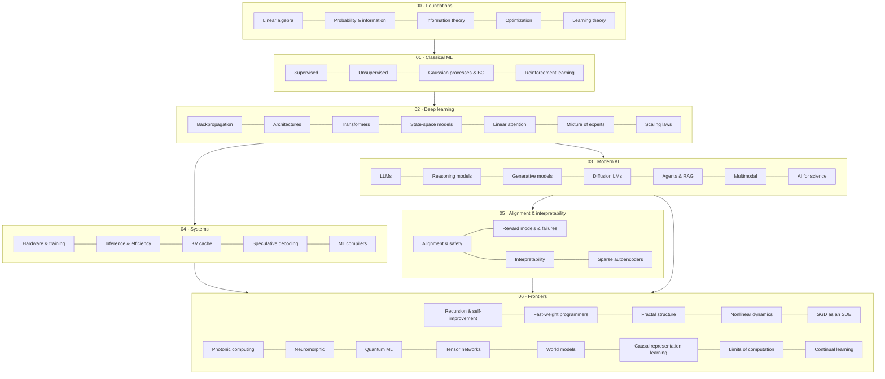

# Understanding AI

**A living, sourced map of artificial intelligence, from the first artificial neuron to the frontiers of self-improving, photonic, and self-similar intelligence.**

[Start reading](#learning-path) · [Field map](#the-field-at-a-glance) · [Frontiers](docs/06-frontiers/README.md) · [What's new](#whats-new) · [Glossary](GLOSSARY.md) · [References](REFERENCES.md)

---

> A model that predicts the next word turns out to learn grammar, facts, and fragments of reasoning. A grid of mirrors and phase shifters can multiply a matrix at the speed of light. The boundary between hyperparameters that train and those that diverge is a fractal. **AI is stranger, and more interesting, than the headlines suggest.**

Understanding AI explains the field the way a good textbook would: plainly first, then precisely, with equations, diagrams, and a citation for every claim. It is written for engineers, researchers, students, and anyone curious enough to look beneath the surface. It grows every day.

## Principles

- **Sourced.** Every result links to a real paper with an arXiv ID or DOI. See [REFERENCES.md](REFERENCES.md).
- **Honest about uncertainty.** Established results, active research, and speculation are kept clearly apart. Speculative sections carry a warning callout.
- **Intuition, then formalism.** Each idea is explained in words before it is written in mathematics.
- **Connected.** Pages link to each other, because the deepest ideas in AI recur at every level.

## The field at a glance

## Contents

| Section | Pages |
|---|---|
| [**00 · Foundations**](docs/00-foundations/README.md) | [History](docs/00-foundations/history.md) · [Linear algebra](docs/00-foundations/linear-algebra.md) · [Probability & information](docs/00-foundations/probability-and-information.md) · [Information theory](docs/00-foundations/information-theory-for-ml.md) · [Optimization](docs/00-foundations/optimization.md) · [Information geometry](docs/00-foundations/information-geometry-natural-gradient.md) · [Learning theory](docs/00-foundations/learning-theory.md) |
| [**01 · Classical ML**](docs/01-classical-ml/README.md) | [Supervised](docs/01-classical-ml/supervised-learning.md) · [Unsupervised](docs/01-classical-ml/unsupervised-learning.md) · [Gaussian processes & Bayesian optimization](docs/01-classical-ml/gaussian-processes-bayesian-optimization.md) · [Reinforcement learning](docs/01-classical-ml/reinforcement-learning.md) |
| [**02 · Deep learning**](docs/02-deep-learning/README.md) | [Backpropagation](docs/02-deep-learning/neural-networks-and-backprop.md) · [Architectures](docs/02-deep-learning/architectures.md) · [Transformers](docs/02-deep-learning/transformers.md) · [Attention gradients](docs/02-deep-learning/attention-gradients.md) · [State-space models](docs/02-deep-learning/state-space-models.md) · [Linear attention](docs/02-deep-learning/linear-attention.md) · [Mixture of experts](docs/02-deep-learning/mixture-of-experts.md) · [Scaling laws](docs/02-deep-learning/scaling-laws.md) |
| [**03 · Modern AI**](docs/03-modern-ai/README.md) | [Large language models](docs/03-modern-ai/large-language-models.md) · [Reasoning models & test-time compute](docs/03-modern-ai/reasoning-models-and-test-time-compute.md) · [Generative models](docs/03-modern-ai/generative-models.md) · [Diffusion language models](docs/03-modern-ai/diffusion-language-models.md) · [Retrieval, tools & agents](docs/03-modern-ai/retrieval-tools-and-agents.md) · [Multimodal](docs/03-modern-ai/multimodal-models.md) · [Evaluation & benchmarks](docs/03-modern-ai/evaluation-and-benchmarks.md) · [Code generation](docs/03-modern-ai/code-generation-and-program-synthesis.md) · [AI for science](docs/03-modern-ai/ai-for-science.md) |
| [**04 · Systems**](docs/04-systems/README.md) | [Hardware & training](docs/04-systems/hardware-and-training.md) · [Inference & efficiency](docs/04-systems/inference-and-efficiency.md) · [KV cache](docs/04-systems/kv-cache.md) · [Speculative decoding](docs/04-systems/speculative-decoding.md) · [ML compilers](docs/04-systems/ml-compilers.md) |
| [**05 · Alignment, safety & interpretability**](docs/05-alignment-safety-interpretability/README.md) | [Alignment & safety](docs/05-alignment-safety-interpretability/alignment.md) · [Reward models & failures](docs/05-alignment-safety-interpretability/reward-model-failure-modes.md) · [Interpretability](docs/05-alignment-safety-interpretability/interpretability.md) · [Sparse autoencoders](docs/05-alignment-safety-interpretability/sparse-autoencoders.md) |
| [**06 · Frontiers**](docs/06-frontiers/README.md) | [Recursion & self-improvement](docs/06-frontiers/recursion-and-self-improvement.md) · [Fast-weight programmers](docs/06-frontiers/fast-weight-programmers.md) · [Fractal & self-similar structure](docs/06-frontiers/fractal-and-self-similar-structure.md) · [Heavy-tailed weight spectra](docs/06-frontiers/heavy-tailed-weight-spectra.md) · [Non-linearity & dynamical systems](docs/06-frontiers/nonlinearity-and-dynamical-systems.md) · [SGD as an SDE](docs/06-frontiers/sgd-as-a-stochastic-differential-equation.md) · [Photonic computing](docs/06-frontiers/photonic-computing.md) · [Optical energy & nonlinearity](docs/06-frontiers/optical-energy-and-nonlinearity.md) · [Neuromorphic computing](docs/06-frontiers/neuromorphic-computing.md) · [Memristive crossbars](docs/06-frontiers/memristive-crossbars-in-memory-computing.md) · [Quantum ML](docs/06-frontiers/quantum-machine-learning.md) · [Tensor networks](docs/06-frontiers/tensor-networks-as-ml-models.md) · [What transformers can compute](docs/06-frontiers/what-transformers-can-and-cannot-compute.md) · [Continual learning](docs/06-frontiers/continual-learning-and-catastrophic-forgetting.md) · [World models](docs/06-frontiers/world-models.md) · [Causal representation learning](docs/06-frontiers/causal-representation-learning.md) |

## Learning path

Pick the route that fits you.

| If you are… | Start here | Then |
|---|---|---|
| **New to AI** | [History](docs/00-foundations/history.md) → [Supervised learning](docs/01-classical-ml/supervised-learning.md) | [Backpropagation](docs/02-deep-learning/neural-networks-and-backprop.md) → [Transformers](docs/02-deep-learning/transformers.md) → [LLMs](docs/03-modern-ai/large-language-models.md) |
| **A software engineer** | [Transformers](docs/02-deep-learning/transformers.md) → [LLMs](docs/03-modern-ai/large-language-models.md) | [Code generation](docs/03-modern-ai/code-generation-and-program-synthesis.md) → [Agents & RAG](docs/03-modern-ai/retrieval-tools-and-agents.md) → [Inference & efficiency](docs/04-systems/inference-and-efficiency.md) · [KV cache](docs/04-systems/kv-cache.md) · [Speculative decoding](docs/04-systems/speculative-decoding.md) · [Diffusion language models](docs/03-modern-ai/diffusion-language-models.md) · [ML compilers](docs/04-systems/ml-compilers.md) |
| **Mathematically minded** | [Probability & information](docs/00-foundations/probability-and-information.md) → [Information theory](docs/00-foundations/information-theory-for-ml.md) → [Learning theory](docs/00-foundations/learning-theory.md) | [Scaling laws](docs/02-deep-learning/scaling-laws.md) → [Linear attention](docs/02-deep-learning/linear-attention.md) → [What transformers can compute](docs/06-frontiers/what-transformers-can-and-cannot-compute.md) → [Continual learning](docs/06-frontiers/continual-learning-and-catastrophic-forgetting.md) → [Tensor networks](docs/06-frontiers/tensor-networks-as-ml-models.md) → [Fractal structure](docs/06-frontiers/fractal-and-self-similar-structure.md) → [Nonlinear dynamics](docs/06-frontiers/nonlinearity-and-dynamical-systems.md) → [Causal representation learning](docs/06-frontiers/causal-representation-learning.md) |
| **A physicist or hardware engineer** | [Linear algebra](docs/00-foundations/linear-algebra.md) → [Hardware & training](docs/04-systems/hardware-and-training.md) | [AI for science](docs/03-modern-ai/ai-for-science.md) → [Photonic computing](docs/06-frontiers/photonic-computing.md) → [Neuromorphic](docs/06-frontiers/neuromorphic-computing.md) → [Memristive crossbars](docs/06-frontiers/memristive-crossbars-in-memory-computing.md) → [Quantum ML](docs/06-frontiers/quantum-machine-learning.md) |
| **Focused on safety** | [LLMs](docs/03-modern-ai/large-language-models.md) → [Reasoning models](docs/03-modern-ai/reasoning-models-and-test-time-compute.md) → [Alignment & safety](docs/05-alignment-safety-interpretability/alignment.md) | [Interpretability](docs/05-alignment-safety-interpretability/interpretability.md) → [Recursion & self-improvement](docs/06-frontiers/recursion-and-self-improvement.md) |

## Frontier highlights

- **[Recursion & self-improvement](docs/06-frontiers/recursion-and-self-improvement.md):** from the Bellman equation to models that refine their own outputs, generate their own training data, and search for new algorithms, plus why recursion without grounding leads to *model collapse*. Its companion, **[fast-weight programmers](docs/06-frontiers/fast-weight-programmers.md)**, shows how networks that edit their own weights at runtime became the linear-attention layers in today's long-context models.
- **[Fractal & self-similar structure](docs/06-frontiers/fractal-and-self-similar-structure.md):** power laws, scale invariance, the renormalization-group view of depth, and the discovery that the boundary of trainability is fractal.
- **[Non-linearity & dynamical systems](docs/06-frontiers/nonlinearity-and-dynamical-systems.md):** the edge of chaos, neural ODEs, reservoir computing, attention as associative memory, and learning the equations of nature.
- **[Photonic computing](docs/06-frontiers/photonic-computing.md):** how interferometer meshes multiply matrices with light, the landmark experiments, and the compiler problem.
- **[Neuromorphic](docs/06-frontiers/neuromorphic-computing.md), [quantum ML](docs/06-frontiers/quantum-machine-learning.md), and [world models](docs/06-frontiers/world-models.md):** alternative substrates and the quest for agents that simulate before they act.

## What's new

| Date | Update |
|---|---|
| 2026-11-04 | **[Reasoning models: reinforcement learning with verifiable rewards and test-time compute](docs/03-modern-ai/reasoning-models-and-test-time-compute.md)**: how o1 and DeepSeek-R1 learned to think before answering by being rewarded only for checkable answers; GRPO's group baseline and the details that turned out to matter (Dr. GRPO, DAPO, GSPO, entropy collapse); process versus outcome rewards; parallel and sequential test-time compute, from Large Language Monkeys to s1's "Wait"; tested code where pass@N climbs to 0.985, majority voting stalls near 0.52 and best-of-N with a slightly fooled verifier peaks at 0.692 then falls to 0.168, and where GRPO more than triples pass@1 while losing a quarter of its pass@64 coverage; the open fight over whether RL teaches new reasoning or only sharpens it, including 2026 exploration methods; and why a chain of thought is not guaranteed to be the real reason for an answer. 36 new checked references. |
| 2026-11-03 (evening) | **[Linear attention and its kernels: from Performer to gated linear attention](docs/02-deep-learning/linear-attention.md)**: how swapping the order of two matrix products turns attention from quadratic into linear and turns a transformer into a recurrent network with a fixed-size state, checked in tested code where the quadratic, recurrent and chunkwise forms agree to round-off with and without a data-dependent decay gate; why Performer's positive random features are accurate where most attention weights live but noisiest exactly where a confident head looks; the complexity results showing sharp softmax attention cannot be approximated fast in general; attention dilution, shown with a linear head whose weights are indistinguishable from uniform while softmax keeps 0.84 of its weight on the right key among 32,768; the recall–state-size trade-off; decay and gates from RetNet to GLA, RWKV-6, HGRN2 and Mamba-2; the chunkwise kernels that finally made it fast (Lightning Attention-2, FlashLinearAttention, the 2026 FlexLA compiler); hybrids at frontier scale (MiniMax-01, Kimi Linear), converting pretrained models (LoLCATs, SUPRA), and 2026 work on recall capacity (KATA, MS-GLA). A labelled speculative section on holding the state in physical matrix hardware. 23 new checked references. |
| 2026-11-03 | **[Information theory for machine learning](docs/00-foundations/information-theory-for-ml.md)**: why a language model's loss *is* a file size, shown in tested code where a real arithmetic coder's output matches each model's cross-entropy to four decimal places and decodes exactly; bits per byte, LLMs compressing images and audio better than PNG and FLAC, compression tracking benchmark scores across 31 models, and the 2026 finding that compute-optimal scaling counts data in bytes, not tokens; the two directions of KL and why maximum likelihood spreads out while variational inference and the RLHF leash lock onto one mode; mutual information, the data processing inequality, and the proof that no sample-based lower bound can report more than about $\log N$, with InfoNCE stuck at exactly $\log N$ on 16.6 nats of true information; the rise and fall of the information-bottleneck theory of deep learning; description length and information-theoretic generalization bounds; and the rate–distortion floor that keeps scalar quantizers 0.254 bits above Shannon's limit. A labelled speculative section on counting useful bits in noisy analog compute. 33 new checked references. |
| 2026-11-02 | **[The KV cache: paging, sharing and compression](docs/04-systems/kv-cache.md)**: the working memory of a running language model and why it, not the weights, often limits how many users a chip can serve and how fast it answers; the cache-size formula; paging with block tables (PagedAttention), prefix sharing (Prompt Cache, RadixAttention, ChunkAttention), chunked prefill and prefill/decode disaggregation (Sarathi-Serve, Splitwise, DistServe, Mooncake, FlatCake); smaller per-token entries through MQA, GQA, cross-layer attention, YOCO, MLA and DMC; token eviction from attention sinks to H2O, SnapKV and PyramidKV versus query-aware selection (Quest); 2- and 3-bit quantization (KIVI, KVQuant, QJL, TurboQuant) and lossless coding; what benchmarks say compression costs in multi-turn use; a tested four-part sketch; and a labelled speculative section. 36 new checked references. |
| 2026-11-02 | **[Diffusion language models: writing every word at once](docs/03-modern-ai/diffusion-language-models.md)**: how a language model can write by filling in blanks in any order instead of left to right; why the masked diffusion objective is just a masked-language-model loss weighted over every masking rate, a bound on log-likelihood that is equivalent to training on all generation orders at once; the scale-up from SEDD and MDLM to LLaDA 8B, Dream 7B and block diffusion, and commercial code models at more than 1,000 tokens per second; the catch that committing several tokens per pass treats them as independent, with the theory that correct (not just fluent) sequences need steps growing with length; a tested sketch where even a perfect denoiser, writing six tokens in one pass, lands 0.74 away from the true distribution in total variation, most-confident-first ordering does worse than random at two and three steps, and confidence thresholds buy speed only when the output is already determined (a copy is written in one pass with no loss); the data-efficiency crossover under repeated data, and learned and set-based unmasking policies from October 2026. 30 new checked references. |
| 2026-11-01 | **[Speculative decoding: several tokens per step, the same answer](docs/04-systems/speculative-decoding.md)**: why a language model generating one token at a time leaves its chip mostly idle, and how a cheap drafter plus one parallel check by the big model produces several tokens per step with output *provably identical in distribution* to the big model's own; the two-line proof that the acceptance rule is exact and accepts with probability one minus the total variation distance; the speed-up formula and why the best draft length grows from 4 to 13 guesses as agreement rises from 0.6 to 0.9; a tested sketch where speculative decoding of 60,000 tokens is statistically indistinguishable from plain sampling while producing up to 4.0 tokens per big-model call; drafters from small models and distillation to Medusa heads, EAGLE-3 (up to 6.5×), self-speculation and multi-token prediction; token trees and the optimal-transport view; and the 2026 findings on when it stops paying: large batches where the energy saving becomes a loss, long contexts, mixture-of-experts routing, and reasoning traces where acceptance does not decay. 32 new checked references. |
| 2026-11-01 | **[State-space models: from S4 to Mamba](docs/02-deep-learning/state-space-models.md)**: how a linear dynamical system became a sequence layer that runs as a recurrence, a convolution or a parallel scan, checked in tested code where all three agree to round-off on 4,096 steps; HiPPO, the state matrix that keeps an optimal polynomial summary of the whole past (16 numbers reconstruct a 10,000-step signal to 6.4% relative error); S4 solving the 16k-step Path-X task that all prior work failed, and the diagonal models showing initialization is what matters; why Mamba makes its parameters depend on the token, shown with a recall task where no time-invariant layer of any size does better than 99.8% unexplained variance at length 1,024 while a selective layer with one state number is exact; Mamba-2's proof that selective SSMs are linear attention with decay, the 2026 Mamba-3 with complex, rotating states, what a fixed-size state still cannot do (copying, associative recall), and why production models such as Jamba and Nemotron-H keep a few attention layers. 28 new checked references. |
| 2026-10-31 | **[Causal representation learning](docs/06-frontiers/causal-representation-learning.md)**: how a model might discover the causal variables behind its observations instead of the correlations that happen to come with them. Structural causal models and interventions, why causal direction is invisible without assumptions, and the theorem that unsupervised disentanglement is impossible; the routes back to identifiability through environments, paired views, interventions, time and invariance; shortcut learning and why tuned ordinary training still beats invariance methods on DomainBed; what LLMs can and cannot do with causality; and the real optical system on which every tested method failed. A tested sketch shows ICA recovering non-Gaussian sources but not Gaussian ones, environments restoring identifiability only when they change latents differently, non-Gaussian noise revealing causal direction, and a causal predictor holding test error at 0.252 where pooled regression reaches 1.738. 49 new checked references. |
| 2026-10-31 | **[AI for science: proteins, materials and weather](docs/03-modern-ai/ai-for-science.md)**: why scientific data, symmetries and verification change the machine-learning problem; AlphaFold and the protein-structure revolution, protein design with RFdiffusion and ProteinMPNN, learned interatomic potentials, GNoME and the debate over what counts as a new material, deep-learning antibiotic discovery, and ML weather from FourCastNet to GenCast. A tested Lorenz-96 sketch shows why a model trained to minimize squared error blurs into the climatological mean while a calibrated ensemble keeps realistic variability, and how CRPS rewards the ensemble. 34 new checked references. |
| 2026-10-30 | **[Tensor networks as machine learning models](docs/06-frontiers/tensor-networks-as-ml-models.md)**: the physicists' trick for writing an exponentially large table as a chain of small ones, and what it does for machine learning; the tensor train and its error-controlled SVD algorithm, DMRG and the area law; why the bond dimension is a hard budget on correlation, and the measurements suggesting text follows a near-volume law that defeats one-dimensional networks while images do not; MPS classifiers under 1% error on MNIST, Born machines with exact likelihoods and perfect sampling, and the proofs that deep multiplicative networks are exponentially more efficient than shallow ones; layer compression from 200,000× on one VGG layer to tensorized LLMs and adapters, with the caveat that fewer parameters often do not mean faster inference; the two-way bridge to quantum computing, including a classical tensor-network simulation of a 127-qubit utility experiment. Tested code shows a cubic polynomial sampled at a million points stored in 302 numbers while noise does not compress at all, a parity Born machine with bond dimension 2 whose 20,000 perfect samples are all even, and a dense layer that compresses 1,986× when it has structure but loses 93% of itself at only 11× when it does not. Plus a labelled speculative section on tensor networks as a contract for small physical compute units. 41 new checked references. |
| 2026-10-30 | **[Continual learning and catastrophic forgetting](docs/06-frontiers/continual-learning-and-catastrophic-forgetting.md)**: why gradient descent on shared weights overwrites old skills, and why forgetting peaks when tasks are similar but not identical; the three continual-learning scenarios and the accuracy and backward-transfer metrics; elastic weight consolidation derived as a Laplace approximation, replay and gradient episodic memory, and parameter isolation; loss of plasticity over thousands of tasks; how continual pre-training, LoRA, RL fine-tuning and sparse memory updates change forgetting in large language models; complementary learning systems in the brain; two tested NumPy sketches; and a labelled speculative section on learning in write-limited analog hardware. 55 new checked references. |
| 2026-10-29 | **[What transformers can and cannot compute](docs/06-frontiers/what-transformers-can-and-cannot-compute.md)**: why a model that writes fluent code can still fail to tell whether a bit string has an even number of ones; how realistic numeric precision makes one forward pass a shallow parallel circuit (the class $\mathsf{TC}^0$), so problems that need many sequential steps are out of reach; why state-space models share the limit; and how chain of thought, looping and slowly growing depth buy the power back, up to exactly the problems solvable in polynomial time. Tested code shows a single input bit's influence on an attention layer shrinking like $1/n$, a one-pass parity solver that is perfect up to 2,048 bits in half precision but at chance by 16,384, and a step-by-step chain-of-thought version that stays exact in half precision. Plus RASP, Tracr, length generalization and why sensitive functions are hard to learn. 34 new checked references. |
| 2026-10-29 | **[Code generation and program synthesis](docs/03-modern-ai/code-generation-and-program-synthesis.md)**: how machines learned to write programs, from 1971 theorem-proving synthesis and the example-driven engine behind Excel's Flash Fill to Codex, AlphaCode and repository-scale agents; why the winning recipe is a fluent but unreliable generator paired with a cheap mechanical check, shown in tested code where filtering 1,000 samples on the public examples and submitting one program per behaviour cluster lifts the solve rate from 24% to 79% of an 87% ceiling; fill-in-the-middle training, self-debugging and reinforcement learning on test results; why thin tests and contamination inflate code benchmarks by up to 29%; FunSearch and AlphaEvolve's 48-multiplication $4 \times 4$ complex matrix product, the first gain over Strassen in that setting in 56 years; and the randomized trial in which experienced developers expected AI to speed them up by 24% but were slowed by 19%. 30 new checked references. |
| 2026-10-28 | **[Memristive crossbars and in-memory computing](docs/06-frontiers/memristive-crossbars-in-memory-computing.md)**: how a grid of programmable resistors multiplies a matrix by a vector in one step, because Ohm's law multiplies and Kirchhoff's law adds, so the weights never move; from Chua's 1971 "missing" circuit element to RRAM, phase-change memory and gain cells; why every analog answer is a little wrong, with tested code where 64 conductance levels already make noise, not quantization, the bottleneck, a year of drift that raises a layer's error from 7% to 59% is cut back to 10% by a single calibration number, and spreading one weight over four self-correcting devices lowers its error from 3% to below 0.01%; hardware-aware training, Tiki-Taka, the NeuRRAM and IBM phase-change chips, attention in gain-cell memory and mixture-of-experts on 3D analog hardware. 23 new checked references. |
| 2026-10-28 | **[Attention gradients, derived by hand](docs/02-deep-learning/attention-gradients.md)**: the whole backward pass of attention on one page, five matrix products and one row-wise correction; the softmax Jacobian, why its largest eigenvalue can never exceed 1/2, and why it vanishes once attention commits to a single key; the one-line identity $\sum_j P_{ij}\,dP_{ij} = dO_i \cdot O_i$ that lets FlashAttention throw away the attention matrix and rebuild it tile by tile, checked in tested code against finite differences to about $10^{-9}$; why the $1/\sqrt{d}$ scale exists, and how attention-logit growth and entropy collapse broke large training runs until QK-norm and σReparam. 10 new checked references. |
| 2026-10-27 | **[SGD as a stochastic differential equation](docs/06-frontiers/sgd-as-a-stochastic-differential-equation.md)**: why minibatch noise acts like heat, and why the learning rate divided by the batch size is the temperature that matters; the Itô equation, its Fokker–Planck density, and the Ornstein–Uhlenbeck picture near a minimum, checked in tested code where two directions whose curvatures differ 37-fold settle to the same spread, as predicted, until the step size nears the stability limit and the sharp direction's spread nearly doubles, matched by the exact discrete formula; escaping sharp minima, the hidden gradient-norm penalty that finite steps add, the square-root scaling rule for Adam, critical batch sizes in modern pre-training, where the picture breaks (edge of stability, heavy-tailed noise), and Langevin sampling. 27 new checked references. |
| 2026-10-27 | **[Sparse autoencoders and the dictionary of features](docs/05-alignment-safety-interpretability/sparse-autoencoders.md)**: how a wide, sparse re-encoding pulls apart the concepts a model stores on top of each other, from 1996 sparse coding of natural images to 34 million features in Claude 3 Sonnet and 16 million in GPT-4; why the penalty moved from L1 to TopK, JumpReLU and BatchTopK, with tested code where no neuron matches any of 128 planted features but a TopK SAE recovers all of them while L1 under-reports their strength by two-thirds or more; Golden Gate Claude, transcoders, and attribution graphs that catch a model planning a rhyme; and the 2025 reckoning, from 30% feature overlap between random seeds to SAE probes losing to plain linear probes. 31 checked references. |
| 2026-10-26 | **[Reward models and how they fail](docs/05-alignment-safety-interpretability/reward-model-failure-modes.md)**: the hidden scorer behind every RLHF-trained assistant, and why pushing on it backfires; the measured rise-then-fall of true quality as optimization grows (Gao et al.'s scaling laws, reproduced in tested code where a proxy that agrees with the gold reward 85% of the time still drives the gold score from 0.48 at its peak to below zero); Goodhart's four variants and the theorem that almost no proxy is unhackable; a field guide from length bias and sycophancy (including the 2025 GPT-4o rollback) to RLHF making humans 24% more likely to accept wrong answers, reward tampering, and 2025 evidence that learning to hack can generalize to broader misalignment; and which mitigations actually help. 22 new checked references. |
| 2026-10-26 | **[Gaussian processes and Bayesian optimization](docs/01-classical-ml/gaussian-processes-bayesian-optimization.md)**: the model that answers with an honest error bar, from 1960s kriging to the loop that tuned AlphaGo before the Lee Sedol match (50% to 66.5% self-play win rate); closed-form posteriors and the marginal likelihood as a built-in Occam's razor; expected improvement, GP-UCB and entropy search; tested code where 15 evaluations of BO find the best grid point in 20 of 20 runs against 2 of 20 for random search; the 2024–2025 papers showing the high-dimensional "curse" was mostly a bad length-scale prior; and why infinitely wide neural networks are Gaussian processes. 26 new checked references. |
| 2026-10-25 | **[Mixture of experts and conditional computation](docs/02-deep-learning/mixture-of-experts.md)**: how DeepSeek-V3 holds 671B parameters but uses 37B per token, from the 1991 mixtures of local experts to today's sparse routers; why routers collapse onto a few favourite experts and four ways to stop it, with tested code where a selection-only bias cuts the busiest expert from 3.1x its fair share to 1.03x; the router z-loss, upcycling and Soft MoE; fine-grained and shared experts; MoE scaling laws; and why sparsity saves arithmetic but not memory. 21 new checked references. |
| 2026-10-25 | **[Information geometry and the natural gradient](docs/00-foundations/information-geometry-natural-gradient.md)**: why gradient descent secretly depends on how a model is written down, the Fisher metric as the one ruler statistics singles out, a tested example where the natural gradient converges in 21 steps against 1,046, the empirical-Fisher trap, how K-FAC, Shampoo and SOAP make curvature affordable (Shampoo won the first AlgoPerf competition), and Muon, the orthogonalizing optimizer behind Moonlight and the trillion-parameter Kimi K2. 19 new checked references. |
| 2026-10-24 | **[Fast-weight programmers and self-referential networks](docs/06-frontiers/fast-weight-programmers.md)**: why linear attention is secretly a 1992 idea, a slow network writing a fast weight matrix one outer product at a time; how the delta rule lets that memory overwrite instead of pile up (with tested code); the family of editing rules behind DeltaNet, Gated DeltaNet, test-time training and Titans, now inside production hybrids such as Qwen3-Next and Kimi Linear; why negative eigenvalues unlock parity; and matrices that rewrite themselves. 20 new checked references. |
| 2026-10-24 | **[Energy per MAC and the nonlinearity problem](docs/06-frontiers/optical-energy-and-nonlinearity.md)**: where the energy of an optical neural network really goes, why conversions and photons are shared across a whole row of multiplications while memory traffic is not, the shot-noise floor that lets experiments run on fewer than one photon per multiplication, a tested energy-budget calculator, the three ways to put a nonlinearity between optical layers, and the 2025 Nature systems that run ResNet and BERT on photonic hardware. 15 new checked references. |
| 2026-10-23 | **[Evaluation and benchmarks, and their pitfalls](docs/03-modern-ai/evaluation-and-benchmarks.md)**: why most leaderboard gaps sit inside the error bar (with tested code for paired comparisons and pass@k), how fresh questions exposed memorized math benchmarks, the estimated 6.49% of MMLU questions with errors, emergent abilities that vanish under a different metric, the biases of LLM judges, how private testing distorted Chatbot Arena (2025), and the shift to measuring agents by task time horizon. 22 new checked references. |
| 2026-10-23 | **[Heavy-tailed weight spectra and generalization](docs/06-frontiers/heavy-tailed-weight-spectra.md)**: why the eigenvalues of trained weight matrices escape the random-matrix baseline and settle into power-law tails, how to fit the exponent without fooling yourself (with code), the contested origins of the tails in SGD, a generalization bound in terms of fractal (Hausdorff) dimension, and how layer spectra now guide learning rates and let LLaMA-7B be pruned to 80% sparsity. 19 new checked references. |
| 2026-10-22 | **[Normalization, initialization and μP](docs/02-deep-learning/normalization-initialization-mup.md)**: why signals explode or vanish with depth, where the LayerNorm goes and why it matters, transformers with no normalization (2025) and with normalization everywhere (2024), and how μP lets hyperparameters tuned on a 40M-parameter model carry over to a 6.7B one. 13 new checked references. |
| 2026-10-18 | **[Compilers for machine learning](docs/04-systems/ml-compilers.md)**: how fusion and tiling cut memory traffic (with the arithmetic), the anatomy of an ML compiler, Halide to PyTorch 2, learned schedule search, LLM-written kernels (KernelBench 2025), and what analog and optical hardware asks of compilers. 14 new checked references. |
| 2026-10-17 | **First edition**: 27 topic pages across seven sections, a glossary, and 220+ checked references. |

Full history in the [changelog](CHANGELOG.md). How updates work: [docs/DAILY_UPDATES.md](docs/DAILY_UPDATES.md).

## Contributing and license

Corrections and additions are welcome. Please read [CONTRIBUTING.md](CONTRIBUTING.md); the one firm rule is that every claim needs a real, checkable source.

Text and diagrams are licensed under [Creative Commons Attribution 4.0 International (CC BY 4.0)](LICENSE). You may share and adapt the material with attribution.
