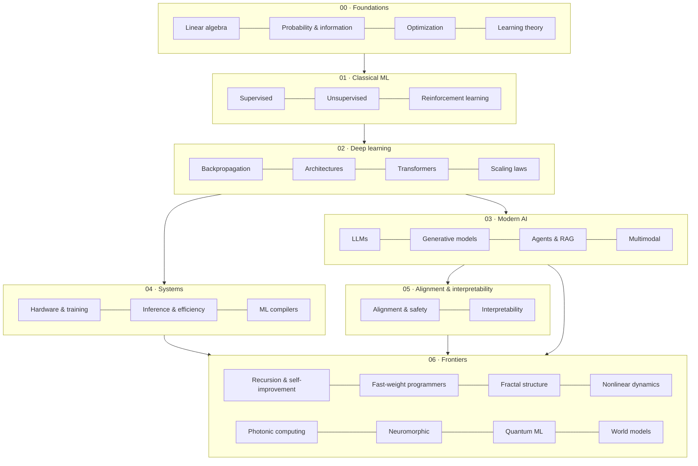

# Understanding AI

**A living, sourced map of artificial intelligence, from the first artificial neuron to the frontiers of self-improving, photonic, and self-similar intelligence.**

[Start reading](#learning-path) · [Field map](#the-field-at-a-glance) · [Frontiers](docs/06-frontiers/README.md) · [What's new](#whats-new) · [Glossary](GLOSSARY.md) · [References](REFERENCES.md)

---

> A model that predicts the next word turns out to learn grammar, facts, and fragments of reasoning. A grid of mirrors and phase shifters can multiply a matrix at the speed of light. The boundary between hyperparameters that train and those that diverge is a fractal. **AI is stranger, and more interesting, than the headlines suggest.**

Understanding AI explains the field the way a good textbook would: plainly first, then precisely, with equations, diagrams, and a citation for every claim. It is written for engineers, researchers, students, and anyone curious enough to look beneath the surface. It grows every day.

## Principles

- **Sourced.** Every result links to a real paper with an arXiv ID or DOI. See [REFERENCES.md](REFERENCES.md).
- **Honest about uncertainty.** Established results, active research, and speculation are kept clearly apart. Speculative sections carry a warning callout.
- **Intuition, then formalism.** Each idea is explained in words before it is written in mathematics.
- **Connected.** Pages link to each other, because the deepest ideas in AI recur at every level.

## The field at a glance

## Contents

| Section | Pages |
|---|---|
| [**00 · Foundations**](docs/00-foundations/README.md) | [History](docs/00-foundations/history.md) · [Linear algebra](docs/00-foundations/linear-algebra.md) · [Probability & information](docs/00-foundations/probability-and-information.md) · [Optimization](docs/00-foundations/optimization.md) · [Information geometry](docs/00-foundations/information-geometry-natural-gradient.md) · [Learning theory](docs/00-foundations/learning-theory.md) |
| [**01 · Classical ML**](docs/01-classical-ml/README.md) | [Supervised](docs/01-classical-ml/supervised-learning.md) · [Unsupervised](docs/01-classical-ml/unsupervised-learning.md) · [Reinforcement learning](docs/01-classical-ml/reinforcement-learning.md) |
| [**02 · Deep learning**](docs/02-deep-learning/README.md) | [Backpropagation](docs/02-deep-learning/neural-networks-and-backprop.md) · [Architectures](docs/02-deep-learning/architectures.md) · [Transformers](docs/02-deep-learning/transformers.md) · [Scaling laws](docs/02-deep-learning/scaling-laws.md) |
| [**03 · Modern AI**](docs/03-modern-ai/README.md) | [Large language models](docs/03-modern-ai/large-language-models.md) · [Generative models](docs/03-modern-ai/generative-models.md) · [Retrieval, tools & agents](docs/03-modern-ai/retrieval-tools-and-agents.md) · [Multimodal](docs/03-modern-ai/multimodal-models.md) · [Evaluation & benchmarks](docs/03-modern-ai/evaluation-and-benchmarks.md) |
| [**04 · Systems**](docs/04-systems/README.md) | [Hardware & training](docs/04-systems/hardware-and-training.md) · [Inference & efficiency](docs/04-systems/inference-and-efficiency.md) · [ML compilers](docs/04-systems/ml-compilers.md) |
| [**05 · Alignment, safety & interpretability**](docs/05-alignment-safety-interpretability/README.md) | [Alignment & safety](docs/05-alignment-safety-interpretability/alignment.md) · [Interpretability](docs/05-alignment-safety-interpretability/interpretability.md) |
| [**06 · Frontiers**](docs/06-frontiers/README.md) | [Recursion & self-improvement](docs/06-frontiers/recursion-and-self-improvement.md) · [Fast-weight programmers](docs/06-frontiers/fast-weight-programmers.md) · [Fractal & self-similar structure](docs/06-frontiers/fractal-and-self-similar-structure.md) · [Heavy-tailed weight spectra](docs/06-frontiers/heavy-tailed-weight-spectra.md) · [Non-linearity & dynamical systems](docs/06-frontiers/nonlinearity-and-dynamical-systems.md) · [Photonic computing](docs/06-frontiers/photonic-computing.md) · [Optical energy & nonlinearity](docs/06-frontiers/optical-energy-and-nonlinearity.md) · [Neuromorphic computing](docs/06-frontiers/neuromorphic-computing.md) · [Quantum ML](docs/06-frontiers/quantum-machine-learning.md) · [World models](docs/06-frontiers/world-models.md) |

## Learning path

Pick the route that fits you.

| If you are… | Start here | Then |
|---|---|---|
| **New to AI** | [History](docs/00-foundations/history.md) → [Supervised learning](docs/01-classical-ml/supervised-learning.md) | [Backpropagation](docs/02-deep-learning/neural-networks-and-backprop.md) → [Transformers](docs/02-deep-learning/transformers.md) → [LLMs](docs/03-modern-ai/large-language-models.md) |
| **A software engineer** | [Transformers](docs/02-deep-learning/transformers.md) → [LLMs](docs/03-modern-ai/large-language-models.md) | [Agents & RAG](docs/03-modern-ai/retrieval-tools-and-agents.md) → [Inference & efficiency](docs/04-systems/inference-and-efficiency.md) · [ML compilers](docs/04-systems/ml-compilers.md) |
| **Mathematically minded** | [Probability & information](docs/00-foundations/probability-and-information.md) → [Learning theory](docs/00-foundations/learning-theory.md) | [Scaling laws](docs/02-deep-learning/scaling-laws.md) → [Fractal structure](docs/06-frontiers/fractal-and-self-similar-structure.md) → [Nonlinear dynamics](docs/06-frontiers/nonlinearity-and-dynamical-systems.md) |
| **A physicist or hardware engineer** | [Linear algebra](docs/00-foundations/linear-algebra.md) → [Hardware & training](docs/04-systems/hardware-and-training.md) | [Photonic computing](docs/06-frontiers/photonic-computing.md) → [Neuromorphic](docs/06-frontiers/neuromorphic-computing.md) → [Quantum ML](docs/06-frontiers/quantum-machine-learning.md) |
| **Focused on safety** | [LLMs](docs/03-modern-ai/large-language-models.md) → [Alignment & safety](docs/05-alignment-safety-interpretability/alignment.md) | [Interpretability](docs/05-alignment-safety-interpretability/interpretability.md) → [Recursion & self-improvement](docs/06-frontiers/recursion-and-self-improvement.md) |

## Frontier highlights

- **[Recursion & self-improvement](docs/06-frontiers/recursion-and-self-improvement.md):** from the Bellman equation to models that refine their own outputs, generate their own training data, and search for new algorithms, plus why recursion without grounding leads to *model collapse*. Its companion, **[fast-weight programmers](docs/06-frontiers/fast-weight-programmers.md)**, shows how networks that edit their own weights at runtime became the linear-attention layers in today's long-context models.
- **[Fractal & self-similar structure](docs/06-frontiers/fractal-and-self-similar-structure.md):** power laws, scale invariance, the renormalization-group view of depth, and the discovery that the boundary of trainability is fractal.
- **[Non-linearity & dynamical systems](docs/06-frontiers/nonlinearity-and-dynamical-systems.md):** the edge of chaos, neural ODEs, reservoir computing, attention as associative memory, and learning the equations of nature.
- **[Photonic computing](docs/06-frontiers/photonic-computing.md):** how interferometer meshes multiply matrices with light, the landmark experiments, and the compiler problem.
- **[Neuromorphic](docs/06-frontiers/neuromorphic-computing.md), [quantum ML](docs/06-frontiers/quantum-machine-learning.md), and [world models](docs/06-frontiers/world-models.md):** alternative substrates and the quest for agents that simulate before they act.

## What's new

| Date | Update |
|---|---|
| 2026-10-25 | **[Information geometry and the natural gradient](docs/00-foundations/information-geometry-natural-gradient.md)**: why gradient descent secretly depends on how a model is written down, the Fisher metric as the one ruler statistics singles out, a tested example where the natural gradient converges in 21 steps against 1,046, the empirical-Fisher trap, how K-FAC, Shampoo and SOAP make curvature affordable (Shampoo won the first AlgoPerf competition), and Muon, the orthogonalizing optimizer behind Moonlight and the trillion-parameter Kimi K2. 19 new checked references. |
| 2026-10-24 | **[Fast-weight programmers and self-referential networks](docs/06-frontiers/fast-weight-programmers.md)**: why linear attention is secretly a 1992 idea, a slow network writing a fast weight matrix one outer product at a time; how the delta rule lets that memory overwrite instead of pile up (with tested code); the family of editing rules behind DeltaNet, Gated DeltaNet, test-time training and Titans, now inside production hybrids such as Qwen3-Next and Kimi Linear; why negative eigenvalues unlock parity; and matrices that rewrite themselves. 20 new checked references. |
| 2026-10-24 | **[Energy per MAC and the nonlinearity problem](docs/06-frontiers/optical-energy-and-nonlinearity.md)**: where the energy of an optical neural network really goes, why conversions and photons are shared across a whole row of multiplications while memory traffic is not, the shot-noise floor that lets experiments run on fewer than one photon per multiplication, a tested energy-budget calculator, the three ways to put a nonlinearity between optical layers, and the 2025 Nature systems that run ResNet and BERT on photonic hardware. 15 new checked references. |
| 2026-10-23 | **[Evaluation and benchmarks, and their pitfalls](docs/03-modern-ai/evaluation-and-benchmarks.md)**: why most leaderboard gaps sit inside the error bar (with tested code for paired comparisons and pass@k), how fresh questions exposed memorized math benchmarks, the estimated 6.49% of MMLU questions with errors, emergent abilities that vanish under a different metric, the biases of LLM judges, how private testing distorted Chatbot Arena (2025), and the shift to measuring agents by task time horizon. 22 new checked references. |
| 2026-10-23 | **[Heavy-tailed weight spectra and generalization](docs/06-frontiers/heavy-tailed-weight-spectra.md)**: why the eigenvalues of trained weight matrices escape the random-matrix baseline and settle into power-law tails, how to fit the exponent without fooling yourself (with code), the contested origins of the tails in SGD, a generalization bound in terms of fractal (Hausdorff) dimension, and how layer spectra now guide learning rates and let LLaMA-7B be pruned to 80% sparsity. 19 new checked references. |
| 2026-10-22 | **[Normalization, initialization and μP](docs/02-deep-learning/normalization-initialization-mup.md)**: why signals explode or vanish with depth, where the LayerNorm goes and why it matters, transformers with no normalization (2025) and with normalization everywhere (2024), and how μP lets hyperparameters tuned on a 40M-parameter model carry over to a 6.7B one. 13 new checked references. |
| 2026-10-18 | **[Compilers for machine learning](docs/04-systems/ml-compilers.md)**: how fusion and tiling cut memory traffic (with the arithmetic), the anatomy of an ML compiler, Halide to PyTorch 2, learned schedule search, LLM-written kernels (KernelBench 2025), and what analog and optical hardware asks of compilers. 14 new checked references. |
| 2026-10-17 | **First edition**: 27 topic pages across seven sections, a glossary, and 220+ checked references. |

Full history in the [changelog](CHANGELOG.md). How updates work: [docs/DAILY_UPDATES.md](docs/DAILY_UPDATES.md).

## Contributing and license

Corrections and additions are welcome. Please read [CONTRIBUTING.md](CONTRIBUTING.md); the one firm rule is that every claim needs a real, checkable source.

Text and diagrams are licensed under [Creative Commons Attribution 4.0 International (CC BY 4.0)](LICENSE). You may share and adapt the material with attribution.
