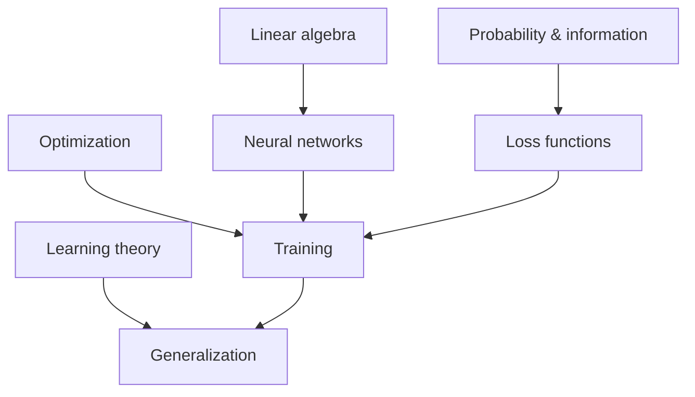

# 00 · Foundations

Before neural networks, transformers, or agents, there are four ideas that everything else is built on: **vectors**, **uncertainty**, **optimization**, and the question of **what it means to learn**. This section gives each one a compact treatment aimed at the parts that matter for modern AI.

| Page | What you will learn |
|---|---|
| [A short history of AI](history.md) | From McCulloch–Pitts neurons to foundation models: the ideas, winters, and breakthroughs |
| [Linear algebra for AI](linear-algebra.md) | Vectors, matrices, eigen-decompositions, SVD, and why matrix multiplication is the engine of AI |
| [Probability and information](probability-and-information.md) | Random variables, Bayes' rule, maximum likelihood, entropy, cross-entropy, KL divergence |
| [Optimization](optimization.md) | Gradients, gradient descent, SGD, momentum, Adam, convexity and its absence |
| [What it means to learn](learning-theory.md) | Generalization, bias–variance, PAC learning, no free lunch, double descent |

**Suggested textbooks** (see [References](../../REFERENCES.md#textbooks)): Goodfellow, Bengio & Courville, *Deep Learning* (2016), Part I; Bishop, *Pattern Recognition and Machine Learning* (2006), chapters 1–2.
