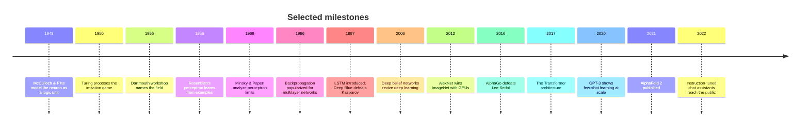

# A short history of AI

Artificial intelligence did not arrive in one leap. It is an 80-year conversation between two instincts: **build intelligence from explicit rules**, or **let it emerge from data**. The pendulum has swung several times.

## 1. The logical neuron (1940s–1950s)

**McCulloch and Pitts (1943)** showed that networks of idealized binary neurons can compute logical functions. **Turing (1950)**, in *Computing Machinery and Intelligence*, replaced the vague question "can machines think?" with an operational test and anticipated learning machines ("child machines") that are educated rather than programmed.

The 1956 **Dartmouth Summer Research Project**, proposed by McCarthy, Minsky, Rochester and Shannon, gave the field its name and its founding conjecture: that "every aspect of learning or any other feature of intelligence can in principle be so precisely described that a machine can be made to simulate it."

## 2. Symbols and perceptrons (1950s–1970s)

Two research programs grew in parallel:

- **Symbolic AI**: logic, search, and hand-built knowledge (theorem provers, planners, later expert systems).
- **Connectionism**: **Rosenblatt's perceptron (1958)** adjusted weights from examples, the first trainable neural model.

Minsky and Papert's book *Perceptrons* (1969) proved that single-layer perceptrons cannot represent functions such as XOR. Multilayer networks could, but nobody yet had a practical way to train them, and enthusiasm for neural networks cooled.

## 3. Expert systems and the AI winters (1970s–1990s)

Rule-based expert systems found commercial success in the 1980s but proved brittle and expensive to maintain. Funding contracted twice (the "AI winters"), each time after expectations outran results.

## 4. Backpropagation and statistical learning (1986–2000s)

**Rumelhart, Hinton and Williams (1986)** popularized **backpropagation**, an efficient application of the chain rule that trains multilayer networks. **Universal approximation theorems** (Cybenko 1989; Hornik, Stinchcombe & White 1989) showed that one hidden layer suffices, in principle, to approximate any continuous function on a compact set.

The 1990s and 2000s were dominated by statistically principled methods with strong theory: **support vector machines** (Cortes & Vapnik 1995), **random forests** (Breiman 2001), **gradient boosting** (Friedman 2001), and Bayesian methods. **LSTMs** (Hochreiter & Schmidhuber 1997) solved key problems in training recurrent networks, and **LeNet** (LeCun et al. 1998) showed convolutional networks reading handwritten digits.

## 5. The deep learning revolution (2006–2017)

Three ingredients converged: **large labelled datasets**, **GPU computation**, and **better training techniques** (ReLU activations, careful initialization, dropout, batch normalization, residual connections).

- **2006**: Hinton, Osindero & Teh trained deep belief networks layer by layer.
- **2012**: **AlexNet** (Krizhevsky, Sutskever & Hinton) cut the ImageNet error rate dramatically using a GPU-trained CNN.
- **2013**: **word2vec** (Mikolov et al.) made dense word embeddings standard.
- **2014**: **sequence-to-sequence** models and **attention** (Bahdanau, Cho & Bengio) transformed machine translation; **GANs** (Goodfellow et al.) launched modern generative modelling.
- **2015**: **ResNets** (He et al.) trained networks with more than 100 layers; **DQN** (Mnih et al.) learned Atari games from pixels.
- **2016**: **AlphaGo** (Silver et al.) combined deep networks with tree search to defeat a world champion at Go.

## 6. Transformers and foundation models (2017–present)

**Vaswani et al. (2017)** introduced the **Transformer**, built entirely on attention. It parallelizes well and scales smoothly, which made it the default architecture for language, then vision, audio, and biology.

- **BERT** (Devlin et al. 2018) and the **GPT** line showed that pretraining on raw text yields general-purpose representations.
- **Scaling laws** (Kaplan et al. 2020; Hoffmann et al. 2022) made performance improvements predictable as a function of compute, data, and parameters.
- **GPT-3** (Brown et al. 2020) demonstrated *in-context* few-shot learning.
- **Instruction tuning and RLHF** (Ouyang et al. 2022) turned raw language models into helpful assistants.
- **AlphaFold 2** (Jumper et al. 2021) predicted protein structures with accuracy that transformed structural biology.

Bommasani et al. (2021) coined **foundation models** for this pattern: one large model pretrained broadly, then adapted to many tasks.

## Where this leaves us

The modern stack combines the **connectionist** core (learned representations) with ideas from the **symbolic** tradition returning in new forms: tool use, planning, search, and verification. The [Frontiers](../06-frontiers/README.md) section looks at where that synthesis may go next.

---
**Sources:** McCulloch & Pitts (1943); Turing (1950); McCarthy et al. (1955/2006); Rosenblatt (1958); Rumelhart, Hinton & Williams (1986); Cybenko (1989); Hornik et al. (1989); Hochreiter & Schmidhuber (1997); LeCun et al. (1998); Hinton et al. (2006); Krizhevsky et al. (2012); Vaswani et al. (2017); Bommasani et al. (2021). Full entries in [REFERENCES.md](../../REFERENCES.md).
