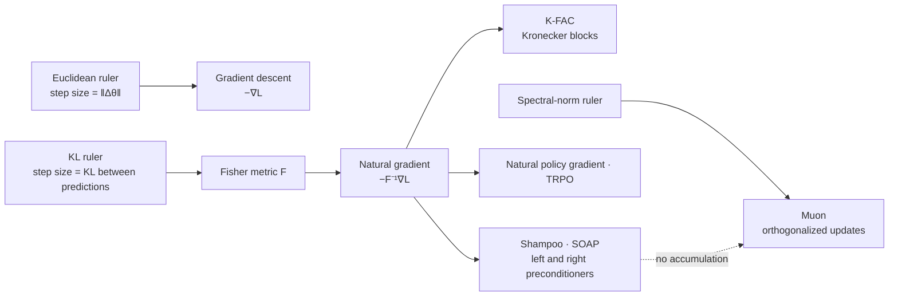
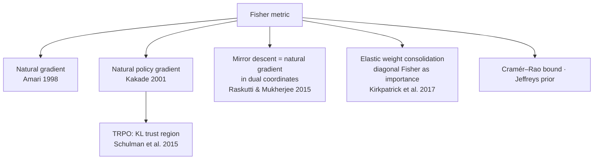

# Information geometry and the natural gradient

Gradient descent has a hidden assumption. It measures the size of a step by how far the *parameters* move, in plain Euclidean distance, as if every coordinate of $\theta$ were equally meaningful. They are not. Rescale a layer, switch from a standard deviation to a log standard deviation, or reorder the phases in a physical device, and the same model is described by different numbers, so plain gradient descent takes a different path. **Information geometry** replaces the ruler. It measures a step by how much the model's *predictions* change, and the update that follows from that choice, the **natural gradient**, sits behind a surprising share of modern practice: K-FAC, Shampoo, SOAP, the trust regions of TRPO, and, through a different choice of ruler, the Muon optimizer used to train trillion-parameter models in 2025.

> The core idea in one sentence: **the distance between two models is the distance between the probability distributions they define, which to second order is the Fisher information metric, and steepest descent under that metric is the natural gradient $F^{-1}\nabla L$.**



## 1. Models as points on a curved space (established)

A model with parameters $\theta$ defines a distribution $p_\theta(y \mid x)$. The set of all such distributions is a **statistical manifold**, and $\theta$ is just one coordinate system on it. The natural measure of how different two nearby models are is the [KL divergence](probability-and-information.md#entropy-cross-entropy-and-kl-divergence) between their predictions. Expanding it to second order around $\theta$ gives

```math
D_{\mathrm{KL}}\big(p_\theta \,\Vert\, p_{\theta+\delta}\big) \approx \tfrac{1}{2}\, \delta^\top F(\theta)\, \delta,
```

where $F$ is the **Fisher information matrix**

```math
F(\theta) = \mathbb{E}_{x \sim \text{data}}\, \mathbb{E}_{y \sim p_\theta(\cdot \mid x)} \Big[ \nabla_\theta \log p_\theta(y \mid x)\, \nabla_\theta \log p_\theta(y \mid x)^\top \Big] = -\,\mathbb{E}\big[\nabla^2_\theta \log p_\theta(y \mid x)\big].
```

$F$ plays the role of a Riemannian metric: a position-dependent ruler that says how much a small move in each direction changes the model. It is not an arbitrary choice. **Chentsov's theorem** states that, on finite sample spaces, the Fisher metric is the only Riemannian metric (up to a constant factor) that is invariant under sufficient statistics, the transformations that relabel or merge outcomes without losing information (Amari & Nagaoka 2000). Statistics singles out this one geometry.

Two familiar facts are special cases. The **Cramér–Rao bound** says no unbiased estimator can have covariance smaller than $F^{-1}/n$ after $n$ samples, so the Fisher metric also measures how well parameters *can* be learned. And **Jeffreys' prior**, the reference prior in Bayesian statistics, is proportional to $\sqrt{\det F}$, the volume element of this geometry.

## 2. The natural gradient (established)

Ask for the step that decreases the loss most while changing the model's predictions by a fixed small amount:

```math
\delta^\star = \arg\min_{\delta}\; L(\theta) + \nabla L^\top \delta \quad \text{subject to} \quad \tfrac{1}{2}\delta^\top F \delta = \epsilon .
```

A Lagrange multiplier gives $\delta^\star \propto -F^{-1}\nabla L$. The **natural gradient** update is

```math
\theta_{t+1} = \theta_t - \eta\, F(\theta_t)^{-1}\, \nabla_\theta L(\theta_t).
```

Amari (1998) introduced it for neural networks and showed it is **Fisher-efficient** in online learning: the estimate it produces asymptotically reaches the Cramér–Rao bound, which plain stochastic gradient descent does not. Three properties make it attractive.

- **Invariance to reparameterization.** If $\phi = g(\theta)$ is a smooth change of coordinates, the natural gradient step in $\phi$ and in $\theta$ describe the same infinitesimal change in the model. Plain gradient descent has no such property. Martens (2014, published 2020) notes the invariance is exact only in the limit of small steps; finite steps, damping, and approximations to $F$ break it partially.
- **Automatic scaling.** Directions in which predictions are sensitive get small steps; directions in which they barely move get large ones. This is the job learning-rate schedules, per-parameter adaptivity, and careful [initialization](../02-deep-learning/normalization-initialization-mup.md) otherwise do by hand.
- **A link to Newton's method.** For losses that are negative log-likelihoods of an exponential family (softmax cross-entropy, squared error with Gaussian noise), the Fisher equals the **generalized Gauss–Newton matrix**, a positive semi-definite approximation to the Hessian (Martens 2014). Natural gradient descent is then a well-behaved second-order method.

### 2.1 Worked example: fitting a narrow Gaussian

Fit $\mathcal{N}(\mu, \sigma^2)$ to data with true $\mu = 3$ and $\sigma = 0.05$, starting from $\mu = 0, \sigma = 1$. In coordinates $(\mu, \sigma)$ the Fisher is $\operatorname{diag}(1/\sigma^2,\, 2/\sigma^2)$. The gradient with respect to $\mu$ is $-(\bar{x} - \mu)/\sigma^2$, so as $\sigma$ shrinks the plain gradient explodes and any fixed learning rate becomes unstable. The natural gradient multiplies by $\sigma^2$, which cancels the blow-up exactly: the $\mu$ update becomes $\mu \leftarrow \mu + \eta(\bar{x} - \mu)$, independent of scale.

```python
import numpy as np
rng = np.random.default_rng(0)

# 1. Fit a Gaussian N(mu, sigma^2) by maximum likelihood, starting far away.
x = rng.normal(3.0, 0.05, size=1000)          # true mu = 3, sigma = 0.05

def grad(mu, s):                               # gradient of the mean negative log-likelihood
    return np.array([-(x - mu).mean() / s**2,
                     1 / s - ((x - mu)**2).mean() / s**3])

def fisher(mu, s):                             # Fisher information of N(mu, s^2) in (mu, s)
    return np.diag([1 / s**2, 2 / s**2])

def run(natural, eta, steps=200):
    mu, s = 0.0, 1.0
    for t in range(steps):
        g = grad(mu, s)
        d = np.linalg.solve(fisher(mu, s), g) if natural else g
        mu, s = mu - eta * d[0], max(s - eta * d[1], 1e-3)
        if abs(mu - x.mean()) < 1e-3 and abs(s - x.std()) < 1e-3:
            return t + 1, mu, s
    return None, mu, s

print("plain GD       ", run(False, 5e-3, 20000))  # eta = 1e-2 diverges
print("natural GD     ", run(True, 0.5))

# 2. The empirical Fisher is not the Fisher (linear regression, unit noise).
X = rng.normal(size=(500, 2)); w_true = np.array([1.0, -2.0])
y = X @ w_true + rng.normal(size=500)
w = np.zeros(2)
F = X.T @ X / len(X)                           # true Fisher: independent of w and y
r = X @ w - y
G = X * r[:, None]                             # per-example gradients
F_emp = G.T @ G / len(X)                       # "empirical Fisher": mean outer product
print("Fisher eigenvalues          ", np.linalg.eigvalsh(F).round(2))
print("empirical Fisher eigenvalues", np.linalg.eigvalsh(F_emp).round(2))

# 3. Orthogonalize a gradient matrix with Newton-Schulz (the core step of Muon).
Gm = rng.normal(size=(64, 32))
U, S, Vt = np.linalg.svd(Gm, full_matrices=False)
Xk = Gm / np.linalg.norm(Gm)                   # Frobenius scaling puts all singular values in (0, 1]
for _ in range(30):
    Xk = 1.5 * Xk - 0.5 * Xk @ Xk.T @ Xk       # cubic iteration: pushes every singular value to 1
print("distance to U V^T:", np.linalg.norm(Xk - U @ Vt).round(6))
print("singular values after:", np.linalg.svd(Xk, compute_uv=False)[[0, -1]].round(4))
```

Running it (NumPy, seed 0) prints:

```text
plain GD        (1046, np.float64(2.9975984322647835), np.float64(0.048502962959753516))
natural GD      (21, np.float64(2.9975971567954596), np.float64(0.04950801615938655))
Fisher eigenvalues           [0.97 1.12]
empirical Fisher eigenvalues [ 6.95 16.52]
distance to U V^T: 0.0
singular values after: [1. 1.]
```

The natural gradient reaches the maximum-likelihood fit in 21 steps; the best stable plain step size we tried needs 1,046, and doubling it diverges. The other two parts of the script are used in sections 3 and 5.

## 3. The empirical Fisher trap (established)

The true Fisher takes the expectation over labels $y$ **sampled from the model**. A tempting shortcut uses the observed labels instead, averaging $\nabla \ell_i \nabla \ell_i^\top$ over the training batch. This **empirical Fisher** is cheap, since the per-example gradients are already computed, and is often described as what Adam's second-moment estimate approximates on its diagonal.

Kunstner, Balles & Hennig (2019) showed that the two matrices are generally different and that the empirical Fisher does not, in general, carry second-order information. The conditions under which it approaches the Fisher, roughly a well-specified model already near its optimum, are unlikely to hold during training. Part 2 of the script shows the effect on the simplest possible model. For linear regression with unit noise, the Fisher is $X^\top X/n$ and does not depend on the current weights at all. Far from the solution, the residuals are large, and the empirical Fisher's eigenvalues come out roughly 7 to 15 times bigger and in a different ratio. Preconditioning with it would shrink steps exactly when the model is worst, which is the opposite of what curvature calls for. The practical lesson: when a method is justified as "approximately natural gradient", check which Fisher it means.

## 4. Making it affordable: K-FAC, Shampoo and SOAP (established, active research)

For a network with $P$ parameters, $F$ has $P^2$ entries and inverting it costs $O(P^3)$, hopeless at millions of parameters, never mind billions. Every practical method is a structured approximation.

**K-FAC** (Martens & Grosse 2015) approximates the block of $F$ for one fully connected layer, $W$, with inputs $a$ and back-propagated output gradients $g$, as a Kronecker product of two small covariance matrices:

```math
F_W \approx A \otimes G, \qquad A = \mathbb{E}[a a^\top], \quad G = \mathbb{E}[g g^\top].
```

Because $(A \otimes G)^{-1} = A^{-1} \otimes G^{-1}$, the natural-gradient step for the layer becomes two small matrix solves, $\Delta W \propto G^{-1}\, \nabla_W L\, A^{-1}$, instead of one enormous one. The approximation assumes activations and output gradients are independent, which is not exactly true, but it captures far more curvature than a diagonal.

**Shampoo** (Gupta, Koren & Singer 2018) keeps the same left-and-right structure but builds it directly from gradients, accumulating $L_t = \sum_s G_s G_s^\top$ and $R_t = \sum_s G_s^\top G_s$ and updating

```math
W_{t+1} = W_t - \eta\, L_t^{-1/4}\, G_t\, R_t^{-1/4}.
```

Anil et al. (2020) made it practical at scale with a distributed implementation that computes the inverse roots on spare accelerators. In the first **AlgoPerf: Training Algorithms** competition, which compares training methods on wall-clock time to a target across several workloads on fixed hardware, the winning submission in the external-tuning track used Distributed Shampoo (Kasimbeg et al. 2025). The authors describe this as evidence that non-diagonal preconditioning can beat Adam even on wall-clock runtime.

**SOAP** (Vyas et al. 2024) proves that Shampoo with the $1/2$ power is equivalent to running Adafactor, a memory-efficient Adam variant, in the eigenbasis of Shampoo's preconditioner. It then runs Adam in that slowly rotating basis. On language-model pre-training at 360M and 660M parameters in the large-batch regime, the authors report over 40% fewer iterations and over 35% less wall-clock time than AdamW, and about 20% better than Shampoo on both counts.

| Method | Approximation to the curvature | Extra memory per $m \times n$ layer | Status |
|---|---|---|---|
| SGD | Identity | None | Established |
| Adam | Diagonal, from squared gradients (not the true Fisher; see section 3) | $mn$ | Established default |
| K-FAC | Kronecker product of activation and gradient covariances | $m^2 + n^2$ | Established; used mostly in research and scientific ML |
| Shampoo | Kronecker product of accumulated gradient outer products, inverse 4th roots | $m^2 + n^2$ | Won AlgoPerf external tuning (2024 competition, published 2025) |
| SOAP | Adam inside Shampoo's eigenbasis | $m^2 + n^2 + mn$ | Promising; results so far up to 660M parameters |
| Muon | No curvature estimate: steepest descent under the spectral norm | $mn$ (momentum) | Used at trillion-parameter scale in 2025 (section 5) |

## 5. A different ruler: Muon and steepest descent in the spectral norm (active research)

The natural gradient answers "steepest descent under which norm?" with the Fisher metric. Bernstein & Newhouse (2024) asked the question again for weight matrices, which act as linear maps, and argued that the operator (spectral) norm is a natural choice. Steepest descent under the spectral norm turns a gradient $G = U \Sigma V^\top$ into the update $-\eta\, U V^\top$: keep the directions, set every singular value to one. They also showed that Shampoo with its accumulation switched off reduces to exactly this update, which ties the two lines of work together.

**Muon** (Jordan et al. 2024) applies this to the momentum of each hidden-layer weight matrix. Computing an SVD every step would be slow, so it approximates $U V^\top$ with a few steps of a **Newton–Schulz iteration**, a polynomial in $X X^\top$ that uses only matrix multiplies. Part 3 of the script uses the classical cubic version, which converges to $U V^\top$ exactly. Muon uses a tuned quintic polynomial with coefficients $(3.4445, -4.7750, 2.0315)$, chosen to grow small singular values quickly while only guaranteeing that the results land roughly between 0.7 and 1.3, trading exactness for speed. Embeddings, output layers, and scalar or vector parameters are still trained with AdamW. The post reports training-speed records on the NanoGPT and CIFAR-10 speedrun benchmarks, including a 1.35× speedup on the NanoGPT task.

The method then scaled quickly:

- Liu et al. (2025) found two changes needed at scale: adding weight decay and adjusting the per-parameter update size. With them, their scaling-law experiments indicate about **2× computational efficiency compared to AdamW** under compute-optimal training, and they trained Moonlight, a 3B-activated, 16B-total-parameter mixture-of-experts model, on 5.7T tokens.
- Kimi Team (2025) trained **Kimi K2**, with 32B activated and 1T total parameters, on 15.5T tokens using **MuonClip**, which adds a "QK-clip" step to curb the growth of attention logits, and report **zero loss spikes** during pre-training.

Whether Muon's advantage holds across architectures, data, and training lengths is still being measured, and most large-scale evidence so far comes from the teams that adopted it.

## 6. The same geometry elsewhere (established)



- **Reinforcement learning.** Kakade (2001) applied the natural gradient to policies, measuring steps by the Fisher of the action distribution. **TRPO** (Schulman et al. 2015) turned the idea into a hard constraint on the average KL divergence between old and new policies, solved approximately with conjugate gradients and Fisher-vector products. PPO's clipped objective ([reinforcement learning](../01-classical-ml/reinforcement-learning.md)) is a cheaper descendant of the same trust-region idea.
- **Mirror descent.** For exponential families, Raskutti & Mukherjee (2015) showed that mirror descent with the Bregman divergence of the log-partition function is equivalent to natural gradient descent in the dual (mean-parameter) coordinates.
- **Continual learning.** Elastic weight consolidation (Kirkpatrick et al. 2017) protects old tasks by penalizing moves in parameters with high diagonal Fisher, treating the Fisher as a measure of which weights the old task depends on.
- **Unifying view.** Pascanu & Bengio (2013) showed that several earlier second-order methods for deep networks, including Hessian-free optimization and Krylov subspace descent, can be read as implementations of the natural gradient.

## 7. What we know and what we don't

| Claim | Status |
|---|---|
| The Fisher metric is the second-order expansion of KL divergence and, on finite spaces, the unique invariant metric | Established (theorem) |
| The natural gradient is invariant to smooth reparameterization for infinitesimal steps | Established; finite steps and approximations are only approximately invariant |
| The empirical Fisher generally does not approximate the Fisher or the Hessian | Established (Kunstner et al. 2019) |
| Kronecker-factored preconditioners (Shampoo) can beat AdamW on wall-clock time | Supported by the AlgoPerf competition and by SOAP up to 660M parameters |
| Muon gives about 2× compute efficiency over AdamW for LLM pre-training | Reported by Liu et al. (2025) under their recipe; independent large-scale replication is limited |
| *Why* orthogonalized updates work so well | Open; the spectral-norm argument is one explanation, not a settled theory |

## 8. Parameterization-free training for physical hardware (speculative)

> [!WARNING]
> **Speculative.** This section is a hypothesis about training models whose parameters are physical device settings. We have not found a study that tests it systematically, and it should be read as a research question rather than a result.

On a [photonic chip](../06-frontiers/photonic-computing.md), a weight matrix is not stored as numbers. It is realized by the phase settings of a mesh of interferometers, and the same matrix can be produced by different mesh layouts (for example, the triangular layout of Reck et al. and the rectangular layout of Clements et al.) with entirely different phase values. Plain gradient descent on the phases therefore depends on the layout: the same model, described by different knobs, would train along different paths with different effective learning rates per knob. The natural gradient is, to first order, indifferent to how the model is parameterized, because it measures steps in the space of predictions. That suggests a testable question: does preconditioning phase updates with an approximate Fisher, for instance a K-FAC-style factorization at the level of the realized matrix, make training on such meshes less sensitive to layout, and does it help where some phases have much larger effects than others? A second question concerns noise. Fabrication error and drift make the hardware model a distribution over matrices rather than a single one, and the Fisher of that noisy model might indicate which settings deserve the most calibration effort or bits of control precision. Both ideas would have to beat the simpler alternative of training a digital weight matrix and decomposing it into phases afterwards.

## Further reading

- Amari, S. (1998). *Natural gradient works efficiently in learning*. Neural Computation 10(2), 251–276. [doi:10.1162/089976698300017746](https://doi.org/10.1162/089976698300017746)
- Amari, S., Nagaoka, H. (2000). *Methods of Information Geometry*. Translations of Mathematical Monographs 191, American Mathematical Society. [doi:10.1090/mmono/191](https://doi.org/10.1090/mmono/191)
- Amari, S. (2016). *Information Geometry and Its Applications*. Applied Mathematical Sciences, Springer. [doi:10.1007/978-4-431-55978-8](https://doi.org/10.1007/978-4-431-55978-8)
- Kakade, S. (2001). *A natural policy gradient*. NeurIPS. [Proceedings](https://proceedings.neurips.cc/paper/2001/hash/4b86abe48d358ecf194c56c69108433e-Abstract.html)
- Pascanu, R., Bengio, Y. (2013). *Revisiting natural gradient for deep networks*. [arXiv:1301.3584](https://arxiv.org/abs/1301.3584)
- Martens, J. (2014). *New insights and perspectives on the natural gradient method*. JMLR 21 (2020). [arXiv:1412.1193](https://arxiv.org/abs/1412.1193)
- Martens, J., Grosse, R. (2015). *Optimizing neural networks with Kronecker-factored approximate curvature*. ICML. [arXiv:1503.05671](https://arxiv.org/abs/1503.05671)
- Schulman, J., Levine, S., Moritz, P., Jordan, M. I., Abbeel, P. (2015). *Trust region policy optimization*. ICML. [arXiv:1502.05477](https://arxiv.org/abs/1502.05477)
- Raskutti, G., Mukherjee, S. (2015). *The information geometry of mirror descent*. IEEE Transactions on Information Theory 61(3), 1451–1457. [doi:10.1109/TIT.2015.2388583](https://doi.org/10.1109/TIT.2015.2388583)
- Kirkpatrick, J., Pascanu, R., Rabinowitz, N., et al. (2017). *Overcoming catastrophic forgetting in neural networks*. PNAS 114(13), 3521–3526. [doi:10.1073/pnas.1611835114](https://doi.org/10.1073/pnas.1611835114)
- Gupta, V., Koren, T., Singer, Y. (2018). *Shampoo: Preconditioned stochastic tensor optimization*. ICML. [arXiv:1802.09568](https://arxiv.org/abs/1802.09568)
- Kunstner, F., Balles, L., Hennig, P. (2019). *Limitations of the empirical Fisher approximation for natural gradient descent*. NeurIPS. [arXiv:1905.12558](https://arxiv.org/abs/1905.12558)
- Anil, R., Gupta, V., Koren, T., Regan, K., Singer, Y. (2020). *Scalable second order optimization for deep learning*. [arXiv:2002.09018](https://arxiv.org/abs/2002.09018)
- Vyas, N., Morwani, D., Zhao, R., Kwun, M., Shapira, I., Brandfonbrener, D., et al. (2024). *SOAP: Improving and stabilizing Shampoo using Adam*. [arXiv:2409.11321](https://arxiv.org/abs/2409.11321)
- Bernstein, J., Newhouse, L. (2024). *Old optimizer, new norm: An anthology*. [arXiv:2409.20325](https://arxiv.org/abs/2409.20325)
- Jordan, K., Jin, Y., Boza, V., You, J., Cesista, F., Newhouse, L., Bernstein, J. (2024). *Muon: An optimizer for hidden layers in neural networks*. Blog post. [kellerjordan.github.io](https://kellerjordan.github.io/posts/muon/)
- Kasimbeg, P., Schneider, F., Eschenhagen, R., Bae, J., Sastry, C. S., Saroufim, M., et al. (2025). *Accelerating neural network training: An analysis of the AlgoPerf competition*. ICLR 2025. [arXiv:2502.15015](https://arxiv.org/abs/2502.15015)
- Liu, J., Su, J., Yao, X., Jiang, Z., Lai, G., Du, Y., et al. (2025). *Muon is scalable for LLM training*. [arXiv:2502.16982](https://arxiv.org/abs/2502.16982)
- Kimi Team, Bai, Y., Bao, Y., et al. (2025). *Kimi K2: Open agentic intelligence*. [arXiv:2507.20534](https://arxiv.org/abs/2507.20534)
