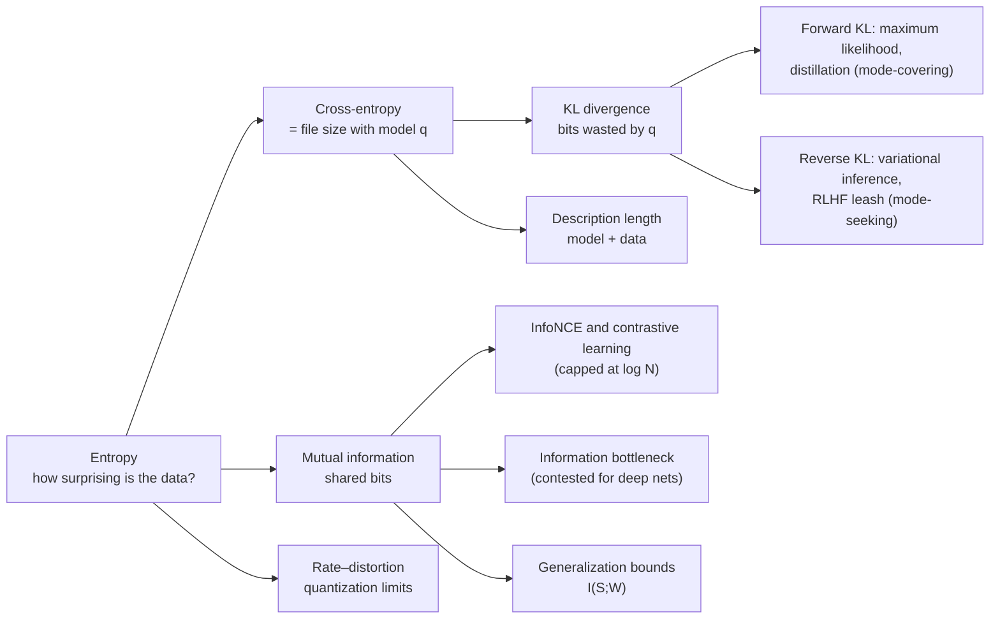

# Information theory for machine learning

Claude Shannon built information theory to answer an engineering question: how many bits does it take to send a message, and how fast can you send them through a noisy wire? Seventy years later the same few quantities sit inside almost every machine-learning system. The loss a language model minimizes is a file size. The penalty that keeps a fine-tuned model near its base is a divergence. Contrastive learning maximizes a bound on mutual information, and quantizing a model is a rate–distortion problem. Knowing the theory turns a list of tricks into one connected picture, and it also tells you where the picture has been oversold.

> The core idea in one sentence: **a probability model is a compressor, so predicting well, learning, generalizing and quantizing can all be measured in bits, but some of the most popular information-theoretic stories about deep learning do not survive careful measurement.**

This page deepens the entropy, KL and mutual-information sections of [probability and information](probability-and-information.md). It connects to [information geometry](information-geometry-natural-gradient.md) (KL as a metric), [learning theory](learning-theory.md) (generalization bounds), [large language models](../03-modern-ai/large-language-models.md) (perplexity), [generative models](../03-modern-ai/generative-models.md) (the ELBO), [the KV cache](../04-systems/kv-cache.md) and [memristive crossbars](../06-frontiers/memristive-crossbars-in-memory-computing.md) (quantization and noise).



## 1. Surprise, entropy and the source coding theorem (established)

An outcome of probability $p$ carries $-\log_2 p$ bits of *surprise*. The **entropy** $H(X) = -\sum_x p(x)\log_2 p(x)$ is the average surprise, and Shannon's (1948) source coding theorem gives it an operational meaning: no lossless code can use fewer than $H(X)$ bits per symbol on average, and codes exist that come arbitrarily close. For a sequence with memory, the relevant number is the **entropy rate** $\lim_{n\to\infty} \tfrac{1}{n} H(X_1,\dots,X_n)$, the irreducible surprise per symbol once you know the whole past. Huffman (1952) gave the optimal symbol-by-symbol prefix code, which can waste up to one bit per symbol; arithmetic coding (Witten, Neal & Cleary 1987) removes that waste by coding a whole message as a single number. The standard reference for everything on this page is Cover and Thomas (2006).

Shannon (1951) also ran the first language-modelling experiment: people guessed the next letter of English text, and from their guesses he bounded the entropy of printed English, with long contexts, at roughly 0.6 to 1.3 bits per letter. Modern language models play exactly that game.

## 2. Prediction is compression (established)

Given any model $q$ that assigns a probability to the next symbol, an arithmetic coder turns it into a lossless compressor whose output length for a message $x_{1:n}$ is within about two bits of

```math
\ell_q(x_{1:n}) = -\sum_{t=1}^{n} \log_2 q(x_t \mid x_{<t}) \ \text{bits}.
```

That sum is the cross-entropy training loss, in base 2 and unnormalized. **Lowering a language model's loss by one bit per token shortens the compressed file by one bit per token**, and the excess over the entropy rate is exactly the KL divergence between the source and the model. Part 1 of the [sketch](#8-a-tested-sketch) runs a real arithmetic coder and finds the actual file size matching the cross-entropy to four decimal places for three models of different quality, with exact decoding.

Because tokenizers differ, comparisons between language models use **bits per byte** (or bits per character): total code length divided by the length of the raw text, which no choice of vocabulary can game. Several recent results take the equivalence literally:

- **Language models as general compressors.** Delétang et al. (2023) used large models with arithmetic coding as compressors. Chinchilla 70B, trained mostly on text, compressed ImageNet patches to 43.4% and LibriSpeech audio to 16.4% of raw size, beating PNG (58.5%) and FLAC (30.3%). They also note the converse: any compressor, gzip included, defines a conditional generative model. (The cost of storing the 70B-parameter model is not counted, which is why this is a statement about prediction, not a practical file format.)
- **Entropy of English.** Valmeekam et al. (2023) used LLaMA-7B to give a new, lower asymptotic upper bound on the entropy of English, and preliminary experiments in which the resulting compressor beat BSC, ZPAQ and paq8h.
- **Compression and capability.** Huang et al. (2024) measured 31 public LLMs on 12 benchmarks and found average benchmark scores almost linearly correlated with how well each model compressed held-out text corpora. This is a correlation across existing models, not a proof that compression causes capability, but it makes bits per byte a cheap, contamination-resistant evaluation signal.
- **Bytes as the unit of data.** Limisiewicz et al. (2026) trained 988 models from 50M to 7B parameters with adjustable bytes-per-token. In compute-optimal settings, parameters scaled with data measured in bytes, not tokens, and the best compression rate per token differed from that of standard BPE and decreased with compute.
- **Tokenizers as channels.** Zouhar et al. (2023) argued that good tokenizers use their channel efficiently. Across machine-translation tokenizers, a Rényi entropy efficiency with $\alpha = 2.5$ correlated with BLEU at 0.78, against $-0.32$ for compressed length.

## 3. Two directions of KL (established)

KL divergence is not symmetric, and which direction a method minimizes shapes what it learns.

```math
D_{\mathrm{KL}}(p \,\Vert\, q) = \mathbb{E}_{p}\!\left[\log \tfrac{p}{q}\right], \qquad
D_{\mathrm{KL}}(q \,\Vert\, p) = \mathbb{E}_{q}\!\left[\log \tfrac{q}{p}\right].
```

- **Forward KL**, $D(p\Vert q)$ with $p$ the data, is what maximum likelihood minimizes. It is infinite wherever $q = 0$ but $p > 0$, so $q$ is forced to **cover every mode**, spreading mass over gaps if it must. Knowledge distillation (Hinton, Vinyals & Dean 2015) trains a student on a teacher's softened outputs with this direction.
- **Reverse KL**, $D(q\Vert p)$, is what variational inference minimizes through the evidence lower bound (Kingma & Welling 2013). It is infinite wherever $q > 0$ but $p = 0$, so $q$ prefers to **sit inside one mode** and ignore the rest. The KL penalty that keeps an RLHF policy near its pretrained reference (Ouyang et al. 2022) also has the policy in the first slot; Gao, Schulman and Hilton (2022) used the KL distance from the initial policy as the axis along which reward-model overoptimization unfolds.

Part 2 of the sketch fits one Gaussian to two well-separated bumps. Forward KL matches moments (mean 0, standard deviation 3.16) and puts 29 times too much density in the empty middle; reverse KL locks onto one bump exactly and pays 8.3 nats of forward KL for the bump it ignores.

## 4. Mutual information and why it is hard to measure (established, active research)

The **mutual information** $I(X;Y) = H(X) - H(X\mid Y)$ is the number of bits that knowing $Y$ saves about $X$. Two properties carry most of its weight in ML:

- **Data processing inequality.** If $X \to Y \to Z$ is a Markov chain (for example, input, layer 3, layer 7), then $I(X;Z) \le I(X;Y)$. Processing cannot create information about the input, only discard it.
- **Invariance.** $I(X;Y)$ is unchanged by any invertible transformation of $X$ or $Y$. That makes it a clean measure of dependence, and, as below, a weak guide to *useful* representations.

Estimating it from samples in high dimensions is hard. Contrastive predictive coding (van den Oord, Li & Vinyals 2018) introduced the **InfoNCE** loss: pick the true partner of $x$ out of $N$ candidates using a learned score $f(x,y)$. With $\mathcal{L}$ the expected cross-entropy of that $N$-way classification,

```math
I(X;Y) \;\ge\; \log N - \mathcal{L}_{\text{InfoNCE}}.
```

Because the loss is never negative, **the bound can never exceed $\log N$**, no matter how much information is actually shared. Poole et al. (2019) unified InfoNCE, MINE (Belghazi et al. 2018) and related estimators and showed that existing variational lower bounds degrade when the mutual information is large, with either high bias or high variance. McAllester and Stratos (2018) proved the limitation is not a quirk of one estimator: any distribution-free, high-confidence lower bound on mutual information from $N$ samples is at most $O(\ln N)$. Part 3 of the sketch shows it directly: with 0.94 nats of true information InfoNCE with the *optimal* critic is accurate, but with 16.61 nats it reports exactly $\log N$ at every batch size.

So why does contrastive learning work so well? Tschannen et al. (2019) argued, with experiments, that the success cannot be attributed to mutual information alone. It depends strongly on the encoder architecture and on how the estimator's critic is parameterized, and is better read as a form of metric learning. The information-theoretic story motivates the loss; the inductive bias does the work.

## 5. The information bottleneck debate (contested)

The **information bottleneck** (Tishby, Pereira & Bialek 2000) asks for a representation $T$ of an input $X$ that keeps as much as possible about a target $Y$ while forgetting as much as possible about $X$:

```math
\min_{p(t\mid x)} \; I(X;T) - \beta\, I(T;Y).
```

Tishby and Zaslavsky (2015) proposed it as a theory of deep learning, and Shwartz-Ziv and Tishby (2017) reported that, plotted in the "information plane", training goes through a fast fitting phase followed by a slow compression phase in which $I(X;T)$ falls, and suggested that compression explains generalization and is driven by the noise of SGD.

The claims did not hold up in general. Saxe et al. (2019) found that the compression phase appears with double-sided saturating nonlinearities like tanh but not with ReLU or linear networks, that networks generalize with or without compression, and that the same curves appear under full-batch gradient descent, so SGD noise is not the cause. Goldfeld et al. (2019) pinned down the measurement problem: in a deterministic network the true $I(X;T)$ is either constant (discrete inputs) or infinite (continuous inputs), so the binning estimates in earlier work were not measuring mutual information at all. In noisy networks where the quantity is meaningful, they found that what looks like compression is the clustering of hidden representations of same-class inputs.

The *objective* survives as a useful tool even where the *theory of training* did not. The deep variational information bottleneck (Alemi et al. 2016) optimizes a variational bound on the IB objective and reported better generalization and robustness to adversarial attack than other regularizers. Achille and Soatto (2018) connected information in the weights to invariance and disentanglement of the learned representation.

## 6. Description length and generalization (established, active research)

The **minimum description length** principle (Rissanen 1978; tutorial in Grünwald 2004) says the best model of data is the one that compresses it most, counting the bits needed to describe the model itself. It is Occam's razor with units. Hinton and van Camp (1993) used it to train networks with noisy weights whose description length could be bounded, an early ancestor of variational Bayesian deep learning.

Large networks seem to violate the principle, since describing billions of parameters costs billions of bits. Blier and Ollivier (2018) showed that they do compress their training data even after paying for the model, if the model is described *prequentially*: transmit the data in chunks, training on everything sent so far and coding the next chunk with the current model. Surprisingly, variational codes built explicitly to minimize description length gave poor bounds, while this simple incremental code gave excellent ones. A language model's training-loss curve, integrated over the data, is a prequential code length.

Information also bounds overfitting directly. Russo and Zou (2015) showed that the bias introduced by adaptive data analysis is controlled by the mutual information between the data and the choice of what to report. Xu and Raginsky (2017) turned this into a bound for learning algorithms: if the loss is $\sigma$-sub-Gaussian, an algorithm that maps a training set $S$ of $n$ examples to weights $W$ has expected generalization gap at most

```math
\sqrt{\frac{2\sigma^2\, I(S;W)}{n}}.
```

An algorithm whose output reveals little about its particular training sample cannot overfit much. The bound is clean but often hard to evaluate for real networks, for the reasons in Section 4.

## 7. Rate–distortion: the limits of lossy compression (established)

Quantizing weights, activations or a cache is lossy compression, and Shannon's **rate–distortion function** $R(D)$ gives the fewest bits per number that can achieve average distortion $D$. For a Gaussian source of variance $\sigma^2$ under squared error it has a closed form:

```math
R(D) = \tfrac12 \log_2 \frac{\sigma^2}{D}, \qquad 0 < D \le \sigma^2,
```

so each extra bit cuts the achievable error by a factor of four (about 6 dB). Practical quantizers sit above this line. Gish and Pierce (1968) showed that at high rates a uniform quantizer followed by entropy coding is within $\tfrac12\log_2(\pi e/6) \approx 0.254$ bits per sample of the limit, for any smooth source, and that this gap cannot be closed by any scalar quantizer. A fixed-rate quantizer, which spends exactly $b$ bits on every value, does worse, and its gap keeps growing with $b$ because it spends codes on rare tail values. Part 4 of the sketch reproduces both: the entropy-coded gap settles at 0.253 to 0.254 bits, while the fixed-rate gap rises from 0.46 to 1.28 bits between 2 and 8 bits.

The framing now runs in both directions:

- **Learned compression.** Ballé, Laparra and Simoncelli (2016) trained an image codec end to end on a rate-plus-distortion loss with a learned entropy model, the template for neural codecs.
- **Generative models.** Alemi et al. (2018) showed that the ELBO of a latent-variable model decomposes into a rate term and a distortion term, and that models with the same ELBO can sit at very different points on that curve, from ignoring the latent entirely to memorizing through it.
- **Model quantization.** Young (2025) set out the foundations of post-training LLM quantization from a rate–distortion perspective, with a method based on simple rate–distortion optimization that scales to hundreds of billions of weights and compresses to a model size or accuracy the user specifies.

## 8. A tested sketch

The script below needs only NumPy and runs in about 20 seconds. Part 1 encodes 20,000 symbols from an 8-symbol Markov chain with a real 32-bit arithmetic coder under three models and decodes them back. Part 2 fits a Gaussian to a two-bump mixture under each direction of KL. Part 3 runs InfoNCE with the optimal critic, $\log p(y\mid x)/p(y)$, on 20-dimensional correlated Gaussians whose mutual information is known in closed form. Part 4 quantizes two million Gaussian samples and compares with $R(D)$.

```python
import numpy as np
rng = np.random.default_rng(0)

# Part 1: a better predictor is a shorter file (real arithmetic coder)
print("Part 1")
A = 8
T = rng.dirichlet(np.full(A, 0.3), size=A)          # true order-1 Markov chain
n = 20000
x = np.zeros(n, int)
for i in range(1, n): x[i] = rng.choice(A, p=T[x[i-1]])
pi = np.bincount(x, minlength=A) / n
models = {"uniform": lambda prev: np.full(A, 1/A),
          "unigram (symbol frequencies)": lambda prev: pi,
          "true bigram": lambda prev: T[prev]}
PREC, FULL = 16, 1 << 32
HALF, QTR = FULL >> 1, FULL >> 2
def freqs(p):  # integer frequency table, every symbol gets at least 1
    f = np.maximum(1, np.round(p * (1 << PREC)).astype(np.int64))
    c = np.concatenate([[0], np.cumsum(f)]); return c
def encode(x, model):
    lo, hi, pend, out = 0, FULL - 1, 0, []
    for i, s in enumerate(x):
        c = freqs(model(x[i-1] if i else 0)); tot = int(c[-1]); r = hi - lo + 1
        hi = lo + r * int(c[s+1]) // tot - 1; lo = lo + r * int(c[s]) // tot
        while True:
            if hi < HALF: out += [0] + [1]*pend; pend = 0
            elif lo >= HALF: out += [1] + [0]*pend; pend = 0; lo -= HALF; hi -= HALF
            elif lo >= QTR and hi < 3*QTR: pend += 1; lo -= QTR; hi -= QTR
            else: break
            lo, hi = 2*lo, 2*hi + 1
    pend += 1; out += ([0] + [1]*pend) if lo < QTR else ([1] + [0]*pend)
    return out
def decode(bits, n, model):
    bits = bits + [0]*64; lo, hi, v, k, res = 0, FULL - 1, 0, 32, []
    for b in bits[:32]: v = 2*v + b
    for i in range(n):
        c = freqs(model(res[-1] if res else 0)); tot = int(c[-1]); r = hi - lo + 1
        cnt = ((v - lo + 1) * tot - 1) // r
        s = int(np.searchsorted(c, cnt, side="right") - 1); res.append(s)
        hi = lo + r * int(c[s+1]) // tot - 1; lo = lo + r * int(c[s]) // tot
        while True:
            if hi < HALF: pass
            elif lo >= HALF: lo -= HALF; hi -= HALF; v -= HALF
            elif lo >= QTR and hi < 3*QTR: lo -= QTR; hi -= QTR; v -= QTR
            else: break
            lo, hi, v = 2*lo, 2*hi + 1, 2*v + bits[k]; k += 1
    return np.array(res)
H_rate = -(pi[:, None] * T * np.log2(T)).sum()
print(f"entropy rate of the source {H_rate:.4f} bits/symbol")
for name, m in models.items():
    ce = -np.mean([np.log2(m(x[i-1] if i else 0)[x[i]]) for i in range(n)])
    bits = encode(x, m); ok = np.array_equal(decode(bits, n, m), x)
    print(f"{name:30s} cross-entropy {ce:.4f}  actual {len(bits)/n:.4f} bits/symbol  decodes exactly: {ok}")

# Part 2: forward vs reverse KL, one Gaussian fitted to two bumps
print("Part 2")
g = np.linspace(-15, 15, 30001); dx = g[1] - g[0]
N = lambda z, m, s: np.exp(-(z-m)**2/(2*s*s))/np.sqrt(2*np.pi)/s
p = 0.5*N(g, -3, 1) + 0.5*N(g, 3, 1)
def kl(a, b): msk = a > 1e-300; return np.sum(a[msk]*np.log(a[msk]/np.maximum(b[msk],1e-300)))*dx
mf, sf = np.sum(g*p)*dx, np.sqrt(np.sum(g*g*p)*dx)
best = min(((kl(N(g, m, s), p), m, s) for m in np.linspace(-4, 4, 161) for s in np.linspace(0.3, 4, 75)))
for lab, m, s in [("forward KL(p||q) (moment matching)", mf, sf), ("reverse KL(q||p) (best on grid)", best[1], best[2])]:
    q = N(g, m, s)
    print(f"{lab:36s} mean {m:+.2f} sd {s:.2f}  KL(p||q) {kl(p,q):.3f}  KL(q||p) {kl(q,p):.3f}  q at x=0 {N(0,m,s):.3f} (p: {0.5*N(0,-3,1)*2:.4f})")

# Part 3: InfoNCE cannot report more than log N
print("Part 3")
d = 20
for rho in [0.3, 0.9]:
    I_true = -0.5*d*np.log(1 - rho**2)
    print(f"rho {rho}: true mutual information {I_true:.2f} nats")
    for Nb in [16, 128, 1024]:
        est = []
        for t in range(max(4, 4096//Nb)):
            X = rng.normal(size=(Nb, d)); Y = rho*X + np.sqrt(1-rho**2)*rng.normal(size=(Nb, d))
            D = Y[None, :, :] - rho*X[:, None, :]
            S = -0.5*(D**2).sum(-1)/(1-rho**2) + 0.5*(Y**2).sum(1)[None, :]   # log p(y_j|x_i)/p(y_j) up to a constant: the optimal critic
            m = S.max(1, keepdims=True); lse = m[:, 0] + np.log(np.exp(S - m).sum(1))
            est.append(np.mean(np.diag(S) - lse) + np.log(Nb))
        print(f"  batch N={Nb:5d}: InfoNCE with the optimal critic {np.mean(est):.2f} nats, ceiling log N = {np.log(Nb):.2f}")

# Part 4: quantizing a Gaussian versus the rate-distortion limit
print("Part 4")
z = rng.normal(size=2_000_000)
for bits in [2, 4, 6, 8]:
    L = 2**bits
    # fixed-rate uniform quantizer: best step size on a grid
    res = []
    for step in np.linspace(0.01, 2.0, 400):
        lim = step*L/2; qz = np.clip(np.floor(z/step)*step + step/2, -lim + step/2, lim - step/2)
        res.append((np.mean((z-qz)**2), step))
    D_fix, st = min(res)
    # entropy-coded uniform quantizer with the same distortion: find step, measure output entropy
    lo_s, hi_s = 1e-4, 3.0
    for _ in range(40):
        s = (lo_s + hi_s)/2; D = np.mean((z - (np.floor(z/s)*s + s/2))**2)
        lo_s, hi_s = (s, hi_s) if D < D_fix else (lo_s, s)
    _, cnt = np.unique(np.floor(z/s), return_counts=True); pq = cnt/cnt.sum()
    H = -(pq*np.log2(pq)).sum(); R_min = 0.5*np.log2(1/D_fix)
    print(f"{bits} bits fixed-rate: MSE {D_fix:.5f} | Shannon limit at this MSE {R_min:.3f} bits | entropy-coded uniform {H:.3f} bits (gap {H-R_min:.3f}) | fixed-rate gap {bits-R_min:.3f}")
```

Output:

```text
Part 1
entropy rate of the source 2.0589 bits/symbol
uniform                        cross-entropy 3.0000  actual 3.0001 bits/symbol  decodes exactly: True
unigram (symbol frequencies)   cross-entropy 2.8927  actual 2.8927 bits/symbol  decodes exactly: True
true bigram                    cross-entropy 2.0400  actual 2.0400 bits/symbol  decodes exactly: True
Part 2
forward KL(p||q) (moment matching)   mean +0.00 sd 3.16  KL(p||q) 0.462  KL(q||p) 0.938  q at x=0 0.126 (p: 0.0044)
reverse KL(q||p) (best on grid)      mean -3.00 sd 1.00  KL(p||q) 8.311  KL(q||p) 0.689  q at x=0 0.004 (p: 0.0044)
Part 3
rho 0.3: true mutual information 0.94 nats
  batch N=   16: InfoNCE with the optimal critic 0.80 nats, ceiling log N = 2.77
  batch N=  128: InfoNCE with the optimal critic 0.93 nats, ceiling log N = 4.85
  batch N= 1024: InfoNCE with the optimal critic 0.95 nats, ceiling log N = 6.93
rho 0.9: true mutual information 16.61 nats
  batch N=   16: InfoNCE with the optimal critic 2.77 nats, ceiling log N = 2.77
  batch N=  128: InfoNCE with the optimal critic 4.85 nats, ceiling log N = 4.85
  batch N= 1024: InfoNCE with the optimal critic 6.93 nats, ceiling log N = 6.93
Part 4
2 bits fixed-rate: MSE 0.11890 | Shannon limit at this MSE 1.536 bits | entropy-coded uniform 1.870 bits (gap 0.334) | fixed-rate gap 0.464
4 bits fixed-rate: MSE 0.01152 | Shannon limit at this MSE 3.220 bits | entropy-coded uniform 3.481 bits (gap 0.261) | fixed-rate gap 0.780
6 bits fixed-rate: MSE 0.00104 | Shannon limit at this MSE 4.957 bits | entropy-coded uniform 5.211 bits (gap 0.254) | fixed-rate gap 1.043
8 bits fixed-rate: MSE 0.00009 | Shannon limit at this MSE 6.720 bits | entropy-coded uniform 6.973 bits (gap 0.253) | fixed-rate gap 1.280
```

What it shows:

1. **The loss is the file size.** The arithmetic coder's output is 3.0001, 2.8927 and 2.0400 bits per symbol for the uniform, frequency-only and true models, matching each model's measured cross-entropy, and all three files decode exactly. The best model's 2.0400 is slightly below the source's entropy rate (2.0589) because one 20,000-symbol sample happens to be a little more predictable than average.
2. **KL direction decides the failure mode.** The forward-KL fit (mean 0, standard deviation 3.16) assigns density 0.126 at $x = 0$, where the data has 0.0044. The reverse-KL fit sits exactly on one bump (mean $-3$, standard deviation 1), matches the data at $x = 0$, and pays 8.311 nats of forward KL for the bump it ignores.
3. **InfoNCE saturates at $\log N$.** With 0.94 nats of true information, the bound reads 0.80, 0.93 and 0.95 nats at batch sizes 16, 128 and 1,024 (accurate within sampling noise once $N$ is moderate). With 16.61 nats it reads 2.77, 4.85 and 6.93, exactly $\log N$, even though the critic is perfect.
4. **Scalar quantization has a floor above Shannon.** Entropy-coded uniform quantization stays 0.334, 0.261, 0.254 and 0.253 bits above $R(D)$ at the distortions of the best 2-, 4-, 6- and 8-bit fixed-rate quantizers, converging to Gish and Pierce's 0.254. The fixed-rate quantizers' own gaps are 0.464, 0.780, 1.043 and 1.280 bits.

These are toy problems with one random seed; they illustrate the theorems rather than benchmark any method.

## 9. Status at a glance

| Claim | Status |
|---|---|
| Cross-entropy loss equals compressed length under arithmetic coding | Established (a theorem; reproduced in the sketch) |
| Large language models are strong general-purpose compressors, ignoring model size | Established for the reported experiments (Delétang et al. 2023) |
| Compression on held-out text tracks benchmark capability across LLMs | Reported correlation across 31 models (Huang et al. 2024); not a causal result |
| Forward KL covers modes, reverse KL seeks them | Established |
| Variational lower bounds on large mutual information are unreliable | Established (McAllester & Stratos 2018; Poole et al. 2019) |
| Contrastive learning works because it maximizes mutual information | Contested; inductive biases matter at least as much (Tschannen et al. 2019) |
| Deep networks generalize because of an information-bottleneck compression phase | Not supported in general (Saxe et al. 2019; Goldfeld et al. 2019) |
| Mutual information between data and weights bounds the generalization gap | Established theorem; hard to evaluate for real networks |
| Entropy-coded uniform scalar quantization is within about 0.254 bits of $R(D)$ at high rate | Established (Gish & Pierce 1968; reproduced in the sketch) |

## 10. Speculative: counting bits in noisy analog compute

> **Speculative.** This section proposes ideas, not established results.

An analog multiply, whether in a resistive crossbar or an optical interferometer, is a noisy channel: the output is the intended product plus noise. Information theory suggests a common currency for comparing such hardware with digital arithmetic. If an output has signal variance $S$ and additive Gaussian noise variance $N$, the Gaussian channel formula $\tfrac12\log_2(1 + S/N)$ bits bounds how much it can say about the intended product, and the rate–distortion results in Section 7 bound how many bits a digital result of the same accuracy would need. One could then rate a device in *useful bits per joule* rather than operations per joule, which would make low-precision analog results and digital results directly comparable, and would expose cases where a fast analog operation delivers fewer bits than its precision label suggests.

Two caveats keep this speculative. The noise in real devices is often not additive, Gaussian or independent (drift and fixed-pattern errors are correlated, as on the [memristive crossbar](../06-frontiers/memristive-crossbars-in-memory-computing.md) page), so the Gaussian formula is at best a guide. And a network does not need every product to be accurate: what matters is the information that survives to the output, which by the data processing inequality can only shrink layer by layer, but which training can learn to protect. Whether bits-per-joule accounting predicts end-task accuracy on real analog hardware is an open empirical question.

## Further reading

- Cover, T. M., Thomas, J. A. (2006). *Elements of Information Theory* (2nd ed.). Wiley. [doi:10.1002/047174882X](https://doi.org/10.1002/047174882X)
- Shannon, C. E. (1948). *A mathematical theory of communication*. Bell System Technical Journal. [doi:10.1002/j.1538-7305.1948.tb01338.x](https://doi.org/10.1002/j.1538-7305.1948.tb01338.x)
- Delétang, G., Ruoss, A., Duquenne, P.-A., Catt, E., Genewein, T., Mattern, C., Grau-Moya, J., et al. (2023). *Language modeling is compression*. [arXiv:2309.10668](https://arxiv.org/abs/2309.10668)
- Poole, B., Ozair, S., van den Oord, A., Alemi, A. A., Tucker, G. (2019). *On variational bounds of mutual information*. ICML. [arXiv:1905.06922](https://arxiv.org/abs/1905.06922)
- Saxe, A. M., Bansal, Y., Dapello, J., Advani, M., Kolchinsky, A., Tracey, B. D., Cox, D. D. (2019). *On the information bottleneck theory of deep learning*. Journal of Statistical Mechanics. [doi:10.1088/1742-5468/ab3985](https://doi.org/10.1088/1742-5468/ab3985)
- Blier, L., Ollivier, Y. (2018). *The description length of deep learning models*. NeurIPS. [arXiv:1802.07044](https://arxiv.org/abs/1802.07044)

All other sources cited on this page are listed in the [Information theory for machine learning](../../REFERENCES.md#information-theory-for-machine-learning) section of the references.
