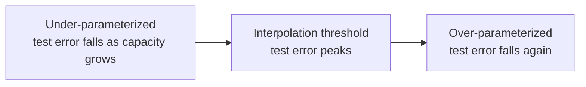

# What it means to learn

Fitting the training data is easy: a lookup table does it perfectly. **Learning** means performing well on data you have *not* seen. Learning theory asks when that is possible and why.

## Generalization

Let $R(f)$ be the expected loss on the true data distribution and $\hat R(f)$ the average loss on the training set. The **generalization gap** is $R(f) - \hat R(f)$. A model **overfits** when the gap is large: it has memorized noise rather than structure.

## The bias–variance trade-off

For squared error, the expected test error at a point decomposes as

```math
\mathbb{E}\big[(y - \hat f(x))^2\big] = \underbrace{\big(\mathbb{E}[\hat f(x)] - f(x)\big)^2}_{\text{bias}^2} + \underbrace{\mathrm{Var}[\hat f(x)]}_{\text{variance}} + \underbrace{\sigma^2}_{\text{noise}}
```

Simple models have high bias; flexible models have high variance. The classical picture is a U-shaped test-error curve as model complexity grows.

## Double descent

Modern practice contradicts the U-curve. **Belkin et al. (2019)** documented **double descent**: as capacity increases, test error falls, rises near the *interpolation threshold* (where the model can just fit the training data exactly), then **falls again** as capacity keeps growing. **Nakkiran et al. (2019)** observed the same phenomenon in deep networks, as a function of both model size and training time.



Relatedly, **Zhang et al. (2016)** showed that standard image networks can perfectly fit *randomly labelled* data, so capacity measures alone cannot explain why the same networks generalize on real labels.

## PAC learning

**Valiant (1984)** formalized learnability: a concept class is **Probably Approximately Correct (PAC)** learnable if, with probability at least $1-\delta$, an algorithm outputs a hypothesis with error at most $\epsilon$, using a number of samples polynomial in $1/\epsilon$ and $1/\delta$. For a finite hypothesis class $\mathcal{H}$ in the realizable case,

```math
N \ge \frac{1}{\epsilon}\left(\ln|\mathcal{H}| + \ln\frac{1}{\delta}\right)
```

samples suffice. VC dimension and Rademacher complexity extend this to infinite classes.

## No free lunch

**Wolpert & Macready (1997)** proved that, averaged over *all* possible problems, every optimization algorithm performs equally well. Learning works in practice because real-world problems are not arbitrary: they have structure (smoothness, compositionality, symmetry) that good **inductive biases** exploit. Convolution assumes translation symmetry; attention assumes relevance can be computed by similarity.

## Grokking

**Power et al. (2022)** trained small transformers on algorithmic tasks such as modular arithmetic and saw a striking pattern: the model first memorizes the training set, and only much later, long after training accuracy reaches 100%, suddenly generalizes. This **grokking** shows that generalization can emerge abruptly during training, and has become a test case for mechanistic interpretability.

## Inductive bias in one table

| Model | Built-in assumption |
|---|---|
| Linear model | Output depends linearly on features |
| k-nearest neighbours | Nearby inputs have similar outputs |
| CNN | Local patterns, translation equivariance |
| RNN | Sequential processing with shared dynamics |
| Transformer | Content-based interactions between all positions |
| Graph neural network | Permutation symmetry over nodes |

## Key takeaways

- Generalization, not fitting, is the goal.
- Classical theory predicts overfitting for huge models; double descent and benign overfitting show the story is richer.
- Learning is possible only because the world has structure, and architectures encode assumptions about it.
