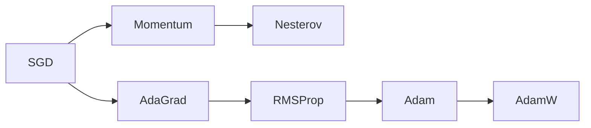

# Optimization

A model is a function with millions or billions of adjustable numbers. **Training** means finding values of those numbers that make a loss small. That search is optimization, and its workhorse is remarkably simple: take small steps downhill.

## The objective

Given parameters $\theta$, a per-example loss $\ell$, and a dataset of $N$ examples, we minimize the empirical risk

```math
L(\theta) = \frac{1}{N} \sum_{i=1}^{N} \ell\big(f_\theta(x_i), y_i\big) + \lambda R(\theta)
```

where $R$ is an optional regularizer.

## Gradient descent

The gradient $\nabla_\theta L$ points uphill. Gradient descent steps the other way:

```math
\theta_{t+1} = \theta_t - \eta \, \nabla_\theta L(\theta_t)
```

The **learning rate** $\eta$ is the most important hyperparameter in deep learning. Too small and training crawls; too large and it diverges.

## Stochastic gradient descent (SGD)

Computing the gradient over all $N$ examples is expensive. **SGD** estimates it from a random **mini-batch** $\mathcal{B}$:

```math
\theta_{t+1} = \theta_t - \eta \, \frac{1}{|\mathcal{B}|} \sum_{i \in \mathcal{B}} \nabla_\theta \ell_i(\theta_t)
```

The idea traces back to stochastic approximation (Robbins & Monro 1951). The noise in SGD is not only a cost: it is widely believed to help escape poor regions and to bias training toward solutions that generalize, although the precise mechanisms remain an active research question.

## Momentum and adaptive methods



- **Momentum** keeps a running velocity $v_{t+1} = \beta v_t + \nabla L$, then steps $\theta \leftarrow \theta - \eta v$. It smooths noisy gradients and accelerates along consistent directions.
- **Adam** (Kingma & Ba 2014) tracks first and second moment estimates of the gradient:

```math
m_t = \beta_1 m_{t-1} + (1-\beta_1) g_t, \qquad v_t = \beta_2 v_{t-1} + (1-\beta_2) g_t^2
```

```math
\hat m_t = \frac{m_t}{1-\beta_1^t}, \quad \hat v_t = \frac{v_t}{1-\beta_2^t}, \quad \theta_t = \theta_{t-1} - \eta \frac{\hat m_t}{\sqrt{\hat v_t} + \epsilon}
```

  Each parameter effectively gets its own step size. **AdamW** (Loshchilov & Hutter 2017) decouples weight decay from the adaptive update and is the default for training transformers.

## Learning-rate schedules

Large models are usually trained with a **warmup** (learning rate rising linearly for the first steps) followed by **decay** (cosine or linear). Warmup avoids instability while adaptive statistics are still poorly estimated.

## Convex vs non-convex

A function is **convex** if every chord lies above the graph. Convex problems (linear regression, logistic regression, SVMs) have a single global minimum that gradient methods reliably find.

Neural network losses are **non-convex**: they have many minima, saddle points, and flat regions. Classical theory offered few guarantees, yet in practice large networks train reliably. Contributing explanations include:

- In high dimensions most critical points are **saddle points**, not bad local minima, and noisy gradients escape them.
- **Overparameterization** makes the landscape more benign; in the infinite-width limit, training behaves like a linear model in a fixed kernel (the **neural tangent kernel**, Jacot et al. 2018).
- Loss landscapes of well-designed architectures (for example with residual connections) are visibly smoother (Li et al. 2018).

## Second-order ideas

Newton's method uses curvature (the Hessian $H$): $\theta \leftarrow \theta - H^{-1}\nabla L$. It is too expensive for large networks, but curvature still matters. **Edge of stability** (Cohen et al. 2021) is the empirical observation that with full-batch gradient descent, the sharpest curvature rises until it hovers around $2/\eta$, the threshold at which plain gradient descent on a quadratic would become unstable.

A different route to curvature measures steps by how much the model's *predictions* change rather than how far its parameters move. That leads to the natural gradient and to practical preconditioners such as K-FAC, Shampoo, SOAP, and Muon; see [Information geometry and the natural gradient](information-geometry-natural-gradient.md).

## Practical stabilizers

| Technique | Problem it addresses |
|---|---|
| Careful initialization (Glorot & Bengio 2010; He et al. 2015) | Keeps activation and gradient scales stable across layers |
| Normalization (BatchNorm, LayerNorm) | Controls internal activation statistics |
| Residual connections | Gives gradients a direct path through depth |
| Gradient clipping | Caps rare exploding updates |
| Mixed precision with loss scaling | Speed without numerical underflow |

## Key takeaways

- Training is noisy gradient descent on a non-convex function, and it works far better than classical theory predicted.
- The learning rate and its schedule matter more than the choice of optimizer in many cases.
- Curvature, noise, and architecture together shape which solution is found.
