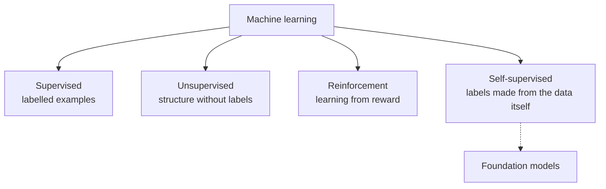

# 01 · Classical machine learning

Deep learning gets the headlines, but the classical toolbox still wins many real problems, especially on tabular data, small datasets, and settings that demand interpretability. It also supplies the concepts (features, kernels, ensembles, rewards) that deep learning inherited.

| Page | What you will learn |
|---|---|
| [Supervised learning](supervised-learning.md) | Linear and logistic regression, SVMs and kernels, decision trees, random forests, gradient boosting, evaluation |
| [Unsupervised learning](unsupervised-learning.md) | Clustering, PCA, mixture models and EM, manifold learning, density estimation |
| [Gaussian processes and Bayesian optimization](gaussian-processes-bayesian-optimization.md) | Distributions over functions, closed-form posteriors, marginal-likelihood model selection, acquisition functions and the tuning loop (with tested code), high-dimensional BO, and the infinite-width link to neural networks |
| [Reinforcement learning](reinforcement-learning.md) | MDPs, value functions, Bellman equations, Q-learning, policy gradients, exploration |

**Self-supervised learning**, in which the data provides its own targets (predict the next word, the masked patch, the other view), is the bridge from this section to [modern AI](../03-modern-ai/README.md).

**Suggested textbooks:** Hastie, Tibshirani & Friedman, *The Elements of Statistical Learning* (2009); Bishop (2006); Sutton & Barto, *Reinforcement Learning: An Introduction* (2018).
