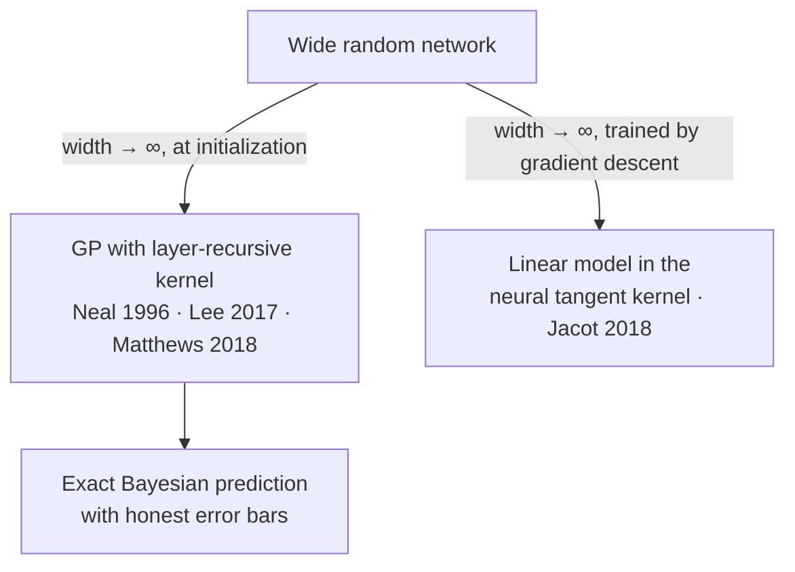

# Gaussian processes and Bayesian optimization

Most models answer a question with a number. A **Gaussian process** answers with a number *and an honest error bar*, and the error bar grows exactly where the data runs out. That one property makes it the engine of **Bayesian optimization**, the standard method for tuning things that are expensive to try: a model's hyperparameters, a chemical reaction, a robot's gait, the settings of a Go-playing program. Instead of trying settings at random, you fit a Gaussian process to the trials so far, ask it where an improvement is most likely, run that one trial, and repeat. DeepMind used this loop to tune AlphaGo before the 2016 Lee Sedol match, raising its self-play win rate from 50% to 66.5% (Chen et al. 2018).

> The core idea in one sentence: **put a probability distribution over functions, condition it on what you have measured, and spend each expensive new measurement where the posterior says the payoff, counting uncertainty, is highest.**


## 1. A distribution over functions (established)

A **Gaussian process** (GP) is a collection of random variables, any finite number of which have a joint Gaussian distribution (Rasmussen & Williams 2006). It is fully specified by a mean function $m(\mathbf{x})$ and a **covariance function**, or kernel, $k(\mathbf{x}, \mathbf{x}')$:

```math
f \sim \mathcal{GP}\big(m(\mathbf{x}),\, k(\mathbf{x}, \mathbf{x}')\big), \qquad \operatorname{Cov}\big(f(\mathbf{x}), f(\mathbf{x}')\big) = k(\mathbf{x}, \mathbf{x}').
```

The kernel encodes everything you believe about the function before seeing data: how smooth it is, over what distance it varies, whether it repeats. Two workhorses:

| Kernel | Formula ($r = \lVert \mathbf{x} - \mathbf{x}' \rVert$) | Sample paths look like |
|---|---|---|
| Squared exponential (RBF) | $\sigma_f^2 \exp\!\big(-r^2 / 2\ell^2\big)$ | Infinitely smooth curves |
| Matérn 5/2 | $\sigma_f^2 \big(1 + \tfrac{\sqrt5 r}{\ell} + \tfrac{5r^2}{3\ell^2}\big) \exp\!\big(-\tfrac{\sqrt5 r}{\ell}\big)$ | Twice-differentiable, rougher curves |

The **length-scale** $\ell$ sets how far apart two inputs must be before their outputs become nearly independent. This is the same kernel idea that powers support vector machines (see [Supervised learning](supervised-learning.md#support-vector-machines-and-kernels)), now read as a covariance.

The idea is older than machine learning. Geostatisticians interpolated ore grades between boreholes with exactly these equations under the name **kriging**, formalized by Matheron (1963). Jones, Schonlau and Welch (1998) used the same surrogate to optimize expensive engineering simulations, an algorithm they called EGO (Efficient Global Optimization), and that paper is the direct ancestor of modern Bayesian optimization.

## 2. Conditioning: regression in closed form (established)

Given training inputs $X$, noisy observations $\mathbf{y} = f(X) + \varepsilon$ with $\varepsilon \sim \mathcal{N}(0, \sigma_n^2 I)$, and a zero prior mean, the prediction at a new point $\mathbf{x}_*$ is Gaussian with

```math
\mu(\mathbf{x}_*) = \mathbf{k}_*^\top (K + \sigma_n^2 I)^{-1} \mathbf{y}, \qquad
\sigma^2(\mathbf{x}_*) = k(\mathbf{x}_*, \mathbf{x}_*) - \mathbf{k}_*^\top (K + \sigma_n^2 I)^{-1} \mathbf{k}_*,
```

where $K_{ij} = k(\mathbf{x}_i, \mathbf{x}_j)$ and $(\mathbf{k}_*)_i = k(\mathbf{x}_i, \mathbf{x}_*)$ (Rasmussen & Williams 2006, ch. 2). Three things are worth noticing.

- **The mean is a weighted sum of observations**, with weights set by kernel similarity. It is kernel ridge regression.
- **The variance does not depend on $\mathbf{y}$ at all.** It shrinks near measured inputs and returns to the prior far from them. That is why the error bar is honest about coverage, though not about a mis-specified kernel.
- **Hyperparameters are learned by the marginal likelihood**, the probability of the data with $f$ integrated out:

```math
\log p(\mathbf{y} \mid X, \theta) = -\tfrac12 \mathbf{y}^\top (K_\theta + \sigma_n^2 I)^{-1} \mathbf{y} \;-\; \tfrac12 \log\lvert K_\theta + \sigma_n^2 I\rvert \;-\; \tfrac{n}{2}\log 2\pi .
```

The first term rewards fitting the data; the second penalizes a flexible, high-volume prior. The trade-off is an automatic Occam's razor: no validation set is needed to choose $\ell$.

The price is a Cholesky factorization of an $n \times n$ matrix, $O(n^3)$ time and $O(n^2)$ memory. That is trivial for the tens to hundreds of points typical of Bayesian optimization and prohibitive for millions, which is what section 5 is about.

## 3. Bayesian optimization: deciding where to look (established)

Bayesian optimization (BO) treats an expensive black-box function as unknown and spends evaluations carefully. Each round it maximizes a cheap **acquisition function** built from the posterior, then evaluates the true function there (Shahriari et al. 2016; Frazier 2018).

| Acquisition | Definition (maximizing $f$, best value so far $f^+$) | Character |
|---|---|---|
| Probability of improvement | $\Phi(z)$, with $z = (\mu - f^+)/\sigma$ | Greedy; tends to over-exploit |
| **Expected improvement** (EI) | $(\mu - f^+)\,\Phi(z) + \sigma\,\varphi(z)$ | The EGO default; closed form |
| **GP-UCB** | $\mu + \sqrt{\beta_t}\,\sigma$ | Optimism under uncertainty; regret bounds |
| Thompson sampling | Maximize one posterior sample | Randomized; parallelizes naturally |
| Entropy search / PES | Most information about the location of the maximum | Information-theoretic; costlier |

Expected improvement has two terms, and they *are* the exploration–exploitation trade-off: the first pays for a high mean, the second for a large standard deviation. Srinivas, Krause, Kakade and Seeger (2009) proved that GP-UCB has sublinear cumulative regret, with bounds stated through the **maximum information gain** of the kernel, which ties optimization to experimental design. Hernández-Lobato, Hoffman and Ghahramani (2014) introduced predictive entropy search, which picks the point expected to reveal most about where the optimum lies.

The modern BO era for machine learning began with Snoek, Larochelle and Adams (2012), who modeled validation performance as a GP sample, used Matérn 5/2 kernels with hyperparameters integrated out, accounted for the varying cost of experiments, and reported results that reach or surpass expert human tuning on models including convolutional networks. BoTorch (Balandat et al. 2020) and GPyTorch (Gardner et al. 2018) are the current open-source workhorses, with Monte-Carlo acquisition functions that handle batches of parallel trials.

### 3.1 Tested sketch: the whole loop in NumPy

The script below implements GP regression with a Cholesky factorization, picks the length-scale by marginal likelihood, and runs expected-improvement BO against random search on a wiggly one-dimensional function on $[0, 2]$. It was run as written with NumPy only.

```python
import numpy as np
from math import erf, sqrt, pi

def rbf(A, B, ell=0.2, sf=1.0):
    d2 = (A[:, None] - B[None, :]) ** 2
    return sf**2 * np.exp(-0.5 * d2 / ell**2)

def gp_posterior(X, y, Xs, ell, sn=1e-2):
    K = rbf(X, X, ell) + sn**2 * np.eye(len(X))
    L = np.linalg.cholesky(K)                       # O(n^3), once
    alpha = np.linalg.solve(L.T, np.linalg.solve(L, y))
    Ks = rbf(X, Xs, ell)
    mu = Ks.T @ alpha                               # posterior mean
    v = np.linalg.solve(L, Ks)
    var = np.clip(1.0 - (v**2).sum(0), 1e-12, None) # posterior variance
    lml = -0.5 * y @ alpha - np.log(np.diag(L)).sum() - 0.5 * len(X) * np.log(2 * pi)
    return mu, np.sqrt(var), lml

Phi = np.vectorize(lambda z: 0.5 * (1 + erf(z / sqrt(2))))
phi = lambda z: np.exp(-0.5 * z**2) / sqrt(2 * pi)

def expected_improvement(mu, sd, best):            # for maximization
    z = (mu - best) / sd
    return (mu - best) * Phi(z) + sd * phi(z)

f = lambda x: np.sin(3 * x) + 0.6 * np.sin(11 * x) - 0.8 * (x - 0.7) ** 2   # hidden objective
grid = np.linspace(0, 2, 2001)
fmax = f(grid).max()

# 1) model selection: the marginal likelihood picks the length-scale
rng = np.random.default_rng(0)
X = rng.uniform(0, 2, 12); y = f(X)
for ell in [0.02, 0.05, 0.1, 0.2, 0.5, 1.0]:  # same list as ELLS below
    print(f"ell={ell:<5} log marginal likelihood={gp_posterior(X, y, grid, ell)[2]:9.2f}")

# 2) Bayesian optimization with EI vs random search, 20 seeds, 15 evaluations each
ELLS = [0.02, 0.05, 0.1, 0.2, 0.5, 1.0]

def bo(seed, n=15):
    r = np.random.default_rng(seed)
    X = r.uniform(0, 2, 3); y = f(X)
    while len(X) < n:
        ell = max(ELLS, key=lambda l: gp_posterior(X, y, X, l)[2])  # refit by marginal likelihood
        mu, sd, _ = gp_posterior(X, y, grid, ell)
        x = grid[np.argmax(expected_improvement(mu, sd, y.max()))]
        X = np.append(X, x); y = np.append(y, f(x))
    return fmax - y.max()

def rs(seed, n=15):
    r = np.random.default_rng(seed)
    return fmax - f(r.uniform(0, 2, n)).max()

b = np.array([bo(s) for s in range(20)]); r = np.array([rs(s) for s in range(20)])
print(f"median regret after 15 evals: BO={np.median(b):.2e}  random={np.median(r):.2e}")
print(f"seeds where BO within 1e-3 of the max: {(b<1e-3).sum()}/20; random: {(r<1e-3).sum()}/20")
```

Output (NumPy 2.x, CPU):

```text
ell=0.02  log marginal likelihood=   -15.13
ell=0.05  log marginal likelihood=   -12.37
ell=0.1   log marginal likelihood=    -7.95
ell=0.2   log marginal likelihood=    -2.81
ell=0.5   log marginal likelihood=  -713.75
ell=1.0   log marginal likelihood= -5518.54
median regret after 15 evals: BO=0.00e+00  random=1.11e-01
seeds where BO within 1e-3 of the max: 20/20; random: 2/20
```

The marginal likelihood picks $\ell = 0.2$: too short a length-scale is penalized as needlessly complex, too long a one cannot fit the oscillation at all. With 15 evaluations, BO found the best point on the 2,001-point search grid in all 20 runs, while random search came within $10^{-3}$ of it in 2. This is a toy in one dimension, chosen to show the mechanism; on real problems the gap is smaller and depends on dimension, noise, and how well the kernel matches the function.

## 4. Where it is used, and the honest comparisons (established)

- **Hyperparameter tuning.** The NeurIPS 2020 black-box optimization challenge, run on held-out tuning problems with no human in the loop, found that Bayesian optimization beat random search; the organizers' analysis is titled accordingly (Turner et al. 2021). Bandit methods such as Hyperband (Li et al. 2016) instead stop bad runs early, and BOHB (Falkner, Klein & Hutter 2018) combines the two.
- **Games and agents.** AlphaGo's hyperparameters were tuned with BO many times during development; one pre-match round raised self-play win rate from 50% to 66.5% (Chen et al. 2018).
- **The physical sciences.** Shields et al. (2021, *Nature*) applied BO to optimizing chemical reactions and benchmarked it against expert chemists, finding the optimizer more efficient and more consistent on average.

The comparison that matters is always against a fair baseline with the same budget. Random search is surprisingly strong when only a few dimensions matter, and early stopping often matters more than clever selection when trials are long training runs.

## 5. Scaling up and scaling out (established, with open questions)

**Many data points.** Sparse GPs summarize the data with $m \ll n$ **inducing points**, cutting cost to $O(nm^2)$; Titsias (2009) chose them by a variational bound, and Hensman, Fusi and Lawrence (2013) made that bound work with stochastic minibatches, so GPs could train on very large datasets. KISS-GP (Wilson & Nickisch 2015) places inducing points on a grid to exploit structured linear algebra, and GPyTorch (Gardner et al. 2018) replaces Cholesky with conjugate-gradient matrix–matrix products that run well on GPUs.

**Many dimensions.** For years the folklore was that BO breaks above about 20 dimensions, and methods added structure to cope. TuRBO (Eriksson et al. 2019) instead keeps several local trust regions and allocates samples among them like a bandit. Then three papers in 2024–2025 argued the folklore was largely a modeling error:

| Paper | Finding |
|---|---|
| Hvarfner, Hellsten & Nardi (2024) | Scaling the length-scale prior with dimension makes vanilla BO outperform specialized high-dimensional methods on standard real-world tasks |
| Xu, Wang, Phillips & Zhe (2024) | Standard BO with a Matérn kernel is consistently top-tier across twelve benchmarks; the RBF kernel's failures trace to length-scale initialization that makes gradients vanish |
| Papenmeier, Poloczek & Nardi (2025) | Confirms vanishing gradients from GP initialization as a major cause, finds maximum-likelihood length-scales suffice, and argues that methods favouring local search do best |

The lesson is about **priors**: in $d$ dimensions, distances between random points grow like $\sqrt d$, so a length-scale prior tuned for $d = 2$ makes every point look unrelated to every other point in $d = 100$.

**Language models in the loop.** LLAMBO (Liu et al. 2024) phrases the optimization history in natural language and lets a language model propose and score candidates, reporting gains mostly in the early, data-poor stage of a search. Whether such priors help beyond warm-starting is open.

## 6. The bridge to deep learning (established)

Gaussian processes are not only a rival to neural networks; they are their infinite-width limit. Neal (1996) showed that a one-hidden-layer network with independent random weights, suitably scaled, converges to a GP as the width goes to infinity. Lee et al. (2017) and Matthews et al. (2018) extended this to deep networks: at initialization, a wide deep network computes a draw from a GP whose kernel is defined recursively layer by layer, and exact Bayesian inference with that kernel is a meaningful baseline. Jacot, Gabriel and Hongler (2018) showed that gradient-descent training in the same limit is governed by another fixed kernel, the **neural tangent kernel**. That is also why finite-width effects, and parameterizations such as μP that escape the kernel regime, matter (see [Normalization, initialization and μP](../02-deep-learning/normalization-initialization-mup.md)).



## 7. Status at a glance

| Claim | Status |
|---|---|
| GP posteriors are closed form; marginal likelihood selects hyperparameters | Established textbook result |
| BO beats random search on expensive, low-dimensional tuning at equal budget | Established empirically (Turner et al. 2021), problem-dependent in size |
| GP-UCB has sublinear regret under kernel assumptions | Proven (Srinivas et al. 2009) |
| Vanilla BO works in high dimensions with sensible length-scale priors | Recent and well supported (2024–2025), still being tested |
| Wide networks at initialization are GPs; trained wide networks follow the NTK | Proven in the infinite-width limit; finite networks deviate |
| LLMs as priors for BO | Early research |

## 8. Calibrating analog hardware with a few expensive measurements (speculative)

> [!WARNING]
> **Speculative.** This section sketches a research direction. It is not an established result, and no system is claimed to work this way.

Analog and optical processors have many tunable knobs per chip, such as heater voltages, bias points, and phase offsets, and each measurement of the whole system can be slow. That is the setting BO was built for: an expensive, noisy, black-box objective with an honest need for uncertainty. One could imagine a calibration loop that treats a measured end-to-end accuracy, or a measured transfer matrix error, as the objective; uses a GP with one length-scale per knob so the data reveals which knobs matter; and uses trust regions to stay near a known-good operating point. The GP's variance would also offer a principled stopping rule (stop when expected improvement falls below the measurement noise). The open questions are practical: whether drift outpaces the loop, whether the knob space is too large for a single GP, and whether physics-based models make a black-box surrogate unnecessary. These are testable claims, and any such scheme should be judged against simple coordinate-wise tuning at equal measurement budget.

## Further reading

- Rasmussen, C. E., Williams, C. K. I. (2006). *Gaussian Processes for Machine Learning*. MIT Press. [Book webpage (free PDF)](https://gaussianprocess.org/gpml/)
- Matheron, G. (1963). *Principles of geostatistics*. Economic Geology 58(8), 1246–1266. [doi:10.2113/gsecongeo.58.8.1246](https://doi.org/10.2113/gsecongeo.58.8.1246)
- Neal, R. M. (1996). *Bayesian Learning for Neural Networks*. Lecture Notes in Statistics 118, Springer. [doi:10.1007/978-1-4612-0745-0](https://doi.org/10.1007/978-1-4612-0745-0)
- Jones, D. R., Schonlau, M., Welch, W. J. (1998). *Efficient global optimization of expensive black-box functions*. Journal of Global Optimization 13, 455–492. [doi:10.1023/A:1008306431147](https://doi.org/10.1023/A:1008306431147)
- Titsias, M. (2009). *Variational learning of inducing variables in sparse Gaussian processes*. AISTATS, PMLR 5. [Link](https://proceedings.mlr.press/v5/titsias09a.html)
- Srinivas, N., Krause, A., Kakade, S. M., Seeger, M. (2009). *Gaussian process optimization in the bandit setting: No regret and experimental design*. ICML 2010. [arXiv:0912.3995](https://arxiv.org/abs/0912.3995)
- Snoek, J., Larochelle, H., Adams, R. P. (2012). *Practical Bayesian optimization of machine learning algorithms*. NeurIPS. [arXiv:1206.2944](https://arxiv.org/abs/1206.2944)
- Hensman, J., Fusi, N., Lawrence, N. D. (2013). *Gaussian processes for big data*. UAI. [arXiv:1309.6835](https://arxiv.org/abs/1309.6835)
- Hernández-Lobato, J. M., Hoffman, M. W., Ghahramani, Z. (2014). *Predictive entropy search for efficient global optimization of black-box functions*. NeurIPS. [arXiv:1406.2541](https://arxiv.org/abs/1406.2541)
- Wilson, A. G., Nickisch, H. (2015). *Kernel interpolation for scalable structured Gaussian processes (KISS-GP)*. ICML. [arXiv:1503.01057](https://arxiv.org/abs/1503.01057)
- Shahriari, B., Swersky, K., Wang, Z., Adams, R. P., de Freitas, N. (2016). *Taking the human out of the loop: A review of Bayesian optimization*. Proceedings of the IEEE 104(1), 148–175. [doi:10.1109/JPROC.2015.2494218](https://doi.org/10.1109/JPROC.2015.2494218)
- Li, L., Jamieson, K., DeSalvo, G., Rostamizadeh, A., Talwalkar, A. (2016). *Hyperband: A novel bandit-based approach to hyperparameter optimization*. JMLR 18 (2018). [arXiv:1603.06560](https://arxiv.org/abs/1603.06560)
- Lee, J., Bahri, Y., Novak, R., Schoenholz, S. S., Pennington, J., Sohl-Dickstein, J. (2017). *Deep neural networks as Gaussian processes*. ICLR 2018. [arXiv:1711.00165](https://arxiv.org/abs/1711.00165)
- Matthews, A. G. de G., Rowland, M., Hron, J., Turner, R. E., Ghahramani, Z. (2018). *Gaussian process behaviour in wide deep neural networks*. ICLR. [arXiv:1804.11271](https://arxiv.org/abs/1804.11271)
- Jacot, A., Gabriel, F., Hongler, C. (2018). *Neural tangent kernel: Convergence and generalization in neural networks*. NeurIPS. [arXiv:1806.07572](https://arxiv.org/abs/1806.07572)
- Falkner, S., Klein, A., Hutter, F. (2018). *BOHB: Robust and efficient hyperparameter optimization at scale*. ICML. [arXiv:1807.01774](https://arxiv.org/abs/1807.01774)
- Frazier, P. I. (2018). *A tutorial on Bayesian optimization*. [arXiv:1807.02811](https://arxiv.org/abs/1807.02811)
- Gardner, J. R., Pleiss, G., Bindel, D., Weinberger, K. Q., Wilson, A. G. (2018). *GPyTorch: Blackbox matrix-matrix Gaussian process inference with GPU acceleration*. NeurIPS. [arXiv:1809.11165](https://arxiv.org/abs/1809.11165)
- Chen, Y., Huang, A., Wang, Z., Antonoglou, I., Schrittwieser, J., Silver, D., de Freitas, N. (2018). *Bayesian optimization in AlphaGo*. [arXiv:1812.06855](https://arxiv.org/abs/1812.06855)
- Eriksson, D., Pearce, M., Gardner, J. R., Turner, R., Poloczek, M. (2019). *Scalable global optimization via local Bayesian optimization*. NeurIPS. [arXiv:1910.01739](https://arxiv.org/abs/1910.01739)
- Balandat, M., Karrer, B., Jiang, D. R., Daulton, S., Letham, B., Wilson, A. G., Bakshy, E. (2019). *BoTorch: A framework for efficient Monte-Carlo Bayesian optimization*. NeurIPS 2020. [arXiv:1910.06403](https://arxiv.org/abs/1910.06403)
- Shields, B. J., Stevens, J., Li, J., Parasram, M., Damani, F., Alvarado, J. I. M., et al. (2021). *Bayesian reaction optimization as a tool for chemical synthesis*. Nature 590, 89–96. [doi:10.1038/s41586-021-03213-y](https://doi.org/10.1038/s41586-021-03213-y)
- Turner, R., Eriksson, D., McCourt, M., Kiili, J., Laaksonen, E., Xu, Z., Guyon, I. (2021). *Bayesian optimization is superior to random search for machine learning hyperparameter tuning: Analysis of the black-box optimization challenge 2020*. [arXiv:2104.10201](https://arxiv.org/abs/2104.10201)
- Hvarfner, C., Hellsten, E. O., Nardi, L. (2024). *Vanilla Bayesian optimization performs great in high dimensions*. ICML. [arXiv:2402.02229](https://arxiv.org/abs/2402.02229)
- Xu, Z., Wang, H., Phillips, J. M., Zhe, S. (2024). *Standard Gaussian process is all you need for high-dimensional Bayesian optimization*. [arXiv:2402.02746](https://arxiv.org/abs/2402.02746)
- Liu, T., Astorga, N., Seedat, N., van der Schaar, M. (2024). *Large language models to enhance Bayesian optimization*. ICLR. [arXiv:2402.03921](https://arxiv.org/abs/2402.03921)
- Papenmeier, L., Poloczek, M., Nardi, L. (2025). *Understanding high-dimensional Bayesian optimization*. [arXiv:2502.09198](https://arxiv.org/abs/2502.09198)
