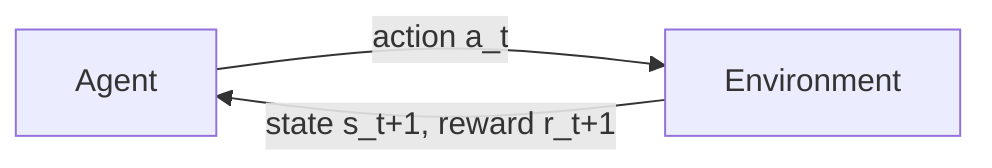

# Reinforcement learning

Reinforcement learning (RL) is learning by **acting**. An agent observes a state, takes an action, receives a reward, and adjusts its behaviour to collect more reward over time. RL is how AlphaGo learned Go and how chat models are tuned with human feedback.



## Markov decision processes

An MDP is a tuple $(\mathcal{S}, \mathcal{A}, P, R, \gamma)$: states, actions, transition probabilities $P(s' \mid s, a)$, rewards, and a discount factor $\gamma \in [0,1)$. A **policy** $\pi(a \mid s)$ chooses actions. The goal is to maximize the expected **return**

```math
G_t = \sum_{k=0}^{\infty} \gamma^k r_{t+k+1}
```

## Value functions and the Bellman equation

The **action-value** of taking $a$ in $s$ and then following $\pi$ is $Q^\pi(s,a) = \mathbb{E}_\pi[G_t \mid s_t = s, a_t = a]$. The optimal action-value satisfies the **Bellman optimality equation**:

```math
Q^*(s, a) = \mathbb{E}_{s'}\left[ r + \gamma \max_{a'} Q^*(s', a') \right]
```

This is a **recursive** definition: the value of now is defined through the value of next. (Recursion is a recurring theme; see [Recursion and self-improvement](../06-frontiers/recursion-and-self-improvement.md).)

## Q-learning and deep Q-networks

**Q-learning** turns the Bellman equation into an update rule using sampled transitions:

```math
Q(s,a) \leftarrow Q(s,a) + \alpha \left[ r + \gamma \max_{a'} Q(s',a') - Q(s,a) \right]
```

The bracket is the **temporal-difference (TD) error**. **DQN** (Mnih et al. 2015) approximated $Q$ with a convolutional network, stabilized by experience replay and a slowly updated target network, and reached human-level play on many Atari games from raw pixels.

## Policy gradients

Instead of learning values, optimize the policy directly. The policy-gradient theorem gives

```math
\nabla_\theta J(\theta) = \mathbb{E}_{\pi_\theta}\left[ \nabla_\theta \log \pi_\theta(a \mid s) \, A^{\pi}(s, a) \right]
```

where the **advantage** $A^\pi(s,a) = Q^\pi(s,a) - V^\pi(s)$ says how much better an action is than average. **Actor–critic** methods learn both a policy (actor) and a value estimate (critic). **PPO** (Schulman et al. 2017) clips each update so the new policy stays close to the old one; it became the standard algorithm for RLHF (Ouyang et al. 2022).

## Exploration vs exploitation

An agent must balance trying new actions (exploration) against using what it knows works (exploitation). Simple strategies include $\epsilon$-greedy action selection and entropy bonuses; more sophisticated ones use optimism, uncertainty estimates, or intrinsic curiosity rewards.

## Model-free vs model-based

- **Model-free** RL (Q-learning, PPO) learns directly from experience.
- **Model-based** RL learns a model of the environment and plans with it. Sutton's **Dyna** (1991) interleaved real experience with simulated experience from a learned model. **MuZero** (Schrittwieser et al. 2020) learned a latent model good enough to plan at superhuman level in Go, chess, shogi and Atari. See [World models](../06-frontiers/world-models.md).

## Self-play

In two-player games, an agent can generate its own curriculum by playing against itself. **AlphaGo Zero** (Silver et al. 2017) and **AlphaZero** (Silver et al. 2018) learned from self-play alone, with no human games, and surpassed earlier systems.

## Reward is a specification

RL optimizes exactly what the reward measures. When the reward is an imperfect proxy, agents can exploit the gap ("reward hacking" or specification gaming), one of the central problems discussed in [Alignment](../05-alignment-safety-interpretability/alignment.md).
