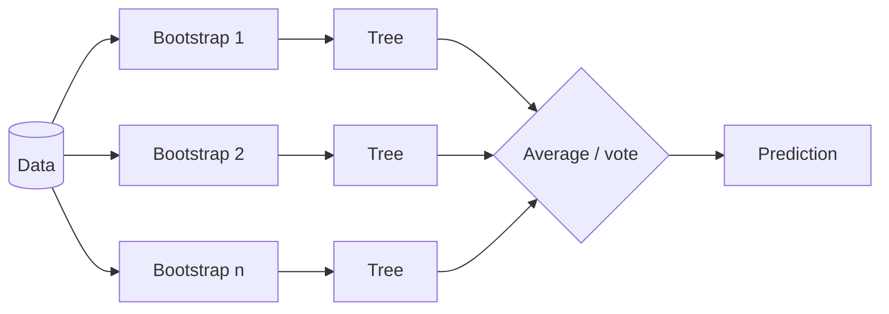

# Supervised learning

In supervised learning we are given pairs $(x_i, y_i)$ and want a function $f$ with $f(x) \approx y$ on new inputs. If $y$ is a number it is **regression**; if it is a category it is **classification**.

## Linear regression

```math
\hat y = \mathbf{w}^\top \mathbf{x} + b, \qquad \min_{\mathbf{w}} \sum_i (y_i - \mathbf{w}^\top \mathbf{x}_i)^2
```

It has a closed-form solution $\mathbf{w} = (X^\top X)^{-1} X^\top \mathbf{y}$. Adding $\lambda \lVert \mathbf{w} \rVert_2^2$ gives **ridge regression**; adding $\lambda \lVert \mathbf{w} \rVert_1$ gives the **lasso** (Tibshirani 1996), which drives many weights to exactly zero and so performs feature selection.

## Logistic regression

For binary labels, pass the linear score through a sigmoid $\sigma(z) = 1/(1+e^{-z})$ and minimize cross-entropy:

```math
p(y=1 \mid \mathbf{x}) = \sigma(\mathbf{w}^\top \mathbf{x} + b)
```

Logistic regression is a single neuron. Its multiclass generalization (softmax regression) is exactly the final layer of most classifiers.

## Support vector machines and kernels

An SVM (Cortes & Vapnik 1995) finds the separating hyperplane with the **largest margin** to the nearest training points. Its solution depends on data only through dot products $\mathbf{x}_i^\top \mathbf{x}_j$, so they can be replaced by a **kernel** $k(\mathbf{x}_i, \mathbf{x}_j) = \phi(\mathbf{x}_i)^\top \phi(\mathbf{x}_j)$, an inner product in a possibly infinite-dimensional feature space, without ever computing $\phi$. This is the **kernel trick**.

A common choice is the RBF kernel $k(\mathbf{x}, \mathbf{x}') = \exp(-\gamma \lVert \mathbf{x} - \mathbf{x}' \rVert^2)$. Kernels returned to deep learning theory through the [neural tangent kernel](../00-foundations/optimization.md#convex-vs-non-convex), and to quantum ML through [quantum feature maps](../06-frontiers/quantum-machine-learning.md).

## Decision trees and ensembles

A **decision tree** recursively splits the feature space with simple threshold rules, choosing each split to reduce impurity (Gini or entropy). Trees are interpretable but high-variance.

**Ensembles** fix that:

- **Random forests** (Breiman 2001) average many trees trained on bootstrap samples with random feature subsets, sharply reducing variance.
- **Gradient boosting** (Friedman 2001) adds trees sequentially, each fitting the negative gradient of the loss with respect to the current predictions. **XGBoost** (Chen & Guestrin 2016) and similar libraries made it the default for tabular data competitions.



## k-nearest neighbours

Predict by majority vote (or average) of the $k$ closest training points. No training at all, just memory and a distance function. The same idea, at scale and with learned embeddings, powers **vector search** in retrieval-augmented generation.

## Evaluating models

- **Train / validation / test split**: tune on validation, report on a held-out test set touched once.
- **Cross-validation**: rotate the validation fold for small datasets.
- **Metrics**: accuracy can mislead on imbalanced data; use precision, recall, F1, ROC-AUC, or calibration error as appropriate.
- **Leakage**: the most common real-world failure is information from the test set or the future sneaking into training features.

## When classical methods win

For **tabular data** with heterogeneous features, gradient-boosted trees frequently match or beat deep networks while being faster to train and easier to explain. For images, audio, and language, learned deep representations dominate.
