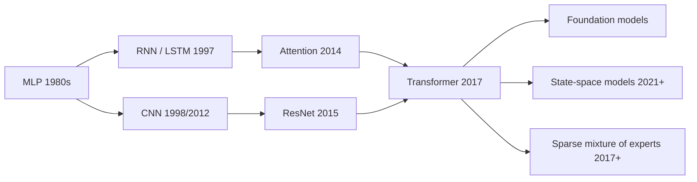

# 02 · Deep learning

Deep learning stacks many simple, differentiable layers and trains them end to end. Its central bet is that **representations should be learned, not engineered**. That bet has paid off in vision, speech, language, games, and science.

| Page | What you will learn |
|---|---|
| [Neural networks and backpropagation](neural-networks-and-backprop.md) | Neurons, activations, universal approximation, computational graphs, the backprop algorithm |
| [Architectures](architectures.md) | CNNs, RNNs and LSTMs, residual networks, normalization, graph neural networks |
| [Transformers](transformers.md) | Attention from first principles, multi-head attention, positional encoding, the full block |
| [Attention gradients, derived by hand](attention-gradients.md) | The full backward pass of attention, the softmax Jacobian and its 1/2 bound, the identity behind FlashAttention's memory-light backward pass (with tested code), and why confident attention stops learning |
| [Normalization, initialization and μP](normalization-initialization-mup.md) | Variance-preserving init, the edge of chaos, Pre-LN vs Post-LN, QK-norm, normalization-free transformers, and μP hyperparameter transfer |
| [Mixture of experts](mixture-of-experts.md) | Sparse routing, load balancing and router collapse (with tested code), stability tricks, fine-grained and shared experts, MoE scaling laws, and the systems cost of sparsity |
| [Scaling laws](scaling-laws.md) | How loss falls with compute, data and parameters, and what that implies |

