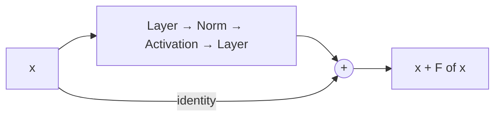
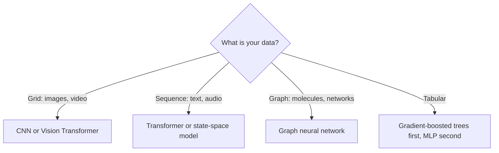

# Architectures

An architecture is a set of **assumptions about the world** written as a network shape. Good assumptions mean less data is needed to learn.

## Convolutional neural networks (CNNs)

A convolution slides a small learned filter across the input, computing the same weighted sum at every location:

```math
(\mathbf{x} * \mathbf{k})[i,j] = \sum_{u,v} \mathbf{x}[i+u, j+v]\, \mathbf{k}[u,v]
```

This builds in two assumptions about images: **locality** (nearby pixels matter together) and **translation equivariance** (a cat is a cat wherever it appears). Stacking convolutions and pooling produces a hierarchy: edges → textures → parts → objects.

Landmarks: **LeNet** (LeCun et al. 1998) for digits; **AlexNet** (Krizhevsky, Sutskever & Hinton 2012) for ImageNet; **ResNet** (He et al. 2016) for very deep networks.

## Residual networks



Instead of learning a mapping $H(\mathbf{x})$ directly, each block learns a residual $F(\mathbf{x}) = H(\mathbf{x}) - \mathbf{x}$. The identity shortcut lets gradients flow through hundreds of layers and makes the loss landscape much smoother (Li et al. 2018). Every transformer block uses this pattern.

## Recurrent neural networks (RNNs)

An RNN processes a sequence one step at a time, carrying a hidden state:

```math
\mathbf{h}_t = \tanh(W_h \mathbf{h}_{t-1} + W_x \mathbf{x}_t + \mathbf{b})
```

The same weights are applied at every step, so an RNN is a **discrete-time dynamical system** driven by its input (see [Non-linearity and dynamical systems](../06-frontiers/nonlinearity-and-dynamical-systems.md)). Training by backpropagation through time multiplies the recurrent Jacobian many times, which causes vanishing or exploding gradients (Pascanu, Mikolov & Bengio 2013).

### LSTMs and GRUs

The **Long Short-Term Memory** (Hochreiter & Schmidhuber 1997) adds a cell state $\mathbf{c}_t$ updated additively and controlled by learned **gates**:

```math
\mathbf{c}_t = \mathbf{f}_t \odot \mathbf{c}_{t-1} + \mathbf{i}_t \odot \tilde{\mathbf{c}}_t, \qquad \mathbf{h}_t = \mathbf{o}_t \odot \tanh(\mathbf{c}_t)
```

The forget gate $\mathbf{f}_t$, input gate $\mathbf{i}_t$ and output gate $\mathbf{o}_t$ are sigmoids of the current input and previous state. The additive path lets information and gradients survive over long spans. GRUs are a simplified two-gate variant.

### Sequence-to-sequence and attention

Sutskever, Vinyals & Le (2014) used one LSTM to encode a sentence into a vector and another to decode a translation. Bahdanau, Cho & Bengio (2014) removed the bottleneck with **attention**: the decoder looks back at all encoder states and takes a weighted average. Attention then became the whole model: the [Transformer](transformers.md).

## Normalization

| Layer | Normalizes over | Typical use |
|---|---|---|
| BatchNorm (Ioffe & Szegedy 2015) | The batch, per channel | CNNs |
| LayerNorm (Ba, Kiros & Hinton 2016) | The features of each example | Transformers, RNNs |
| RMSNorm (Zhang & Sennrich 2019) | Root-mean-square of features, no mean subtraction | Many recent LLMs |

## Graph neural networks

Many datasets are graphs: molecules, social networks, road maps. A **message-passing** GNN updates each node from its neighbours:

```math
\mathbf{h}_v^{(\ell+1)} = \phi\Big(\mathbf{h}_v^{(\ell)}, \bigoplus_{u \in \mathcal{N}(v)} \psi(\mathbf{h}_u^{(\ell)}, \mathbf{h}_v^{(\ell)})\Big)
```

where $\bigoplus$ is a permutation-invariant aggregation (sum, mean, max). The built-in assumption is that node order does not matter. A transformer can be viewed as a GNN on a fully connected graph.

## State-space models

**Structured state-space models** such as S4 (Gu, Goel & Ré 2021) and **Mamba** (Gu & Dao 2023) revisit linear recurrences $\mathbf{h}_t = \bar A \mathbf{h}_{t-1} + \bar B \mathbf{x}_t$ with carefully structured matrices. They can be trained in parallel like convolutions but run as recurrences at inference, with cost linear in sequence length. Mamba makes the parameters input-dependent ("selective"), recovering some of attention's flexibility.

## Choosing an architecture


