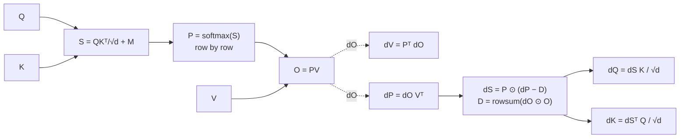
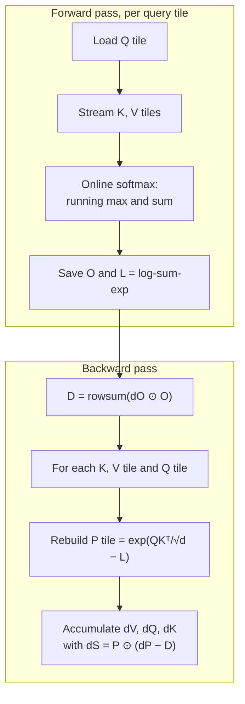

# Attention gradients, derived by hand

Every framework will differentiate attention for you, so why do it by hand? Because the derivation explains three things that otherwise look like folklore. It shows why queries and keys are scaled by $1/\sqrt{d}$ and why attention can stop learning when its softmax becomes too confident. It shows where the memory of a training run actually goes, and it contains one small identity that let FlashAttention run the backward pass without ever storing the $n \times n$ attention matrix. The whole derivation fits on one page and checks out against finite differences to nine digits.

> The core idea in one sentence: **the backward pass of attention is five matrix products and one row-wise correction, $dS = P \odot (dP - D)$, where the correction $D$ can be computed from the output alone, so the attention matrix can be thrown away after the forward pass and rebuilt on the fly.**

This page deepens the attention section of [Transformers](transformers.md) and leans on [backpropagation](neural-networks-and-backprop.md#backpropagation). It is the derivation behind the kernels discussed in [compilers for ML](../04-systems/ml-compilers.md) and [inference and efficiency](../04-systems/inference-and-efficiency.md).



## 1. Setup and notation (established)

Take one attention head with $n$ positions and head dimension $d$. Queries, keys and values are $Q, K, V \in \mathbb{R}^{n \times d}$. The forward pass of scaled dot-product attention (Vaswani et al. 2017), which grew out of the additive attention of Bahdanau, Cho and Bengio (2014), is

```math
S = \frac{QK^\top}{\sqrt{d}} + M, \qquad P_{ij} = \frac{\exp(S_{ij})}{\sum_{k} \exp(S_{ik})}, \qquad O = PV,
```

where $M$ is the mask ($0$ where a query may look, $-\infty$ where it may not; in a causal decoder, every position after the query). Training supplies the **upstream gradient** $dO = \partial \mathcal{L}/\partial O \in \mathbb{R}^{n \times d}$, and the job is to return $dQ$, $dK$ and $dV$. Throughout, $dX$ means $\partial \mathcal{L}/\partial X$, a matrix the same shape as $X$, which is the convention of reverse-mode automatic differentiation (Baydin et al. 2018; Griewank and Walther 2008).

## 2. The easy half: values and probabilities (established)

$O = PV$ is a plain matrix product, and for $C = AB$ the reverse-mode rules are $dA = dC\,B^\top$ and $dB = A^\top dC$. So

```math
dV = P^\top dO, \qquad dP = dO\,V^\top .
```

Read $dV$ row by row: value $j$ receives the upstream gradients of every query, weighted by how much each query attended to it. A key that nobody attends to gets no gradient through its value, which is one way attention patterns become self-reinforcing.

## 3. The softmax Jacobian (established)

The softmax acts on each row separately. For one row $p = \operatorname{softmax}(s)$, differentiating the quotient gives

```math
\frac{\partial p_j}{\partial s_k} = p_j(\delta_{jk} - p_k), \qquad J = \operatorname{diag}(p) - p\,p^\top .
```

$J$ is symmetric, so the vector-Jacobian product needs no transpose:

```math
ds = J\,dp = p \odot \big(dp - (p^\top dp)\,\mathbf{1}\big).
```

In words: each score's gradient is its probability times *how much its own upstream gradient exceeds the probability-weighted average*. Stacking rows,

```math
dS = P \odot (dP - D\,\mathbf{1}^\top), \qquad D_i = \sum_j P_{ij}\, dP_{ij}.
```

Three properties of $J$ matter later, and each takes one line to check.

- **It never pushes all scores up together.** $J\mathbf{1} = p - p(p^\top \mathbf{1}) = 0$: adding a constant to a row of scores changes nothing, so the gradient of every row of $dS$ sums to zero. This is also why subtracting the row maximum before exponentiating is free.
- **It is bounded.** For a unit vector $x$, $x^\top J x = \sum_j p_j x_j^2 - (\sum_j p_j x_j)^2$, the variance of the entries of $x$ under the distribution $p$. A variance is at most the squared half-range, $\big((x_{\max} - x_{\min})/2\big)^2 \le (x_{\max}^2 + x_{\min}^2)/2 \le 1/2$, so the largest eigenvalue of $J$ is at most $1/2$, reached when $p$ splits evenly between two entries. Gao and Pavel (2017) collect this and related properties of the softmax, including that it is Lipschitz.
- **It vanishes at both extremes.** If $p$ is one-hot, the variance of anything under $p$ is zero, so $J = 0$. If $p$ is uniform over $n$ entries, the largest eigenvalue is $1/n$. Gradients flow best through a softmax that is undecided between a few options.

## 4. Back to queries and keys (established)

$S = QK^\top/\sqrt{d}$ is again a matrix product, so

```math
dQ = \frac{1}{\sqrt{d}}\, dS\, K, \qquad dK = \frac{1}{\sqrt{d}}\, dS^\top Q .
```

Masked entries have $P_{ij} = 0$, so $dS_{ij} = 0$ there and no gradient leaks across the mask; nothing special has to be done for causal attention. The full backward pass is five matrix products ($dV$, $dP$, $dQ$, $dK$, and recomputing $S$ if it was not stored) plus the elementwise correction, against two products ($QK^\top$ and $PV$) in the forward pass. Counting each $n \times n \times d$ product as $2n^2 d$ floating-point operations, that is about $10n^2d$ backward against $4n^2d$ forward, a ratio of 2.5. That count is simple arithmetic, and it is one reason the attention backward kernel is harder to make fast than the forward kernel (Dao 2023).

## 5. The identity that made FlashAttention possible (established)

The correction term looks as if it needs the whole matrix $P$: $D_i = \sum_j P_{ij}\,dP_{ij}$. But $dP_{ij} = dO_i \cdot V_j$, so

```math
D_i = \sum_j P_{ij}\,(dO_i \cdot V_j) = dO_i \cdot \Big(\sum_j P_{ij} V_j\Big) = dO_i \cdot O_i .
```

$D$ is the row-wise dot product of the upstream gradient with the output, an $O(nd)$ computation that needs nothing of size $n \times n$.

That identity is half of the trick. The other half is that $P$ can be **rebuilt exactly** from two things already at hand. The forward pass computes softmax row by row with a running maximum and normalizer (the online softmax of Milakov and Gimelshein 2018), and it can save the per-row log-sum-exp $L_i = \log \sum_j \exp(S_{ij})$, one number per query. In the backward pass, any tile of $P$ is then $\exp(S_{\text{tile}} - L)$, recomputed from a tile of $Q$ and a tile of $K$. FlashAttention (Dao et al. 2022) is built on exactly this: tile the computation so tiles stay in fast on-chip memory, store only $O$ and the softmax statistics, and recompute attention in the backward pass instead of reading a stored $n \times n$ matrix back from slow memory. Recomputing costs extra arithmetic but saves memory traffic, which is the scarcer resource on modern accelerators. FlashAttention-2 (Dao 2023) reorganized the parallelism and work partitioning of both passes, and FlashAttention-3 (Shah et al. 2024) added asynchrony and low-precision support for newer GPUs. The same recompute-instead-of-store idea is gradient checkpointing (Chen et al. 2016) applied inside one operator, and Rabe and Staats (2021) showed independently that attention needs only $O(\sqrt{n})$ memory in practice by chunking and checkpointing.



## 6. Tested sketch: check every formula (established)

The script below implements the forward pass, the naive backward pass from sections 2 to 4, and a tiled backward pass that stores no $n \times n$ matrix, then checks them against central finite differences. It needs only NumPy.

```python
import numpy as np

def forward(Q, K, V, causal=True):
    n, d = Q.shape
    S = Q @ K.T / np.sqrt(d)
    if causal:
        S = np.where(np.tril(np.ones((n, n), bool)), S, -np.inf)
    m = S.max(axis=1, keepdims=True)
    L = m + np.log(np.exp(S - m).sum(axis=1, keepdims=True))  # log-sum-exp per row
    P = np.exp(S - L)
    return P @ V, P, L

def backward(Q, K, V, P, dO):
    d = Q.shape[1]
    dV = P.T @ dO
    dP = dO @ V.T
    D = (dP * P).sum(axis=1, keepdims=True)
    dS = P * (dP - D)
    return dS @ K / np.sqrt(d), dS.T @ Q / np.sqrt(d), dV

def flash_backward(Q, K, V, O, L, dO, B=16, causal=True):
    """Rebuild P tile by tile from Q, K and the saved log-sum-exp L."""
    n, d = Q.shape
    D = (dO * O).sum(axis=1, keepdims=True)      # = rowsum(dP * P), O(n d) work
    dQ, dK, dV = np.zeros_like(Q), np.zeros_like(K), np.zeros_like(V)
    for j in range(0, n, B):                      # key/value tile
        Kj, Vj = K[j:j+B], V[j:j+B]
        for i in range(0, n, B):                  # query tile
            S = Q[i:i+B] @ Kj.T / np.sqrt(d)
            if causal:
                qi = np.arange(i, min(i+B, n))[:, None]
                kj = np.arange(j, min(j+B, n))[None, :]
                S = np.where(kj <= qi, S, -np.inf)
            P = np.exp(S - L[i:i+B])
            dV[j:j+B] += P.T @ dO[i:i+B]
            dS = P * (dO[i:i+B] @ Vj.T - D[i:i+B])
            dQ[i:i+B] += dS @ Kj / np.sqrt(d)
            dK[j:j+B] += dS.T @ Q[i:i+B] / np.sqrt(d)
    return dQ, dK, dV

rng = np.random.default_rng(0)
n, d = 64, 16
Q, K, V, dO = (rng.standard_normal((n, d)) for _ in range(4))
O, P, L = forward(Q, K, V)
dQ, dK, dV = backward(Q, K, V, P, dO)
# finite-difference check of loss = sum(O * dO), the D identity, and the tiled pass
```

Run on a causal head with $n = 64$ and $d = 16$, the results were:

| Check | Result |
|---|---|
| $dQ$ against central finite differences (step $10^{-6}$), max relative error | $1.2 \times 10^{-9}$ |
| $dK$, same check | $4.3 \times 10^{-9}$ |
| $dV$, same check | $7.8 \times 10^{-10}$ |
| $\max_i \lvert \sum_j P_{ij} dP_{ij} - dO_i \cdot O_i \rvert$ | $1.8 \times 10^{-15}$ (round-off) |
| Tiled backward (tiles of 16) against naive backward, max difference | $1.8 \times 10^{-15}$ (round-off) |
| Numbers saved for the backward pass | 4,096 for $P$ against 64 for $L$ |
| Largest eigenvalue of $J$ over 20,000 random distributions $p$ | 0.5000, as the bound in section 3 predicts |

The finite-difference errors are at the level expected from a step of $10^{-6}$ in double precision, so the formulas are exact rather than approximately right. The memory row is the point of section 5: at $n = 64$ the saving is 64-fold, and it grows linearly with sequence length.

## 7. Why $1/\sqrt{d}$, and how attention stops learning (established, with active research)

If the entries of $q$ and $k$ are independent with mean zero and variance one, then $q \cdot k$ has variance $d$. Without the scale, scores grow like $\sqrt{d}$, rows of $P$ approach one-hot, and by section 3 the Jacobian $J$ approaches zero, so almost no gradient reaches $Q$ and $K$. Vaswani et al. (2017) give exactly this reason for the $1/\sqrt{d}$ factor, stated as a suspicion: for large $d$ the dot products grow large and push the softmax into regions with extremely small gradients. The same sketch shows the effect directly. For one row of 64 scores drawn with standard deviation 1, 4 and 16, the largest probability was 0.061, 0.412 and 0.999, and the largest eigenvalue of $J$ was $6.1 \times 10^{-2}$, $2.8 \times 10^{-1}$ and $1.1 \times 10^{-3}$. Gradient flow peaked when the softmax was undecided between a few keys and nearly vanished once it committed to one.

The scale is set at initialization, but training can undo it, because nothing stops $\lVert q \rVert$ and $\lVert k \rVert$ from growing. Large-scale training has run into exactly this.

- **Attention logit growth.** Dehghani et al. (2023) found that training an 8B-parameter vision transformer diverged because attention logits grew without bound, producing almost one-hot attention, and fixed it by applying LayerNorm to queries and keys (**QK-norm**) before the dot product; that change was part of scaling ViT to 22B parameters. Wortsman et al. (2023) reproduced the same instability in small models trained at high learning rates and showed that QK-norm mitigates it there too, which makes the failure cheap to study.
- **Entropy collapse.** Zhai et al. (2023) tracked the entropy of attention rows and found that pathologically low entropy accompanies unstable training. They proved a tight lower bound on attention entropy that decreases exponentially with the spectral norm of the attention logits, and proposed σReparam, which reparameterizes linear layers with spectral normalization and a learned scalar.
- **No global Lipschitz bound.** Kim, Papamakarios and Mnih (2021) proved that standard dot-product self-attention is *not* Lipschitz on an unbounded input domain, because the scores are quadratic in the input, and proposed an L2-distance variant that is. Bounded sensitivity matters for stability and for invertible models; QK-norm can be read as a practical way of keeping inputs in a bounded region.

The [normalization and μP](normalization-initialization-mup.md) page covers QK-norm and small-scale proxies from the initialization side; this section is the gradient-side reason they work.

## 8. Variations, and what changes in the backward pass (established)

| Variant | Forward change | Backward consequence |
|---|---|---|
| Causal mask | $M_{ij} = -\infty$ for $j > i$ | $dS$ is zero above the diagonal; tiled kernels skip those tiles entirely, roughly halving the work |
| Additive bias (ALiBi, relative position) | $S \leftarrow S + B$ | $dB = dS$ (summed over any broadcast dimensions); the bias is learned through the same correction term |
| Sparsemax (Martins and Astudillo 2016) | Euclidean projection onto the simplex instead of softmax | Jacobian is nonzero only on the support, so entries at exactly zero pass no gradient; outputs can be truly sparse |
| Linear attention (Katharopoulos et al. 2020) | $\phi(Q)\big(\phi(K)^\top V\big)$, no softmax | No $n \times n$ matrix in either pass; gradients flow through a $d \times d$ state, the [fast-weight](../06-frontiers/fast-weight-programmers.md) view |
| Multi-head and grouped-query | Many heads, possibly shared $K, V$ | Each head is independent; shared $K, V$ sum their gradients over the heads that use them |

## 9. Status at a glance

| Claim | Status |
|---|---|
| The backward pass is $dV = P^\top dO$, $dS = P \odot (dP - D)$, $dQ = dS\,K/\sqrt{d}$, $dK = dS^\top Q/\sqrt{d}$ | Exact; checked here against finite differences |
| $D_i = dO_i \cdot O_i$, so the backward pass needs only $O$ and the per-row log-sum-exp | Exact; the basis of FlashAttention's backward pass |
| The softmax Jacobian has eigenvalues in $[0, 1/2]$ and vanishes for one-hot rows | Exact; proved in section 3 |
| Growing attention logits cause training divergence at scale | Strong evidence (ViT-22B, small-scale reproductions); QK-norm is a widely used fix |
| Low attention entropy causes instability, rather than accompanying it | Debated; Zhai et al. give a theoretical link and interventions, but causality in large runs is hard to isolate |

## 10. Speculative: gradients when the forward pass is physical

> **Speculative.** The ideas in this section are hypotheses for discussion, not established results.

Section 5 rests on an assumption so ordinary it is easy to miss: recomputing $S = QK^\top/\sqrt{d}$ in the backward pass gives the *same* numbers as in the forward pass. On digital hardware that is true bit for bit, given a fixed order of operations. If the products $QK^\top$ were computed by analog or optical hardware, as discussed on the [photonic computing](../06-frontiers/photonic-computing.md) and [optical energy](../06-frontiers/optical-energy-and-nonlinearity.md) pages, each evaluation would carry fresh noise, and a rebuilt tile of $P$ would differ slightly from the one that produced $O$. Three questions follow, each of which can be tested in simulation.

1. **How much inconsistency can the correction absorb?** The rows of $dS$ sum to zero only if $D$ and $P$ come from the same distribution. A mismatch adds a bias to every score's gradient in proportion to $P$. Measuring how training degrades as recompute noise grows, against storing $P$ in a digital buffer, would give a concrete rule for when an analog accelerator should recompute and when it should store.
2. **Is the softmax the right place to switch back to digital?** The Jacobian bound in section 3 says the softmax shrinks perturbations of the scores by at least a factor of two in the worst direction, and far more when rows are confident. That suggests the scores can tolerate more analog noise than the values, which feed $O$ and $dV$ directly. Whether that holds for real models is an empirical question.
3. **Does noise act like a temperature?** Additive noise on the scores flattens the expected softmax in a way that resembles a temperature change. If so, the logit-growth instabilities of section 7 might be partly self-limiting on noisy hardware, or QK-norm might need retuning there. This is a guess, and it could easily go the other way.

## Further reading

- Bahdanau, D., Cho, K., Bengio, Y. (2014). *Neural machine translation by jointly learning to align and translate*. ICLR 2015. [arXiv:1409.0473](https://arxiv.org/abs/1409.0473)
- Vaswani, A., Shazeer, N., Parmar, N., Uszkoreit, J., Jones, L., Gomez, A. N., et al. (2017). *Attention is all you need*. NeurIPS. [arXiv:1706.03762](https://arxiv.org/abs/1706.03762)
- Griewank, A., Walther, A. (2008). *Evaluating derivatives: Principles and techniques of algorithmic differentiation* (2nd ed.). SIAM. [doi:10.1137/1.9780898717761](https://doi.org/10.1137/1.9780898717761)
- Baydin, A. G., Pearlmutter, B. A., Radul, A. A., Siskind, J. M. (2018). *Automatic differentiation in machine learning: a survey*. JMLR 18(153). [arXiv:1502.05767](https://arxiv.org/abs/1502.05767)
- Gao, B., Pavel, L. (2017). *On the properties of the softmax function with application in game theory and reinforcement learning*. [arXiv:1704.00805](https://arxiv.org/abs/1704.00805)
- Martins, A. F. T., Astudillo, R. F. (2016). *From softmax to sparsemax: A sparse model of attention and multi-label classification*. ICML. [arXiv:1602.02068](https://arxiv.org/abs/1602.02068)
- Chen, T., Xu, B., Zhang, C., Guestrin, C. (2016). *Training deep nets with sublinear memory cost*. [arXiv:1604.06174](https://arxiv.org/abs/1604.06174)
- Milakov, M., Gimelshein, N. (2018). *Online normalizer calculation for softmax*. [arXiv:1805.02867](https://arxiv.org/abs/1805.02867)
- Katharopoulos, A., Vyas, A., Pappas, N., Fleuret, F. (2020). *Transformers are RNNs: Fast autoregressive transformers with linear attention*. ICML. [arXiv:2006.16236](https://arxiv.org/abs/2006.16236)
- Kim, H., Papamakarios, G., Mnih, A. (2021). *The Lipschitz constant of self-attention*. ICML. [arXiv:2006.04710](https://arxiv.org/abs/2006.04710)
- Rabe, M. N., Staats, C. (2021). *Self-attention does not need $O(n^2)$ memory*. [arXiv:2112.05682](https://arxiv.org/abs/2112.05682)
- Dao, T., Fu, D. Y., Ermon, S., Rudra, A., Ré, C. (2022). *FlashAttention: Fast and memory-efficient exact attention with IO-awareness*. NeurIPS. [arXiv:2205.14135](https://arxiv.org/abs/2205.14135)
- Dao, T. (2023). *FlashAttention-2: Faster attention with better parallelism and work partitioning*. ICLR 2024. [arXiv:2307.08691](https://arxiv.org/abs/2307.08691)
- Shah, J., Bikshandi, G., Zhang, Y., Thakkar, V., Ramani, P., Dao, T. (2024). *FlashAttention-3: Fast and accurate attention with asynchrony and low-precision*. NeurIPS. [arXiv:2407.08608](https://arxiv.org/abs/2407.08608)
- Dehghani, M., Djolonga, J., Mustafa, B., Padlewski, P., Heek, J., Gilmer, J., et al. (2023). *Scaling vision transformers to 22 billion parameters*. ICML. [arXiv:2302.05442](https://arxiv.org/abs/2302.05442)
- Zhai, S., Likhomanenko, T., Littwin, E., Busbridge, D., Ramapuram, J., Zhang, Y., et al. (2023). *Stabilizing transformer training by preventing attention entropy collapse*. ICML. [arXiv:2303.06296](https://arxiv.org/abs/2303.06296)
- Wortsman, M., Liu, P. J., Xiao, L., Everett, K., Alemi, A., Adlam, B., et al. (2023). *Small-scale proxies for large-scale transformer training instabilities*. ICLR 2024. [arXiv:2309.14322](https://arxiv.org/abs/2309.14322)
