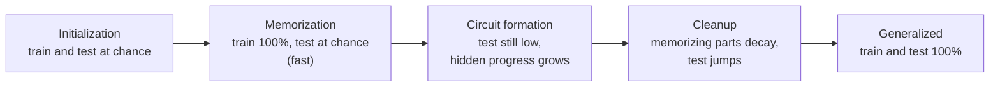

# Grokking: when generalization arrives long after memorization

In early 2022 a team at OpenAI reported training small transformers on tables of modular arithmetic and seeing something no learning curve was supposed to do. Training accuracy hit 100% early, test accuracy sat near chance, and then, thousands of steps later and with no change to the setup, test accuracy climbed to 100% too. They called it **grokking** (Power et al. 2022), borrowing Robert Heinlein's word for understanding something so completely that it becomes part of you.

Grokking looked like a paradox. Classical advice says to stop training when validation loss stops improving; here the useful learning happened long after that point. Four years of work have turned the paradox into a mechanism, or rather into several compatible ones. The network is not idle during the plateau: a generalizing circuit grows quietly underneath a memorizing one, and weight decay, the optimizer and even floating-point arithmetic decide when it takes over.

> The core idea in one sentence: **a network can fit its training data in two ways, by memorizing it or by finding the rule behind it; the rule is slower to find but cheaper to keep, so if training continues and something penalizes waste, the rule eventually wins, and grokking is the moment it does.**

This page connects to [learning theory](../00-foundations/learning-theory.md#grokking) (the short version and double descent), [optimization](../00-foundations/optimization.md) (AdamW and the neural tangent kernel), [normalization, initialization and μP](normalization-initialization-mup.md) (the kernel versus feature-learning regimes), [interpretability](../05-alignment-safety-interpretability/interpretability.md) (reverse-engineering circuits), [scaling laws](scaling-laws.md) (emergence and smooth progress), [heavy-tailed weight spectra](../06-frontiers/heavy-tailed-weight-spectra.md) and [non-linearity and dynamical systems](../06-frontiers/nonlinearity-and-dynamical-systems.md) (phase transitions in training).

## 1. The phenomenon (established)

Power et al. (2022) built datasets from binary operations on small finite sets, such as $a + b \bmod p$, $a \cdot b^{-1} \bmod p$ and composition in the permutation group $S_5$. Each dataset is a complete table of $p^2$ equations; a random fraction trains the model and the rest tests it. Three findings defined the field:

1. **Generalization well past overfitting.** On some tasks, test accuracy rose from chance to perfect long after training accuracy had saturated.
2. **Less data, more optimization.** As the training fraction shrinks, the number of steps needed to generalize grows quickly, and below some fraction it does not happen within the budget.
3. **Weight decay matters most.** Among the interventions they compared (minibatch noise, dropout, gradient noise, learning rate), weight decay had the largest effect on data efficiency.



The diagram uses the three phases that Nanda et al. (2023) measured inside a grokking transformer (Section 3). The "sudden" jump is the last phase, not the whole story.

## 2. The puzzle in one equation (established)

Write the training loss of parameters $\theta$ with decoupled weight decay $\lambda$ as an objective the optimizer effectively minimizes:

```math
J(\theta) = \underbrace{\frac{1}{n}\sum_{i=1}^{n} \ell\big(f_\theta(x_i), y_i\big)}_{\text{data fit}} + \frac{\lambda}{2}\,\|\theta\|^2 .
```

Suppose two families of parameters both drive the data-fit term to nearly zero: a **memorizing** solution $\theta_{\text{mem}}$ that stores each training pair separately, and a **generalizing** solution $\theta_{\text{gen}}$ that implements the rule. Two facts produce grokking:

- **Speed.** Gradient descent reaches $\theta_{\text{mem}}$ first. Memorization needs no coordination among parameters; every training example can be fitted locally.
- **Efficiency.** For a given data-fit level, the generalizing solution usually needs a smaller norm. A rule is one circuit reused by every example; a lookup table needs capacity for each entry, so its cost grows with the training set while the rule's does not.

Once the data-fit term is saturated, the only remaining pressure is the penalty $\tfrac{\lambda}{2}\|\theta\|^2$, and it favours $\theta_{\text{gen}}$. With small $\lambda$ that pressure is weak, so the switch takes a long time. Varma et al. (2023) made this argument precise as **circuit efficiency**: the generalizing circuit produces larger logits per unit of parameter norm. They predicted, and confirmed, a **critical dataset size** at which memorizing and generalizing are equally efficient, and two new behaviours on either side of it: **ungrokking**, where a network that had generalized regresses to low test accuracy when further trained on a smaller dataset, and **semi-grokking**, delayed generalization to partial rather than perfect accuracy near the critical size.

Liu et al. (2022b) reached a related picture from the loss landscape. Plotted against weight norm, training loss looks like an "L" (low for every norm above some value) while test loss looks like a "U" (low only in a band). Networks initialized at large norm memorize, then drift slowly down the flat floor of the "L" towards the bottom of the "U". They called this the **LU mechanism**, used it to induce grokking on images, language and molecules by enlarging the initialization, and, in the reverse direction, removed grokking from algorithmic datasets by constraining the norm.

## 3. Looking inside: the Fourier algorithm and progress measures (established)

The cleanest explanation comes from interpretability. Nanda et al. (2023) trained a one-layer transformer on $a + b \bmod 113$ with 30% of the $113^2$ pairs, AdamW with weight decay $\lambda = 1$, for 40,000 epochs, and reverse-engineered what it learned. The network embeds each number $a$ as points on several circles, $\big(\cos(\omega_k a), \sin(\omega_k a)\big)$ with $\omega_k = 2\pi k/113$ for a handful of **key frequencies** (five in their mainline run), and uses trigonometric identities to compose the two inputs:

```math
\cos\big(\omega_k(a+b-c)\big) = \cos(\omega_k(a+b))\cos(\omega_k c) + \sin(\omega_k(a+b))\sin(\omega_k c),
```

which is largest when $c = (a + b) \bmod p$. Addition becomes rotation around a circle. Approximating the output logits with just the five directions the interpretation predicts explains 95% of their variance.

Knowing the algorithm let them define **progress measures**, quantities computable from the weights that change continuously while accuracy looks flat. "Restricted loss" keeps only the key frequencies; "excluded loss" removes them. Excluded loss *rises* during the plateau while train and test loss stay flat, which shows the network is shifting work from the memorizing components to the Fourier circuit. Their three phases are **memorization**, **circuit formation** and **cleanup**, in which weight decay removes the memorizing components. The sudden test-accuracy jump happens during cleanup, after the generalizing circuit is already in place.

The algorithm is not unique. Zhong et al. (2023) showed that small changes in hyperparameters and initialization lead networks on the same task to a "Clock" algorithm like Nanda et al.'s, to a different but comprehensible "Pizza" algorithm, or to mixtures of several. Gromov (2023) wrote down analytic weights for two-layer MLPs that solve a large class of modular arithmetic tasks, showed that gradient descent finds feature maps of the same form, and found grokking with the mean-squared-error loss and no regularization at all. Mechanistic accounts explain *a* grokking network, not every one.

## 4. Hidden progress beyond modular arithmetic (established)

Barak et al. (2022) studied learning a $k$-sparse parity of $n$ bits, a problem that is statistically easy but computationally hard. Many architectures learned it with abrupt jumps in their training curves after roughly $n^{O(k)}$ iterations, close to the statistical-query lower bound. Their analysis showed the jump is not luck: SGD steadily amplifies the right features through a **Fourier gap** in the population gradient, making continual progress "invisible to loss and error metrics." Merrill et al. (2023) then looked inside networks that grok sparse parity and found two competing subnetworks: a dense one that dominates before the transition and generalizes poorly, and a sparse one, driven by rapid norm growth in a few neurons, that dominates after.

The lesson shared by Sections 3 and 4 is that **abrupt changes in accuracy can sit on top of smooth changes in the weights**. Discontinuity is often a property of the metric, a point that also runs through debates about emergent abilities in large models (see [scaling laws](scaling-laws.md)). Davies et al. (2023) go further and propose that grokking and [double descent](../00-foundations/learning-theory.md#double-descent) are the same dynamics, driven by patterns that are learned at different speeds, and demonstrate grokking as a function of model size rather than training time.

## 5. Why the delay? Five mechanisms (established and active research)

The explanations below are not rivals so much as views of one process at different levels.

| Mechanism | One-line account | Key evidence |
|---|---|---|
| **Circuit efficiency** | Generalizing circuits give more logit per unit norm; weight decay selects them once data fit saturates | Varma et al. 2023 (ungrokking, semi-grokking); Wang et al. 2024 |
| **Norm and landscape (LU)** | Large-norm memorizing solutions drift under weight decay into the low-test-loss norm band | Liu et al. 2022b; Khanh et al. 2026a, 2026b |
| **Lazy to rich** | The network first fits a kernel regression with its initial features, then learns new features | Kumar et al. 2023; Lyu et al. 2024 |
| **Representation phases** | Structured representations form only in a "Goldilocks zone" of hyperparameters between memorization and confusion | Liu et al. 2022a |
| **Numerical limits** | Without regularization, logits grow until floating-point softmax returns zero gradient, stopping learning before generalization | Prieto et al. 2025 |

**Lazy to rich.** In the *lazy* (kernel) regime a wide network behaves like a linear model in its initial features, the neural tangent kernel (Jacot et al. 2018). Kumar et al. (2023) showed that a two-layer network doing polynomial regression with plain gradient descent groks without any regularization: it first fits a kernel solution with its initial features, which interpolates the training data but generalizes poorly, and then, late in training, learns features that generalize. Grokking appears when the top eigenvectors of the initial kernel are misaligned with the target, the dataset is large enough to make generalization possible but small enough that train loss does not track test loss, and training starts lazy. Lyu et al. (2024) proved a version of this for homogeneous networks with large initialization and small weight decay: training stays trapped near a kernel predictor for a long time, then makes a sharp transition to a min-norm or max-margin predictor.

**Representation phases.** Liu et al. (2022a) built an effective theory of how input embeddings organize into structured shapes (for modular addition, a ring) and mapped phase diagrams over hyperparameters with four regions: comprehension (fast generalization), grokking, memorization and confusion. Representation learning happens only in a "Goldilocks zone" covering comprehension and grokking; on transformers the grokking region sits closer to memorization, which is why generalization is delayed.

**Numerical limits.** Prieto et al. (2025) asked why grokking usually needs regularization. Once a model fits its training set, the steepest way to lower cross-entropy is to scale up the logits without changing any prediction, which they call the **naïve loss minimization** (NLM) direction. The logits grow until $\mathrm{softmax}$ reaches the limits of floating point: when the correct class's probability rounds to exactly 1, its gradient $p_y - 1$ becomes exactly 0. They call this **Softmax Collapse** (SC). In float32, adding anything smaller than $2^{-23}$ to 1 leaves 1 unchanged. SC arrived earlier in float32 than in float64, earlier for smaller datasets, and in the common setups before any test progress. Two fixes enabled grokking without regularization: **StableMax**, a softmax replacement that grows linearly rather than exponentially for positive inputs, and **⊥Grad**, an optimizer step that removes the NLM component of the gradient and produced quick generalization.

**The optimizer.** Thilak et al. (2022) found that adaptive optimizers at very late training show cyclic jumps in last-layer weight norm, the **Slingshot mechanism**, and that without explicit regularization grokking almost always coincided with the onset of slingshots. Tveit et al. (2025) compared Muon with AdamW across seven numerical tasks and three softmax variants and reported a mean grokking epoch of 102.89 against 153.09.

**Delay laws (2026, active research).** Two papers by the same group make the norm account quantitative. Khanh et al. (2026a) derive a **norm-separation delay law**,

```math
T_{\text{grok}} - T_{\text{mem}} = \Theta\!\left(\gamma_{\text{eff}}^{-1}\,\log\frac{\|\theta_{\text{mem}}\|^2}{\|\theta_{\text{post}}\|^2}\right), \qquad \gamma_{\text{eff}} = \eta\lambda \text{ for SGD},
```

so the delay scales inversely with learning rate times weight decay and logarithmically with how much the norm must shrink. Across 293 runs on modular addition, modular multiplication and sparse parity they report fits of $R^2 = 0.97$ for weight-decay scaling and $0.92$ for learning-rate scaling, and Pearson $r = 0.91$ for the norm ratio; SGD failed to grok at hyperparameters where AdamW reliably did. A follow-up (Khanh et al. 2026b) clamped the weight norm at a fixed multiple $\rho$ of the critical value and found that networks grok at whatever norm they are held, with the time growing roughly as $e^{\alpha\rho}$, about $\alpha \approx 7.5$ across moduli for an MLP and about 15 for an attention model. Kataria (2026) fitted an empirical power law over 384 MLP configurations, $T_{\text{grok}} \propto H^{-0.27} D^{-2.04} \eta^{-0.50} \lambda^{-0.64}$ ($R^2 = 0.732$), in which data matters far more than width. These are recent single-group preprints; treat the exponents as provisional.

**Is there a single root cause? (active research).** Tian et al. (2026) argue that grokking requires the low-loss regions of the training and validation partitions to be *misaligned*. Under a symmetry-preserving train/validation split of modular arithmetic, they observed stable **anti-grokking**, in which validation performance never recovers, which they present as a counterexample to several correlational explanations. Mehendale and Chopra (2026) tested whether a fall in the effective rank of weight matrices drives grokking. In their transformers the steepest rank compression came about 900 steps *after* the onset of generalization, and imposing low rank delayed or prevented grokking (capping the embedding's rank stopped 15 of 20 runs from grokking). Compression, they conclude, is a signature of grokking rather than its cause.

## 6. Grokking outside toy tasks (active research)

Three lines of work suggest grokking is not confined to modular arithmetic.

- **Vision networks.** Humayun et al. (2024) report delayed generalization in a CNN on CIFAR-10 and a ResNet on Imagenette, and introduce **delayed robustness**: networks become robust to adversarial examples long after they interpolate or generalize. Their progress measure is the local density of the linear regions that a ReLU network carves its input space into; after a phase transition these regions migrate away from training points and towards the decision boundary.
- **Implicit reasoning.** Wang et al. (2024) trained transformers on synthetic knowledge and found they learned composition and comparison over facts stored in their weights only through grokking. Out of distribution, the grokked models generalized systematically for comparison but not for composition, which the authors trace to how the generalizing circuit is laid out across layers. On a hard comparison task with a large search space, a fully grokked small transformer reached near-perfect accuracy where GPT-4-Turbo and Gemini-1.5-Pro with retrieval failed badly.
- **LLM pretraining.** Li et al. (2026) studied one-epoch pretraining of mixture-of-experts language models and report *local* grokking: different groups of training data enter their memorization-to-generalization transition at different times. The routing pathways of training examples evolve from random and example-specific to structured and shared across examples even after pretraining loss has converged, and two zero-cost pathway metrics track downstream performance without running benchmarks.

These results stretch the word. In LLM pretraining no example is seen thousands of times; "grokking" there means a lag between fitting data and generalizing from it, measured by internal structure.

## 7. Making it faster (active research)

If the delay is the slow part of a useful process, it can be shortened.

- **Weight decay and norm control.** The simplest knob (Power et al. 2022; Liu et al. 2022b); constraining the norm can remove the delay on algorithmic data.
- **Amplifying slow gradients.** Lee et al. (2024) treat each parameter's gradient sequence as a signal and split it into a fast component that drives overfitting and a slow one that drives generalization. Adding a low-pass filtered (exponential moving average) copy of the gradient back into the update accelerated grokking by more than 50× in their experiments, in a few lines of code (**Grokfast**).
- **Removing the NLM direction.** ⊥Grad and StableMax address the numerical stall directly (Prieto et al. 2025).
- **Optimizer choice.** Muon's spectral-norm geometry shortened the mean time to grok in one study (Tveit et al. 2025).

Gains are reported mostly on the small tasks where grokking was found. Whether they transfer to large-scale training, where there is no long plateau to compress, is open.

## 8. A tested sketch

The code reproduces grokking from scratch in NumPy and isolates the knobs from Sections 2 and 5. All data is synthetic; the point is the mechanisms, not the numbers.

- **Parts 1–3** train a two-layer network on $(a + b) \bmod 31$: each input number has a learned 128-dimensional embedding, the two embeddings are summed and squared element-wise (a quadratic activation, as in Gromov 2023), and a linear layer gives 31 logits. Full-batch AdamW, learning rate $2 \times 10^{-3}$, cross-entropy, 20,000 steps. As a progress measure, each hidden neuron's input weights are Fourier-transformed over the 31 input values, and the measure is the average share of power in each neuron's single strongest frequency ($1/15$ if a neuron's power were spread evenly over the 15 non-zero frequencies, 1 if it used a single frequency; 0.219 at this random initialization). Part 1 uses 30% of the 961 pairs with weight decay 1.0 for three seeds; Part 2 varies weight decay; Part 3 varies the training fraction.
- **Part 4** takes 1,618 correctly classified examples with random logits over 31 classes, multiplies all logits by a scale factor (which leaves every prediction unchanged, the NLM direction) and counts how often float32 softmax cross-entropy gives an exactly zero gradient, compared with StableMax.

```python
import numpy as np

# ---------- Parts 1-3: modular addition with a two-layer quadratic MLP ----------
def split(p, frac, seed):
    rng = np.random.default_rng(seed)
    a, b = np.meshgrid(np.arange(p), np.arange(p), indexing="ij")
    a, b = a.ravel(), b.ravel()
    idx = rng.permutation(p * p); n = int(frac * p * p)
    return a, b, (a + b) % p, idx[:n], idx[n:]

def train(p=31, frac=0.3, H=128, wd=1.0, lr=2e-3, steps=20000, seed=0, log=250):
    """Full-batch AdamW on cross-entropy; logits = (E_a[a] + E_b[b])**2 @ W."""
    rng = np.random.default_rng(seed + 100)
    a, b, y, tr, te = split(p, frac, seed)
    Ea = rng.normal(0, 1 / np.sqrt(p), (p, H)); Eb = rng.normal(0, 1 / np.sqrt(p), (p, H))
    W = rng.normal(0, 1 / np.sqrt(H), (H, p))
    P = [Ea, Eb, W]; m = [np.zeros_like(x) for x in P]; v = [np.zeros_like(x) for x in P]
    b1, b2 = 0.9, 0.98
    def logits(ix):
        z = Ea[a[ix]] + Eb[b[ix]]; return z, z ** 2, (z ** 2) @ W
    hist = []
    for t in range(1, steps + 1):
        z, h, lo = logits(tr)
        pr = np.exp(lo - lo.max(1, keepdims=True)); pr /= pr.sum(1, keepdims=True)
        g = pr; g[np.arange(len(tr)), y[tr]] -= 1; g /= len(tr)
        gz = (g @ W.T) * 2 * z
        gEa = np.zeros_like(Ea); np.add.at(gEa, a[tr], gz)
        gEb = np.zeros_like(Eb); np.add.at(gEb, b[tr], gz)
        for i, G in enumerate([gEa, gEb, h.T @ g]):          # decoupled weight decay
            m[i] = b1 * m[i] + (1 - b1) * G; v[i] = b2 * v[i] + (1 - b2) * G ** 2
            P[i] -= lr * ((m[i] / (1 - b1 ** t)) / (np.sqrt(v[i] / (1 - b2 ** t)) + 1e-8) + wd * P[i])
        if t == 1 or t % log == 0:
            acc_tr = (logits(tr)[2].argmax(1) == y[tr]).mean()
            acc_te = (logits(te)[2].argmax(1) == y[te]).mean()
            norm = np.sqrt(sum((x ** 2).sum() for x in P))
            F = np.abs(np.fft.rfft(Ea, axis=0))[1:] ** 2          # per-neuron Fourier power
            conc = (F.max(0) / F.sum(0)).mean()                   # share in each neuron's top frequency
            hist.append((t, acc_tr, acc_te, norm, conc))
    return hist

def first(hist, col, thr):
    return next((r[0] for r in hist if r[col] >= thr), None)

def report(name, h):
    print(f"  {name}: train>=99% at {first(h,1,0.99)}, test>=50% at {first(h,2,0.5)}, "
          f"test>=90% at {first(h,2,0.9)}, final test {h[-1][2]:.3f}, final norm {h[-1][3]:.1f}")

print("Part 1: grokking on (a+b) mod 31, 30% of pairs for training, weight decay 1.0")
runs = {s: train(seed=s) for s in range(3)}
for s, h in runs.items(): report(f"seed {s}", h)
print("  seed 0 trajectory (step: train acc, test acc, weight norm, Fourier concentration)")
for r in runs[0]:
    if r[0] in (1, 250, 1000, 2000, 4000, 6000, 8000, 12000, 16000, 20000):
        print(f"    {r[0]:6d}: {r[1]:.3f} {r[2]:.3f} {r[3]:5.1f} {r[4]:.3f}")

print("Part 2: weight decay sweep (seed 0, 20,000 steps)")
for wd in [0.0, 0.3, 3.0]:
    report(f"wd {wd}", train(wd=wd))
print("  wd 1.0: see Part 1, seed 0")

print("Part 3: training-fraction sweep (seed 0, weight decay 1.0)")
for frac in [0.2, 0.4, 0.5]:
    report(f"frac {frac}", train(frac=frac))

# ---------- Part 4: softmax collapse in float32 ----------
print("Part 4: scaling correct logits in float32 (Softmax Collapse)")
rng = np.random.default_rng(0)
L = rng.normal(0, 1, (2000, 31)); y = rng.integers(0, 31, 2000); L[np.arange(2000), y] += 3.0
keep = L.argmax(1) == y; L, y = L[keep], y[keep]; n = len(y); r = np.arange(n)
def softmax_ce(l, dt):
    l = l.astype(dt); e = np.exp(l - l.max(1, keepdims=True)); p = e / e.sum(1, keepdims=True)
    with np.errstate(divide="ignore"): loss = -np.log(p[r, y])
    g = p.copy(); g[r, y] -= dt(1); return loss, g
def stablemax_ce(l, dt):
    l = l.astype(dt); s = np.where(l >= 0, l + dt(1), dt(1) / (dt(1) - l)); p = s / s.sum(1, keepdims=True)
    g = p.copy(); g[r, y] -= dt(1); return -np.log(p[r, y]), g
print(f"  {n} correctly classified examples, 31 classes; predictions identical at every scale")
for s in [1, 5, 10, 20, 50, 100]:
    l64, _ = softmax_ce(L * s, np.float64); l32, g32 = softmax_ce(L * s, np.float32)
    ls, gs = stablemax_ce(L * s, np.float32)
    print(f"  scale {s:3d}: float64 loss {l64.mean():.2e} | float32 softmax: correct-class grad exactly 0 "
          f"for {np.mean(g32[r, y] == 0):.3f}, whole grad 0 for {np.mean(np.abs(g32).max(1) == 0):.3f} "
          f"| StableMax loss {ls.mean():.3f}, grad 0 for {np.mean(gs[r, y] == 0):.3f}")
```

Output (NumPy 2, about three minutes on a laptop CPU):

```text
Part 1: grokking on (a+b) mod 31, 30% of pairs for training, weight decay 1.0
  seed 0: train>=99% at 250, test>=50% at 7750, test>=90% at 16000, final test 0.948, final norm 44.1
  seed 1: train>=99% at 250, test>=50% at 5750, test>=90% at 12000, final test 0.947, final norm 43.8
  seed 2: train>=99% at 250, test>=50% at 5500, test>=90% at 13500, final test 0.949, final norm 44.1
  seed 0 trajectory (step: train acc, test acc, weight norm, Fourier concentration)
         1: 0.062 0.030  16.9 0.219
       250: 1.000 0.001  38.3 0.261
      1000: 1.000 0.051  47.8 0.342
      2000: 1.000 0.073  50.0 0.396
      4000: 1.000 0.183  47.9 0.456
      6000: 1.000 0.363  47.1 0.498
      8000: 1.000 0.522  46.4 0.539
     12000: 1.000 0.804  45.2 0.592
     16000: 1.000 0.900  44.5 0.620
     20000: 1.000 0.948  44.1 0.635
Part 2: weight decay sweep (seed 0, 20,000 steps)
  wd 0.0: train>=99% at 250, test>=50% at None, test>=90% at None, final test 0.006, final norm 62.4
  wd 0.3: train>=99% at 250, test>=50% at None, test>=90% at None, final test 0.218, final norm 41.5
  wd 3.0: train>=99% at 250, test>=50% at None, test>=90% at None, final test 0.380, final norm 35.5
  wd 1.0: see Part 1, seed 0
Part 3: training-fraction sweep (seed 0, weight decay 1.0)
  frac 0.2: train>=99% at 250, test>=50% at None, test>=90% at None, final test 0.034, final norm 42.7
  frac 0.4: train>=99% at 250, test>=50% at 1500, test>=90% at 2500, final test 1.000, final norm 45.5
  frac 0.5: train>=99% at 250, test>=50% at 750, test>=90% at 1250, final test 1.000, final norm 46.9
Part 4: scaling correct logits in float32 (Softmax Collapse)
  1618 correctly classified examples, 31 classes; predictions identical at every scale
  scale   1: float64 loss 1.07e+00 | float32 softmax: correct-class grad exactly 0 for 0.000, whole grad 0 for 0.000 | StableMax loss 2.246, grad 0 for 0.000
  scale   5: float64 loss 8.17e-02 | float32 softmax: correct-class grad exactly 0 for 0.018, whole grad 0 for 0.000 | StableMax loss 1.705, grad 0 for 0.000
  scale  10: float64 loss 3.36e-02 | float32 softmax: correct-class grad exactly 0 for 0.332, whole grad 0 for 0.000 | StableMax loss 1.610, grad 0 for 0.000
  scale  20: float64 loss 1.49e-02 | float32 softmax: correct-class grad exactly 0 for 0.677, whole grad 0 for 0.000 | StableMax loss 1.564, grad 0 for 0.000
  scale  50: float64 loss 5.55e-03 | float32 softmax: correct-class grad exactly 0 for 0.870, whole grad 0 for 0.208 | StableMax loss 1.537, grad 0 for 0.000
  scale 100: float64 loss 2.66e-03 | float32 softmax: correct-class grad exactly 0 for 0.939, whole grad 0 for 0.582 | StableMax loss 1.529, grad 0 for 0.000
```

### Reading the results

**Part 1: memorize first, generalize much later.** All three seeds reach 100% training accuracy by step 250 while test accuracy is at chance (0.001 for seed 0, against 1/31 ≈ 0.032 for guessing). Test accuracy then passes 50% at steps 7,750, 5,750 and 5,500 and 90% at 16,000, 12,000 and 13,500: a delay of roughly 20 to 30 times the memorization time, with nothing in the setup changing. The weight norm shows the LU story: it rises from 16.9 to 50.0 while the network memorizes, then falls slowly under weight decay (44.1 by step 20,000) as test accuracy climbs. The hidden-progress measure moves first: the Fourier concentration rises from 0.261 at step 250 to 0.396 by step 2,000, while test accuracy is still 0.073, and keeps rising to 0.635. Neurons are reorganizing around single frequencies, the ingredient of the Fourier algorithm, well before accuracy reveals it. In this small network the transition is a long climb rather than a cliff; with larger tables and smaller weight decay it becomes sharper.

**Part 2: weight decay has a sweet spot.** Without weight decay, the network memorizes at the same step, its norm grows to 62.4, the Fourier measure stalls (it sits near 0.27 from step 4,000 on in this run) and test accuracy ends at 0.006: no grokking within 20,000 steps. With $\lambda = 0.3$ test accuracy reaches only 0.218, and with $\lambda = 3$ only 0.380, against 0.948 at $\lambda = 1$. That non-monotone dependence matches the Goldilocks picture of Liu et al. (2022a); with a single seed per setting, the exact ordering of 0.3 and 3 should not be over-read.

**Part 3: data shortens the delay sharply.** With 20% of pairs the network memorizes and never generalizes (final test 0.034). With 40% it passes 90% test accuracy at step 2,500, and with 50% at step 1,250, against 16,000 at 30%. Going from 30% to 50% of the data cut the time to 90% by more than ten times, in line with Power et al.'s observation and Kataria's (2026) finding that data size is the dominant driver of the delay.

**Part 4: the loss can keep falling while learning stops.** Scaling the logits never changes a prediction, yet float64 loss falls from 1.07 to 0.0027 as the scale grows from 1 to 100, exactly the "free" descent along the NLM direction. In float32 the correct-class gradient becomes exactly zero for 1.8% of examples at scale 5, 33.2% at scale 10, 67.7% at 20 and 93.9% at 100, and at scale 100 the entire gradient vector is zero for 58.2% of examples. Those examples stop contributing anything to learning. StableMax, whose probabilities grow only linearly in the logits, never produces a zero gradient here; its loss falls slowly (2.246 to 1.529), so scaling buys little and the pressure to scale is correspondingly weaker. This is the Softmax Collapse mechanism of Prieto et al. (2025) in miniature.

## 9. Status at a glance

| Claim | Status |
|---|---|
| Networks trained on small algorithmic datasets can generalize long after fitting the training set | Established (Power et al. 2022; many replications) |
| Grokking modular addition corresponds to a Fourier, rotation-based algorithm, built gradually before the test-accuracy jump | Established for the studied models (Nanda et al. 2023; Gromov 2023); other algorithms also occur (Zhong et al. 2023) |
| Weight decay and dataset size control the delay; a critical dataset size separates memorization from generalization | Established on algorithmic tasks (Power et al. 2022; Varma et al. 2023) |
| Grokking can be explained as a lazy-to-rich (kernel to feature learning) transition | Established in simplified settings, with proofs for homogeneous networks (Kumar et al. 2023; Lyu et al. 2024) |
| Floating-point Softmax Collapse explains why grokking usually needs regularization | Strong evidence in one line of work (Prieto et al. 2025) |
| Grokking delay follows quantitative laws in norm, learning rate and weight decay | Early evidence, recent preprints (Khanh et al. 2026a, 2026b; Kataria 2026) |
| Grokking occurs in practical settings: vision models, implicit reasoning, LLM pretraining | Active research, with broader definitions of the term (Humayun et al. 2024; Wang et al. 2024; Li et al. 2026) |
| Grokking can be accelerated by 50× or more | Shown on small tasks (Lee et al. 2024); transfer to large-scale training unknown |

## 10. Speculative: grokking as a design target

> [!WARNING]
> **Speculative.** These are open hypotheses, not established results.

- **Progress measures as training telemetry.** If generalizing structure becomes measurable in the weights before it shows up in validation metrics, as in Part 1 and in the pathway metrics of Li et al. (2026), cheap internal probes could tell practitioners when to keep training past an apparent plateau, or when a plateau is genuinely dead. The open question is whether such probes can be found without first knowing the algorithm the network will learn.
- **Precision as a hidden hyperparameter.** Softmax Collapse implies that numerical format can change *what* a network learns, not just how fast. As training moves to 8-bit and lower-precision formats (see [hardware and training](../04-systems/hardware-and-training.md)), the point at which logits saturate arrives earlier. Whether low-precision training quietly forecloses some late-phase generalization is untested at scale.
- **Physical substrates with built-in decay.** Weight decay is a continuous pull of every parameter towards zero. Analog and optical hardware (see [memristive crossbars](../06-frontiers/memristive-crossbars-in-memory-computing.md) and [photonic computing](../06-frontiers/photonic-computing.md)) often has relaxation or leakage of its own. If that physical decay could play the role of $\lambda$, a device might bias itself towards efficient, generalizing circuits for free; if it is too strong or uneven, it could equally push training into the confusion phase. The measurement that would decide it is a grokking task trained with the device's own drift in place of explicit weight decay.
- **Ungrokking as a safety concern.** Varma et al.'s ungrokking shows a model can lose a generalizing circuit when the training data shrinks or shifts. Fine-tuning large models on narrow data is routine; whether capabilities, or safety behaviours, can ungrok in the same way during fine-tuning is an open empirical question (compare [continual learning](../06-frontiers/continual-learning-and-catastrophic-forgetting.md)).

## Further reading

- Jacot, A., Gabriel, F., Hongler, C. (2018). *Neural tangent kernel: Convergence and generalization in neural networks*. NeurIPS. [arXiv:1806.07572](https://arxiv.org/abs/1806.07572)
- Power, A., Burda, Y., Edwards, H., Babuschkin, I., Misra, V. (2022). *Grokking: Generalization beyond overfitting on small algorithmic datasets*. [arXiv:2201.02177](https://arxiv.org/abs/2201.02177)
- Liu, Z., Kitouni, O., Nolte, N., Michaud, E. J., Tegmark, M., Williams, M. (2022a). *Towards understanding grokking: An effective theory of representation learning*. NeurIPS. [arXiv:2205.10343](https://arxiv.org/abs/2205.10343)
- Thilak, V., Littwin, E., Zhai, S., Saremi, O., Paiss, R., Susskind, J. (2022). *The Slingshot mechanism: An empirical study of adaptive optimizers and the grokking phenomenon*. [arXiv:2206.04817](https://arxiv.org/abs/2206.04817)
- Barak, B., Edelman, B. L., Goel, S., Kakade, S., Malach, E., Zhang, C. (2022). *Hidden progress in deep learning: SGD learns parities near the computational limit*. NeurIPS. [arXiv:2207.08799](https://arxiv.org/abs/2207.08799)
- Liu, Z., Michaud, E. J., Tegmark, M. (2022b). *Omnigrok: Grokking beyond algorithmic data*. [arXiv:2210.01117](https://arxiv.org/abs/2210.01117)
- Gromov, A. (2023). *Grokking modular arithmetic*. [arXiv:2301.02679](https://arxiv.org/abs/2301.02679)
- Nanda, N., Chan, L., Lieberum, T., Smith, J., Steinhardt, J. (2023). *Progress measures for grokking via mechanistic interpretability*. ICLR. [arXiv:2301.05217](https://arxiv.org/abs/2301.05217)
- Davies, X., Langosco, L., Krueger, D. (2023). *Unifying grokking and double descent*. NeurIPS 2022 ML Safety Workshop. [arXiv:2303.06173](https://arxiv.org/abs/2303.06173)
- Merrill, W., Tsilivis, N., Shukla, A. (2023). *A tale of two circuits: Grokking as competition of sparse and dense subnetworks*. ICLR 2023 Workshop on Understanding Foundation Models. [arXiv:2303.11873](https://arxiv.org/abs/2303.11873)
- Zhong, Z., Liu, Z., Tegmark, M., Andreas, J. (2023). *The clock and the pizza: Two stories in mechanistic explanation of neural networks*. NeurIPS. [arXiv:2306.17844](https://arxiv.org/abs/2306.17844)
- Varma, V., Shah, R., Kenton, Z., Kramár, J., Kumar, R. (2023). *Explaining grokking through circuit efficiency*. [arXiv:2309.02390](https://arxiv.org/abs/2309.02390)
- Kumar, T., Bordelon, B., Gershman, S. J., Pehlevan, C. (2023). *Grokking as the transition from lazy to rich training dynamics*. [arXiv:2310.06110](https://arxiv.org/abs/2310.06110)
- Lyu, K., Jin, J., Li, Z., Du, S. S., Lee, J. D., Hu, W. (2024). *Dichotomy of early and late phase implicit biases can provably induce grokking*. ICLR. [arXiv:2311.18817](https://arxiv.org/abs/2311.18817)
- Humayun, A. I., Balestriero, R., Baraniuk, R. (2024). *Deep networks always grok and here is why*. ICML. [arXiv:2402.15555](https://arxiv.org/abs/2402.15555)
- Wang, B., Yue, X., Su, Y., Sun, H. (2024). *Grokked transformers are implicit reasoners: A mechanistic journey to the edge of generalization*. NeurIPS. [arXiv:2405.15071](https://arxiv.org/abs/2405.15071)
- Lee, J., Kang, B. G., Kim, K., Lee, K. M. (2024). *Grokfast: Accelerated grokking by amplifying slow gradients*. [arXiv:2405.20233](https://arxiv.org/abs/2405.20233)
- Prieto, L., Barsbey, M., Mediano, P. A. M., Birdal, T. (2025). *Grokking at the edge of numerical stability*. ICLR. [arXiv:2501.04697](https://arxiv.org/abs/2501.04697)
- Tveit, A., Remseth, B., Skogvold, A. (2025). *Muon optimizer accelerates grokking*. [arXiv:2504.16041](https://arxiv.org/abs/2504.16041)
- Li, Z., Fan, C., Zhou, T. (2026). *Grokking in LLM pretraining? Monitor memorization-to-generalization without test*. ICLR. [arXiv:2506.21551](https://arxiv.org/abs/2506.21551)
- Khanh, T. X., Hoa, T. Q., Trung, L. D., Duc, P. T. (2026a). *The norm-separation delay law of grokking: A first-principles theory of delayed generalization*. [arXiv:2603.13331](https://arxiv.org/abs/2603.13331)
- Khanh, T. X., Viet, D. H., Trung, L. D., Duc, P. T. (2026b). *The weight norm sets the grokking timescale: A causal delay law*. [arXiv:2606.13753](https://arxiv.org/abs/2606.13753)
- Kataria, A. (2026). *Quantifying the memorization-to-generalization transition: Scaling laws and phase structure in grokking*. [arXiv:2609.10657](https://arxiv.org/abs/2609.10657)
- Tian, Y., Al-Ars, Z., Kitsak, M., Hofstee, P. (2026). *Misalignment of low-loss regions causes grokking*. [arXiv:2610.00620](https://arxiv.org/abs/2610.00620)
- Mehendale, S., Chopra, P. (2026). *Subspace crystallization in grokking: Rank compression tracks the phase transition*. [arXiv:2610.35112](https://arxiv.org/abs/2610.35112)
