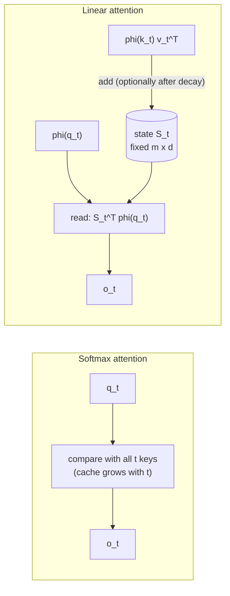
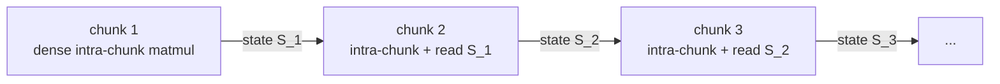

# Linear attention and its kernels: from Performer to gated linear attention

Softmax attention compares every token with every other token, so its cost grows with the square of the context. In 2020 a one-line algebraic observation suggested a way out: if the similarity between a query and a key can be written as a dot product of two feature vectors, the order of the matrix products can be swapped, and attention becomes linear in sequence length. Katharopoulos et al. (2020) showed that the resulting **linear attention** is also a recurrent network with a matrix-valued state, and reported autoregressive generation up to 4,000 times faster on very long sequences.

The idea then spent four years underperforming. Linear transformers were cheaper but noticeably worse, and on GPUs they were often not even faster than optimized softmax attention. What changed was not one trick but three: better **feature maps** (the kernel), **forgetting** through decay and data-dependent gates, and **chunkwise kernels** that turn the recurrence back into matrix multiplications. By 2025 descendants of linear attention were running inside production language models with hundreds of billions of parameters, usually alongside a few softmax layers.

> The core idea in one sentence: **linear attention replaces the softmax similarity with a kernel that factorizes, which lets the model keep a fixed-size running summary instead of the whole past, and nearly everything since 2020 is about choosing that kernel, deciding what the summary forgets, and computing it fast.**

This page connects to [transformers](transformers.md) (softmax attention itself), [attention gradients](attention-gradients.md) (FlashAttention's tiling, which chunkwise kernels mirror), [state-space models](state-space-models.md) (state space duality, the same algebra seen from the other side), [fast-weight programmers](../06-frontiers/fast-weight-programmers.md) (linear attention as an outer-product memory, and the delta rule), the [KV cache](../04-systems/kv-cache.md) (the memory that linear attention replaces), [ML compilers](../04-systems/ml-compilers.md), [Gaussian processes](../01-classical-ml/gaussian-processes-bayesian-optimization.md) (kernels and random features) and [what transformers can compute](../06-frontiers/what-transformers-can-and-cannot-compute.md).

## 1. Attention is a kernel smoother (established)

For one query $\mathbf{q}_i$, softmax attention returns a weighted average of the values,

```math
\mathbf{o}_i = \frac{\sum_j \kappa(\mathbf{q}_i, \mathbf{k}_j)\, \mathbf{v}_j}{\sum_j \kappa(\mathbf{q}_i, \mathbf{k}_j)}, \qquad \kappa(\mathbf{q}, \mathbf{k}) = \exp\!\left(\mathbf{q}^\top \mathbf{k} / \sqrt{d}\right).
```

Tsai et al. (2019) pointed out that this is a **kernel smoother**: a classical nonparametric estimator that averages nearby observations, weighted by a similarity kernel $\kappa$. Nothing in the formula requires the exponential. Any non-negative similarity gives a valid weighted average, and the choice of $\kappa$ decides both what the layer can express and how cheaply it can be computed.

The exponential kernel is expensive for a structural reason. The weights for query $i$ depend jointly on $\mathbf{q}_i$ and every $\mathbf{k}_j$, so computing all outputs touches all $N^2$ query–key pairs. The question linear attention asks is whether a different $\kappa$ can break that coupling.

## 2. The associativity trick (established)

Suppose the kernel factorizes as an inner product of feature maps, $\kappa(\mathbf{q}, \mathbf{k}) = \phi(\mathbf{q})^\top \phi(\mathbf{k})$ with $\phi : \mathbb{R}^d \to \mathbb{R}^m_{\ge 0}$. Then

```math
\mathbf{o}_i = \frac{\phi(\mathbf{q}_i)^\top \sum_j \phi(\mathbf{k}_j)\, \mathbf{v}_j^\top}{\phi(\mathbf{q}_i)^\top \sum_j \phi(\mathbf{k}_j)} .
```

The sums no longer depend on $i$. In matrix form, $\big(\phi(Q)\phi(K)^\top\big)V$ costs $O(N^2 m)$, while $\phi(Q)\big(\phi(K)^\top V\big)$ costs $O(N m d)$: the same numbers, multiplied in a different order (Katharopoulos et al. 2020). For causal (left-to-right) attention the sums run only over $j \le t$, which gives a recurrence:

```math
S_t = S_{t-1} + \phi(\mathbf{k}_t)\,\mathbf{v}_t^\top, \qquad \mathbf{z}_t = \mathbf{z}_{t-1} + \phi(\mathbf{k}_t), \qquad \mathbf{o}_t = \frac{S_t^\top \phi(\mathbf{q}_t)}{\mathbf{z}_t^\top \phi(\mathbf{q}_t)} .
```

$S_t$ is an $m \times d$ matrix that never grows. A transformer with this attention is a recurrent network: generation costs the same per token whether the context holds ten tokens or ten million, and the [KV cache](../04-systems/kv-cache.md) is replaced by one fixed-size state per head. Schlag et al. (2021) showed that $S_t$ is exactly a 1990s **fast-weight memory** that stores associations as summed outer products, which explains both its appeal and its main weakness (Section 4; see the [fast-weight page](../06-frontiers/fast-weight-programmers.md)).



The price is in the kernel. The exponential has no finite feature map, so linear attention either approximates it (Section 3) or replaces it (Section 4).

## 3. Approximating softmax with random features (established)

**Random Fourier features.** Rahimi and Recht (2007) showed that shift-invariant kernels such as the Gaussian can be approximated by inner products of random features $\cos(\mathbf{w}^\top\mathbf{x})$ and $\sin(\mathbf{w}^\top\mathbf{x})$ with $\mathbf{w}$ drawn from the kernel's spectral distribution, turning kernel machines into linear models. Because $\exp(\mathbf{q}^\top\mathbf{k}) = \exp(\|\mathbf{q}\|^2/2)\exp(\|\mathbf{k}\|^2/2)\exp(-\|\mathbf{q}-\mathbf{k}\|^2/2)$, the softmax kernel inherits such features. Random feature attention (Peng et al. 2021) used them and added a learned gate, an early hint of Section 5.

**Positive random features (Performer).** Trigonometric features have a flaw for attention: their estimates of a small kernel value can be negative, and most attention weights are small. Choromanski et al. (2020) introduced FAVOR+, which uses the identity

```math
\exp(\mathbf{q}^\top\mathbf{k}) = \mathbb{E}_{\mathbf{w} \sim \mathcal{N}(0, I)}\Big[ e^{\mathbf{w}^\top\mathbf{q} - \|\mathbf{q}\|^2/2}\; e^{\mathbf{w}^\top\mathbf{k} - \|\mathbf{k}\|^2/2} \Big],
```

so the features $\phi(\mathbf{x})_r = m^{-1/2}\exp(\mathbf{w}_r^\top\mathbf{x} - \|\mathbf{x}\|^2/2)$ are always positive, and draws the $\mathbf{w}_r$ to be orthogonal to reduce variance further. Performers come with "unbiased or nearly-unbiased estimation of the attention matrix, uniform convergence and low estimation variance", and were competitive on tasks from pixel prediction to protein sequences. The tested sketch below shows the trade-off concretely: positive features are accurate exactly where trigonometric features fail (small kernel values) and much noisier where the kernel is large, which is where a sharp, confident attention head puts its weight.

**Why approximation alone cannot win.** There are complexity-theoretic limits on approximating softmax attention quickly. Keles et al. (2022) proved that self-attention needs time quadratic in the input length unless the Strong Exponential Time Hypothesis (SETH, a standard conjecture in fine-grained complexity) is false, even approximately, and that finite Taylor-series approximations run in linear time only at a cost exponential in the polynomial order. Alman and Song (2023) located a sharp threshold: with head dimension $d = O(\log n)$, attention can be approximated in almost-linear time when entries of $Q$ and $K$ are bounded by $o(\sqrt{\log n})$, but not in truly subquadratic time when the bound is $\Theta(\sqrt{\log n})$, under SETH. Informally, cheap approximation works for soft, spread-out attention and fails for the sharp attention that precise retrieval needs.

## 4. Choosing the kernel instead of approximating it (established; active research)

If the exponential cannot be matched cheaply, the alternative is to treat $\phi$ as a design choice and train the model around it.

| Feature map $\phi$ | Idea | Source |
|---|---|---|
| $\operatorname{elu}(x) + 1$ | Simplest positive map; $m = d$ | Katharopoulos et al. 2020 |
| Learned MLP, swap then finetune | Convert a pretrained transformer into a recurrent one | Kasai et al. 2021 |
| ReLU with cosine reweighting | Positive weights plus a locality bias, no approximation of softmax | Qin et al. 2022a (cosFormer) |
| Normalized output instead of scaling | Fixes unbounded gradients; diagonal (local) attention in early layers | Qin et al. 2022b (TransNormer) |
| Second-order Taylor expansion of $\exp$ | $m = 1 + d + d^2$; paired with sliding-window attention | Arora et al. 2024 (Based) |
| Trainable MLP mimicking softmax | Keeps "spiky" low-entropy weights and monotonicity in $\mathbf{q}^\top\mathbf{k}$ | Zhang et al. 2024 (Hedgehog) |
| Rank-one positive semidefinite features | Capacity framed as sphere packing | Ghriss and Chakraborty 2026 (KATA) |

**What goes wrong with naive maps.** Qin et al. (2022b) diagnosed two failures of kernel-based linear transformers: *unbounded gradients* from the normalizing denominator, and *attention dilution*, which "trivially distributes attention scores over long sequences while neglecting neighbouring structures". Zhang et al. (2024) put the missing properties plainly: softmax weights are low-entropy and monotonic in the dot product, and prior linear attentions are not. A map such as $\operatorname{elu}(x)+1$ stays close to 1 for the small inputs typical after scaling, so every key gets nearly the same weight, as the sketch below shows with entropies indistinguishable from uniform.

**The capacity limit.** Even a perfect feature map leaves the state at a fixed size. Writing $N$ associations into an $m \times d$ matrix by summing outer products can store them without interference only if the $N$ feature vectors are close to orthogonal, so retrieval degrades once $N$ exceeds roughly $m$ (Schlag et al. 2021). Arora et al. (2024) made this a measured trade-off between state size and **recall**, the ability to retrieve tokens seen earlier in context. They showed that fixed-state models "struggle at recall", and their Based architecture combines a Taylor-map linear attention with a small sliding window so that state size can be dialled along the Pareto frontier, outperforming Mamba on recall-intensive tasks by 6.22 accuracy points at matched perplexity. Larger feature maps buy capacity at the cost of a larger state: the sketch's second-order map lifts recall but still collapses once the number of stored pairs outgrows the 273 feature dimensions.

## 5. Forgetting: decay and data-dependent gates (established)

A state that only adds can never get rid of anything, so old associations accumulate as noise. The fix that made linear attention competitive is to let the state forget. Most modern layers fit one template,

```math
S_t = G_t \odot S_{t-1} + \phi(\mathbf{k}_t)\,\mathbf{v}_t^\top, \qquad \mathbf{o}_t = S_t^\top \phi(\mathbf{q}_t),
```

and differ mainly in the shape of the forgetting term $G_t$ and whether it depends on the input. (Many drop the normalizing denominator and use an output normalization instead, following TransNormer.)

| Layer | Forgetting $G_t$ | Note | Source |
|---|---|---|---|
| Linear transformer | none ($G_t = 1$) | Pure accumulation | Katharopoulos et al. 2020 |
| RetNet | fixed scalar decay $\gamma$ per head | Parallel, recurrent and chunkwise forms | Sun et al. 2023 |
| Gated linear attention (GLA) | data-dependent decay per key dimension | Hardware-efficient training; generalizes from 2K to more than 20K tokens | Yang et al. 2023 |
| HGRN2 | data-dependent forget gate with outer-product state expansion | Recasts a gated linear RNN as linear attention | Qin et al. 2024b |
| RWKV-6 (Finch) | data-dependent decay, matrix-valued state | Recurrent design with matrix states | Peng et al. 2024 |
| Mamba-2 (SSD) | data-dependent scalar decay | Equals masked linear attention with a decay mask | Dao and Gu 2024 |
| Gated DeltaNet and Kimi Delta Attention | decay plus a delta-rule overwrite | The state is corrected, not just added to | Yang et al. 2024b, 2024c; Kimi Team 2025 |

Scalar decay with a data-dependent rate is exactly the selective state-space model of Mamba-2, which is why the [state-space page](state-space-models.md#state-space-duality-mamba-2) and this one describe the same layer from two ends. The delta-rule rows replace "add the new association" with "move the stored value toward the new one", one online gradient step on a reconstruction loss; the [fast-weight page](../06-frontiers/fast-weight-programmers.md) derives it and shows why it overwrites rather than piling up.

## 6. Kernels: making it fast on real hardware (established)

Linear complexity on paper did not translate into speed. The recurrent form is a long sequence of small, dependent, memory-bound updates, and a naive parallel form needs a cumulative sum over a state for every position. Qin et al. (2024a) note that "due to the issue with cumulative summation (cumsum), current linear attention algorithms cannot demonstrate their theoretical advantage in a causal setting", and Yang et al. (2023) observe that implementations lacking I/O-awareness were "slower than highly optimized implementations of softmax attention".

**The chunkwise form.** The solution, used by RetNet, Lightning Attention-2 and FlashLinearAttention, splits the sequence into chunks of length $C$. Inside a chunk the layer is computed in its quadratic, attention-like form, which is a dense matrix multiplication that tensor cores run well; between chunks only the $m \times d$ state is carried:

```math
O_{[c]} = \big(\phi(Q_{[c]})\,\phi(K_{[c]})^\top \odot M\big) V_{[c]} \;+\; \phi(Q_{[c]})\, S_{[c-1]}, \qquad S_{[c]} = S_{[c-1]} + \phi(K_{[c]})^\top V_{[c]},
```

with $M$ the causal mask (multiplied by the decay factors when there is forgetting). Work is $O(N C m + N m d)$, the state is read and written $N/C$ times instead of $N$ times, and $C$ trades parallelism against arithmetic. The sketch checks that the three forms agree to round-off, with and without data-dependent decay.



**Reported speed.** Lightning Attention-2 handles intra-block parts with conventional attention and inter-block parts with the linear-attention trick, and reports constant training and inference speed regardless of sequence length (Qin et al. 2024a). FlashLinearAttention was faster than FlashAttention-2 as a standalone layer "even on short sequence lengths (e.g., 1K)" (Yang et al. 2023), and Based's IO-aware kernels gave 24 times higher generation throughput than FlashAttention-2 when generating 1,024 tokens with 1.3B-parameter models (Arora et al. 2024). In 2026 the work moved toward generality: FlexLA (Duanmu et al. 2026) is a compiler that decomposes any linear-attention variant into intra-chunk computation, inter-chunk state propagation and output merging, and reports kernels at 1.01 to 4.9 times an expert-optimized library and near-linear scaling of scalar gated linear attention to 16 million tokens on 128 GPUs. KATA (Ghriss and Chakraborty 2026) reports a chunked form reaching about 11 times FlashAttention-2 forward throughput at 131k tokens, and an associative scan that cuts the inter-chunk recurrence depth to $O(\log(T/C))$. These are the authors' measurements on their hardware.

## 7. At scale: hybrids and linearized models (established; active research)

**Hybrids won.** Pure linear-attention models remained weaker at recall, so the large deployed designs interleave them with a minority of softmax layers. MiniMax-01 (MiniMax et al. 2025), with 456 billion total and 45.9 billion active parameters, places one softmax-attention block after every seven lightning-attention (TransNormer-style) blocks, trains with up to 1 million tokens of context and extrapolates to 4 million at inference. Kimi Linear (Kimi Team 2025) mixes Kimi Delta Attention with latent attention and reports beating full attention under an identical training recipe while cutting KV-cache use by up to 75%. The [state-space page](state-space-models.md) describes the same pattern in Jamba and Nemotron-H.

**Converting instead of pretraining.** Because pretraining is expensive, several groups convert existing transformers. Kasai et al. (2021) swap softmax for a learned-feature linear attention and finetune. SUPRA (Mercat et al. 2024) uptrains large pretrained transformers into RNNs at 5% of the training cost but finds "persistent in-context learning and long-context modeling shortfalls". LoLCATs (Zhang et al. 2025) first trains linear attentions to match their softmax counterparts' outputs ("attention transfer") and then repairs the remaining error with low-rank adaptation; it produced the first linearized 70B and 405B models and closed 77.8% and 78.1% of the 5-shot MMLU gap to the originals at those sizes, using 0.2% of prior methods' parameters and 0.4% of their training tokens.

**Recent work (2026).** Two directions stand out. One enlarges effective capacity without enlarging the state: MS-GLA (Dev et al. 2026) spreads gated-linear-attention heads across several temporal resolutions and reports up to 18.9% improvement on recall-intensive tasks over GLA at matched parameters. The other revisits the kernel from geometry: KATA (Ghriss and Chakraborty 2026) frames associative recall as sphere packing, derives feature maps that certify non-negative weights, reports several variants outperforming Gated DeltaNet on long-range multi-query associative recall, and keeps 0.985 recall at 16 times the training length. Both are recent preprints whose results have not yet been widely reproduced.

## 8. A tested sketch

The script below builds causal linear attention three ways, compares random-feature estimators of the softmax kernel, measures attention dilution, and measures recall against state size. It needs only NumPy and runs in a few seconds.

```python
import numpy as np
rng=np.random.default_rng(0)

# Part 1: one causal linear attention (with an optional scalar decay gate), three ways of computing it
print("Part 1")
N,d,C=2048,64,64
Q=rng.normal(size=(N,d))/d**0.25; K=rng.normal(size=(N,d))/d**0.25; V=rng.normal(size=(N,d))
phi=lambda x: np.where(x>0,x+1,np.exp(x))            # elu(x)+1, a positive feature map
fq,fk=phi(Q),phi(K)
for gname,a in [("no decay",np.ones(N)),("data-dependent decay",1/(1+np.exp(-(3+rng.normal(size=N)))))]:
    # (a) quadratic "parallel" form: O = (mask * decay * phi(Q)phi(K)^T) V
    la=np.cumsum(np.log(a))                            # log of prod_{s<=t} a_s
    D=np.tril(np.exp(la[:,None]-la[None,:]))           # decay from s to t
    A=(fq@fk.T)*D; Oa=A@V; Za=A.sum(1)
    # (b) recurrent form: S_t = a_t S_{t-1} + phi(k_t) v_t^T, z_t = a_t z_{t-1} + phi(k_t)
    S=np.zeros((d,d)); z=np.zeros(d); Ob=np.zeros((N,d)); Zb=np.zeros(N)
    for t in range(N):
        S=a[t]*S+np.outer(fk[t],V[t]); z=a[t]*z+fk[t]; Ob[t]=fq[t]@S; Zb[t]=fq[t]@z
    # (c) chunkwise form: exact attention inside each chunk, carried state between chunks
    S=np.zeros((d,d)); z=np.zeros(d); Oc=np.zeros((N,d)); Zc=np.zeros(N)
    for c0 in range(0,N,C):
        sl=slice(c0,c0+C); l=np.cumsum(np.log(a[sl]))
        Dc=np.tril(np.exp(l[:,None]-l[None,:])); Ac=(fq[sl]@fk[sl].T)*Dc
        Oc[sl]=Ac@V[sl]+np.exp(l)[:,None]*(fq[sl]@S); Zc[sl]=Ac.sum(1)+np.exp(l)*(fq[sl]@z)
        w=np.exp(l[-1]-l)[:,None]*fk[sl]
        S=np.exp(l[-1])*S+w.T@V[sl]; z=np.exp(l[-1])*z+w.sum(0)
    ya,yb,yc=Oa/Za[:,None],Ob/Zb[:,None],Oc/Zc[:,None]
    print(f"{gname:22s} max |parallel-recurrent| {np.abs(ya-yb).max():.1e}   max |parallel-chunked| {np.abs(ya-yc).max():.1e}")
for n in [1024,8192,65536]:
    quad=2*n*n*d; rec=4*n*d*d; ch=2*n*C*d+4*n*d*d
    print(f"N={n:6d}: multiply-adds, quadratic {quad/1e9:7.2f}G  recurrent {rec/1e9:5.2f}G  chunked (C={C}) {ch/1e9:5.2f}G")

# Part 2: random features for the softmax kernel exp(q.k)
print("Part 2")
d=16
def trig(X,W): m=W.shape[0]; return np.exp((X**2).sum(-1,keepdims=True)/2)*np.concatenate([np.cos(X@W.T),np.sin(X@W.T)],-1)/np.sqrt(m)
def pos(X,W):  m=W.shape[0]; return np.exp(X@W.T-(X**2).sum(-1,keepdims=True)/2)/np.sqrt(m)
def ortho(m):
    blocks=[]
    while sum(b.shape[0] for b in blocks)<m:
        G,_=np.linalg.qr(rng.normal(size=(d,d))); blocks.append(G*np.sqrt(rng.chisquare(d,size=(d,1))))
    return np.concatenate(blocks)[:m]
q=rng.normal(size=d); q*=1.5/np.linalg.norm(q)
u=rng.normal(size=d); u-=u@q/(q@q)*q; u/=np.linalg.norm(u)
for cosang,label in [(-0.9,"small kernel, q.k=-2.0"),(0.9,"large kernel, q.k=+2.0")]:
    k=1.5*(cosang*q/np.linalg.norm(q)+np.sqrt(1-cosang**2)*u); true=np.exp(q@k)
    for m in [16,64,256]:
        res={}
        for name,f,draw in [("trig",trig,lambda: rng.normal(size=(m//2,d))),("positive",pos,lambda: rng.normal(size=(m,d)))]:
            est=np.array([f(q[None],W)@f(k[None],W).T for W in [draw() for _ in range(5000)]]).ravel()
            res[name]=(np.sqrt(np.mean((est-true)**2))/true,np.mean(est<0))
        print(f"{label}  m={m:3d}: rel. RMSE trig {res['trig'][0]:6.2f} (negative {res['trig'][1]:.0%})  positive {res['positive'][0]:5.2f}")

# Part 3: attention dilution, weight on the one matching key as context grows
print("Part 3")
d=64
for N in [64,512,4096,32768]:
    rows=[]
    for t in range(20):
        K=rng.normal(size=(N,d))/np.sqrt(d)*2; i=rng.integers(N); q=K[i]*1.0+0.1*rng.normal(size=d)
        s=K@q*np.sqrt(d)/2; w=np.exp(s-s.max()); w/=w.sum()
        e=phi(K)@phi(q); e/=e.sum()
        W=rng.normal(size=(256,d))  # Performer estimate of the same softmax weights
        p=pos(K*np.sqrt(np.sqrt(d)/2)/1,W)@pos(q[None]*np.sqrt(np.sqrt(d)/2),W).T; p=p.ravel()/p.sum()
        rows.append((w[i],e[i],p[i],-(w*np.log(w+1e-300)).sum(),-(e*np.log(e)).sum()))
    r=np.mean(rows,0)
    print(f"N={N:6d}: weight on match, softmax {r[0]:.3f}  elu+1 linear {r[1]:.4f}  Performer m=256 {r[2]:.3f} | entropy softmax {r[3]:.2f}  linear {r[4]:.2f} nats (uniform {np.log(N):.2f})")

# Part 4: recall versus state size
print("Part 4")
d=16
def taylor(X): return np.concatenate([np.ones((len(X),1)),X,(X[:,:,None]*X[:,None,:]).reshape(len(X),-1)/np.sqrt(2)],1)
for N in [8,16,32,64,128,256]:
    names=["identity map (state 16x16)","2nd-order Taylor map (state 273x16)","softmax (cache grows: N x 32)"]
    acc={k:[] for k in names}
    for t in range(30):
        K=rng.normal(size=(N,d)); K/=np.linalg.norm(K,axis=1,keepdims=True)
        Vals=rng.normal(size=(N,d)); Vals/=np.linalg.norm(Vals,axis=1,keepdims=True)
        def score(out): return np.mean((out@Vals.T).argmax(1)==np.arange(N))   # read back each key; nearest stored value
        acc[names[0]].append(score(K@(K.T@Vals)))
        acc[names[1]].append(score(taylor(2*K)@(taylor(2*K).T@Vals)))
        s_=8*K@K.T; w=np.exp(s_-s_.max(1,keepdims=True)); w/=w.sum(1,keepdims=True); acc[names[2]].append(score(w@Vals))
    print(f"N={N:4d} pairs: "+"  ".join(f"{k} {np.mean(v):.2f}" for k,v in acc.items()))
```

Output:

```text
Part 1
no decay               max |parallel-recurrent| 4.4e-16   max |parallel-chunked| 3.1e-16
data-dependent decay   max |parallel-recurrent| 2.2e-14   max |parallel-chunked| 2.2e-14
N=  1024: multiply-adds, quadratic    0.13G  recurrent  0.02G  chunked (C=64)  0.03G
N=  8192: multiply-adds, quadratic    8.59G  recurrent  0.13G  chunked (C=64)  0.20G
N= 65536: multiply-adds, quadratic  549.76G  recurrent  1.07G  chunked (C=64)  1.61G
Part 2
small kernel, q.k=-2.0  m= 16: rel. RMSE trig  17.92 (negative 48%)  positive  0.19
small kernel, q.k=-2.0  m= 64: rel. RMSE trig   8.96 (negative 46%)  positive  0.09
small kernel, q.k=-2.0  m=256: rel. RMSE trig   4.49 (negative 40%)  positive  0.05
large kernel, q.k=+2.0  m= 16: rel. RMSE trig   0.11 (negative 0%)  positive 12.62
large kernel, q.k=+2.0  m= 64: rel. RMSE trig   0.06 (negative 0%)  positive  4.43
large kernel, q.k=+2.0  m=256: rel. RMSE trig   0.03 (negative 0%)  positive  1.31
Part 3
N=    64: weight on match, softmax 0.998  elu+1 linear 0.0164  Performer m=256 0.363 | entropy softmax 0.02  linear 4.16 nats (uniform 4.16)
N=   512: weight on match, softmax 0.999  elu+1 linear 0.0021  Performer m=256 0.195 | entropy softmax 0.01  linear 6.24 nats (uniform 6.24)
N=  4096: weight on match, softmax 0.974  elu+1 linear 0.0003  Performer m=256 0.012 | entropy softmax 0.25  linear 8.32 nats (uniform 8.32)
N= 32768: weight on match, softmax 0.843  elu+1 linear 0.0000  Performer m=256 0.003 | entropy softmax 1.60  linear 10.40 nats (uniform 10.40)
Part 4
N=   8 pairs: identity map (state 16x16) 0.99  2nd-order Taylor map (state 273x16) 1.00  softmax (cache grows: N x 32) 1.00
N=  16 pairs: identity map (state 16x16) 0.93  2nd-order Taylor map (state 273x16) 1.00  softmax (cache grows: N x 32) 1.00
N=  32 pairs: identity map (state 16x16) 0.59  2nd-order Taylor map (state 273x16) 0.93  softmax (cache grows: N x 32) 1.00
N=  64 pairs: identity map (state 16x16) 0.27  2nd-order Taylor map (state 273x16) 0.63  softmax (cache grows: N x 32) 1.00
N= 128 pairs: identity map (state 16x16) 0.09  2nd-order Taylor map (state 273x16) 0.25  softmax (cache grows: N x 32) 1.00
N= 256 pairs: identity map (state 16x16) 0.03  2nd-order Taylor map (state 273x16) 0.07  softmax (cache grows: N x 32) 1.00
```

What it shows:

1. **One layer, three algorithms.** For 2,048 tokens with head dimension 64, the quadratic masked form, the token-by-token recurrence and the chunkwise form (64-token chunks) agree to $4.4 \times 10^{-16}$ without decay and $2.2 \times 10^{-14}$ with a data-dependent decay gate, which is round-off. The multiply-add counts show why the recurrence matters: at 65,536 tokens the quadratic form needs about 550 billion against 1.07 billion for the recurrence and 1.61 billion for the chunkwise form, which pays about 50% extra arithmetic to run as dense matrix products. These are operation counts, not timings.
2. **Positive features fix small weights and pay on large ones.** For a 16-dimensional query and key with $\mathbf{q}^\top\mathbf{k} = -2$, trigonometric random features estimate the kernel with relative error 17.92 at 16 features and 4.49 at 256, and 40% to 48% of the estimates are negative; Performer-style positive features have relative error 0.19 and 0.05. For $\mathbf{q}^\top\mathbf{k} = +2$ the ranking reverses: trigonometric 0.11 and 0.03, positive 12.62 and 1.31. The positive estimator is heavy-tailed there, so its error estimates from 5,000 draws are themselves noisy.
3. **Dilution.** With one key matching the query among $N$ random keys, softmax puts 0.998 of its weight on the match at $N = 64$ and still 0.843 at $N = 32{,}768$. Linear attention with $\operatorname{elu}+1$ on the same scaled inputs gives the match 0.0164 at $N = 64$, about the uniform share of 0.0156, and its entropy equals that of the uniform distribution to two decimals at every length. A Performer estimate of the same softmax weights with 256 features gives 0.363 at $N = 64$ but only 0.003 at $N = 32{,}768$: a confident head has a large kernel value on the match, which is where positive features are noisiest (part 2).
4. **Recall is bounded by the state.** Storing $N$ unit-norm key–value pairs in 16 dimensions and reading each back, an identity feature map (a $16 \times 16$ state) recalls 0.93 of 16 pairs, 0.59 of 32 and 0.03 of 256. A second-order Taylor map (a $273 \times 16$ state) recalls 0.93 of 32 and 0.63 of 64 pairs, then also collapses (0.07 at 256). Softmax recalls all 256 because its cache grows with $N$. This is a single-seed toy with random keys and values, an illustration of the trade-off measured by Arora et al. (2024), not a benchmark.

## 9. Status at a glance

| Claim | Status |
|---|---|
| Kernelized attention with a factorizable kernel can be computed in linear time and run as a recurrence with a fixed-size state | Established (exact algebra) |
| Positive random features give unbiased, low-variance estimates of the softmax kernel where its values are small | Established (Choromanski et al. 2020) |
| Fast approximation of softmax attention is impossible in general when query and key entries are large | Established under SETH (Keles et al. 2022; Alman and Song 2023) |
| Fixed-state models trade recall for memory, and recall falls when stored associations exceed state capacity | Established empirically and theoretically for associative recall (Arora et al. 2024; Schlag et al. 2021) |
| Data-dependent decay or gating closes much of the quality gap to softmax at moderate scale | Established at the reported scales (GLA, HGRN2, RWKV-6, Mamba-2) |
| Chunkwise kernels make linear attention faster than FlashAttention-class kernels in practice | Established for reported layers and lengths; depends on hardware, head size and chunk size |
| Hybrids with a minority of softmax layers match full attention at frontier scale | Reported by model developers (MiniMax-01, Kimi Linear); independent comparisons are limited |
| Pretrained transformers can be linearized cheaply without loss | Contested: large gap reductions (LoLCATs), with persistent long-context and in-context shortfalls reported (SUPRA) |
| Geometry-derived kernels and multi-resolution heads lift recall without a larger state | New 2026 preprints (KATA, MS-GLA); not yet independently reproduced |

## 10. Speculative: a state that physics could hold

> **Speculative.** This section proposes ideas, not established results.

Linear attention's state update is a sum of outer products followed, at read time, by one matrix–vector product. That is the access pattern that analog and optical matrix hardware performs natively: the [memristive crossbar](../06-frontiers/memristive-crossbars-in-memory-computing.md) page describes arrays that compute a matrix–vector product in place, and the [photonic computing](../06-frontiers/photonic-computing.md) page describes optical meshes and interference that do the same in light. A softmax KV cache, by contrast, grows without bound and must be scanned in full, a poor match for fixed-size physical arrays.

The idea worth testing is a fixed-size linear-attention state held in a physical matrix, with gated decay played by the medium's own relaxation, so that forgetting costs nothing. Several questions decide whether it could work. Recall is already capacity-limited (part 4 of the sketch); device noise and drift add interference of their own, and the open measurement is how many associations survive at a given noise level before recall falls below a useful threshold. Writes would be frequent, one outer product per token, which is the operation most analog memories do worst, so the update might need to stay digital while only the read is analog. And positive random features are an exponential of a random projection; whether a physical random projection followed by a nonlinear detector could supply them cheaply, and whether the heavy tails seen in part 2 survive analog noise, are both unmeasured. Any of these could fail; each is a concrete experiment rather than a claim.

## Further reading

- Rahimi, A., Recht, B. (2007). *Random features for large-scale kernel machines*. NeurIPS. [Proceedings](https://papers.nips.cc/paper_files/paper/2007/hash/013a006f03dbc5392effeb8f18fda755-Abstract.html)
- Tsai, Y.-H. H., Bai, S., Yamada, M., Morency, L.-P., Salakhutdinov, R. (2019). *Transformer dissection: A unified understanding of transformer's attention via the lens of kernel*. EMNLP. [arXiv:1908.11775](https://arxiv.org/abs/1908.11775)
- Katharopoulos, A., Vyas, A., Pappas, N., Fleuret, F. (2020). *Transformers are RNNs: Fast autoregressive transformers with linear attention*. ICML. [arXiv:2006.16236](https://arxiv.org/abs/2006.16236)
- Wang, S., Li, B. Z., Khabsa, M., Fang, H., Ma, H. (2020). *Linformer: Self-attention with linear complexity*. [arXiv:2006.04768](https://arxiv.org/abs/2006.04768)
- Tay, Y., Dehghani, M., Bahri, D., Metzler, D. (2020). *Efficient transformers: A survey*. [arXiv:2009.06732](https://arxiv.org/abs/2009.06732)
- Choromanski, K., Likhosherstov, V., Dohan, D., Song, X., Gane, A., Sarlos, T., Hawkins, P., et al. (2020). *Rethinking attention with Performers*. ICLR 2021. [arXiv:2009.14794](https://arxiv.org/abs/2009.14794)
- Xiong, Y., Zeng, Z., Chakraborty, R., Tan, M., Fung, G., Li, Y., Singh, V. (2021). *Nyströmformer: A Nyström-based algorithm for approximating self-attention*. AAAI. [arXiv:2102.03902](https://arxiv.org/abs/2102.03902)
- Schlag, I., Irie, K., Schmidhuber, J. (2021). *Linear transformers are secretly fast weight programmers*. ICML. [arXiv:2102.11174](https://arxiv.org/abs/2102.11174)
- Peng, H., Pappas, N., Yogatama, D., Schwartz, R., Smith, N. A., Kong, L. (2021). *Random feature attention*. ICLR. [arXiv:2103.02143](https://arxiv.org/abs/2103.02143)
- Kasai, J., Peng, H., Zhang, Y., Yogatama, D., Ilharco, G., Pappas, N., Mao, Y., et al. (2021). *Finetuning pretrained transformers into RNNs*. EMNLP. [arXiv:2103.13076](https://arxiv.org/abs/2103.13076)
- Qin, Z., Sun, W., Deng, H., Li, D., Wei, Y., Lv, B., Yan, J., et al. (2022a). *cosFormer: Rethinking softmax in attention*. ICLR. [arXiv:2202.08791](https://arxiv.org/abs/2202.08791)
- Qin, Z., Han, X., Sun, W., Li, D., Kong, L., Barnes, N., Zhong, Y. (2022b). *The devil in linear transformer*. EMNLP. [arXiv:2210.10340](https://arxiv.org/abs/2210.10340)
- Keles, F. D., Wijewardena, P. M., Hegde, C. (2022). *On the computational complexity of self-attention*. [arXiv:2209.04881](https://arxiv.org/abs/2209.04881)
- Alman, J., Song, Z. (2023). *Fast attention requires bounded entries*. [arXiv:2302.13214](https://arxiv.org/abs/2302.13214)
- Sun, Y., Dong, L., Huang, S., Ma, S., Xia, Y., Xue, J., Wang, J., Wei, F. (2023). *Retentive network: A successor to transformer for large language models*. [arXiv:2307.08621](https://arxiv.org/abs/2307.08621)
- Yang, S., Wang, B., Shen, Y., Panda, R., Kim, Y. (2023). *Gated linear attention transformers with hardware-efficient training*. [arXiv:2312.06635](https://arxiv.org/abs/2312.06635)
- Qin, Z., Sun, W., Li, D., Shen, X., Sun, W., Zhong, Y. (2024a). *Lightning Attention-2: A free lunch for handling unlimited sequence lengths in large language models*. [arXiv:2401.04658](https://arxiv.org/abs/2401.04658)
- Zhang, M., Bhatia, K., Kumbong, H., Ré, C. (2024). *The Hedgehog & the Porcupine: Expressive linear attentions with softmax mimicry*. ICLR. [arXiv:2402.04347](https://arxiv.org/abs/2402.04347)
- Arora, S., Eyuboglu, S., Zhang, M., Timalsina, A., Alberti, S., Zinsley, D., Zou, J., et al. (2024). *Simple linear attention language models balance the recall-throughput tradeoff*. ICML. [arXiv:2402.18668](https://arxiv.org/abs/2402.18668)
- Peng, B., Goldstein, D., Anthony, Q., Albalak, A., Alcaide, E., Biderman, S., Cheah, E., et al. (2024). *Eagle and Finch: RWKV with matrix-valued states and dynamic recurrence*. [arXiv:2404.05892](https://arxiv.org/abs/2404.05892)
- Qin, Z., Yang, S., Sun, W., Shen, X., Li, D., Sun, W., Zhong, Y. (2024b). *HGRN2: Gated linear RNNs with state expansion*. COLM. [arXiv:2404.07904](https://arxiv.org/abs/2404.07904)
- Mercat, J., Vasiljevic, I., Keh, S., Arora, K., Dave, A., Gaidon, A., Kollar, T. (2024). *Linearizing large language models*. [arXiv:2405.06640](https://arxiv.org/abs/2405.06640)
- Dao, T., Gu, A. (2024). *Transformers are SSMs: Generalized models and efficient algorithms through structured state space duality*. ICML. [arXiv:2405.21060](https://arxiv.org/abs/2405.21060)
- Yang, S., Wang, B., Zhang, Y., Shen, Y., Kim, Y. (2024b). *Parallelizing linear transformers with the delta rule over sequence length*. NeurIPS. [arXiv:2406.06484](https://arxiv.org/abs/2406.06484)
- Yang, S., Kautz, J., Hatamizadeh, A. (2024c). *Gated delta networks: Improving Mamba2 with delta rule*. ICLR 2025. [arXiv:2412.06464](https://arxiv.org/abs/2412.06464)
- Zhang, M., Arora, S., Chalamala, R., Wu, A., Spector, B., Singhal, A., Ramesh, K., Ré, C. (2025). *LoLCATs: On low-rank linearizing of large language models*. ICLR. [arXiv:2410.10254](https://arxiv.org/abs/2410.10254)
- MiniMax, Li, A., Gong, B., Yang, B., Shan, B., Liu, C., Zhu, C., Zhang, C., et al. (2025). *MiniMax-01: Scaling foundation models with lightning attention*. [arXiv:2501.08313](https://arxiv.org/abs/2501.08313)
- Kimi Team, Zhang, Y., Lin, Z., Yao, X., Hu, J., Meng, F., Liu, C., Men, X., et al. (2025). *Kimi Linear: An expressive, efficient attention architecture*. [arXiv:2510.26692](https://arxiv.org/abs/2510.26692)
- Duanmu, H., Zheng, S., Zheng, N., Lu, J., Zheng, X., Zhang, X., Chang, L.-W., Liu, X., Lin, D. (2026). *FlexLinearAttention: Compiling a unified abstraction into scalable kernels for linear attention*. ICLR. [Proceedings](https://proceedings.iclr.cc/paper_files/paper/2026/hash/d029c97ee0db162c60f2ebc9cb93387e-Abstract-Conference.html)
- Ghriss, A., Chakraborty, S. (2026). *Kernelized linear attention: Breaking the capacity wall with symmetric cones*. [arXiv:2607.17419](https://arxiv.org/abs/2607.17419)
- Dev, P., Sankar, A., Varma, V. (2026). *MS-GLA: Multi-scale gated linear attention for addressing representational bottlenecks via multi-temporal resolution*. [arXiv:2609.35664](https://arxiv.org/abs/2609.35664)
