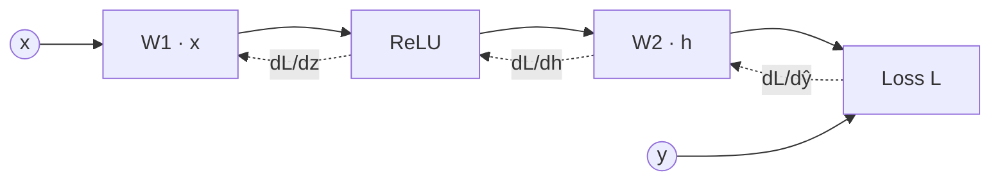

# Neural networks and backpropagation

## The artificial neuron

A neuron computes a weighted sum of its inputs and passes it through a nonlinear **activation function**:

```math
h = \sigma\Big(\sum_j w_j x_j + b\Big)
```

A **multilayer perceptron (MLP)** stacks layers of such units:

```math
\mathbf{h}^{(\ell)} = \sigma\big(W^{(\ell)} \mathbf{h}^{(\ell-1)} + \mathbf{b}^{(\ell)}\big)
```

## Activation functions

| Name | Formula | Notes |
|---|---|---|
| Sigmoid | $1/(1+e^{-z})$ | Saturates; gradients vanish for large $\lvert z \rvert$ |
| tanh | $\tanh z$ | Zero-centred, still saturates |
| ReLU | $\max(0, z)$ | Cheap, non-saturating for $z>0$; default for CNNs |
| GELU | $z\,\Phi(z)$ | Smooth ReLU variant common in transformers (Hendrycks & Gimpel 2016) |
| SwiGLU | gated linear unit with Swish | Used in many recent LLM feed-forward blocks (Shazeer 2020) |

## Universal approximation

A network with one hidden layer of sigmoid units can approximate any continuous function on a compact domain to arbitrary accuracy, given enough units (Cybenko 1989; Hornik, Stinchcombe & White 1989). The theorem says such networks *exist*; it says nothing about how many units are needed or whether gradient descent will find them. In practice, **depth** is far more parameter-efficient than width for the compositional functions found in nature, an argument developed for example by Lin, Tegmark & Rolnick (2017).

## Computational graphs

Any model can be written as a directed acyclic graph of elementary operations. Training needs the derivative of the loss with respect to every parameter.



## Backpropagation

Backpropagation (Rumelhart, Hinton & Williams 1986) is the chain rule applied in **reverse order** over the graph. For a layer $\mathbf{z} = W\mathbf{h} + \mathbf{b}$, $\mathbf{a} = \sigma(\mathbf{z})$, with upstream gradient $\boldsymbol\delta = \partial L / \partial \mathbf{a}$:

```math
\frac{\partial L}{\partial \mathbf{z}} = \boldsymbol\delta \odot \sigma'(\mathbf{z}), \qquad
\frac{\partial L}{\partial W} = \frac{\partial L}{\partial \mathbf{z}} \, \mathbf{h}^\top, \qquad
\frac{\partial L}{\partial \mathbf{h}} = W^\top \frac{\partial L}{\partial \mathbf{z}}
```

Two facts make it powerful:

1. **Efficiency.** Computing all gradients costs only a small constant factor more than the forward pass, regardless of the number of parameters. This is *reverse-mode automatic differentiation*.
2. **Generality.** Any composition of differentiable operations can be trained this way, so architectures can be designed freely.

## Vanishing and exploding gradients

The backward pass multiplies many Jacobians together. If their typical scale is below 1, gradients shrink exponentially with depth; above 1, they explode. Remedies:

- **Initialization** that preserves variance, e.g. Glorot & Bengio (2010) for tanh and He et al. (2015) for ReLU.
- **Residual connections** $\mathbf{h}_{\ell+1} = \mathbf{h}_\ell + F(\mathbf{h}_\ell)$ (He et al. 2016), which give an identity path for gradients.
- **Normalization** layers (Ioffe & Szegedy 2015; Ba, Kiros & Hinton 2016).
- **Gating** in LSTMs (Hochreiter & Schmidhuber 1997).

## Regularization

- **Weight decay** (L2 penalty).
- **Dropout** (Srivastava et al. 2014): randomly zero activations during training, which discourages co-adaptation.
- **Data augmentation**: train on transformed copies (crops, flips, noise).
- **Early stopping**: halt when validation loss stops improving.

## Is backprop how brains learn?

Probably not literally: it requires symmetric forward and backward weights and a separate backward phase. Biologically plausible alternatives are an active research area and connect to [neuromorphic computing](../06-frontiers/neuromorphic-computing.md) and to training [physical neural networks](../06-frontiers/photonic-computing.md), where exact backprop may be impossible in hardware.
