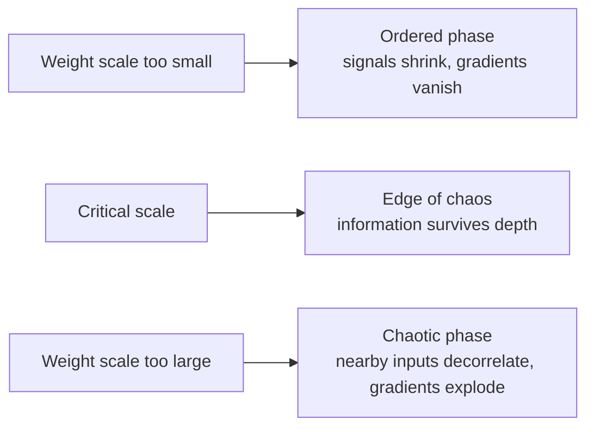
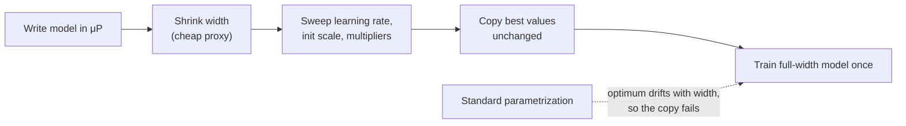
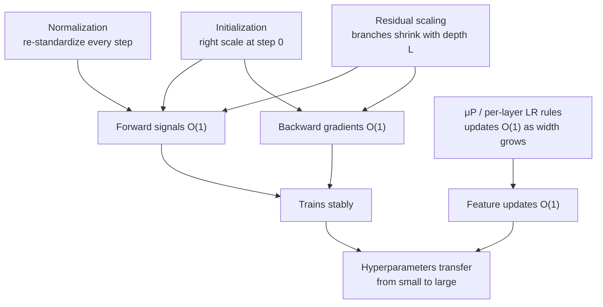

# Normalization, initialization and μP

Train a small model and a learning rate of $3\times10^{-3}$ works beautifully. Make the same model ten times wider and that learning rate may blow it up. Make it a hundred layers deeper and the gradients may vanish before they reach the first layer. Whether a deep network trains at all is decided less by its architecture than by three quiet choices: **how its weights start, how its activations are rescaled, and how every scale changes as the model grows.**

> The core idea in one sentence: **keep every signal at a sensible size (forward activations, backward gradients, and the size of each update) and keep it that way as width and depth grow, so that what you learn on a small model still holds on a large one.**

This page connects three ideas usually taught separately: variance-preserving initialization, normalization layers, and the **Maximal Update Parametrization (μP)**, which turns "scale-aware initialization" into a practical way to tune huge models on cheap proxies.

## 1. Initialization: keeping the forward pass alive (established)

Take one linear layer $y = Wx$ with $n_{\text{in}}$ inputs, independent zero-mean weights of variance $\sigma_w^2$, and inputs of variance $\sigma_x^2$. Each output is a sum of $n_{\text{in}}$ independent terms, so

```math
\operatorname{Var}(y_i) = n_{\text{in}}\,\sigma_w^2\,\sigma_x^2 .
```

Stack $L$ such layers and the activation scale is multiplied by $(n_{\text{in}}\sigma_w^2)^{L}$ (times a factor from each nonlinearity). Anything other than a factor of one per layer grows or decays **exponentially in depth**. The classical fixes choose $\sigma_w^2$ to make that factor one:

| Scheme | Weight variance | Designed for | Source |
|---|---|---|---|
| Glorot / Xavier | $\dfrac{2}{n_{\text{in}} + n_{\text{out}}}$ | tanh, sigmoid (balances forward and backward) | Glorot & Bengio 2010 |
| He / Kaiming | $\dfrac{2}{n_{\text{in}}}$ | ReLU (which zeroes half its inputs, hence the 2) | He et al. 2015 |
| Orthogonal | $W$ a scaled orthogonal matrix | Deep linear and near-linear nets | Saxe, McClelland & Ganguli 2013 |

Preserving the *average* size is not the whole story. Saxe et al. showed that orthogonal initialization makes all singular values of the input–output map equal (**dynamical isometry**), so every direction of the signal survives depth, not just its average norm. Schoenholz et al. (2016) used mean-field theory to show that random deep networks have a characteristic depth over which information propagates, and that this depth diverges only at the boundary between ordered and chaotic phases, the [edge of chaos](../06-frontiers/nonlinearity-and-dynamical-systems.md). Good initialization places the network on that boundary.



## 2. Normalization: rescaling on the fly (established)

Initialization fixes scales at step zero. Training then moves the weights, and scales drift. **Normalization layers** re-standardize activations at every step. For a feature vector $x \in \mathbb{R}^d$:

```math
\text{LayerNorm}(x) = \gamma \odot \frac{x - \mu}{\sqrt{\sigma^2 + \epsilon}} + \beta,
\qquad
\text{RMSNorm}(x) = \gamma \odot \frac{x}{\sqrt{\tfrac{1}{d}\sum_i x_i^2 + \epsilon}},
```

where $\mu$ and $\sigma^2$ are the mean and variance over the $d$ features. BatchNorm (Ioffe & Szegedy 2015) computes the statistics over the batch instead; LayerNorm (Ba, Kiros & Hinton 2016) and RMSNorm (Zhang & Sennrich 2019) work per example, which is why they suit sequence models. See the [comparison table](architectures.md#normalization).

### Where the norm goes matters

In a transformer, the residual stream is $h_{\ell+1} = h_\ell + F_\ell(\cdot)$. The original design applied LayerNorm *after* the addition (**Post-LN**); most modern LLMs apply it *inside* the branch, before attention and the MLP (**Pre-LN**):

```math
\text{Post-LN: } h_{\ell+1} = \text{LN}\big(h_\ell + F_\ell(h_\ell)\big)
\qquad
\text{Pre-LN: } h_{\ell+1} = h_\ell + F_\ell\big(\text{LN}(h_\ell)\big)
```

Xiong et al. (2020) proved with mean-field theory that at initialization a Post-LN transformer has large expected gradients for parameters near the output, which is why it needs a learning-rate warm-up. Pre-LN gradients are well behaved at initialization, and they showed Pre-LN models can drop the warm-up stage. Pre-LN keeps an untouched identity path from input to output; the price is that the residual stream can grow with depth.

### Pushing depth: rescale the branches

Two results show that normalization and initialization are partly interchangeable:

- **Fixup** (Zhang, Dauphin & Ma 2019) removes normalization from residual networks entirely, rescaling a standard initialization so each residual branch starts small. They trained networks with 10,000 layers as stably as normalized ones.
- **DeepNet** (Wang et al. 2022) keeps Post-LN but up-weights the residual, $h_{\ell+1} = \text{LN}(\alpha\, h_\ell + F_\ell(h_\ell))$ with $\alpha > 1$, plus a matching down-scaled initialization of the branches (**DeepNorm**). It trained transformers with 1,000 layers.

The common thread is that **each of $L$ residual branches must contribute an amount that shrinks with $L$**, or their sum grows without bound.

### Instabilities at scale, and the norms that fix them

Large-model teams have reported failures that do not appear at small scale. Dehghani et al. (2023), training a 22-billion-parameter vision transformer, observed attention logits growing until the softmax collapsed onto a single token, and fixed it by applying LayerNorm to queries and keys before their dot product (**QK-norm**). Wortsman et al. (2023) showed that this attention-logit growth, and the divergence of output logits, also appear in *small* models trained at high learning rates, and that the large-scale mitigations work there too. That made instability something you can study on a laptop-sized budget.

### Do we need normalization at all? (active research)

Two 2024–2025 results push in opposite directions:

- **Dynamic Tanh** (Zhu, Chen, He, LeCun & Liu 2025) replaces every normalization layer with the elementwise $\tanh(\alpha x)$, $\alpha$ learned, motivated by the observation that trained LayerNorms often produce S-shaped input–output maps. The authors report matching or exceeding normalized transformers across vision and language, mostly without retuning.
- **nGPT** (Loshchilov et al. 2024) goes the other way and normalizes *everything*: embeddings, hidden states, and the rows of weight matrices all live on the unit hypersphere, and each layer contributes a displacement along it. The authors report reaching the same accuracy in 4 to 20 times fewer training steps, depending on sequence length.

Both are recent, and independent replications at frontier scale are still limited.

## 3. μP: making hyperparameters survive scale (established, with active refinements)

Initialization and normalization control the size of activations. They do not control the size of **updates**, and that is what breaks when you widen a model.

### Why the best learning rate drifts with width

Consider a hidden layer of width $n$ trained with Adam, which normalizes gradients so each weight moves by roughly the learning rate $\eta$. After one step the update $\Delta W$ has entries of size about $\eta$, and, crucially, they are **correlated with the input $x$** that produced them (the gradient is an outer product involving $x$). So the change in output,

```math
(\Delta W x)_i = \sum_{j=1}^{n} \Delta W_{ij}\, x_j ,
```

adds $n$ *aligned* terms and grows like $\eta\, n$, not like $\eta\sqrt{n}$ as random terms would. With a fixed $\eta$, a wider model takes proportionally larger effective steps. Under the **standard parametrization (SP)**, the optimal learning rate therefore shifts as width grows, and a value tuned on a small model is wrong for a large one. Scaling $\eta \propto 1/n$ for hidden layers keeps the update's effect on features at order one. Making that choice consistently for every layer type is the Maximal Update Parametrization.

### The μP rules

Yang & Hu (2020) classified how infinite-width networks behave under every per-layer scaling of initialization, multipliers and learning rate. In the *kernel* regime (the neural tangent kernel limit, Jacot et al. 2018) features stop changing as width grows. μP is the unique choice in their classification where **every layer's features keep learning at the maximal stable rate**, independent of width. For Adam, one common way to write it, relative to a base width:

| Weight | Initialization variance | Adam learning rate |
|---|---|---|
| Input / embedding | $\propto 1$ | $\propto 1$ |
| Hidden ($n \times n$) | $\propto 1/n$ | $\propto 1/n$ |
| Output / readout | $\propto 1/n^2$ (or a $1/n$ output multiplier) | $\propto 1/n$ |
| Attention logits | scale $q^\top k$ by $1/d$ instead of $1/\sqrt{d}$ | |

Several equivalent forms exist (moving factors between initialization, multipliers and learning rates); the reference implementation is the [`mup` library](https://github.com/microsoft/mup).

### μTransfer: tune small, train big

The payoff (Yang et al. 2022, *Tensor Programs V*) is **zero-shot hyperparameter transfer**: parametrize the target model in μP, sweep hyperparameters on a narrow proxy, and copy them to the full model without tuning it. Their headline results: hyperparameters transferred from a 40M-parameter model beat the published numbers of the 6.7B GPT-3 model, with tuning cost 7% of total pretraining cost; transferred from 13M parameters, they beat published BERT-large numbers.



### Depth, and the debates (active research)

- **Depth.** μP handles width. For depth, Yang et al. (2023, *Tensor Programs VI*) and Bordelon et al. (2023) independently studied scaling each residual branch by $1/\sqrt{L}$, so that hyperparameters also transfer across depth. Yang et al. identify a unique optimal depthwise parametrization (**Depth-μP**) for residual networks with one layer per block, but show fundamental limits for deeper blocks such as transformer blocks.
- **Is μP special?** Everett et al. (2024) trained tens of thousands of models up to 26.8B parameters across optimizers and parametrizations. They found that *all* the parametrizations they studied can transfer hyperparameters with the right per-layer learning rates, that their own per-layer prescription for standard parametrization outperformed μP, and that Adam's $\epsilon$ must also be scaled to avoid gradient underflow; they propose **Adam-atan2**, which removes $\epsilon$ entirely.
- **Low precision.** **u-μP** (Blake et al. 2024) combines μP with *unit scaling*, so activations, weights and gradients all start at scale one. The authors report that defaults are near-optimal and that models work out of the box in FP8.

The lesson that survives the debate is that **learning-rate scaling has to be designed per layer as a function of width and depth**. Whether μP's particular rules are the best ones is still being worked out.

## 4. One picture



## 5. Scale control on analog and optical hardware (speculative)

> **Speculative.** This section connects established ideas to hardware that is still largely experimental. It is a hypothesis, not a result.

Digital floating point gives enormous dynamic range for free. Analog accelerators, including [photonic](../06-frontiers/photonic-computing.md) and [in-memory](../06-frontiers/neuromorphic-computing.md) designs, typically do not: signals live within a fixed physical range set by detector noise at the bottom and saturation at the top, and converters often offer only a few effective bits. A parametrization that keeps every activation, weight and gradient near unit scale at every width, as unit scaling and u-μP aim to, is a natural match for such hardware, because the compiler or runtime would not need to chase drifting scales layer by layer. Likewise, normalization-free designs such as Dynamic Tanh replace a reduction over the whole feature vector with an elementwise saturating function, the kind of nonlinearity some optical and analog devices exhibit physically. Whether these properties actually improve accuracy on noisy analog hardware is an open, testable question; we know of no published study that settles it.

## Further reading

- Glorot, X., Bengio, Y. (2010). *Understanding the difficulty of training deep feedforward neural networks*. AISTATS. [Link](https://proceedings.mlr.press/v9/glorot10a.html)
- He, K., Zhang, X., Ren, S., Sun, J. (2015). *Delving deep into rectifiers*. ICCV. [arXiv:1502.01852](https://arxiv.org/abs/1502.01852)
- Saxe, A. M., McClelland, J. L., Ganguli, S. (2013). *Exact solutions to the nonlinear dynamics of learning in deep linear neural networks*. [arXiv:1312.6120](https://arxiv.org/abs/1312.6120)
- Schoenholz, S. S., Gilmer, J., Ganguli, S., Sohl-Dickstein, J. (2016). *Deep information propagation*. [arXiv:1611.01232](https://arxiv.org/abs/1611.01232)
- Zhang, H., Dauphin, Y. N., Ma, T. (2019). *Fixup initialization: Residual learning without normalization*. [arXiv:1901.09321](https://arxiv.org/abs/1901.09321)
- Xiong, R., et al. (2020). *On layer normalization in the Transformer architecture*. [arXiv:2002.04745](https://arxiv.org/abs/2002.04745)
- Wang, H., et al. (2022). *DeepNet: Scaling Transformers to 1,000 layers*. [arXiv:2203.00555](https://arxiv.org/abs/2203.00555)
- Yang, G., Hu, E. J. (2020). *Feature learning in infinite-width neural networks* (Tensor Programs IV). [arXiv:2011.14522](https://arxiv.org/abs/2011.14522)
- Yang, G., et al. (2022). *Tensor Programs V: Tuning large neural networks via zero-shot hyperparameter transfer*. [arXiv:2203.03466](https://arxiv.org/abs/2203.03466)
- Yang, G., Yu, D., Zhu, C., Hayou, S. (2023). *Tensor Programs VI: Feature learning in infinite-depth neural networks*. [arXiv:2310.02244](https://arxiv.org/abs/2310.02244)
- Bordelon, B., Noci, L., Li, M. B., Hanin, B., Pehlevan, C. (2023). *Depthwise hyperparameter transfer in residual networks*. [arXiv:2309.16620](https://arxiv.org/abs/2309.16620)
- Dehghani, M., et al. (2023). *Scaling vision transformers to 22 billion parameters*. [arXiv:2302.05442](https://arxiv.org/abs/2302.05442)
- Wortsman, M., et al. (2023). *Small-scale proxies for large-scale Transformer training instabilities*. [arXiv:2309.14322](https://arxiv.org/abs/2309.14322)
- Everett, K., et al. (2024). *Scaling exponents across parameterizations and optimizers*. [arXiv:2407.05872](https://arxiv.org/abs/2407.05872)
- Blake, C., et al. (2024). *u-μP: The unit-scaled maximal update parametrization*. [arXiv:2407.17465](https://arxiv.org/abs/2407.17465)
- Loshchilov, I., Hsieh, C.-P., Sun, S., Ginsburg, B. (2024). *nGPT: Normalized Transformer with representation learning on the hypersphere*. [arXiv:2410.01131](https://arxiv.org/abs/2410.01131)
- Zhu, J., Chen, X., He, K., LeCun, Y., Liu, Z. (2025). *Transformers without normalization*. arXiv. [arXiv:2503.10622](https://arxiv.org/abs/2503.10622)
