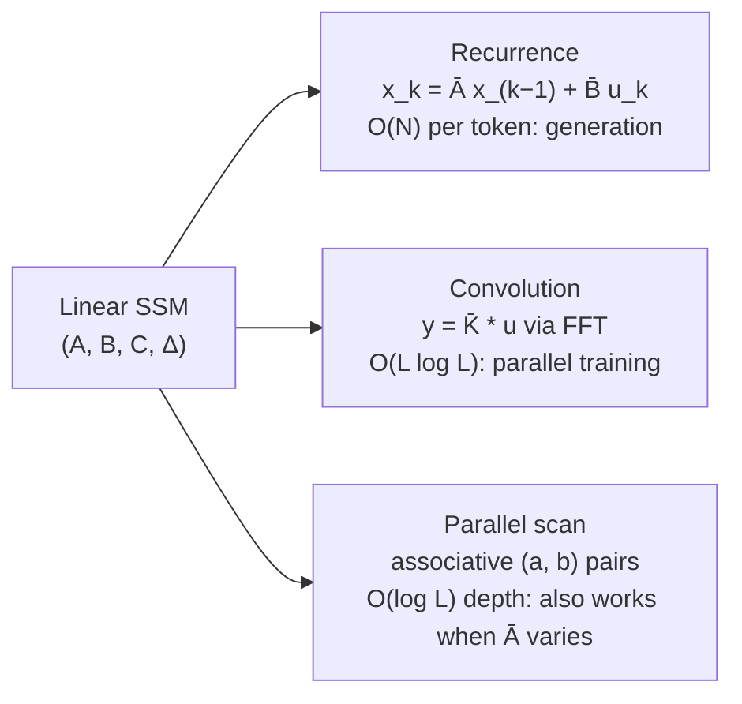
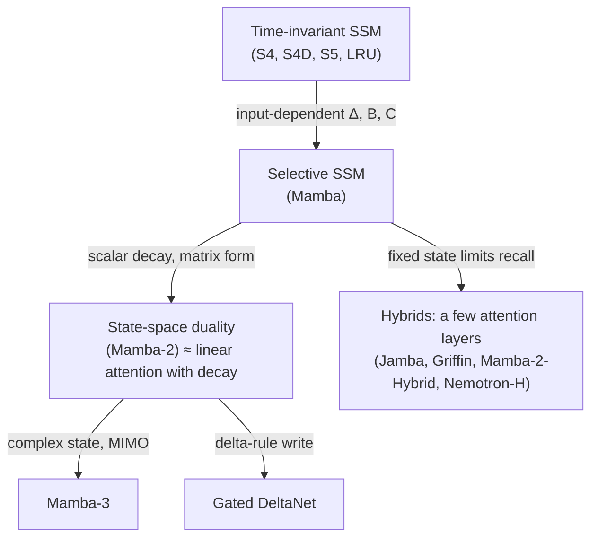

# State-space models: from S4 to Mamba

For most of the 2010s, recurrent networks lost to attention for one reason: a nonlinear recurrence has to be computed one step at a time, so it cannot use a GPU's parallelism during training. Between 2020 and 2024 a line of work found a way out. If the recurrence is **linear**, the same layer can be run three ways: as a recurrence for cheap generation, as a long convolution for parallel training, and as a parallel scan. Add a carefully chosen state matrix and the layer remembers thousands of steps. Make its parameters depend on the input and it starts to compete with attention on language.

That family, the **structured state-space models** (SSMs), now sits inside production language models, usually mixed with a few attention layers. This page explains how they work, what the mathematics buys, and what a fixed-size state cannot do.

> The core idea in one sentence: **a sequence layer can be a linear dynamical system whose state summarizes the past, and the choice of state matrix, discretization and input-dependence decides how long it remembers, how fast it trains and what it can recall.**

This page expands the short state-space section of [architectures](architectures.md). It connects to [transformers](transformers.md), [fast-weight programmers](../06-frontiers/fast-weight-programmers.md) (the same story told from the linear-attention side), [what transformers can compute](../06-frontiers/what-transformers-can-and-cannot-compute.md), [non-linearity and dynamical systems](../06-frontiers/nonlinearity-and-dynamical-systems.md), and [inference and efficiency](../04-systems/inference-and-efficiency.md).

## 1. The state-space model (established)

Control engineers have described systems this way since Kalman (1960). An input signal $u(t)$ drives a hidden state $\mathbf{x}(t) \in \mathbb{R}^N$, and the output is read from the state:

```math
\dot{\mathbf{x}}(t) = A\,\mathbf{x}(t) + B\,u(t), \qquad y(t) = C\,\mathbf{x}(t) + D\,u(t).
```

Gu et al. (2021) proposed using exactly this system as a deep-learning layer, the **linear state-space layer** (LSSL), with $A$, $B$, $C$, $D$ learned. A layer usually runs one such single-input, single-output system per channel and mixes channels with ordinary linear layers and nonlinearities between SSM layers. All the nonlinearity lives *outside* the recurrence. That is the trade that makes everything below possible.

### Discretization

Tokens arrive at discrete steps, so the continuous system is sampled with a step size $\Delta$. Two standard rules give a discrete recurrence $\mathbf{x}_k = \bar A\,\mathbf{x}_{k-1} + \bar B\,u_k$, $y_k = C\,\mathbf{x}_k$:

| Rule | $\bar A$ | $\bar B$ | Used by |
|---|---|---|---|
| Bilinear (Tustin) | $(I - \tfrac{\Delta}{2}A)^{-1}(I + \tfrac{\Delta}{2}A)$ | $(I - \tfrac{\Delta}{2}A)^{-1}\Delta B$ | LSSL, S4 |
| Zero-order hold | $\exp(\Delta A)$ | $(\Delta A)^{-1}(\exp(\Delta A) - I)\,\Delta B$ | S4D, Mamba |

The step size is learned. It acts as a timescale: a small $\Delta$ makes the state change slowly and remember for a long time, while a large $\Delta$ makes it track the latest input. Gu et al. (2021) noted that this explains the gates of classical RNNs, which can be read as learned, input-dependent step sizes. That observation returns in Section 5.

## 2. One layer, three algorithms (established)

Unroll the recurrence from a zero state and the output is a convolution of the input with a kernel built from powers of $\bar A$:

```math
y_k = \sum_{j=0}^{k} \bar K_j\, u_{k-j}, \qquad \bar K = \big(C\bar B,\; C\bar A\bar B,\; C\bar A^2\bar B,\; \dots\big).
```

So the same layer can be computed three ways:



- **Recurrence.** Constant memory and constant work per generated token, with no growing [KV cache](../04-systems/kv-cache.md). This is the inference advantage.
- **Convolution.** When the parameters are the same at every step (the layer is *linear time-invariant*, LTI), the kernel can be computed once and applied with a fast Fourier transform. This is how S4 trained.
- **Parallel scan.** The pairs $(\bar A_k, \bar B_k u_k)$ compose associatively: $(a_2, b_2) \circ (a_1, b_1) = (a_2 a_1,\; a_2 b_1 + b_2)$. Any associative operation can be evaluated in $O(\log L)$ parallel rounds (Hillis & Steele 1986). Martin and Cundy (2017) used this to parallelize linear RNNs over sequence length, reporting up to 9× speed-ups and training on a dependency one million steps long; S5 (Smith, Warrington & Linderman 2022) made the scan the core of an SSM layer. Crucially, the scan does not need the parameters to be the same at every step.

## 3. Remembering the past: HiPPO (established)

A random $A$ forgets quickly. The question Gu, Dao, Ermon, Rudra and Ré (2020) asked was: what state matrix makes $\mathbf{x}(t)$ the *best possible summary* of the whole history $u(s)$, $s \le t$? Their **HiPPO** framework answers by projecting the history onto orthogonal polynomials under a chosen measure of importance and deriving the ODE that the projection coefficients obey. With a uniform measure over all of $[0, t]$ (the *scaled Legendre*, LegS, case) the coefficients $\mathbf{c}(t)$ evolve as

```math
\frac{d\mathbf{c}}{dt} = -\frac{1}{t} A\,\mathbf{c}(t) + \frac{1}{t} B\,u(t),
\qquad
A_{nk} = \begin{cases} \sqrt{2n+1}\sqrt{2k+1} & n > k \\ n+1 & n = k \\ 0 & n < k \end{cases},
\qquad B_n = \sqrt{2n+1},
```

and the history can be read back as $u(s) \approx \sum_n c_n(t)\sqrt{2n+1}\,P_n(2s/t - 1)$ with Legendre polynomials $P_n$. The authors showed the framework re-derives the Legendre Memory Unit, generalizes RNN gating, and that HiPPO-LegS has timescale robustness and bounded gradients; it set a then state-of-the-art 98.3% on permuted MNIST.

S4 used the HiPPO matrix as a *time-invariant* $A$ (dropping the $1/t$), which had no clear meaning until Gu et al. (2022, "How to train your HiPPO") showed that it amounts to projecting onto exponentially warped Legendre polynomials, a memory that fades smoothly rather than a hard window.

## 4. S4 and its simplifications (established)

The HiPPO matrix is dense, and naively computing its kernel costs too much. **S4** (Gu, Goel & Ré 2021) rewrote $A$ as a normal matrix plus a low-rank correction, diagonalized it stably, and reduced the kernel to a Cauchy-kernel computation. The reported results were striking for 2021: 91% on sequential CIFAR-10 with no data augmentation, generation 60× faster than a transformer on its image and language tests, and state of the art on every task of the Long Range Arena benchmark (Tay et al. 2020), including **Path-X**, a 16,384-step task "that all prior work fails on".

The low-rank machinery then turned out to be mostly unnecessary:

| Model | Change | Reported result |
|---|---|---|
| DSS (Gupta, Gu & Berant 2022) | Purely diagonal $A$ | Matches S4 on Long Range Arena and speech |
| S4D (Gu, Gupta, Goel & Ré 2022) | Diagonal $A$ with principled initialization; kernel in "2 lines of code" | About 85% Long Range Arena average; shows initialization is what matters |
| S5 (Smith et al. 2022) | One multi-input, multi-output SSM, parallel scan | 87.4% Long Range Arena average, 98.5% on Path-X |
| LRU (Orvieto et al. 2023) | A plain linear, diagonal, complex RNN with careful parameterization and normalization | Matches deep SSMs on Long Range Arena and their speed |

S4D explains why the diagonal version works: the diagonal part of S4's matrix recovers the same kernel in the limit of infinite state size. The LRU paper made a point worth remembering: much of the "SSM magic" is a well-initialized, linear, diagonal recurrence with eigenvalues close to the unit circle. In diagonal form, each state coordinate is a **damped complex oscillator** $x_k = \bar\lambda\, x_{k-1} + \bar b\, u_k$ with $|\bar\lambda| < 1$; its magnitude sets how long it remembers and its phase sets how fast it rotates.

## 5. Selectivity: Mamba (established, with open questions)

Time-invariant SSMs were excellent on audio, images and long synthetic tasks but lagged attention on language. H3 (Fu et al. 2022) used synthetic tasks to locate the gap: existing SSMs struggled to *recall earlier tokens* and to *compare tokens* across the sequence. Zoology (Arora et al. 2023) quantified it: 82% of the perplexity gap between gated-convolution models and attention on the Pile came from **associative recall**, and a 70M-parameter attention model beat a 1.4B-parameter gated-convolution model at it.

Gu and Dao (2023) diagnosed the cause as an inability to do content-based reasoning and fixed it by making $\Delta$, $B$ and $C$ **functions of the current token**:

```math
\Delta_k = \operatorname{softplus}(W_\Delta \mathbf{u}_k), \quad B_k = W_B \mathbf{u}_k, \quad C_k = W_C \mathbf{u}_k, \qquad
\mathbf{x}_k = \exp(\Delta_k A)\,\mathbf{x}_{k-1} + \Delta_k B_k\, u_k .
```

This is exactly the RNN-gating reading of Section 1 taken seriously. A large $\Delta_k$ resets the state and writes the current token; a $\Delta_k$ near zero leaves the state untouched and ignores the token. The price is that the layer is no longer time-invariant, so the convolution algorithm is gone. Mamba keeps the parallel scan and makes it fast with a hardware-aware kernel that keeps the expanded state in on-chip memory and recomputes it in the backward pass rather than storing it, an idea close to [FlashAttention](attention-gradients.md).

The paper reports 5× higher generation throughput than transformers, linear scaling in sequence length with gains up to million-length sequences, state-of-the-art results across language, audio and genomics, and a 3B-parameter Mamba that outperforms transformers of the same size and matches transformers twice its size. The Mamba paper also separates two synthetic tasks that make the role of selectivity precise: plain *copying* with fixed spacing can be solved by a time-invariant convolution, but **selective copying**, where the tokens to remember appear at random positions, needs the parameters to depend on content.

### State-space duality: Mamba-2

Dao and Gu (2024) made the simplest selective case, a scalar $A_k = a_k I$, and wrote the whole sequence map as one matrix:

```math
\mathbf{y} = M\,\mathbf{u}, \qquad M_{ij} = C_i^{\top}\Big(\textstyle\prod_{l=j+1}^{i} a_l\Big) B_j \quad (i \ge j),
\qquad M = L \circ (C B^{\top}),\;\; L_{ij} = \textstyle\prod_{l=j+1}^{i} a_l .
```

Read with $C$ as queries and $B$ as keys, this is **masked linear attention** with a data-dependent decay mask $L$. Matrices of this form are *semiseparable*, and different ways of factoring them recover the recurrence, the quadratic attention-like form, and a chunked hybrid that uses matrix multiplications. Their **state space duality** (SSD) framework produced Mamba-2, whose core layer is 2 to 8 times faster than Mamba's while remaining competitive with transformers. The same algebra underlies RetNet (Sun et al. 2023), RWKV (Peng et al. 2023), gated linear recurrences in Griffin (De et al. 2024), and the delta-rule layers on the [fast-weight page](../06-frontiers/fast-weight-programmers.md). The boundary between "state-space model" and "linear attention" is now largely a matter of notation; the [linear attention page](linear-attention.md) tells the same story from the attention side, from feature maps to chunkwise kernels.

### Mamba-3 and complex states (active research)

Mamba-2's real, scalar decay cannot rotate the state. Lahoti et al. (2026) introduced **Mamba-3** with three changes: a more expressive recurrence derived from SSM discretization, a complex-valued state update for richer state tracking, and a multi-input, multi-output formulation that adds quality without increasing decode latency. At the 1.5B scale they report average downstream accuracy 0.6 points above Gated DeltaNet (1.8 points for the MIMO variant) and Mamba-2's perplexity at half its state size. Liang and Song (2026) interpret the rotations as underdamped second-order dynamics and report, in controlled comparisons, that oscillatory regimes beat non-oscillatory damping on state-tracking tasks. Both results are recent and come from small numbers of groups. They fit an older theoretical finding: Grazzi et al. (2024) proved that linear RNNs whose transitions have only positive real eigenvalues cannot solve parity in finite precision, and Merrill, Petty and Sabharwal (2024) argued that common SSMs, like transformers, cannot express inherently sequential state tracking. Complex and negative eigenvalues are one way out.

## 6. A tested sketch

The code checks the three algorithms against each other, measures how well HiPPO-LegS compresses a long history, and isolates what selectivity buys. It runs as written with NumPy in a few seconds.

```python
import numpy as np
from numpy.polynomial import legendre as L
rng = np.random.default_rng(0)

# 1. One layer, three algorithms: recurrence, convolution, parallel scan
N, T, dt = 16, 4096, 0.01
lam = -0.5 + 1j * np.pi * np.arange(N)          # S4D-Lin style diagonal A
B = np.ones(N); C = rng.standard_normal(N) + 1j * rng.standard_normal(N)
Ab = np.exp(dt * lam); Bb = (Ab - 1) / lam * B   # zero-order hold
u = rng.standard_normal(T)

h = np.zeros(N, complex); y_rec = np.empty(T)
for t in range(T):
    h = Ab * h + Bb * u[t]; y_rec[t] = 2 * (C @ h).real

K = 2 * (C * Bb @ (Ab[:, None] ** np.arange(T))).real   # kernel K_k = 2 Re(C Ab^k Bb)
n = 2 * T
y_conv = np.fft.irfft(np.fft.rfft(K, n) * np.fft.rfft(u, n), n)[:T]

a = np.tile(Ab, (T, 1)); b = Bb[None, :] * u[:, None]   # elements (a_t, b_t)
step = 1
while step < T:                                          # Hillis-Steele scan, log2(T) rounds
    a_prev, b_prev = a[:-step].copy(), b[:-step].copy()
    b[step:] = a[step:] * b_prev + b[step:]
    a[step:] = a[step:] * a_prev
    step *= 2
y_scan = 2 * (b @ C).real
print("1) max |conv - rec| = %.1e, max |scan - rec| = %.1e, rounds = %d"
      % (abs(y_conv - y_rec).max(), abs(y_scan - y_rec).max(), int(np.log2(T))))

# 2. HiPPO-LegS: compress a whole history into N coefficients online
def legs(Nst):
    n = np.arange(Nst); r = np.sqrt(2 * n + 1)
    A = -np.tril(np.outer(r, r), -1) - np.diag(n + 1)
    return A, r
Tsig = 10000
s = np.linspace(0, 1, Tsig)
f = np.sin(6 * np.pi * s) * np.exp(-2 * s) + 0.5 * np.sin(23 * s) + (s > 0.6) * 0.4
print("2) HiPPO-LegS reconstruction of a %d-step signal from N numbers:" % Tsig)
for Nst in (4, 8, 16, 32, 64):
    A, Bv = legs(Nst); I = np.eye(Nst); c = np.zeros(Nst)
    for k in range(1, Tsig + 1):                       # bilinear (GBT alpha=1/2) step of c' = A c / t + B f / t
        M = I - A / (2 * k)
        c = np.linalg.solve(M, (I + A / (2 * k)) @ c + Bv * f[k - 1] / k)
    rec = L.legval(2 * s - 1, c * np.sqrt(2 * np.arange(Nst) + 1))
    print("   N = %2d: relative RMS error %.3f" % (Nst, np.sqrt(np.mean((rec - f) ** 2) / np.mean(f ** 2))))

# 3. Why selectivity: recall a value whose position varies, after distractor tokens
trials = 20000
print("3) recall of one marked value at a random position (fraction of variance unexplained):")
for G in (16, 128, 1024):
    u = rng.standard_normal((trials, G))               # every token is a number
    p = rng.integers(0, G // 2, trials)                # marker sits somewhere in the first half
    v = u[np.arange(trials), p]
    # any linear time-invariant layer, whatever its state size, outputs a fixed weighted sum of the tokens.
    # Tokens are independent with unit variance, so the least-squares weights are E[u_j v] = P(p = j).
    M = G // 2
    K = np.r_[np.full(M, 1 / M), np.zeros(G - M)]
    lti = np.mean((u @ K - v) ** 2) / np.var(v)
    # selective scalar SSM: step size depends on the token (marker -> overwrite, distractor -> hold)
    h = np.zeros(trials)
    for t in range(G):
        Delta = np.where(p == t, 20.0, 0.0)
        h = np.exp(-Delta) * h + (1 - np.exp(-Delta)) * u[:, t]
    sel = np.mean((h - v) ** 2) / np.var(v)
    print("   length %4d: best time-invariant %.3f (theory %.3f), selective with 1 state number %.1e"
          % (G, lti, 1 - 1 / M, sel))
```

Output:

```text
1) max |conv - rec| = 6.9e-15, max |scan - rec| = 6.0e-15, rounds = 12
2) HiPPO-LegS reconstruction of a 10000-step signal from N numbers:
   N =  4: relative RMS error 0.775
   N =  8: relative RMS error 0.619
   N = 16: relative RMS error 0.064
   N = 32: relative RMS error 0.046
   N = 64: relative RMS error 0.033
3) recall of one marked value at a random position (fraction of variance unexplained):
   length   16: best time-invariant 0.873 (theory 0.875), selective with 1 state number 4.2e-18
   length  128: best time-invariant 0.983 (theory 0.984), selective with 1 state number 4.2e-18
   length 1024: best time-invariant 0.998 (theory 0.998), selective with 1 state number 4.2e-18
```

What it shows:

1. **Same layer, three algorithms.** On 4,096 steps the FFT convolution and a 12-round parallel scan agree with the step-by-step recurrence to about $10^{-14}$, round-off level. The choice between them is purely about hardware.
2. **A long history in a few numbers.** HiPPO-LegS keeps a running summary of all 10,000 samples of a signal and reconstructs the whole history from it. With 4 or 8 coefficients the summary misses the oscillation (errors 0.78 and 0.62); with 16 the error drops to 6.4%, and to 3.3% with 64. The remaining error comes mostly from the jump at $s = 0.6$, which polynomials approximate slowly.
3. **What time-invariance cannot do.** One value must be recalled from a random position in the first half of the sequence, with every other token a distractor drawn from the same distribution. Any linear time-invariant layer, with any state size, can only output a fixed weighted sum of the tokens; its best possible error, $1 - 2/G$, is matched by the simulation and approaches total failure as the sequence grows. A selective layer with a *single* state number solves it exactly, because its step size is large at the marker and zero elsewhere. (In a trained model the "is this the marker" signal would come from the token's own features; here it is given, to isolate the mechanism.)

## 7. What a fixed-size state cannot do (active research)

Selectivity decides *what* enters the state. It does not change *how much* fits.

- **Copying.** Jelassi et al. (2024) proved that a two-layer transformer can copy strings of exponential length while models with a fixed-size latent state are fundamentally limited by it, and found that pretrained transformers "dramatically outperform" SSMs at copying and retrieving from context.
- **The recall-memory trade-off.** Arora et al. (2024) identified a trade-off between state size and recall across H3, Mamba and RWKV, and designed BASED, which combines linear and sliding-window attention so the state size can be dialed along it; at 1.3B parameters it matched Mamba's perplexity and beat it by 6.22 accuracy points on recall-intensive tasks.
- **At scale.** Waleffe et al. (2024) trained 8B-parameter Mamba, Mamba-2 and transformer models on the same data (up to 3.5T tokens). Pure SSMs matched or exceeded the transformer on many tasks but lagged on copying and in-context learning (5-shot MMLU, a phonebook lookup) and on long-context reasoning. A hybrid with 43% Mamba-2, 7% attention and 50% MLP layers exceeded the transformer on all 12 standard tasks (+2.65 points on average) and was predicted to generate up to 8× faster.
- **Forgetting.** Chen et al. (2024) found that Mamba models trained on contexts too short for their state size never learn to forget, and degrade beyond the training length; the training length needed to learn forgetting grew linearly with state size.



## 8. Hybrids in practice (established)

The practical answer to the recall problem has been to keep a small number of attention layers.

- **Jamba** (Lieber et al. 2024) interleaves transformer and Mamba layers with mixture-of-experts layers, fits in a single 80 GB GPU in the reported configuration, and shows strong results up to 256K tokens; **Jamba-1.5** (Jamba Team 2024) scaled it to 94B active parameters.
- **Griffin** (De et al. 2024) mixes gated linear recurrences with local attention and matched Llama-2 while trained on over 6 times fewer tokens; its recurrent-only sibling Hawk exceeded Mamba's reported downstream results. **RecurrentGemma** (Botev et al. 2024) released open models built on it.
- **Nemotron-H** (NVIDIA 2025) replaced most attention layers with Mamba layers in 8B and 56B models, reporting accuracy on par with or better than similarly sized open transformers such as Qwen-2.5 and Llama-3.1 while being up to 3× faster at inference.

The common pattern: recurrent layers carry most of the sequence mixing with constant memory per token, and a handful of attention layers provide exact lookup into the context. The [inference page](../04-systems/inference-and-efficiency.md) explains why removing most of the KV cache matters for serving cost.

## 9. What we know and what we don't

| Claim | Status |
|---|---|
| A linear time-invariant SSM can be computed equivalently as a recurrence, a convolution or a parallel scan | Established (an algebraic identity; reproduced above) |
| HiPPO matrices give a principled long-memory initialization | Established; S4D shows initialization matters more than the low-rank structure |
| Input-dependent (selective) parameters close most of the gap to attention on language at small and medium scale | Supported by several groups |
| Fixed-size-state models are fundamentally weaker than attention at copying and associative recall | Proved for copying; consistent across empirical studies up to 8B parameters |
| Hybrids with a few attention layers match or beat transformers at equal data | Reported by several labs (NVIDIA, AI21, Google DeepMind) under their own recipes |
| Complex-valued or oscillatory states improve state tracking in large language models | Early; 2026 results from few groups |

## 10. Physical linear systems as sequence layers (speculative)

> [!WARNING]
> **Speculative.** This section is a hypothesis connecting SSMs to analog and optical hardware. We have not checked it against experimental results, and we cite no study that tests it.

A diagonal SSM is a bank of damped oscillators driven by the input, a continuous-time linear system that existed long before deep learning. Many physical devices *are* such systems: resonant cavities, delay lines and LC circuits all have decay rates and natural frequencies that play the roles of $|\bar\lambda|$ and $\arg\bar\lambda$. Because the time-invariant layer is just a convolution with a sum of damped sinusoids, one could ask whether a physical filter bank could compute it directly, at the device's own speed, with digital hardware supplying the channel mixing and nonlinearities between layers, as on the [photonic computing page](../06-frontiers/photonic-computing.md). The hard part is the part that made Mamba work: selectivity requires changing the decay and coupling *per token*, which for a physical device means fast, precise tuning, and every analog stage adds noise that a recurrence carries forward. The tested sketch above suggests a narrower, testable question: for a given task, how much of the benefit of selectivity survives if $\Delta$ can only be switched between a few physical settings, and how quickly does analog noise in a held state destroy a value the layer was meant to keep?

## Further reading

- Kalman, R. E. (1960). *A new approach to linear filtering and prediction problems*. Journal of Basic Engineering 82(1), 35–45. [doi:10.1115/1.3662552](https://doi.org/10.1115/1.3662552)
- Hillis, W. D., Steele, G. L. (1986). *Data parallel algorithms*. Communications of the ACM 29(12), 1170–1183. [doi:10.1145/7902.7903](https://doi.org/10.1145/7902.7903)
- Martin, E., Cundy, C. (2017). *Parallelizing linear recurrent neural nets over sequence length*. ICLR 2018. [arXiv:1709.04057](https://arxiv.org/abs/1709.04057)
- Gu, A., Dao, T., Ermon, S., Rudra, A., Ré, C. (2020). *HiPPO: Recurrent memory with optimal polynomial projections*. NeurIPS. [arXiv:2008.07669](https://arxiv.org/abs/2008.07669)
- Tay, Y., Dehghani, M., Abnar, S., et al. (2020). *Long Range Arena: A benchmark for efficient transformers*. ICLR 2021. [arXiv:2011.04006](https://arxiv.org/abs/2011.04006)
- Gu, A., Johnson, I., Goel, K., Saab, K., Dao, T., Rudra, A., Ré, C. (2021). *Combining recurrent, convolutional, and continuous-time models with linear state-space layers*. NeurIPS. [arXiv:2110.13985](https://arxiv.org/abs/2110.13985)
- Gu, A., Goel, K., Ré, C. (2021). *Efficiently modeling long sequences with structured state spaces*. ICLR 2022. [arXiv:2111.00396](https://arxiv.org/abs/2111.00396)
- Gupta, A., Gu, A., Berant, J. (2022). *Diagonal state spaces are as effective as structured state spaces*. NeurIPS. [arXiv:2203.14343](https://arxiv.org/abs/2203.14343)
- Gu, A., Gupta, A., Goel, K., Ré, C. (2022). *On the parameterization and initialization of diagonal state space models*. NeurIPS. [arXiv:2206.11893](https://arxiv.org/abs/2206.11893)
- Gu, A., Johnson, I., Timalsina, A., Rudra, A., Ré, C. (2022). *How to train your HiPPO: State space models with generalized orthogonal basis projections*. ICLR 2023. [arXiv:2206.12037](https://arxiv.org/abs/2206.12037)
- Smith, J. T. H., Warrington, A., Linderman, S. W. (2022). *Simplified state space layers for sequence modeling*. ICLR 2023. [arXiv:2208.04933](https://arxiv.org/abs/2208.04933)
- Fu, D. Y., Dao, T., Saab, K. K., Thomas, A. W., Rudra, A., Ré, C. (2022). *Hungry Hungry Hippos: Towards language modeling with state space models*. ICLR 2023. [arXiv:2212.14052](https://arxiv.org/abs/2212.14052)
- Poli, M., Massaroli, S., Nguyen, E., et al. (2023). *Hyena hierarchy: Towards larger convolutional language models*. ICML. [arXiv:2302.10866](https://arxiv.org/abs/2302.10866)
- Orvieto, A., Smith, S. L., Gu, A., Fernando, A., Gulcehre, C., Pascanu, R., De, S. (2023). *Resurrecting recurrent neural networks for long sequences*. ICML. [arXiv:2303.06349](https://arxiv.org/abs/2303.06349)
- Peng, B., Alcaide, E., Anthony, Q., et al. (2023). *RWKV: Reinventing RNNs for the transformer era*. Findings of EMNLP. [arXiv:2305.13048](https://arxiv.org/abs/2305.13048)
- Sun, Y., Dong, L., Huang, S., et al. (2023). *Retentive network: A successor to transformer for large language models*. [arXiv:2307.08621](https://arxiv.org/abs/2307.08621)
- Gu, A., Dao, T. (2023). *Mamba: Linear-time sequence modeling with selective state spaces*. COLM 2024. [arXiv:2312.00752](https://arxiv.org/abs/2312.00752)
- Arora, S., Eyuboglu, S., Timalsina, A., et al. (2023). *Zoology: Measuring and improving recall in efficient language models*. ICLR 2024. [arXiv:2312.04927](https://arxiv.org/abs/2312.04927)
- Jelassi, S., Brandfonbrener, D., Kakade, S. M., Malach, E. (2024). *Repeat after me: Transformers are better than state space models at copying*. ICML. [arXiv:2402.01032](https://arxiv.org/abs/2402.01032)
- Arora, S., Eyuboglu, S., Zhang, M., et al. (2024). *Simple linear attention language models balance the recall-throughput tradeoff*. ICML. [arXiv:2402.18668](https://arxiv.org/abs/2402.18668)
- De, S., Smith, S. L., Fernando, A., et al. (2024). *Griffin: Mixing gated linear recurrences with local attention for efficient language models*. [arXiv:2402.19427](https://arxiv.org/abs/2402.19427)
- Lieber, O., Lenz, B., Bata, H., et al. (2024). *Jamba: A hybrid transformer-Mamba language model*. [arXiv:2403.19887](https://arxiv.org/abs/2403.19887)
- Botev, A., De, S., Smith, S. L., et al. (2024). *RecurrentGemma: Moving past transformers for efficient open language models*. [arXiv:2404.07839](https://arxiv.org/abs/2404.07839)
- Merrill, W., Petty, J., Sabharwal, A. (2024). *The illusion of state in state-space models*. ICML. [arXiv:2404.08819](https://arxiv.org/abs/2404.08819)
- Dao, T., Gu, A. (2024). *Transformers are SSMs: Generalized models and efficient algorithms through structured state space duality*. ICML. [arXiv:2405.21060](https://arxiv.org/abs/2405.21060)
- Waleffe, R., Byeon, W., Riach, D., et al. (2024). *An empirical study of Mamba-based language models*. [arXiv:2406.07887](https://arxiv.org/abs/2406.07887)
- Jamba Team, Lenz, B., Arazi, A., et al. (2024). *Jamba-1.5: Hybrid transformer-Mamba models at scale*. [arXiv:2408.12570](https://arxiv.org/abs/2408.12570)
- Chen, Y., Zhang, X., Hu, S., Han, X., Liu, Z., Sun, M. (2024). *Stuffed Mamba: Oversized states lead to the inability to forget*. COLM 2025. [arXiv:2410.07145](https://arxiv.org/abs/2410.07145)
- Grazzi, R., Siems, J., Zela, A., Franke, J. K. H., Hutter, F., Pontil, M. (2024). *Unlocking state-tracking in linear RNNs through negative eigenvalues*. ICLR 2025. [arXiv:2411.12537](https://arxiv.org/abs/2411.12537)
- NVIDIA, Blakeman, A., Basant, A., et al. (2025). *Nemotron-H: A family of accurate and efficient hybrid Mamba-transformer models*. [arXiv:2504.03624](https://arxiv.org/abs/2504.03624)
- Lahoti, A., Li, K. Y., Chen, B., Wang, C., Bick, A., Kolter, J. Z., Dao, T., Gu, A. (2026). *Mamba-3: Improved sequence modeling using state space principles*. [arXiv:2603.15569](https://arxiv.org/abs/2603.15569)
- Liang, S., Song, Y. (2026). *Understanding Mamba-3 through oscillatory dynamics*. [arXiv:2610.13341](https://arxiv.org/abs/2610.13341)
