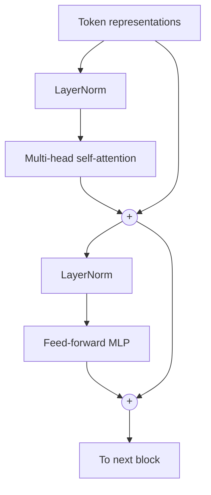

# Transformers

The Transformer (Vaswani et al. 2017) is the architecture behind essentially every frontier language model and much of modern vision, audio and biology. Its core idea fits in one sentence: **every token decides which other tokens to listen to, based on content.**

## Tokens and embeddings

Text is split into **tokens** (sub-word units, typically produced by byte-pair encoding; Sennrich, Haddow & Birch 2015). Each token id maps to a learned vector, giving a matrix $X \in \mathbb{R}^{n \times d}$ for a sequence of $n$ tokens.

## Scaled dot-product attention

Each token is projected into three roles:

- a **query** $\mathbf{q}$: *what am I looking for?*
- a **key** $\mathbf{k}$: *what do I contain?*
- a **value** $\mathbf{v}$: *what do I pass along if selected?*

With $Q = XW_Q$, $K = XW_K$, $V = XW_V$:

```math
\mathrm{Attention}(Q, K, V) = \mathrm{softmax}\!\left(\frac{QK^\top}{\sqrt{d_k}} + M\right) V
```

- $QK^\top$ scores every pair of tokens by similarity.
- Dividing by $\sqrt{d_k}$ keeps scores at a scale where the softmax is not saturated.
- $M$ is a **mask**. In a decoder (GPT-style) it sets future positions to $-\infty$ so each token sees only the past (**causal attention**).
- The output for each token is a weighted average of value vectors.

Attention is a soft, differentiable **lookup table**: a content-addressable memory.

## Multi-head attention

Run $h$ attention operations in parallel with separate projections, concatenate, and project back:

```math
\mathrm{MHA}(X) = \mathrm{Concat}(\mathrm{head}_1, \dots, \mathrm{head}_h)\, W_O
```

Different heads can specialize, for example one tracking syntax and another copying earlier tokens. **Induction heads**, circuits that complete patterns of the form `A B ... A → B`, are a well-studied example linked to in-context learning (Olsson et al. 2022).

## The transformer block



This is the *pre-norm* layout used by most modern models. The **residual stream** runs straight through; attention moves information *between* positions, and the MLP transforms information *within* each position. A model stacks dozens of such blocks.

## Positional information

Attention by itself is permutation-invariant: it does not know word order. Position is injected by:

- **Sinusoidal encodings** added to embeddings (the original paper);
- **Learned absolute embeddings** (GPT-2, BERT);
- **Rotary position embeddings (RoPE)** (Su et al. 2021), which rotate queries and keys by position-dependent angles so that attention scores depend on *relative* position. RoPE is widely used in open LLMs.

## Three families

| Family | Attention | Training objective | Examples |
|---|---|---|---|
| Encoder-only | Bidirectional | Masked-token prediction | BERT (Devlin et al. 2018) |
| Decoder-only | Causal | Next-token prediction | GPT-3 (Brown et al. 2020), LLaMA (Touvron et al. 2023) |
| Encoder–decoder | Both, plus cross-attention | Sequence-to-sequence | Original Transformer, T5 (Raffel et al. 2019) |

## Cost

Self-attention costs $O(n^2 d)$ time and memory for a sequence of length $n$. This quadratic term motivates efficient attention kernels such as **FlashAttention** (Dao et al. 2022), which computes exact attention while avoiding materializing the $n \times n$ matrix in slow memory, as well as sub-quadratic alternatives such as [state-space models](architectures.md#state-space-models). The [attention gradients](attention-gradients.md) page derives the backward pass by hand and shows the identity that lets FlashAttention skip storing the attention matrix.

During generation, keys and values of past tokens are cached (the **KV cache**), so each new token costs $O(n d)$, but the cache grows with context length. See [Inference and efficiency](../04-systems/inference-and-efficiency.md).

## Beyond text

- **Vision Transformer (ViT)** (Dosovitskiy et al. 2020): split an image into 16×16 patches and treat them as tokens.
- **Diffusion Transformers (DiT)** (Peebles & Xie 2022): transformers as the denoising network in diffusion models.
- **AlphaFold 2** (Jumper et al. 2021) used attention-based modules over protein sequences and residue pairs.

## Why transformers won

1. **Parallelism**: all positions are processed at once during training, unlike RNNs.
2. **Short paths**: any token can influence any other in one layer.
3. **Scalability**: performance improves predictably with size (see [Scaling laws](scaling-laws.md)).
4. **Generality**: the same block works for text, images, audio, code and molecules.

What this architecture can compute in principle, and why one forward pass cannot track long sequential state without a chain of thought, is the subject of [What transformers can and cannot compute](../06-frontiers/what-transformers-can-and-cannot-compute.md).
