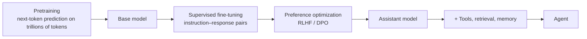

# 03 · Modern AI

Modern AI is built around **foundation models**: large networks pretrained on broad data, then adapted to many tasks (Bommasani et al. 2021). This section explains how they are trained, aligned to be useful, connected to tools and knowledge, and extended beyond text.

| Page | What you will learn |
|---|---|
| [Large language models](large-language-models.md) | Pretraining, in-context learning, instruction tuning, RLHF and DPO, reasoning, hallucination |
| [Generative models](generative-models.md) | VAEs, GANs, diffusion and flow matching, latent diffusion |
| [Retrieval, tools and agents](retrieval-tools-and-agents.md) | RAG, tool use, ReAct, planning loops, multi-agent systems, agent runtimes |
| [Multimodal models](multimodal-models.md) | Vision–language models, CLIP, image and video generation, speech |
| [Evaluation and benchmarks](evaluation-and-benchmarks.md) | Error bars and paired comparisons, pass@k, contamination, saturation, label errors, LLM judges, leaderboard gaming, agent time horizons |
| [Code generation and program synthesis](code-generation-and-program-synthesis.md) | Synthesis from specs and examples, code models and fill-in-the-middle, sample-filter-cluster selection (tested code), execution feedback and RL, repository agents, honest code benchmarks, program search for discovery, developer productivity evidence |
| [AI for science](ai-for-science.md) | Why science differs as an ML problem, protein structure prediction and design, learned interatomic potentials and materials discovery (with the GNoME caveat), ML weather and ensemble forecasting, the blurring trap and CRPS (tested Lorenz-96 sketch), neural operators and equation discovery, honest status |

