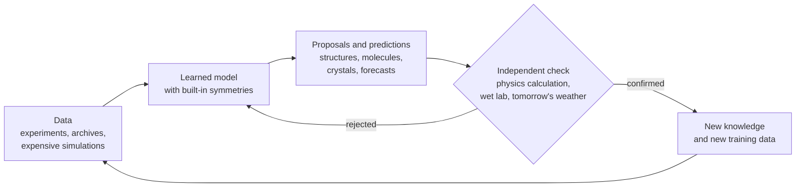
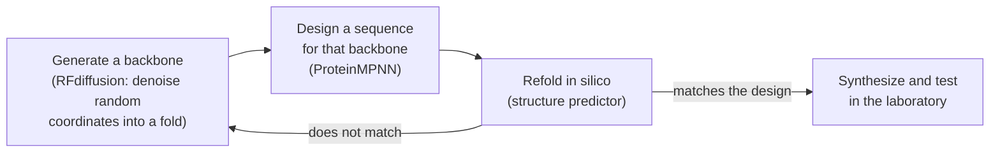

# AI for science: proteins, materials and weather

In 2020 a neural network predicted the shapes of proteins in a blind test about as accurately as the experiments that later measured them, and four years later its designers shared a Nobel Prize. In 2023 a graph network proposed 2.2 million inorganic crystals that its own physics calculations rated as stable, and machine-learned weather models began to beat the best physics-based forecast in the world on most of its own scorecards. These are among the clearest cases where modern AI has changed what working scientists do. This page explains how, using three case studies (protein structure and design, molecules and materials, and weather), then the tools that cut across them, an honest status table, and a tested NumPy sketch of the subtle statistical trap that made early weather models look better than they were.

> **The core idea.** Science suits machine learning best where three things hold together: a large body of trustworthy data, usually produced by decades of experiments or by expensive simulations; a structure the model can respect, such as rotational symmetry or the conservation laws of physics; and an independent, mechanical way to check what the model proposes, whether a crystal structure, a laboratory synthesis, or tomorrow's weather. When all three are present, a learned model becomes a fast **emulator** of something slow, and its errors get caught. When the check is missing, impressive numbers can mean very little.



## 1. Why science is a different machine-learning problem (established)

Most of the rest of this knowledge base deals with models trained on text and images collected from people. Scientific machine learning differs in four ways that shape everything below.

| Property | Typical consumer AI | Typical scientific AI |
|---|---|---|
| Where the data comes from | Web text, photos, human labels | Experiments, archives such as the Protein Data Bank, or numerical simulation |
| What is known in advance | Little beyond the data | Symmetries, conservation laws, units, and often the governing equations themselves |
| What a correct answer looks like | Judged by people or benchmarks | Checked against physics, the laboratory, or the future |
| What an error costs | A bad answer the user may notice | A wasted synthesis, a wrong mechanism, or a missed storm warning |

The second row explains why architectures in this field look different. A model that predicts the energy of a molecule should give the same energy when the molecule is rotated, and the forces should rotate with it. Building that in, rather than hoping the model learns it, is one of the most reliable ways to save data (section 4). The third row explains why the field's best results come with an external check attached: a fold-prediction contest scored after experiments are released, a crystal structure verified with quantum-mechanical calculations, or a forecast scored against what the weather actually did.

## 2. Protein structure prediction (established)

A protein is a chain of amino acids that folds into a three-dimensional shape, and the shape largely determines what it does. Experiments had solved around 100,000 unique protein structures by 2021, a small fraction of the billions of known sequences, because each structure can take months or years of work (Jumper et al., 2021).

Since 1994 the **Critical Assessment of protein Structure Prediction** (CASP) has run blind tests: organizers collect structures that have been solved but not yet released, and predictors submit their models before the answers are published. AlphaFold's first version used a network to predict distances between residues and then optimized a structure to match them (Senior et al., 2020). Its redesigned second version, AlphaFold 2, reached accuracy "competitive with experimental structures in a majority of cases" in CASP14 (Jumper et al., 2021). The CASP organizers' own assessment described the results as a solution to the classical folding problem, "at least for single proteins" (Kryshtafovych et al., 2021).

Three ingredients carried most of the weight:

- **Evolution as data.** Related sequences from many species are aligned in a *multiple sequence alignment*. Positions that mutate together are often in contact in the folded structure, so the alignment carries geometric information.
- **A pair representation.** Alongside a representation of each residue, the network keeps a representation of every *pair* of residues and refines both repeatedly, with updates that enforce rough geometric consistency between pairs.
- **Geometry-aware output.** The structure module places each residue as a rigid frame in 3-D space and is trained with a loss that does not change when the whole protein is rotated or moved.

Baek et al. (2021) independently built RoseTTAFold, a three-track network over sequence, distance and coordinates that approached AlphaFold 2's accuracy and also modelled protein complexes. The AlphaFold Protein Structure Database made predictions freely available, starting with over 360,000 structures across 21 model-organism proteomes and planned expansion to most of the more than 100 million representative sequences in UniRef90 (Varadi et al., 2021). Lin et al. (2023) showed that a protein language model alone, scaled to 15 billion parameters and trained without alignments, learns enough to predict structure about an order of magnitude faster; they used it to predict more than 617 million metagenomic proteins, over 225 million with high confidence. AlphaFold 3 replaced the structure module with a diffusion model and extended prediction to complexes of proteins with DNA, RNA, small molecules, ions and modified residues, with much higher accuracy than specialized docking tools on protein–ligand pairs (Abramson et al., 2024).

The 2024 Nobel Prize in Chemistry went half to David Baker "for computational protein design" and half jointly to Demis Hassabis and John Jumper "for protein structure prediction" (Nobel Prize Outreach, 2024).

**What it did not solve.** A predicted structure is a single static shape. Proteins move, some regions are disordered, and the effect of a single mutation on stability or function is a much harder target. Confidence scores such as AlphaFold's per-residue estimate are informative, and low-confidence regions should be read as "unknown", not as a prediction of disorder.

## 3. Protein design: running the problem backwards (established)

Prediction asks which shape a sequence will fold into. Design asks which sequence will fold into a shape you want, often one that binds a chosen target. Deep learning turned this into a three-stage pipeline, with a structure predictor serving as the cheap check before anything reaches the laboratory.



- **Backbone generation.** RFdiffusion fine-tunes the RoseTTAFold network as a diffusion model over protein backbones. Its authors experimentally characterized hundreds of designed symmetric assemblies, metal-binding proteins and binders, and a cryogenic electron microscopy structure of one binder bound to influenza haemagglutinin was nearly identical to the design (Watson et al., 2023).
- **Sequence design.** ProteinMPNN, a message-passing network, recovers 52.4% of native sequences on native backbones against 32.9% for the physics-based Rosetta method, and rescued designs that had failed when made with Rosetta or AlphaFold alone (Dauparas et al., 2022).
- **Generative language models.** ESM3 reasons jointly over sequence, structure and function. Prompted to make fluorescent proteins, it produced a bright one with only 58% sequence identity to any known fluorescent protein, which its authors estimate corresponds to 500 million years of natural evolution (Hayes et al., 2025).

The design loop works because refolding is cheap and moderately reliable. It is not a guarantee: experimental success rates still vary widely by task, and a design that refolds correctly on a computer can still fail to express, aggregate, or bind weakly.

## 4. Molecules and materials (established, with an important caveat)

### Learned interatomic potentials

The quantum-mechanical method most used for molecules and solids, density functional theory, is accurate but scales steeply with the number of atoms. A **machine-learned interatomic potential** is trained on such calculations and then predicts energies and forces orders of magnitude faster, which makes long molecular-dynamics simulations possible. Behler and Parrinello (2007) introduced the standard decomposition: the total energy is a sum of atomic contributions, each a learned function of that atom's local environment,

$$
E \;=\; \sum_{i=1}^{N} E_i\big(\{\mathbf{r}_j - \mathbf{r}_i : \|\mathbf{r}_j - \mathbf{r}_i\| < r_c\}\big),
\qquad
\mathbf{F}_i = -\nabla_{\mathbf{r}_i} E .
$$

Because forces are derivatives of one energy, they conserve energy by construction. Because the sum runs over atoms, the model applies to systems of any size.

Modern potentials add **equivariance**: internal features are geometric tensors that rotate along with the input, rather than scalars only. NequIP showed that an E(3)-equivariant network matches or beats earlier models with up to three orders of magnitude less training data (Batzner et al., 2022), and MACE combined equivariance with higher-order many-body messages to reach similar accuracy with fewer message-passing steps (Batatia et al., 2022). This is the clearest case in all of scientific machine learning where building physics into the architecture pays off in data.

### Discovering crystals at scale

Merchant et al. (2023) trained graph networks to predict whether a proposed inorganic crystal is stable, used them to filter candidates, and checked survivors with density functional theory, feeding confirmed results back into training. Starting from 48,000 stable crystals known from earlier work, the GNoME project reported 2.2 million structures **below the current convex hull**, meaning the calculations rated them more stable than any known combination of competing phases, and noted that 736 of the stable structures had already been made independently by experimentalists.

The same issue of *Nature* described the **A-Lab**, an autonomous laboratory that combined computed stability data, literature-trained models for synthesis recipes, active learning and robotics. Over 17 days of continuous operation it made 36 of 57 target compounds (Szymanski et al., 2023). MatterGen, a diffusion model over crystal structures, generates candidates that are more than twice as likely to be new and stable as earlier generative models and can be steered toward target properties; its authors synthesized one design and measured its property within 20% of the target (Zeni et al., 2025).

**The caveat.** "Stable according to a calculation" is not the same as "a new, useful material". Cheetham and Seshadri (2024) examined the GNoME claims from a solid-state chemist's point of view and questioned how many of the reported structures amount to genuinely new, useful materials. The disagreement is not about whether the network is accurate; it is about what counts as a discovery. That gap between a computed label and scientific value is the recurring caveat of this whole field.

### Drug and antibiotic discovery

Stokes et al. (2020) trained a graph network on growth inhibition of *E. coli*, screened a library of existing compounds, and identified halicin, a structurally unusual antibacterial molecule. Wong et al. (2023) went further: they measured antibiotic activity and human-cell toxicity for 39,312 compounds, scored 12,076,365 compounds with ensembles of graph networks, used explainability methods to extract the chemical substructures behind confident predictions, tested 283 compounds, and found a structural class active against methicillin-resistant *Staphylococcus aureus* (MRSA) that reduced bacterial counts in mouse infection models. The pattern is the same as everywhere on this page: a model ranks a vast space, and an experiment checks the short list.

## 5. Weather forecasting (established)

Numerical weather prediction integrates the equations of fluid dynamics forward from an estimate of today's atmosphere, and the European Centre for Medium-Range Weather Forecasts (ECMWF) has long run the most accurate global system. Machine-learned forecasters instead learn a time step directly from **reanalysis**, the multi-decade reconstruction of past atmospheric states, and apply it repeatedly.

| Model | What it is | Headline result (from its paper) |
|---|---|---|
| FourCastNet (Pathak et al., 2022) | Adaptive Fourier neural operator on a global grid | Matched ECMWF's operational system at short lead times for large-scale variables; a week-long 0.25° forecast in under 2 seconds |
| Pangu-Weather (Bi et al., 2023) | 3-D transformer, trained on 39 years of data, hierarchical time steps | Stronger deterministic results than ECMWF's operational system in all tested variables, evaluated on reanalysis |
| GraphCast (Lam et al., 2023) | Graph network on a multi-resolution mesh | Better than the most accurate operational deterministic system on 90% of 1,380 verification targets; a 10-day forecast in under a minute |
| NeuralGCM (Kochkov et al., 2024) | Differentiable physics solver for large-scale dynamics plus learned small-scale physics | Competitive with ML models for 1–10 days, with ECMWF's ensemble for 1–15 days, and stable for multi-decade climate runs |
| GenCast (Price et al., 2024) | Diffusion model that generates an ensemble of 15-day forecasts | Better than ECMWF's ensemble on 97.2% of 1,320 targets, in 8 minutes |
| Aurora (Bodnar et al., 2025) | Foundation model trained on over a million hours of geophysical data | Fine-tuned to beat operational forecasts of air quality, ocean waves, cyclone tracks and high-resolution weather |

WeatherBench 2 provides open data and shared metrics for comparing these systems, and its authors discuss the caveats in current evaluation (Rasp et al., 2024). One caveat matters so much that it gets its own section.

### The blurring trap: why low error is not a good forecast

Most early models were trained to minimize mean squared error, one step at a time. For any target $y$ and inputs $x$, the forecast that minimizes expected squared error is the conditional mean,

$$
\hat{y}^{\star}(x) \;=\; \arg\min_{f}\; \mathbb{E}\big[(y - f)^2 \,\big|\, x\big] \;=\; \mathbb{E}[\,y \mid x\,].
$$

In a chaotic system the conditional distribution of the weather two weeks ahead spreads out until it is nearly the climatological distribution. Its mean then becomes a smooth, average-looking field that no real atmosphere ever resembles: storms are smeared out and extremes disappear. Such a forecast genuinely has low error. If the truth has climatological standard deviation $\sigma$, predicting the climatological mean scores a root-mean-square error of $\sigma$, while a realistic sample independent of the truth scores $\sqrt{2}\,\sigma$, because the errors of two independent fields add. A loss built on squared error therefore *rewards* blurring at long lead times.

The fix is to forecast a distribution. Ensemble systems run many perturbed forecasts, and the quality of the whole ensemble is scored with a **proper scoring rule** such as the continuous ranked probability score (Hersbach, 2000; Gneiting & Raftery, 2007):

$$
\mathrm{CRPS}(F, y) \;=\; \mathbb{E}_{X \sim F}\,|X - y| \;-\; \tfrac{1}{2}\,\mathbb{E}_{X, X' \sim F}\,|X - X'| .
$$

The first term rewards members that land near the truth; the second rewards spread, so a collapsed ensemble cannot win by hedging. For a single deterministic forecast the second term vanishes and CRPS reduces to absolute error. A well-calibrated ensemble also has a **spread** (the standard deviation across members) close to the error of its mean. GenCast and NeuralGCM's ensembles are designed and scored this way.

## 6. A tested sketch: blurring versus ensembles in a toy atmosphere

The Lorenz-96 system is a 40-variable model of a chaotic quantity travelling around a latitude circle; Lorenz and Emanuel (1998) suggest reading 0.05 model time units as about six hours, so 0.2 units is about a day. The script at the end of the page samples its climate, then makes 200 forecasts from slightly wrong initial conditions using 50-member ensembles constructed so that the truth is statistically just one more member. It compares a single member (a sharp, realistic forecast), the ensemble mean (the best estimate of what an MSE-trained model converges toward), and the full ensemble. MAE is mean absolute error. "Activity" is the standard deviation of a forecast field about the climatological mean, divided by the climatological standard deviation of 3.641: 1 means realistically variable, 0 means completely flat.

| Lead (days) | RMSE, one member | RMSE, ensemble mean | Ensemble spread | Activity, one member | Activity, ensemble mean | CRPS, ensemble | MAE, one member | MAE, ensemble mean |
|---|---|---|---|---|---|---|---|---|
| 0 | 0.142 | 0.101 | 0.100 | 1.002 | 1.001 | 0.058 | 0.113 | 0.081 |
| 1 | 0.195 | 0.136 | 0.136 | 1.008 | 1.007 | 0.075 | 0.148 | 0.105 |
| 2.5 | 0.407 | 0.282 | 0.282 | 1.000 | 0.996 | 0.137 | 0.274 | 0.192 |
| 5 | 1.195 | 0.752 | 0.767 | 0.997 | 0.974 | 0.319 | 0.683 | 0.454 |
| 10 | 3.057 | 2.140 | 2.117 | 0.998 | 0.820 | 1.038 | 2.077 | 1.497 |
| 15 | 4.366 | 3.113 | 3.062 | 1.007 | 0.557 | 1.697 | 3.321 | 2.430 |
| 20 | 4.851 | 3.455 | 3.425 | 1.004 | 0.367 | 1.958 | 3.834 | 2.786 |
| 30 | 5.118 | 3.674 | 3.606 | 0.996 | 0.199 | 2.109 | 4.119 | 2.990 |

What the numbers show:

- **The mean always wins on squared error.** At every lead the ensemble mean's RMSE is about $1/\sqrt{2}$ of a single member's (0.136 against 0.195 at one day, 3.674 against 5.118 at thirty). At thirty days the two approach $\sigma = 3.641$ and $\sqrt{2}\,\sigma = 5.149$, exactly as the argument above predicts.
- **But the mean stops looking like weather.** Its activity falls from 1.00 to 0.82 at ten days, 0.56 at fifteen and 0.20 at thirty. A single member stays at 1.00 throughout. A model judged only by RMSE would be pushed toward the flat field.
- **The ensemble is calibrated.** Spread tracks the error of the mean at every lead (2.117 against 2.140 at ten days, 3.606 against 3.674 at thirty), so the ensemble knows how uncertain it is.
- **A proper score sees the whole picture.** The ensemble's CRPS (2.109 at thirty days) is about half a single member's absolute error (4.119), and below the ensemble mean's absolute error at that lead (2.990), while keeping every member realistic.

This is the reason the field moved from deterministic MSE-trained emulators toward generative ensembles: the summary score that first made machine-learned forecasts look best was partly rewarding a loss of realism.

## 7. Cross-cutting tools (established, with uneven maturity)

- **Neural operators** learn a map from one function to another, such as from an initial condition to the solution of a partial differential equation, instead of solving one instance. The Fourier neural operator parameterizes the integral kernel in Fourier space and reported up to three orders of magnitude speed-ups over traditional solvers on Burgers, Darcy and Navier–Stokes problems (Li et al., 2020). FourCastNet is one descendant.
- **Physics-informed neural networks** put the governing equation's residual into the loss (Raissi, Perdikaris & Karniadakis, 2019). They are elegant for inverse problems with little data but are often hard to train and slower than classical solvers for routine forward problems, so treat speed claims with care.
- **Hybrid models** keep a numerical solver for what physics already does well and learn only the uncertain parts. NeuralGCM is the clearest example, and its multi-decade stability is a large part of its appeal.
- **Equation discovery** searches for compact formulas rather than black boxes: symbolic regression found conservation laws from motion-tracking data (Schmidt & Lipson, 2009), sparse regression over a library of candidate terms recovers governing equations (SINDy; Brunton, Proctor & Kutz, 2016), and AI Feynman uses dimensional analysis and symmetries to rediscover physics formulas (Udrescu & Tegmark, 2020).
- **Algorithm discovery and control.** AlphaTensor framed matrix multiplication as a game of finding tensor decompositions and found, for $4 \times 4$ matrices over a finite field, the first improvement on Strassen's two-level algorithm in 50 years (Fawzi et al., 2022); FunSearch and AlphaEvolve pair language models with automatic evaluators (see [Code generation and program synthesis](code-generation-and-program-synthesis.md)). Reinforcement learning has shaped and held plasma in a tokamak, including two separate plasmas at once (Degrave et al., 2022).
- **Language-model "scientists".** The AI Scientist runs a loop of idea, code, experiment and paper on machine-learning topics (Lu et al., 2024), and Co-Scientist is a multi-agent system that generates and ranks hypotheses, evaluated on drug repurposing, target discovery and antimicrobial resistance (Gottweis et al., 2025). These are early systems whose outputs still depend heavily on human experts to check.

## 8. Honest status (October 2026)

| Claim | Status |
|---|---|
| Single-chain protein structure can be predicted at near-experimental accuracy in most cases | Established by blind CASP14 assessment |
| Deep learning can design new proteins that fold and bind as intended | Established for many tasks; success rates vary widely |
| Equivariant learned potentials reach DFT-level accuracy with far less data | Established for systems close to the training data; transferability is an active concern |
| ML has expanded the number of computed-stable crystals by an order of magnitude | Established as a computational result; how many are new, useful materials is disputed |
| Autonomous labs can make computationally proposed materials without humans in the loop | Demonstrated for powder synthesis of tens of targets; scaling and characterization standards are debated |
| ML weather models beat the best physics-based deterministic and ensemble forecasts on most standard scores | Established in published comparisons on reanalysis; operational use is growing alongside physics models |
| ML emulators are stable for climate projection | Promising in hybrid models; pure emulators remain unproven for climates unlike the training period |
| Language-model agents can do independent science | Early demonstrations; not established |

## 9. Speculative: emulators as a natural workload for noisy analog hardware

> **Speculative.** The ideas in this section are open hypotheses, not established results.

Scientific emulators have two properties that set them apart from most AI workloads. First, their outputs are judged against a physical check with its own error bars, so an emulator only has to be as precise as the measurement or simulation it replaces. Second, the best of them, like GenCast, are *generative*: they need a source of randomness to produce ensemble members. Section 6 shows that an ensemble's value comes from its spread being calibrated, not from any one member being exact.

That suggests a falsifiable hypothesis: that low-precision analog accelerators, including the optical and in-memory designs described on the [photonic computing](../06-frontiers/photonic-computing.md) and [memristive crossbar](../06-frontiers/memristive-crossbars-in-memory-computing.md) pages, could run ensemble emulators with little loss in a proper score such as CRPS, even where they would hurt a deterministic model's RMSE, provided the hardware noise is characterized well enough to be folded into the ensemble's calibrated spread rather than added on top of it. A clean test would train one generative emulator, run it with injected noise of measured size and correlation structure, and compare CRPS and spread–skill ratios against a digital baseline at equal energy. The hypothesis fails if uncontrolled noise correlations make ensembles over- or under-dispersive in ways a calibration step cannot repair.

## 10. Code: the Lorenz-96 ensemble sketch

This script needs only NumPy and runs in about ten seconds. It produced the table in section 6.

```python
import numpy as np

rng = np.random.default_rng(0)
N, F, dt = 40, 8.0, 0.01          # Lorenz-96: 40 variables, forcing 8, RK4 step

def tendency(x):
    return (np.roll(x, -1, -1) - np.roll(x, 2, -1)) * np.roll(x, 1, -1) - x + F

def step(x):
    k1 = tendency(x); k2 = tendency(x + dt / 2 * k1)
    k3 = tendency(x + dt / 2 * k2); k4 = tendency(x + dt * k3)
    return x + dt / 6 * (k1 + 2 * k2 + 2 * k3 + k4)

# spin up, then sample the climate
x = F + 0.01 * rng.standard_normal(N)
for _ in range(5000): x = step(x)
clim = []
for i in range(20000):
    x = step(x)
    if i % 10 == 0: clim.append(x.copy())
clim = np.array(clim); mu, sd = clim.mean(), clim.std()
print(f'climatology: mean {mu:.3f}, std {sd:.3f}')

# 200 forecast cases, 50 members; the truth is statistically one more member
C, M, sig = 200, 50, 0.1
truth = clim[rng.choice(len(clim), C, replace=False)]
analysis = truth + sig * rng.standard_normal((C, N))             # imperfect observation
ens = analysis[:, None, :] + sig * rng.standard_normal((C, M, N))

def crps(e, y):  # ensemble CRPS: E|X - y| - 0.5 E|X - X'|
    a = np.abs(e - y[:, None, :]).mean(1)
    b = np.abs(e[:, :, None, :] - e[:, None, :, :]).mean((1, 2)) / 2
    return (a - b).mean()

rmse = lambda f, y: np.sqrt(((f - y) ** 2).mean())
print('days  RMSE member  RMSE mean  spread  activity member  activity mean  '
      'CRPS ensemble  MAE member  MAE mean')
t = 0
for days in [0, 1, 2.5, 5, 10, 15, 20, 30]:      # 0.2 time units ~ 1 day
    while t < round(days * 0.2 / dt):
        truth = step(truth); ens = step(ens); t += 1
    mean = ens.mean(1)
    print(f'{days:4}  {rmse(ens[:, 0], truth):11.3f}  {rmse(mean, truth):9.3f}  '
          f'{np.sqrt(ens.var(1, ddof=1).mean()):6.3f}  '
          f'{(ens[:, 0] - mu).std() / sd:15.3f}  {(mean - mu).std() / sd:13.3f}  '
          f'{crps(ens, truth):13.3f}  {np.abs(ens[:, 0] - truth).mean():10.3f}  '
          f'{np.abs(mean - truth).mean():8.3f}')
```

## References

New sources are listed under *AI for science* in [REFERENCES.md](../../REFERENCES.md#ai-for-science), each checked against Crossref or its arXiv abstract page. Sources already in the knowledge base stay in their original sections: Jumper et al. (2021) is listed under *Generative and multimodal models*; Raissi et al. (2019) and Brunton et al. (2016) under *Frontiers: non-linearity and dynamical systems*; Lu et al. (2024) and FunSearch under *Frontiers: recursion and self-improvement*; AlphaEvolve under *Code generation and program synthesis*. The Nobel citation is from the [Nobel Prize in Chemistry 2024 summary](https://www.nobelprize.org/prizes/chemistry/2024/summary/).
