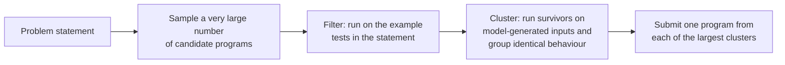

# Code generation and program synthesis

Writing programs automatically is one of the oldest goals in computer science, and for most of its history it meant *search*: describe what you want precisely, then hunt through the space of programs for one that satisfies the description. Large language models changed the starting point. A model trained on billions of lines of code proposes plausible programs directly, and the old ideas (specifications, search, verification) return as the machinery that decides which proposals to trust.

This page traces that arc: from deductive synthesis and programming by example to code models, the sample-filter-select pipeline, learning from execution, repository-scale agents, and programs that discover new mathematics. It ends with what the evidence says about real developers.

> **In one sentence.** Code is the domain where a model's output can be *run*, so the central idea of modern code generation is to pair a fluent but unreliable generator with a cheap, mechanical check, and to spend extra computation on sampling, testing and repairing until the check is satisfied.

## 1. Synthesis before language models (established)

A synthesis problem has two parts: a **specification** of the desired behaviour and a **search space** of candidate programs. The field is largely organized by the kind of specification.

| Specification | Example | How candidates are found |
|---|---|---|
| Logical formula | "Return a sorted permutation of the input" | Theorem proving: extract a program from a constructive proof (Manna and Waldinger 1971) |
| Partial program plus assertions | A loop with "holes" whose constants must be filled | Constraint solving: encode the holes for a SAT or SMT solver (Solar-Lezama et al. 2006, *sketching*) |
| Input-output examples | "`John Smith` becomes `J. Smith`" | Enumerate programs in a small domain-specific language, pruned by the examples (Gulwani 2011, the engine behind Excel's Flash Fill) |
| Natural language | A docstring or an issue report | Sample from a learned model of code (sections 3 onwards) |

The first three share a guarantee the fourth lacks: a returned program provably meets the specification. Their weakness is that the specification is hard to write, and the search explodes as programs grow.

## 2. Neural networks guide the search (established)

Before large language models, the main use of neural networks was to make classical search faster:

- **DeepCoder** (Balog et al. 2016) trained a network to predict, from input-output examples, which functions of a small list-processing language the target program probably uses, and used those predictions to order an enumerative or SMT-based search, reporting an order-of-magnitude speedup.
- **RobustFill** (Devlin et al. 2017) generated string-transformation programs directly with an attention-based sequence model conditioned on examples, reaching 92% accuracy on a real-world test set against 34% for the previous best neural approach, and stayed robust to typos in the examples where a hand-engineered rule-based system failed entirely.
- **DreamCoder** (Ellis et al. 2020) alternated between solving problems with a neural-guided search and *compressing* the solutions into new library functions, so its programming language grew with experience. It rediscovered basics of functional programming, vector algebra and classical physics laws such as Newton's and Coulomb's.

DreamCoder's library learning is a small instance of a theme developed on the [recursion and self-improvement](../06-frontiers/recursion-and-self-improvement.md) page: a system that improves the language it thinks in.

## 3. Code as language (established)

Hindle et al. (2012) observed that real source code is *natural*: highly repetitive and predictable, so simple $n$-gram language models capture it well, even better than they capture English. A decade later that observation scaled. Chen et al. (2021) fine-tuned GPT-3 on public GitHub code to produce **Codex**, a production version of which powered GitHub Copilot, and introduced **HumanEval**, 164 hand-written Python problems checked by unit tests. Codex solved 28.8% of them with one sample, where GPT-3 solved none, and 70.2% when 100 samples were drawn per problem. Austin et al. (2021) introduced the 974-problem MBPP benchmark and found that synthesis performance scales log-linearly with model size, with their largest model solving 59.6% of MBPP problems few-shot. Hendrycks et al. (2021) released APPS, 10,000 problems ranging from one-liners to substantial algorithmic challenges.

Two training ingredients specific to code followed:

- **Fill-in-the-middle (FIM).** Editors need completions that respect the code *after* the cursor, not only before it. Bavarian et al. (2022) showed that moving a random middle span of each training document to its end, marked by sentinel tokens, teaches a left-to-right model to infill without hurting ordinary generation, and recommended it as a default. InCoder (Fried et al. 2022) introduced a closely related masking objective.
- **Curated, licensed corpora at repository scale.** Open code models are trained on deduplicated, permissively licensed source with opt-out processes, increasingly organized by repository so that the model sees files in dependency order.

| Model | Year | Notable design points |
|---|---|---|
| Codex (Chen et al.) | 2021 | GPT-3 fine-tuned on GitHub Python; introduced HumanEval and the unbiased pass@k estimator |
| StarCoder (Li et al.) | 2023 | 15.5B parameters, 8K context, FIM, multi-query attention, trained on 1T tokens of The Stack |
| Code Llama (Rozière et al.) | 2023 | Llama 2 continued on code, 7B to 70B, infilling, 16K training sequences, up to 67% on HumanEval |
| DeepSeek-Coder (Guo et al.) | 2024 | 1.3B to 33B, trained from scratch on 2T tokens with a project-level corpus and FIM |
| StarCoder2 (Lozhkov et al.) | 2024 | 3B to 15B on 3.3 to 4.3T tokens, The Stack v2 built with Software Heritage across 619 languages |

How pass@k is estimated, and why a pass@k figure means nothing without its $k$, is covered on the [evaluation page](evaluation-and-benchmarks.md).

## 4. Sample, filter, select (established)

Codex's jump from 28.8% to 70.2% exposes the basic fact of code generation: the right program is often *somewhere* in the model's distribution, just not at the top. Brown et al. (2024) measured this as **coverage**, the fraction of problems solved by at least one of $k$ samples, and found it grows roughly log-linearly over four orders of magnitude of $k$. On SWE-bench Lite, one open model went from 15.9% of issues with one sample to 56% with 250. Coverage only becomes *performance* if something can pick the right sample, which is where code has an advantage over prose: programs can be executed.

**AlphaCode** (Li et al. 2022) built the canonical pipeline for competitive programming, where a contestant may submit only a handful of attempts:



Filtering removes the large majority of samples. Clustering matters because many surviving programs are the *same* program written differently; submitting ten copies of one wrong idea wastes the budget. In simulated evaluations on recent Codeforces contests with more than 5,000 participants, AlphaCode ranked on average in the top 54.3%. **CodeT** (Chen et al. 2022) applied the same logic without hidden examples: the model also writes test cases, and candidates are ranked by agreement both with those tests and with each other, lifting HumanEval pass@1 for code-davinci-002 by 18.8 points to 65.8%.

### A tested sketch

The toy simulation below makes the pipeline's arithmetic concrete. It is a model of the idea, not of AlphaCode's data. Each of 2,000 problems has one correct behaviour and 200 wrong behaviours, with popular wrong behaviours sampled far more often (a Zipf law). The chance that a sample is correct varies by problem from about $3 \times 10^{-4}$ to $0.3$. Each wrong behaviour passes the public examples with probability $q$; the correct one always passes. We draw 1,000 samples per problem and may submit 10.

```python
import numpy as np

def run(seed=0, P=2000, N=1000, budget=10, n_wrong=200, q_pass=0.10, zipf=1.1):
    rng = np.random.default_rng(seed)
    res = {"random": 0, "filter": 0, "filter+cluster": 0, "coverage@N": 0}
    kept = []
    for _ in range(P):
        p = 10 ** rng.uniform(-3.5, -0.5)              # chance a sample is correct
        w = 1.0 / np.arange(1, n_wrong + 1) ** zipf    # popular wrong behaviours
        w = (1 - p) * w / w.sum()
        probs = np.concatenate([[p], w])               # class 0 = correct behaviour
        cls = rng.choice(n_wrong + 1, size=N, p=probs)
        passes_public = np.concatenate([[True], rng.random(n_wrong) < q_pass])
        ok = passes_public[cls]
        kept.append(ok.mean())
        res["coverage@N"] += (cls == 0).any()
        res["random"] += (rng.choice(cls, budget, replace=False) == 0).any()
        surv = cls[ok]
        if len(surv) == 0:
            continue
        pick = surv if len(surv) <= budget else rng.choice(surv, budget, replace=False)
        res["filter"] += (pick == 0).any()
        labels, counts = np.unique(surv, return_counts=True)
        top = labels[np.argsort(-counts, kind="stable")][:budget]
        res["filter+cluster"] += (top == 0).any()
    return {k: v / P for k, v in res.items()}, float(np.mean(kept))

for q in (0.10, 0.30):
    r, k = run(q_pass=q)
    print(f"q_pass={q:.2f} kept={k:.3f} " + " ".join(f"{a}={b:.3f}" for a, b in r.items()))
```

Output:

```text
q_pass=0.10 kept=0.139 random=0.243 filter=0.606 filter+cluster=0.794 coverage@N=0.869
q_pass=0.30 kept=0.335 random=0.248 filter=0.431 filter+cluster=0.613 coverage@N=0.876
```

| Selection strategy (10 submissions from 1,000 samples) | Solved, $q = 0.10$ | Solved, $q = 0.30$ |
|---|---|---|
| Submit 10 samples at random | 24.3% | 24.8% |
| Filter on public examples, then pick at random | 60.6% | 43.1% |
| Filter, then one program per largest behaviour cluster | 79.4% | 61.3% |
| Ceiling: any of the 1,000 samples is correct | 86.9% | 87.6% |

Three lessons survive outside the toy. First, a weak filter that keeps 14% of samples more than doubles the solve rate. Second, clustering recovers most of the remaining gap to the ceiling, because popular wrong programs collapse into a few clusters. Third, everything depends on the filter's discrimination: when wrong programs pass the public examples three times as often, both gains shrink, which is why generated tests (CodeT) and stronger test suites matter so much.

## 5. Learning from execution (established, moving fast)

Execution gives a signal at training time, not only at selection time.

- **Repair loops.** Self-Debugging (Chen et al. 2023) prompts a model to run its code, explain it line by line and fix it, improving accuracy by up to 12% where unit tests exist and matching baselines that sample more than ten times as many programs. Reflexion (Shinn et al. 2023) stores verbal reflections on failed attempts in memory and reported 91% pass@1 on HumanEval against 80% for GPT-4 alone.
- **Reinforcement learning on test outcomes.** CodeRL (Le et al. 2022) trained a critic to predict whether a program passes its tests and used it as a dense reward for the generator. The 2024 to 2025 reasoning models generalized this to *reinforcement learning from verifiable rewards*: sample long reasoning traces, run the final program or check the final answer, and reinforce what passes. DeepSeek-R1 (DeepSeek-AI 2025) is the most documented open example; see [large language models](large-language-models.md).

The weakness is the same one that haunts [reward models](../05-alignment-safety-interpretability/reward-model-failure-modes.md): a test suite is a proxy. A policy optimized hard against incomplete tests can learn to special-case them, so the quality of the checker bounds the quality of the learner.

## 6. From functions to repositories (active research)

Real software work means reading a large codebase, locating the relevant files, editing several of them and running the project's own tests. SWE-bench (Jimenez et al. 2023) turned real GitHub issues into such tasks; at release the best model resolved 1.96% of them.

- **Agent-computer interfaces.** SWE-agent (Yang et al. 2024) gave a model purpose-built commands for searching, viewing and editing files, and found that the interface design itself changed performance substantially, reaching 12.5% on SWE-bench. OpenHands (Wang et al. 2024) is an open platform for such agents with sandboxed execution.
- **Pipelines without autonomy.** Agentless (Xia et al. 2024) replaced the open-ended agent with three fixed phases (localize, repair, validate) and reached 32.0% on SWE-bench Lite at a reported cost of about \$0.70 per issue, then the best result among open-source software agents. The lesson recurs across this page: a simple generate-and-check structure is a strong baseline.
- **Task length.** Kwa et al. (2025) measured the length of software tasks, in human time, that frontier models complete with 50% reliability, and found that it has doubled roughly every seven months since 2019; see [evaluation](evaluation-and-benchmarks.md).

For the general design of tool-using agents, see [retrieval, tools and agents](retrieval-tools-and-agents.md).

## 7. Measuring it honestly (established)

Code benchmarks look objective because they run tests, but they inherit every weakness of those tests:

- **Thin tests.** EvalPlus (Liu et al. 2023) added about 80 times more tests to HumanEval and found previously undetected wrong code that reduced pass@k by up to 19.3 to 28.9%, enough to reorder model rankings.
- **Contamination.** Popular problems leak into training data. LiveCodeBench (Jain et al. 2024) collects problems continuously from contest sites with release dates, so a model can be scored only on problems published after its training cutoff.
- **Unrealistic tasks.** Short algorithmic puzzles say little about library-heavy work. BigCodeBench (Zhuo et al. 2024) asks for 1,140 tasks calling functions from 139 libraries; the best models scored up to 60% against 97% for humans.

## 8. Search over programs as a discovery engine (active research)

When the checker is an *evaluator* that scores how good a program is, rather than a pass-or-fail test, generate-and-check becomes an optimizer. **FunSearch** (Romera-Paredes et al. 2023) paired a language model with an automatic evaluator in an evolutionary loop over short programs and found new constructions for the cap set problem in extremal combinatorics, published in *Nature*. **AlphaEvolve** (Novikov et al. 2025) extended the loop to whole files and multiple evaluators. Its white paper reports a more efficient data-centre scheduling heuristic, a simplification in an accelerator circuit design, faster training of the model behind the system itself, and a procedure to multiply two $4 \times 4$ complex-valued matrices using 48 scalar multiplications, the first improvement in that setting over Strassen's algorithm in 56 years.

What makes these results credible is not the language model but the evaluator: every claimed improvement is a program whose output can be checked independently.

## 9. What happens to programmers (contested)

Controlled studies disagree, and the disagreement is informative:

- Peng et al. (2023) ran an experiment in which developers with GitHub Copilot implemented an HTTP server in JavaScript 55.8% faster than a control group.
- Becker et al. (2025) ran a randomized controlled trial with 16 experienced open-source developers on 246 real tasks in mature projects they knew well. With early-2025 AI tools allowed, tasks took 19% *longer*, although the developers had forecast a 24% speedup and afterwards believed they had been 20% faster.
- Pearce et al. (2021) generated 1,689 programs with Copilot in scenarios chosen around high-risk weakness types and found approximately 40% vulnerable.

A reasonable reading is that the benefit depends strongly on the task, the codebase and the developer's familiarity with it, and that self-reported speedups are not reliable evidence.

## 10. Status (honest summary)

| Claim | Status |
|---|---|
| Language models trained on code solve a large share of short, well-specified programming problems | Established on many benchmarks, with contamination caveats |
| Sampling many candidates and selecting by execution greatly improves results | Established (Codex, AlphaCode, CodeT, repeated-sampling studies) |
| Training against test outcomes improves code models | Established; limited by test quality and open to test-specific hacks |
| Autonomous agents resolve a meaningful fraction of real repository issues | Established on SWE-bench-style tasks; rising quickly; real-world transfer less clear |
| LLM-guided program search can discover new, checkable mathematical and engineering results | Established for specific problems with automatic evaluators |
| AI tools reliably make experienced developers faster on their own codebases | Contested; one 2025 randomized trial found a slowdown |
| Generated code is as secure as carefully written human code | Not established; studies find frequent vulnerabilities |

## 11. Synthesis for unfamiliar hardware (speculative)

> [!WARNING]
> **Speculative.** This section is a hypothesis about where these methods may go. It is not an established result.

The strongest results on this page share one structure: a generator that proposes programs and an evaluator that checks them cheaply and objectively. Low-level code for new kinds of accelerators may fit that structure unusually well. A kernel or a compiler lowering pass for, say, an [analog in-memory](../06-frontiers/memristive-crossbars-in-memory-computing.md) or [optical](../06-frontiers/photonic-computing.md) processor has a precise reference (the same computation in ordinary floating point), measurable costs (latency, energy per operation, numerical error against the reference), and few human-written examples to learn from, so hand-tuning is slow and training data is scarce. An evolutionary search in the style of FunSearch or AlphaEvolve, with a simulator or the device itself as the evaluator, could explore mappings, tilings and calibration routines that no engineer has tried.

Two cautions follow from the rest of the page. The evaluator must test what matters, including behaviour under the device's noise and drift, or the search will exploit the gaps exactly as policies exploit thin unit tests. And results found in simulation would need confirmation on hardware before they mean anything.

## Further reading

- Chen, M., et al. (2021). *Evaluating large language models trained on code*. [arXiv:2107.03374](https://arxiv.org/abs/2107.03374)
- Li, Y., et al. (2022). *Competition-level code generation with AlphaCode*. Science. [doi:10.1126/science.abq1158](https://doi.org/10.1126/science.abq1158)
- Gulwani, S. (2011). *Automating string processing in spreadsheets using input-output examples*. POPL. [doi:10.1145/1926385.1926423](https://doi.org/10.1145/1926385.1926423)
- Jimenez, C. E., et al. (2023). *SWE-bench: Can language models resolve real-world GitHub issues?* [arXiv:2310.06770](https://arxiv.org/abs/2310.06770)
- Novikov, A., et al. (2025). *AlphaEvolve: A coding agent for scientific and algorithmic discovery*. [arXiv:2506.13131](https://arxiv.org/abs/2506.13131)

All references for this page are collected in [REFERENCES.md](../../REFERENCES.md#code-generation-and-program-synthesis).
