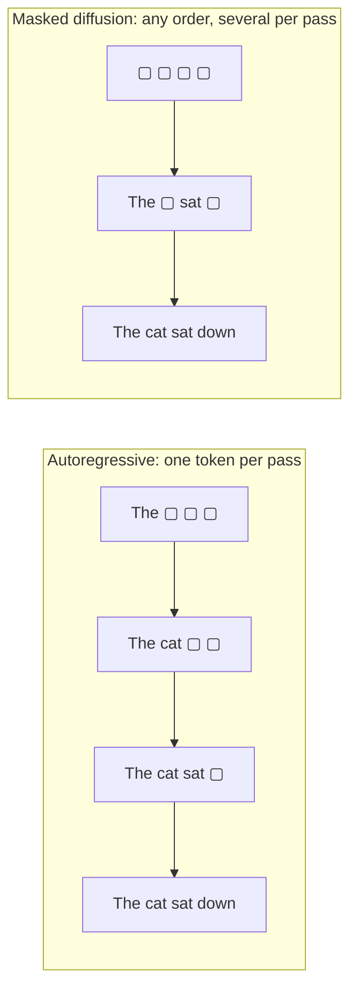

# Diffusion language models: writing every word at once

Every mainstream chatbot writes left to right, one token per forward pass. A **diffusion language model** works differently. It starts from a sequence of blanks (or noise), predicts every position at once, keeps some of its guesses, and repeats until no blank remains. The same network can write a sentence in any order, fill in a gap in the middle, and commit several tokens in a single pass. In 2025 the idea crossed from research toy to product: an 8-billion-parameter diffusion model competitive with LLaMA3 8B on in-context learning (Nie et al. 2025), and commercial code models reporting more than 1,000 tokens per second on one GPU (Inception Labs et al. 2025; Song et al. 2025).

> The core idea in one sentence: **train a network to fill in randomly hidden tokens at every masking rate, then generate by un-hiding a few positions at a time, and accept that every token committed in parallel is a bet that those tokens do not depend on each other.**

This page connects to [generative models](generative-models.md) (continuous diffusion and flow matching), [large language models](large-language-models.md), [speculative decoding](../04-systems/speculative-decoding.md) (the other way to get several tokens per pass), [inference and efficiency](../04-systems/inference-and-efficiency.md), [what transformers can and cannot compute](../06-frontiers/what-transformers-can-and-cannot-compute.md), and [code generation](code-generation-and-program-synthesis.md).

## 1. Why not left to right? (established)

An autoregressive model factorizes a sequence as $p(x) = \prod_i p(x_i \mid x_{<i})$. This is exact, easy to train, and gives a clean likelihood, but it fixes two things: generation takes one forward pass per token, and the model only ever learns to predict the *next* token from the *left* context. Parallel generation is an old ambition. Gu et al. (2017) built a non-autoregressive translator with "an order of magnitude lower latency", at a cost of about 2 BLEU points; Mask-Predict (Ghazvininejad et al. 2019) predicted every target word at once and then repeatedly re-masked and regenerated the least confident ones, reaching within about 1 BLEU of a left-to-right model. MaskGIT (Chang et al. 2022) did the same for image tokens and reported up to 64× faster decoding than raster-order generation. Diffusion language models are the probabilistic grown-up of this line: the same "predict everything, keep the confident part" loop, now with a training objective that is a bound on the log-likelihood.



## 2. Diffusion on discrete tokens (established)

Continuous diffusion (Ho et al. 2020) adds Gaussian noise to pixels and learns to remove it. Words have no "slightly noisier" version, so discrete diffusion replaces the noise with a **corruption process on tokens**:

- **Multinomial (uniform) diffusion** (Hoogeboom et al. 2021) gradually replaces tokens by random ones.
- **D3PM** (Austin et al. 2021) generalized the corruption to any transition matrix, including an **absorbing state**: a special `[MASK]` token that, once reached, never leaves. The authors noted that this choice draws "a connection between diffusion models and autoregressive and mask-based generative models".
- **Continuous embeddings.** Diffusion-LM (Li et al. 2022) instead diffused word embeddings with Gaussian noise; the continuous intermediate states allowed gradient-based control of syntax and other fine-grained attributes.
- **Score entropy.** SEDD (Lou, Meng and Ermon 2023) extended score matching to discrete spaces by learning ratios of data probabilities, cut perplexity by 25 to 75% relative to earlier language diffusion models and was competitive with GPT-2 at comparable size.
- **Discrete flow matching** (Gat et al. 2024) brought the flow-matching framework of [generative models](generative-models.md#flow-matching) to tokens and scaled to 1.7B parameters on code.

The absorbing (masked) version won. It is the simplest, and by 2024 it was the strongest.

## 3. Masked diffusion is a weighted masked language model (established)

Let $\alpha_t$ be the probability that a token is still visible at time $t \in [0, 1]$, decreasing from $\alpha_0 = 1$ to $\alpha_1 = 0$. The forward process hides each token independently: $x_t^i = \texttt{[MASK]}$ with probability $1 - \alpha_t$, otherwise $x_t^i = x^i$. A network $p_\theta(x^i \mid x_t)$ sees the partially masked sequence and predicts the hidden tokens. Three groups showed in 2024 that the continuous-time variational bound collapses to a **weighted cross-entropy on the masked positions** (Sahoo et al. 2024; Shi et al. 2024; Ou et al. 2024):

```math
-\log p_\theta(x) \;\le\; \int_0^1 \frac{-\alpha_t'}{1 - \alpha_t}\; \mathbb{E}_{x_t}\!\left[\sum_{i:\,x_t^i = \texttt{[MASK]}} -\log p_\theta\!\left(x^i \mid x_t\right)\right] dt .
```

For the linear schedule $\alpha_t = 1 - t$ the weight is simply $1/t$. This is BERT's masked language modelling loss (Devlin et al. 2018) with two changes: the masking rate is drawn uniformly from 0 to 1 instead of being fixed at 15%, and each rate is weighted so that the total is a bound on the negative log-likelihood. Shi et al. (2024) put it as "a simple weighted integral of cross-entropy losses".

Two further facts make the picture clean:

- **Time does not matter.** Ou et al. (2024) proved that the optimal denoiser for absorbing diffusion is the conditional distribution of clean data times an analytic scalar, so the network needs no time input. Zheng et al. (2024) went further: both training and sampling are "theoretically free from the time variable" and equivalent to masked models.
- **It is any-order autoregression.** Ou et al. (2024) also showed that the bound equals the expected negative log-likelihood of an *any-order* autoregressive model, averaged over random generation orders. A masked diffusion model is, in effect, a left-to-right model that has been trained on every order at once.

That last point explains both a strength and a cost. Training on every order means the model must solve every infilling problem, and Kim et al. (2025) showed that some of these subproblems are computationally intractable, which a left-to-right model never has to face. In return the model can choose a good order at inference time (Section 6).

## 4. Generating text by un-masking (established)

Sampling runs the corruption backwards. Start with $L$ mask tokens. At each step, the network predicts a distribution for every hidden position; the sampler **commits** some of them and leaves the rest masked. Choices that matter:

| Choice | Options | Effect |
|---|---|---|
| How many to commit per step | Fixed schedule ($L/S$ per step for $S$ steps), or every position above a confidence threshold | Fewer steps means faster, but riskier (Section 5) |
| Which positions | Random (the "true" reverse process), most confident first, largest probability margin | Adaptive orders sidestep hard subproblems (Kim et al. 2025) |
| Re-masking | Never (pure absorbing), or re-mask low-confidence tokens as in Mask-Predict | Lets the model fix early mistakes |
| Length | Fixed canvas, or **blocks** generated left to right with diffusion inside each block | Blocks give variable length and a reusable KV cache (Arriola et al. 2025) |

Two practical warnings come from the literature. Zheng et al. (2024) found a numerical issue: categorical sampling with 32-bit floats lowers the effective temperature, reducing diversity and making earlier "generative perplexity" comparisons partly unfair. And because attention is bidirectional, the standard key-value cache of a left-to-right model does not apply directly; Fast-dLLM (Wu et al. 2025) added an approximate block-wise cache and confidence-thresholded parallel decoding, reporting up to 27.6× higher throughput on LLaDA and Dream with minimal accuracy loss.

## 5. The parallel decoding problem (established)

Here is the catch. When the sampler commits two hidden tokens in the same step, it draws each from its own marginal, $p(x^i \mid x_t)$ and $p(x^j \mid x_t)$, as if they were independent. If they are not, the pair can be inconsistent even when each token is individually plausible. Wu et al. (2025) identify this "disruption of token dependencies under the conditional independence assumption" as the root cause of quality loss in parallel decoding.

Feng et al. (2025) made the trade-off precise. Measured by perplexity, a masked diffusion model can reach near-optimal quality in a number of sampling steps that does not grow with sequence length. Measured by **sequence error rate**, which is what matters for a proof, a program or a chain of reasoning, the number of steps must grow *linearly* with length to get sequences right, which removes the speed advantage over autoregression. Fluent text can be written in parallel; *correct* text often cannot.

A 2026 measurement shows the same thing from the other side. Fayyaz et al. (2026) counted forward passes per token in diffusion models across ten tasks: in DiffusionGemma, story writing needed more than three times as many passes per token as grammar correction, because text copied or lightly edited from the input is already determined. Wrong answers to a math problem also took more passes per token than right ones, and weighting candidate answers by decoding speed beat majority voting by up to 4.2 points.

## 6. A tested sketch

The script below makes Sections 3 to 5 concrete on distributions small enough to enumerate exactly, so the denoiser can be **perfect**: it returns the true conditional of every hidden position given the visible ones. Any error that remains is caused by the sampler, not the model. It needs only NumPy.

- **Part 1** estimates the masked-diffusion bound for a 6-token, 3-symbol Markov chain by Monte Carlo over the time integral (100,000 draws), once with the perfect denoiser and once with a "context-free" denoiser that ignores visible tokens.
- **Part 2** samples 30,000 sequences from the same chain with the perfect denoiser, committing tokens over 1, 2, 3 or 6 steps, in random or most-confident-first order, or by a confidence threshold, and reports the total variation (TV) distance between the sample histogram and the true distribution. Direct sampling of 30,000 sequences sets the noise floor.
- **Part 3** does the same for a hard constraint: the uniform distribution over the 120 permutations of 5 symbols (out of $5^5 = 3125$ strings), reporting how often the output is a valid permutation.
- **Part 4** gives the sampler the first 3 tokens as a prompt and compares a *copy* task (the last 3 tokens repeat the first 3) with a free *continuation* of the Markov chain.

```python
import numpy as np, itertools
rng=np.random.default_rng(0)

def enum(V,L): return np.array(list(itertools.product(range(V),repeat=L)))

# Part 1: the masked-diffusion bound with exact conditionals equals the entropy
V,L=3,6
S=enum(V,L)
T=np.array([[0.80,0.10,0.10],[0.10,0.80,0.10],[0.10,0.10,0.80]]); pi0=np.array([0.5,0.3,0.2])
pA=pi0[S[:,0]]*np.prod(T[S[:,:-1],S[:,1:]],axis=1); pA/=pA.sum()
H=-(pA*np.log(pA)).sum()

def marg(states,p,x,mask):
    # marginals of each position given unmasked positions of x (mask True = hidden)
    ok=np.all((states[:,~mask]==x[~mask]),axis=1)
    w=p*ok
    if w.sum()==0: return None
    w=w/w.sum()
    M=np.zeros((states.shape[1],V if states.max()<V else states.max()+1))
    for i in range(states.shape[1]):
        M[i]=np.bincount(states[:,i],weights=w,minlength=M.shape[1])
    return M

# time-integral estimator, linear schedule: NELBO = E_t[(1/t) sum_{masked} -log p(x_i|x_t)]
N=100000; est=[]
idx=rng.choice(len(S),size=N,p=pA)
for n in range(N):
    x=S[idx[n]]; t=rng.uniform(); mask=rng.uniform(size=L)<t
    if not mask.any(): est.append(0.0); continue
    M=marg(S,pA,x,mask)
    est.append(-np.log(M[mask,x[mask]]).sum()/t)
est=np.array(est)
print(f"P1 entropy H={H:.4f} nats; NELBO estimate={est.mean():.4f} +/- {est.std()/np.sqrt(N):.4f}")
# context-free model: predicts each masked token from the position marginal only
Mfree=marg(S,pA,S[0],np.ones(L,bool))
est2=[]
for n in range(N):
    x=S[idx[n]]; t=rng.uniform(); mask=rng.uniform(size=L)<t
    if mask.any(): est2.append(-np.log(Mfree[mask,x[mask]]).sum()/t)
    else: est2.append(0.0)
print(f"P1 context-free denoiser NELBO={np.mean(est2):.4f}")

# Part 2: parallel unmasking with a perfect denoiser
def sample(states,p,L,V,steps,policy,tau=None,prefix=None):
    x=np.zeros(L,int); mask=np.ones(L,bool); nsteps=0
    if prefix is not None: x[:len(prefix)]=prefix; mask[:len(prefix)]=False
    while mask.any():
        M=marg(states,p,x,mask); nsteps+=1
        if M is None: return np.zeros(L,int),nsteps  # contradiction: already invalid
        hid=np.flatnonzero(mask)
        if policy=='thresh':
            conf=M[hid].max(1); pick=hid[conf>=tau]
            if len(pick)==0: pick=hid[[conf.argmax()]]
        else:
            k=int(np.ceil(len(hid)/(steps-nsteps+1)))
            if policy=='random': pick=rng.choice(hid,size=k,replace=False)
            else: pick=hid[np.argsort(-M[hid].max(1))[:k]]
        for i in pick:
            pr=M[i]/M[i].sum(); x[i]=rng.choice(len(pr),p=pr)  # independent draws from marginals
        mask[pick]=False
    return x,nsteps

code=lambda X,V: (X*(V**np.arange(X.shape[1]-1,-1,-1))).sum(1)
NS=30000
def tv_of(samples,p,V):
    c=np.bincount(code(np.array(samples),V),minlength=len(p))/len(samples); return 0.5*np.abs(c-p).sum()
base=S[rng.choice(len(S),size=NS,p=pA)]
print(f"P2 direct-sampling TV={tv_of(base,pA,V):.4f}")
for steps in [1,2,3,6]:
    for pol in ['random','confident']:
        sm=[sample(S,pA,L,V,steps,pol)[0] for _ in range(NS)]
        print(f"P2 MarkovA steps={steps} {pol}: TV={tv_of(sm,pA,V):.4f}")
for tau in [0.5,0.7,0.9]:
    out=[sample(S,pA,L,V,None,'thresh',tau) for _ in range(NS)]
    print(f"P2 MarkovA thresh={tau}: TV={tv_of([o[0] for o in out],pA,V):.4f} mean steps={np.mean([o[1] for o in out]):.2f}")

# Part 3: hard constraints -- uniform over permutations of 5 symbols
V2=L2=5; S2=enum(V2,L2); valid=np.array([len(set(r))==L2 for r in S2]); pB=valid/valid.sum()
NB=20000
for steps in [1,2,3,5]:
    for pol in ['random','confident']:
        sm=np.array([sample(S2,pB,L2,V2,steps,pol)[0] for _ in range(NB)])
        v=np.mean([len(set(r))==L2 for r in sm])
        print(f"P3 perm steps={steps} {pol}: valid={v:.4f}")
for tau in [0.5,0.9]:
    out=[sample(S2,pB,L2,V2,None,'thresh',tau) for _ in range(NB)]
    v=np.mean([len(set(o[0]))==L2 for o in out])
    print(f"P3 perm thresh={tau}: valid={v:.4f} mean steps={np.mean([o[1] for o in out]):.2f}")

# Part 4: a copy task versus a free continuation, both given a 3-token prompt, threshold decoding
V,L=3,6; S=enum(V,L)
T=np.array([[0.80,0.10,0.10],[0.10,0.80,0.10],[0.10,0.10,0.80]]); pi0=np.array([0.5,0.3,0.2])
first=pi0[S[:,0]]*T[S[:,0],S[:,1]]*T[S[:,1],S[:,2]]
pC=first*np.all(S[:,3:]==S[:,:3],axis=1); pC/=pC.sum()
NS=30000
pA=pi0[S[:,0]]*np.prod(T[S[:,:-1],S[:,1:]],axis=1); pA/=pA.sum()
for name,p in [('copy',pC),('continue',pA)]:
    starts=S[rng.choice(len(S),size=NS,p=p)][:,:3]
    print(f"P4 {name} direct TV={tv_of(S[rng.choice(len(S),size=NS,p=p)],p,V):.4f}")
    for tau in [0.5,0.9]:
        out=[sample(S,p,L,V,None,'thresh',tau,prefix=starts[n]) for n in range(NS)]
        print(f"P4 {name} given 3-token prompt, thresh={tau}: TV={tv_of([o[0] for o in out],p,V):.4f} passes per generated token={np.mean([o[1] for o in out])/3:.3f}")
```

Output (seed 0):

| Experiment | Setting | Result |
|---|---|---|
| Part 1: bound vs entropy | perfect denoiser | entropy 4.2248 nats; bound estimate 4.2129 ± 0.0254 (equal within noise) |
| | context-free denoiser | bound 6.4278 nats |
| Part 2: Markov chain, TV to truth | direct sampling (noise floor) | 0.0338 |
| | 1 step (all 6 at once) | 0.7361 random, 0.7317 confident |
| | 2 steps | 0.3805 random, 0.6268 confident |
| | 3 steps | 0.1985 random, 0.5300 confident |
| | 6 steps (one per pass) | 0.0318 random, 0.0345 confident |
| | threshold 0.5 / 0.7 / 0.9 | 0.4757 in 3.00 steps / 0.0300 in 6.00 / 0.0336 in 6.00 |
| Part 3: permutations, fraction valid | 1 / 2 / 3 / 5 steps, random | 0.0374 / 0.2402 / 0.5350 / 1.0000 |
| | 1 / 2 / 3 / 5 steps, confident | 0.0361 / 0.2444 / 0.5322 / 1.0000 |
| | threshold 0.5 / 0.9 | 0.4951 in 4.00 steps / 1.0000 in 5.00 |
| Part 4: given a 3-token prompt | copy, threshold 0.5 or 0.9 | TV 0.0078 (floor 0.0082), 0.333 passes per generated token |
| | continuation, threshold 0.5 | TV 0.4239 (floor 0.0293), 0.333 passes per token |
| | continuation, threshold 0.9 | TV 0.0306, 1.000 pass per token |

What it shows:

1. **The objective is a likelihood bound, tight for a perfect model.** With exact conditionals the weighted masked cross-entropy matches the entropy within its Monte Carlo error, as the any-order equivalence of Section 3 predicts. A denoiser that ignores context pays about 2.2 extra nats per sequence.
2. **A perfect denoiser is not enough.** Committing all six tokens in one pass produces a distribution 0.74 away from the truth in total variation, even though every individual prediction was exact. Only one token per pass recovers the true distribution. The one-step permutation result, 0.0374 valid, is what independent marginals predict ($120/3125 = 0.0384$).
3. **Committing the most confident tokens together can be worse than random.** In this chain, the most confident positions tend to sit next to each other and are strongly dependent, so committing them in the same step (TV 0.63 at 2 steps) does more harm than a random pair (0.38). This is the dependency problem that SetCommit (Feng et al. 2026) addresses by choosing the committed *set* rather than independent tokens. It is a property of this toy, not a general ranking of policies.
4. **Thresholds buy speed only where the answer is already determined.** With a strict threshold, the sampler stays exact and falls back to one token per pass on open-ended continuation, but commits the whole copy in a single pass with no loss. A loose threshold of 0.5 is just as fast on both tasks and wrecks the continuation (TV 0.42). This is a miniature of Fayyaz et al. (2026): parallelism pays when the output is constrained by the input, not when it is new.

## 7. Diffusion LLMs at scale (active research)

| Model or study | Year | What it reported |
|---|---|---|
| MDLM (Sahoo et al.) | 2024 | Simplified Rao-Blackwellized objective; new state of the art among diffusion models, approaching autoregressive perplexity |
| MD4 (Shi et al.) | 2024 | Surpassed prior diffusion language models at GPT-2 scale; 2.75 bits per dimension on CIFAR-10 pixels, better than autoregressive models of similar size |
| SMDM (Nie et al.) | 2024 | First scaling law for masked diffusion, "comparable" scaling rate to autoregressive models; a 1.1B model breaks the reversal curse that affects 13B Llama-2 and 175B GPT-3 |
| LLaDA 8B (Nie et al.) | 2025 | Trained from scratch; competitive with LLaMA3 8B in in-context learning; beat GPT-4o on a reversal poem-completion task |
| LLaDA 1.5 (Zhu et al.) | 2025 | Variance-reduced preference optimization; GSM8K +4.7, HumanEval +3.0, IFEval +4.0 over its SFT-only predecessor |
| d1 (Zhao et al.) | 2025 | First policy-gradient RL (diffu-GRPO) for masked diffusion LLMs, improving maths and planning |
| Block diffusion (Arriola et al.) | 2025 | Diffusion inside blocks, autoregression across blocks: arbitrary length, KV caching, new diffusion state of the art on language modelling benchmarks |
| Dream 7B (Ye et al.) | 2025 | Initialized from an autoregressive LLM; outperforms earlier diffusion LLMs on general, maths and code tasks |
| Mercury Coder (Inception Labs et al.) | 2025 | Commercial code models: 1,109 and 737 tokens/s on H100 in independent tests, "up to 10x" faster than speed-optimized frontier models at comparable quality |
| Seed Diffusion Preview (Song et al.) | 2025 | 2,146 tokens/s on H20 GPUs with competitive code benchmark scores |
| BYOD (Kuiper and Bagheri) | 2026 | LoRA-only conversion of four 7 to 9B autoregressive models to diffusion in 3 to 4 GPU-hours each; 50.6% average accuracy against 51.9% for LLaDA 8B Instruct, but much worse open-generation perplexity at low step counts |

Two things stand out. First, speed claims are mostly about **code**, which is highly constrained and often copies from context, the regime where Section 6 says parallel commitment is cheap. Second, the field converged on **hybrids**: block diffusion, semi-autoregressive sampling and conversion from autoregressive checkpoints all keep some left-to-right structure.

### Data efficiency (active research)

Because the masking objective trains on many orders and masking rates, each pass over the data is a different problem. Prabhudesai et al. (2025) found that when data is scarce and compute abundant, masked diffusion "significantly" outperforms autoregression under repeated epochs, and derived the compute threshold at which it overtakes. Ni et al. (2025) reported the same **crossover** under strictly controlled settings, including a 1.7B diffusion coder trained on 10B unique Python tokens that overtook a matched autoregressive model. Gao et al. (2025) traced most of the gain to random input masking itself and found that MLP dropout and weight decay recover similar benefits, so the advantage may be a regularization effect rather than something unique to diffusion. With high-quality text becoming the scarce input to pre-training, this is one of the more consequential open questions.

### Choosing what to commit (active research)

Since the order is free, the unmasking policy is a design surface of its own. Kim et al. (2025) showed that adaptive ordering lifted a pretrained masked diffusion model on Sudoku from under 7% to about 90%, beating autoregressive models with 7× as many parameters trained in the right order. In 2026, Sakurai, Xu and Yoon (2026) trained an 856,000-parameter unmasking policy for LLaDA-8B that gave the best accuracy-per-pass trade-off on GSM8K, and found that a policy pays for itself once it saves about 10% of forward passes. SetCommit (Feng et al. 2026) chose committed sets jointly and reported gains of up to 7.4 points at 32 model evaluations.

## 8. What we know and what we don't

| Claim | Status |
|---|---|
| The masked diffusion objective is a weighted masked-LM loss and a bound on log-likelihood | Established (proved three ways in 2024) |
| Masked diffusion is equivalent to any-order autoregression and needs no time input | Established |
| Diffusion LLMs can match autoregressive models of similar size on many benchmarks | Supported at the 1 to 8B scale; no public frontier-scale comparison |
| Parallel commitment of dependent tokens loses quality | Established theoretically and empirically |
| Large speed-ups on code at comparable quality | Reported by developers; independent throughput tests exist, broader quality comparisons are limited |
| Diffusion is more data-efficient than autoregression under repeated data | Reported by several groups; mechanism debated |
| Bidirectional training fixes the reversal curse | Reported at 1.1B and 8B; limited to specific tasks |
| Diffusion LLMs reason as well as autoregressive ones | Open; theory says correct long chains need many steps |

## 9. Physical sampling of the denoiser (speculative)

> [!WARNING]
> **Speculative.** This section is a hypothesis, not a reported result. We cite no study that tests it.

A masked diffusion sampler spends most of its time doing two things: running a denoiser that outputs a distribution for every hidden position at once, and drawing independent samples from those distributions. The second step is exactly the operation that noisy physical hardware does for free: an analog or optical system that encodes logits as intensities and thresholds them with physical noise is, in principle, a parallel categorical sampler. Zheng et al. (2024) show that even 32-bit rounding in this step distorts the output temperature, so any physical sampler would need its effective temperature measured and corrected, not assumed. Section 6 suggests where such a scheme could help: when the output is mostly determined by the input (copying, editing, constrained code), commitments are near-deterministic and parallel sampling is nearly free of error; for open-ended text, the dependency problem dominates and no amount of fast sampling helps. The testable questions are how well a physical sampler's temperature can be calibrated, and whether a confidence threshold measured on the digital denoiser keeps the end-to-end error at the floor.

## Further reading

- Gu, J., Bradbury, J., Xiong, C., Li, V. O. K., Socher, R. (2017). *Non-autoregressive neural machine translation*. ICLR 2018. [arXiv:1711.02281](https://arxiv.org/abs/1711.02281)
- Ghazvininejad, M., Levy, O., Liu, Y., Zettlemoyer, L. (2019). *Mask-Predict: Parallel decoding of conditional masked language models*. EMNLP. [arXiv:1904.09324](https://arxiv.org/abs/1904.09324)
- Hoogeboom, E., Nielsen, D., Jaini, P., Forré, P., Welling, M. (2021). *Argmax flows and multinomial diffusion: Learning categorical distributions*. NeurIPS. [arXiv:2102.05379](https://arxiv.org/abs/2102.05379)
- Austin, J., Johnson, D. D., Ho, J., Tarlow, D., van den Berg, R. (2021). *Structured denoising diffusion models in discrete state-spaces*. NeurIPS. [arXiv:2107.03006](https://arxiv.org/abs/2107.03006)
- Chang, H., Zhang, H., Jiang, L., Liu, C., Freeman, W. T. (2022). *MaskGIT: Masked generative image transformer*. CVPR. [arXiv:2202.04200](https://arxiv.org/abs/2202.04200)
- Li, X. L., Thickstun, J., Gulrajani, I., Liang, P., Hashimoto, T. B. (2022). *Diffusion-LM improves controllable text generation*. NeurIPS. [arXiv:2205.14217](https://arxiv.org/abs/2205.14217)
- Lou, A., Meng, C., Ermon, S. (2023). *Discrete diffusion modeling by estimating the ratios of the data distribution*. ICML 2024. [arXiv:2310.16834](https://arxiv.org/abs/2310.16834)
- Sahoo, S. S., Arriola, M., Schiff, Y., Gokaslan, A., Marroquin, E., Chiu, J. T., et al. (2024). *Simple and effective masked diffusion language models*. NeurIPS. [arXiv:2406.07524](https://arxiv.org/abs/2406.07524)
- Shi, J., Han, K., Wang, Z., Doucet, A., Titsias, M. K. (2024). *Simplified and generalized masked diffusion for discrete data*. NeurIPS. [arXiv:2406.04329](https://arxiv.org/abs/2406.04329)
- Ou, J., Nie, S., Xue, K., Zhu, F., Sun, J., Li, Z., et al. (2024). *Your absorbing discrete diffusion secretly models the conditional distributions of clean data*. ICLR 2025. [arXiv:2406.03736](https://arxiv.org/abs/2406.03736)
- Gat, I., Remez, T., Shaul, N., Kreuk, F., Chen, R. T. Q., Synnaeve, G., et al. (2024). *Discrete flow matching*. NeurIPS. [arXiv:2407.15595](https://arxiv.org/abs/2407.15595)
- Zheng, K., Chen, Y., Mao, H., Liu, M.-Y., Zhu, J., Zhang, Q. (2024). *Masked diffusion models are secretly time-agnostic masked models and exploit inaccurate categorical sampling*. ICLR 2025. [arXiv:2409.02908](https://arxiv.org/abs/2409.02908)
- Nie, S., Zhu, F., Du, C., Pang, T., Liu, Q., Zeng, G., et al. (2024). *Scaling up masked diffusion models on text*. ICLR 2025. [arXiv:2410.18514](https://arxiv.org/abs/2410.18514)
- Kim, J., Shah, K., Kontonis, V., Kakade, S., Chen, S. (2025). *Train for the worst, plan for the best: Understanding token ordering in masked diffusions*. ICML. [arXiv:2502.06768](https://arxiv.org/abs/2502.06768)
- Feng, G., Geng, Y., Guan, J., Wu, W., Wang, L., He, D. (2025). *Theoretical benefit and limitation of diffusion language model*. [arXiv:2502.09622](https://arxiv.org/abs/2502.09622)
- Nie, S., Zhu, F., You, Z., Zhang, X., Ou, J., Hu, J., et al. (2025). *Large language diffusion models*. [arXiv:2502.09992](https://arxiv.org/abs/2502.09992)
- Arriola, M., Gokaslan, A., Chiu, J. T., Yang, Z., Qi, Z., Han, J., et al. (2025). *Block diffusion: Interpolating between autoregressive and diffusion language models*. ICLR. [arXiv:2503.09573](https://arxiv.org/abs/2503.09573)
- Zhao, S., Gupta, D., Zheng, Q., Grover, A. (2025). *d1: Scaling reasoning in diffusion large language models via reinforcement learning*. [arXiv:2504.12216](https://arxiv.org/abs/2504.12216)
- Zhu, F., Wang, R., Nie, S., Zhang, X., Wu, C., Hu, J., et al. (2025). *LLaDA 1.5: Variance-reduced preference optimization for large language diffusion models*. [arXiv:2505.19223](https://arxiv.org/abs/2505.19223)
- Wu, C., Zhang, H., Xue, S., Liu, Z., Diao, S., Zhu, L., et al. (2025). *Fast-dLLM: Training-free acceleration of diffusion LLM by enabling KV cache and parallel decoding*. [arXiv:2505.22618](https://arxiv.org/abs/2505.22618)
- Inception Labs, Khanna, S., Kharbanda, S., Li, S., Varma, H., Wang, E., et al. (2025). *Mercury: Ultra-fast language models based on diffusion*. [arXiv:2506.17298](https://arxiv.org/abs/2506.17298)
- Prabhudesai, M., Wu, M., Zadeh, A., Fragkiadaki, K., Pathak, D. (2025). *Diffusion beats autoregressive in data-constrained settings*. [arXiv:2507.15857](https://arxiv.org/abs/2507.15857)
- Song, Y., Zhang, Z., Luo, C., Gao, P., Xia, F., Luo, H., et al. (2025). *Seed Diffusion: A large-scale diffusion language model with high-speed inference*. [arXiv:2508.02193](https://arxiv.org/abs/2508.02193)
- Ye, J., Xie, Z., Zheng, L., Gao, J., Wu, Z., Jiang, X., et al. (2025). *Dream 7B: Diffusion large language models*. [arXiv:2508.15487](https://arxiv.org/abs/2508.15487)
- Gao, Z., Luo, H., Chen, L., Liu, J. K., Tao, R., et al. (2025). *What makes diffusion language models super data learners?* [arXiv:2510.04071](https://arxiv.org/abs/2510.04071)
- Ni, J., Liu, Q., Dou, L., Du, C., Wang, Z., Yan, H., et al. (2025). *Diffusion language models are super data learners*. [arXiv:2511.03276](https://arxiv.org/abs/2511.03276)
- Fayyaz, M., Modarressi, A., Israel, D., Bandarkar, L., Peng, N. (2026). *Diffusion language models change speed across tasks and languages*. [arXiv:2610.25835](https://arxiv.org/abs/2610.25835)
- Feng, Y., Ye, Y., Yao, W., Chen, Y., Wong, N., Zhou, W., et al. (2026). *SetCommit: Coordinated token commitments for few-step diffusion language model decoding*. [arXiv:2610.31120](https://arxiv.org/abs/2610.31120)
- Sakurai, J., Xu, X., Yoon, J. (2026). *What makes a good unmasking policy? A controlled study of learned unmasking in diffusion language models*. [arXiv:2610.31576](https://arxiv.org/abs/2610.31576)
- Kuiper, R. J. A., Bagheri, R. A. (2026). *BYOD: Build your own DLM: Efficient autoregressive-to-diffusion language model conversion*. [arXiv:2610.41574](https://arxiv.org/abs/2610.41574)
- Already listed elsewhere: Ho, Jain and Abbeel (2020), *Denoising diffusion probabilistic models*; Devlin et al. (2018), *BERT*.
