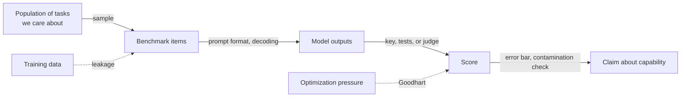

# Evaluation and benchmarks, and their pitfalls

Every headline about AI progress is, underneath, a number on a test. "State of the art on MMLU." "Top of the leaderboard." "Solves 50% of real GitHub issues." Those numbers move billions of dollars of investment and shape what researchers build next, yet most of them come with no error bar, are measured on questions that may have leaked into the training data, and are graded by answer keys that are sometimes wrong. **Evaluation is the least glamorous and most consequential part of modern AI.**

> The core idea in one sentence: **a benchmark score is a measurement taken with a noisy, leaky, and gameable instrument, so it means something only once you know its error bar, what it actually samples, and how hard people have been optimizing against it.**

This page explains how language models are evaluated today, the statistics behind a trustworthy comparison (with tested code), and the six ways benchmark numbers most often mislead.

## 1. What an evaluation is (established)

An evaluation is an experiment. Miller (2024) frames it cleanly: the questions in a benchmark are a sample from an unseen **super-population** of questions we actually care about, and the benchmark score is an estimate of the model's accuracy on that population. Seen this way, every score has sampling error, and two models can only be compared once that error is accounted for.

Modern evaluations come in four broad families:

| Family | How it is scored | Examples | Main strength | Main weakness |
|---|---|---|---|---|
| Static, closed-form | Exact match against an answer key | MMLU (Hendrycks et al. 2020), GPQA (Rein et al. 2023), Humanity's Last Exam (Phan et al. 2025) | Cheap, reproducible | Saturates and leaks into training data |
| Execution-based | Run the output and check it | HumanEval (Chen et al. 2021), SWE-bench (Jimenez et al. 2023) | Hard to fake; checks function, not form | Test suites can be incomplete |
| Judged | A human or an LLM grades open-ended output | MT-Bench (Zheng et al. 2023), Chatbot Arena (Chiang et al. 2024) | Covers open-ended quality | Judge biases, crowd biases |
| Dynamic and live | Questions refreshed or written adversarially | Dynabench (Kiela et al. 2021), LiveBench (White et al. 2024) | Resists contamination and saturation | Harder to compare over time |

Holistic suites try to cover many axes at once. HELM (Liang et al. 2022) measured seven metrics (accuracy, calibration, robustness, fairness, bias, toxicity, and efficiency) across 16 core scenarios for 30 models, and found that before HELM, models had on average been evaluated on just 17.9% of its core scenarios, with some prominent models sharing no scenario at all. BIG-bench (Srivastava et al. 2022) collected 204 tasks from 450 authors to probe abilities believed to be beyond the models of the day.



The dotted arrows are where most of the trouble comes from.

## 2. The statistics of a fair comparison (established)

### Error bars

If a model answers $n$ independent questions and gets a fraction $\hat p$ right, the standard error of that accuracy is

```math
\operatorname{SE}(\hat p) = \sqrt{\frac{\hat p\,(1-\hat p)}{n}} .
```

For $\hat p = 0.8$ on $n = 1{,}000$ questions, a 95% confidence interval is about $\pm 1.96 \times 0.0126 \approx \pm 2.5$ percentage points. Many leaderboard gaps are smaller than that. Miller (2024) adds two refinements: questions often come in related **clusters** (several questions about one passage), which inflates the true standard error, and two models evaluated on the same questions should be compared with **paired** differences, which shrinks it, because much of the variation comes from question difficulty that both models share.

Model training itself adds noise. Madaan et al. (2024) measured **seed variance** (retraining the same model from a different random initialization) across many benchmarks and found it large enough to matter when benchmarks are used to choose between training recipes. They also found that recasting multiple-choice tasks such as MMLU as completion tasks often reduces variance for models around 7B parameters.

```python
import numpy as np
from math import comb

def pass_at_k(n, c, k):
    """Unbiased pass@k from n samples with c correct (Chen et al. 2021)."""
    if n - c < k:
        return 1.0
    return 1.0 - comb(n - c, k) / comb(n, k)

def paired_diff(a, b):
    """Mean score difference and its standard error on the same questions."""
    d = np.asarray(a, float) - np.asarray(b, float)
    return d.mean(), d.std(ddof=1) / np.sqrt(len(d))

rng = np.random.default_rng(0)
skill = rng.normal(size=1000)          # question difficulty shared by both models
a = (skill + rng.normal(0.0, 1, 1000) > -0.8).astype(float)
b = (skill + rng.normal(0.0, 1, 1000) > -0.7).astype(float)
for name, s in [("A", a), ("B", b)]:
    p = s.mean(); se = np.sqrt(p * (1 - p) / len(s))
    print(f"{name}: {p:.3f} +/- {1.96*se:.3f}")
m, se = paired_diff(a, b)
print(f"A-B: {m:.3f} +/- {1.96*se:.3f}")
# A: 0.704 +/- 0.028
# B: 0.689 +/- 0.029
# A-B: 0.015 +/- 0.034
```

On this synthetic example, model A "wins" by 1.5 points, but the paired 95% interval ($\pm 3.4$ points) comfortably includes zero. The paired interval is also tighter than the $\pm 4.0$ points you would get by treating the two scores as independent, which is the payoff of pairing.

### pass@k

For code, a model is often allowed several attempts. Naively estimating "solved in $k$ tries" by drawing exactly $k$ samples is high-variance. Chen et al. (2021) instead draw $n \ge k$ samples, count the $c$ that pass the tests, and use the unbiased estimator

```math
\text{pass@}k = \mathbb{E}_{\text{problems}}\left[\,1 - \frac{\binom{n-c}{k}}{\binom{n}{k}}\,\right].
```

With $n = 200$ samples of which $c = 13$ pass, the function above gives pass@1 $= 0.065$, pass@10 $\approx 0.50$, and pass@100 $\approx 1.0$. The same model looks weak or near-perfect depending on $k$, which is why a pass@k number without its $k$ is meaningless. How sampling many programs and selecting among them by execution turns high pass@k into real accuracy is covered on the [code generation page](code-generation-and-program-synthesis.md#4-sample-filter-select-established). Chen et al. reported that Codex solved 28.8% of HumanEval problems with one sample and 70.2% with 100 samples per problem.

## 3. Six ways benchmark numbers mislead

### 3.1 Contamination (established)

If test questions appear in the pretraining data, a high score may reflect memory rather than ability. Contamination is hard to rule out because training corpora are enormous and often undisclosed. Golchin & Surdeanu (2023) detect it by prompting a model with a dataset's name, split, and the first part of a test instance and checking whether it completes the rest; against human judgment their best method was 92% to 100% accurate across seven datasets, and it flagged GPT-4 as contaminated with AG News, WNLI, and XSum.

The cleanest test is to write fresh questions. Zhang et al. (2024) commissioned **GSM1k**, a new set of grade-school math problems matched to the popular GSM8k benchmark in difficulty and style. Some model families dropped by up to 8% accuracy on the fresh set, and a model's probability of generating GSM8k examples correlated with its drop (Spearman $r^2 = 0.36$), suggesting partial memorization. The same study found that many frontier models showed minimal overfitting, a useful reminder that contamination is a measurable effect, not a reason to dismiss every score.

### 3.2 Saturation (established)

Benchmarks have short lives. When MMLU was introduced, the largest GPT-3 model beat random chance by almost 20 percentage points on average (Hendrycks et al. 2020); by early 2025, the authors of Humanity's Last Exam noted that models exceeded 90% on it (Phan et al. 2025). Once the top models cluster near the ceiling, the remaining differences are dominated by noise and label errors. The response has been to build ever-harder tests: GPQA's 448 expert-written science questions, on which PhD-level experts reached 65% while skilled non-experts with unrestricted web access reached 34% (Rein et al. 2023), and HLE's 2,500 questions at the frontier of human knowledge.

### 3.3 Broken answer keys (established)

Gema et al. (2024) re-annotated 5,700 MMLU questions and estimated that 6.49% of MMLU questions contain errors, with 57% of the analysed questions in the Virology subset affected. When the answer key is wrong several percent of the time, a "state-of-the-art" gain of one point may be a model learning to agree with the key's mistakes.

### 3.4 Metric choice creates mirages (established, with debate)

Schaeffer, Miranda & Koyejo (2023) argued that many reported **emergent abilities**, sudden jumps in capability at some model scale, come from the metric rather than the model. The intuition: if per-token accuracy $p$ improves smoothly with scale, exact match on an $L$-token answer scores roughly $p^L$, which stays near zero and then shoots up.

```math
\text{exact match} \approx p^{L}: \quad p = 0.5 \Rightarrow 0.5^{10} \approx 0.001, \qquad p = 0.9 \Rightarrow 0.9^{10} \approx 0.35 .
```

Switching to a continuous metric on the same model outputs often turns the jump into a smooth curve. BIG-bench had already observed that tasks with "breakthrough" behaviour often involve multiple steps or brittle metrics (Srivastava et al. 2022). This does not prove that no capability ever appears abruptly, but it means a sharp curve is evidence about the metric before it is evidence about the model.

### 3.5 Judges have biases (established)

Open-ended answers need a grader, and the cheapest grader is another LLM. Zheng et al. (2023) found that GPT-4 as a judge agreed with human preferences over 80% of the time, about the level at which humans agree with each other, but documented **position bias** (preferring the first or second answer), **verbosity bias** (preferring longer answers), and **self-enhancement bias** (preferring its own outputs). Wang et al. (2023) showed how fragile this can be: merely swapping the order of two answers let Vicuna-13B beat ChatGPT on 66 of 80 queries with ChatGPT as the judge. Standard mitigations are to score both orders and average, ask the judge for reasoning before a verdict, and spot-check against humans.

### 3.6 Leaderboards get optimized against (established, recent)

Chatbot Arena (Chiang et al. 2024) ranks models from crowdsourced head-to-head votes, more than 240,000 of them at the time of its paper, using a **Bradley–Terry** model (Bradley & Terry 1952), in which each model $i$ has a strength $\theta_i$ and

```math
P(i \text{ beats } j) = \frac{1}{1 + e^{-(\theta_i - \theta_j)}} .
```

It became one of the most cited leaderboards precisely because human preference is hard to fake. Singh et al. (2025), in *The Leaderboard Illusion*, then showed how even this can be distorted. Some providers privately tested many variants and published only the best (they identify 27 private variants tested by Meta before the Llama 4 release); selecting the maximum of several noisy scores biases it upward. Proprietary models were also sampled in more battles, with Google and OpenAI estimated to receive 19.2% and 20.4% of all Arena data, against 29.7% for 83 open-weight models combined, and they found that extra Arena data can yield relative gains of up to 112% on the Arena distribution. The result, in their words, is overfitting to Arena-specific dynamics rather than general model quality.

The selection effect is simple to see. If each private variant's score is the true score plus independent noise of standard deviation $\sigma$, publishing the best of $m$ variants inflates the expected score by roughly $\sigma\sqrt{2\ln m}$ for large $m$, even if no variant is actually better.

All six failures are instances of **Goodhart's law**, "when a measure becomes a target, it ceases to be a good measure." Manheim & Garrabrant (2018) distinguish four mechanisms: *regressional* (selecting on a noisy proxy picks up the noise, as in best-of-$m$ above), *extremal* (the proxy–goal relationship breaks in unexplored regimes), *causal* (intervening on the proxy does not move the goal), and *adversarial* (agents game the proxy). Benchmarks experience all four.

## 4. Measuring what matters: agents and time horizons (active research)

As models act in the world, evaluation is shifting from "answer this question" to "complete this task." SWE-bench (Jimenez et al. 2023) asks a model to resolve 2,294 real GitHub issues across 12 Python repositories by editing the codebase until hidden tests pass; at release, the best model solved 1.96% of them. Execution-based scoring makes such benchmarks harder to game than multiple choice, though they inherit the weaknesses of whatever test suites they rely on.

Kwa et al. (2025) at METR proposed translating benchmark performance into human terms with a **50% task-completion time horizon**: the length of task, measured by how long skilled humans take, that a model completes with 50% success. They report a horizon of around 50 minutes for frontier models such as Claude 3.7 Sonnet, doubling roughly every seven months since 2019, and they discuss the limits of its external validity. The metric is attractive because it is continuous, interpretable, and does not saturate at 100%; whether the trend continues is an empirical question, not a law.

See [Retrieval, tools and agents](retrieval-tools-and-agents.md) for how agents are built, and [Alignment and safety](../05-alignment-safety-interpretability/alignment.md#evaluation) for dangerous-capability evaluations.

## 5. A checklist for reading (or writing) a benchmark claim

| Question | Why it matters |
|---|---|
| Is there an error bar, and is the comparison paired? | Gaps of one or two points on a thousand questions are often noise (Miller 2024) |
| How many seeds, prompts, or attempts? | Seed and prompt variance can exceed the claimed gain (Madaan et al. 2024); pass@k depends on $k$ |
| Could the test items be in the training data? | Fresh-question replications reveal memorization (Zhang et al. 2024) |
| Is the benchmark near its ceiling? | Near-saturated scores are dominated by noise and label errors (Gema et al. 2024) |
| Is the metric continuous or all-or-nothing? | Discontinuous metrics manufacture sudden jumps (Schaeffer et al. 2023) |
| Who or what is the judge, and was order randomized? | LLM judges have position and verbosity biases (Zheng et al. 2023; Wang et al. 2023) |
| How many variants were tried before this one was reported? | Best-of-$m$ selection inflates scores (Singh et al. 2025) |

## 6. Evaluating models on analog and optical hardware (speculative)

> **Speculative.** This section applies the statistics above to hardware that is still largely experimental. It is a proposal for good practice, not an established result.

On a digital accelerator, running the same model twice gives (nearly) the same answers, so a benchmark score has only one source of noise: which questions were sampled. On [photonic](../06-frontiers/photonic-computing.md) or [in-memory analog](../06-frontiers/neuromorphic-computing.md) hardware, the computation itself is noisy, drifts with temperature, and varies from chip to chip. A score then has at least three variance components (questions, repeated runs on one device, and devices), and the paired, clustered analysis of Section 2 extends naturally to all three. A claim such as "the optical model matches the digital baseline" would be meaningful only as a paired difference with a confidence interval that includes run-to-run and device-to-device variation, together with the energy and latency at which it was measured. We know of no standard benchmark protocol for this yet; building one is an open and testable problem.

## Key takeaways

- A benchmark score is an estimate with sampling error; report error bars and compare models with paired differences.
- Contamination, saturation, label errors, metric choice, judge bias, and selective reporting are the six most common ways scores mislead, and all are forms of Goodhart's law.
- Fresh questions, execution-based scoring, continuous metrics, and live benchmarks are the main defences.
- Agentic evaluations and time-horizon metrics are the current frontier of measuring what models can actually do.

## Further reading

- Hendrycks, D., Burns, C., Basart, S., et al. (2020). *Measuring massive multitask language understanding*. [arXiv:2009.03300](https://arxiv.org/abs/2009.03300)
- Chen, M., Tworek, J., Jun, H., et al. (2021). *Evaluating large language models trained on code*. [arXiv:2107.03374](https://arxiv.org/abs/2107.03374)
- Kiela, D., Bartolo, M., Nie, Y., et al. (2021). *Dynabench: Rethinking benchmarking in NLP*. [arXiv:2104.14337](https://arxiv.org/abs/2104.14337)
- Srivastava, A., Rastogi, A., Rao, A., et al. (2022). *Beyond the imitation game: Quantifying and extrapolating the capabilities of language models*. [arXiv:2206.04615](https://arxiv.org/abs/2206.04615)
- Liang, P., Bommasani, R., Lee, T., et al. (2022). *Holistic evaluation of language models*. [arXiv:2211.09110](https://arxiv.org/abs/2211.09110)
- Schaeffer, R., Miranda, B., Koyejo, S. (2023). *Are emergent abilities of large language models a mirage?* [arXiv:2304.15004](https://arxiv.org/abs/2304.15004)
- Wang, P., Li, L., Chen, L., et al. (2023). *Large language models are not fair evaluators*. [arXiv:2305.17926](https://arxiv.org/abs/2305.17926)
- Zheng, L., Chiang, W.-L., Sheng, Y., et al. (2023). *Judging LLM-as-a-judge with MT-Bench and Chatbot Arena*. [arXiv:2306.05685](https://arxiv.org/abs/2306.05685)
- Golchin, S., Surdeanu, M. (2023). *Time travel in LLMs: Tracing data contamination in large language models*. [arXiv:2308.08493](https://arxiv.org/abs/2308.08493)
- Jimenez, C. E., Yang, J., Wettig, A., et al. (2023). *SWE-bench: Can language models resolve real-world GitHub issues?* [arXiv:2310.06770](https://arxiv.org/abs/2310.06770)
- Rein, D., Hou, B. L., Stickland, A. C., et al. (2023). *GPQA: A graduate-level Google-proof Q&A benchmark*. [arXiv:2311.12022](https://arxiv.org/abs/2311.12022)
- Chiang, W.-L., Zheng, L., Sheng, Y., et al. (2024). *Chatbot Arena: An open platform for evaluating LLMs by human preference*. [arXiv:2403.04132](https://arxiv.org/abs/2403.04132)
- Zhang, H., Da, J., Lee, D., et al. (2024). *A careful examination of large language model performance on grade school arithmetic*. [arXiv:2405.00332](https://arxiv.org/abs/2405.00332)
- Gema, A. P., Leang, J. O. J., Hong, G., et al. (2024). *Are we done with MMLU?* [arXiv:2406.04127](https://arxiv.org/abs/2406.04127)
- Madaan, L., Singh, A. K., Schaeffer, R., et al. (2024). *Quantifying variance in evaluation benchmarks*. [arXiv:2406.10229](https://arxiv.org/abs/2406.10229)
- White, C., Dooley, S., Roberts, M., et al. (2024). *LiveBench: A challenging, contamination-limited LLM benchmark*. [arXiv:2406.19314](https://arxiv.org/abs/2406.19314)
- Miller, E. (2024). *Adding error bars to evals: A statistical approach to language model evaluations*. [arXiv:2411.00640](https://arxiv.org/abs/2411.00640)
- Phan, L., Gatti, A., Han, Z., et al. (2025). *Humanity's Last Exam*. [arXiv:2501.14249](https://arxiv.org/abs/2501.14249)
- Kwa, T., West, B., Becker, J., et al. (2025). *Measuring AI ability to complete long software tasks*. [arXiv:2503.14499](https://arxiv.org/abs/2503.14499)
- Singh, S., Nan, Y., Wang, A., et al. (2025). *The leaderboard illusion*. [arXiv:2504.20879](https://arxiv.org/abs/2504.20879)
- Manheim, D., Garrabrant, S. (2018). *Categorizing variants of Goodhart's law*. [arXiv:1803.04585](https://arxiv.org/abs/1803.04585)
- Bradley, R. A., Terry, M. E. (1952). *Rank analysis of incomplete block designs: I. The method of paired comparisons*. Biometrika 39(3/4). [doi:10.2307/2334029](https://doi.org/10.2307/2334029)
