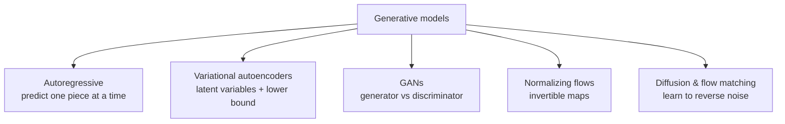
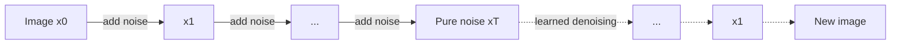

# Generative models

A generative model learns a distribution $p_\theta(\mathbf{x})$ it can **sample from**: new images, molecules, audio, or text. Language models are one family (autoregressive). This page covers the others.



## Variational autoencoders (VAEs)

Kingma & Welling (2013) pair an **encoder** $q_\phi(\mathbf{z} \mid \mathbf{x})$ with a **decoder** $p_\theta(\mathbf{x} \mid \mathbf{z})$ and maximize the **evidence lower bound (ELBO)**:

```math
\log p_\theta(\mathbf{x}) \;\ge\; \mathbb{E}_{q_\phi(\mathbf{z}\mid\mathbf{x})}\big[\log p_\theta(\mathbf{x} \mid \mathbf{z})\big] - D_{\mathrm{KL}}\big(q_\phi(\mathbf{z} \mid \mathbf{x}) \,\Vert\, p(\mathbf{z})\big)
```

The **reparameterization trick**, $\mathbf{z} = \boldsymbol\mu + \boldsymbol\sigma \odot \boldsymbol\epsilon$ with $\boldsymbol\epsilon \sim \mathcal{N}(0, I)$, makes sampling differentiable. VAEs give smooth latent spaces; their samples tend to be blurrier than other methods, but their encoders are central to latent diffusion.

## Generative adversarial networks (GANs)

Goodfellow et al. (2014) set up a two-player game between a generator $G$ and a discriminator $D$:

```math
\min_G \max_D \; \mathbb{E}_{\mathbf{x} \sim p_{\text{data}}}[\log D(\mathbf{x})] + \mathbb{E}_{\mathbf{z}}[\log(1 - D(G(\mathbf{z})))]
```

At the game's equilibrium, the generator's distribution matches the data. GANs produced the first photorealistic face images, but training can be unstable and prone to **mode collapse** (covering only part of the data distribution).

## Diffusion models

Diffusion models (Sohl-Dickstein et al. 2015; Ho, Jain & Abbeel 2020) learn to **reverse a gradual noising process**.

**Forward process** (fixed): add Gaussian noise over $T$ steps until data becomes pure noise. In closed form,

```math
\mathbf{x}_t = \sqrt{\bar\alpha_t}\, \mathbf{x}_0 + \sqrt{1 - \bar\alpha_t}\, \boldsymbol\epsilon, \qquad \boldsymbol\epsilon \sim \mathcal{N}(0, I)
```

**Reverse process** (learned): a network $\boldsymbol\epsilon_\theta(\mathbf{x}_t, t)$ predicts the noise, trained with a simple regression loss:

```math
\mathcal{L} = \mathbb{E}_{\mathbf{x}_0, \boldsymbol\epsilon, t}\big\lVert \boldsymbol\epsilon - \boldsymbol\epsilon_\theta(\mathbf{x}_t, t) \big\rVert^2
```

Sampling starts from noise and denoises step by step.



Song et al. (2021) unified diffusion with **score matching** via stochastic differential equations: the network learns the score $\nabla_{\mathbf{x}} \log p_t(\mathbf{x})$, the direction toward higher data density at each noise level.

### Latent diffusion

Running diffusion on full-resolution pixels is expensive. **Latent diffusion** (Rombach et al. 2022) first compresses images with an autoencoder, then diffuses in the smaller latent space, conditioned on text through cross-attention. This is the design behind Stable Diffusion.

### Flow matching

**Flow matching** (Lipman et al. 2022) trains a network to predict a velocity field that transports noise to data along simple (for example straight-line) paths, solved as an ordinary differential equation at sampling time. It generalizes and often simplifies diffusion training.

## Conditioning and guidance

Text-to-image models condition the denoiser on a text embedding. **Classifier-free guidance** (Ho & Salimans 2022) trains the same network with and without the condition and, at sampling time, extrapolates away from the unconditional prediction to strengthen adherence to the prompt.

## Comparison

| Family | Exact likelihood | Sample quality | Sampling speed |
|---|---|---|---|
| Autoregressive | Yes | High | Sequential, slow for long outputs |
| VAE | Lower bound | Moderate | Fast |
| GAN | No | High | Fast |
| Normalizing flow | Yes | Moderate | Fast |
| Diffusion / flow matching | Bound or via ODE | Very high | Many steps (reducible by distillation) |

## Science applications

Generative models now design proteins, propose materials, and simulate weather. These applications pair generation with physical constraints and verification, a pattern that also appears in [Recursion and self-improvement](../06-frontiers/recursion-and-self-improvement.md).
