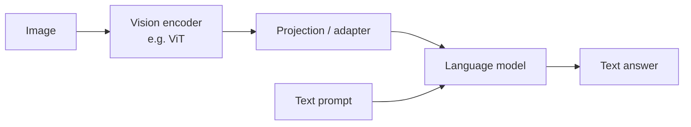

# Multimodal models

Humans learn from sight, sound, and language together. Multimodal models do the same, mapping different kinds of data into shared representations.

## Contrastive image–text learning: CLIP

**CLIP** (Radford et al. 2021) trains an image encoder and a text encoder so that matching image–caption pairs have high cosine similarity and mismatched pairs low similarity. For a batch of $N$ pairs with similarity matrix $S_{ij} = \mathbf{u}_i^\top \mathbf{v}_j / \tau$, the loss is a symmetric cross-entropy over rows and columns:

```math
\mathcal{L} = \frac{1}{2N}\sum_{i=1}^{N}\left[-\log\frac{e^{S_{ii}}}{\sum_j e^{S_{ij}}} - \log\frac{e^{S_{ii}}}{\sum_j e^{S_{ji}}}\right]
```

The result supports **zero-shot classification**: embed the prompt "a photo of a {label}" for each label and pick the closest. CLIP-style encoders also condition many image generators.

## Vision transformers

**ViT** (Dosovitskiy et al. 2020) splits an image into fixed-size patches, embeds each as a token, and applies a standard transformer. With enough data it matches or exceeds CNNs, and it lets vision share architecture (and hardware optimizations) with language.

## Vision–language models

Modern assistants that "see" typically connect a pretrained vision encoder to a language model:



**Flamingo** (Alayrac et al. 2022) inserted cross-attention layers into a frozen language model; **LLaVA** (Liu et al. 2023) showed a simple projection plus instruction tuning on generated visual dialogues works well.

## Generating images, video and audio

- **Text-to-image**: diffusion models conditioned on text embeddings, e.g. DALL·E 2 (Ramesh et al. 2022) and latent diffusion (Rombach et al. 2022). See [Generative models](generative-models.md).
- **Video**: diffusion or autoregressive models over space–time patches; video generators are increasingly discussed as learned simulators, a topic covered in [World models](../06-frontiers/world-models.md).
- **Speech**: large-scale weakly supervised speech recognition such as **Whisper** (Radford et al. 2022) is robust across accents and noise.

## Why multimodality matters

- **Grounding**: language tied to perception may represent the physical world more faithfully.
- **Data**: images, video and audio vastly exceed text in volume.
- **Interfaces**: agents that read screens and documents can operate software the way people do.
