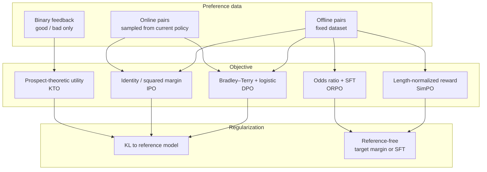
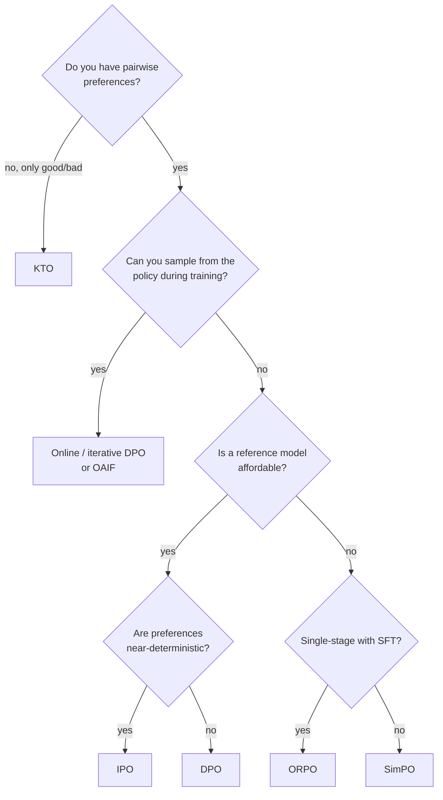

# Preference optimization beyond DPO

Direct Preference Optimization (DPO) made post-training feel almost like supervised learning: take pairs of preferred and dispreferred responses, fit a logistic loss, and skip the separate reward model and RL loop (Rafailov et al. 2023). It worked well enough that a swarm of variants followed—IPO, KTO, SimPO, ORPO, online and iterative DPO, Nash-style methods—each fixing a failure mode of the one before. This page is the map of that swarm.

The short treatment of RLHF and DPO on the [large language models](large-language-models.md) page is the prerequisite. How proxy rewards fail under pressure is covered in [reward models and how they fail](../05-alignment-safety-interpretability/reward-model-failure-modes.md); how verifiable rewards change the picture for reasoning is in [reasoning models](reasoning-models-and-test-time-compute.md).

> The core idea in one sentence: **every direct alignment method is a choice of preference model, a choice of regularizer, and a choice of whether the data is offline or online—and the failure modes (length hacking, overfitting, likelihood displacement) are predictable from those choices.**



## 1. Recap: from RLHF to DPO (established)

Classical RLHF (Christiano et al. 2017; Stiennon et al. 2020; Ouyang et al. 2022) has three stages: collect human rankings, train a reward model $r_\phi(x,y)$ under a Bradley–Terry preference model (Bradley and Terry 1952), then optimize the policy with PPO under a KL leash to a reference $\pi_{\mathrm{ref}}$:

```math
\max_{\pi_\theta}\;\mathbb{E}_{x,y\sim\pi_\theta}\big[r_\phi(x,y)\big] - \beta\, D_{\mathrm{KL}}\big(\pi_\theta(\cdot\mid x)\,\Vert\,\pi_{\mathrm{ref}}(\cdot\mid x)\big).
```

The optimal policy of this KL-regularized objective has a closed form in terms of the reward. Rafailov et al. (2023) inverted it: express the reward through the policy, substitute into the Bradley–Terry likelihood, and obtain a binary classification loss on preference pairs $(x, y_w, y_l)$ with no reward model and no RL:

```math
\mathcal{L}_{\mathrm{DPO}} = -\mathbb{E}\left[\log\sigma\!\left(\beta\log\frac{\pi_\theta(y_w\mid x)}{\pi_{\mathrm{ref}}(y_w\mid x)} - \beta\log\frac{\pi_\theta(y_l\mid x)}{\pi_{\mathrm{ref}}(y_l\mid x)}\right)\right].
```

The quantity inside the sigmoid is an *implicit reward margin*. DPO pushes that margin up without bound whenever the observed preference is certain.

## 2. What can go wrong with DPO (established; active research)

Three failure modes showed up quickly.

| Failure | What happens | Sources |
|---|---|---|
| **Overfitting on deterministic preferences** | When $P(y_w \succ y_l) \approx 1$, the logistic loss keeps rewarding a larger margin forever; the KL term is effectively ignored and the policy can collapse | Azar et al. (2023), analysis of $\Psi$PO |
| **Length confounds** | Pairwise data and learned rewards both correlate with length; DPO can amplify the bias already in the data; sum-of-logprob implicit rewards treat long and short sequences differently | Singhal et al. (2023); Park et al. (2024) |
| **Likelihood displacement** | The loss depends only on the *difference* of log-probabilities. Preferred and dispreferred likelihoods can both fall while the margin rises, and probability mass can move to responses with opposite meaning—especially when the two responses induce similar embeddings | Pal et al. (2024); Razin et al. (2024); Shi et al. (2024) |

Rafailov et al. (2024) then showed that direct alignment algorithms over-optimize too: true quality against a gold preference still rises and then falls as the KL budget grows, often before a single epoch over the preference data is done. The proxy has moved inside the loss, but it is still a proxy.

Razin et al. (2024) made displacement concrete. Training a model to prefer `No` over `Never` can sharply raise the probability of `Yes`. On a refusal task, DPO cut Llama-3-8B-Instruct's refusal rate from 74.4% to 33.4% by shifting mass from preferred refusals toward compliance. They characterize the risk with a centered hidden embedding similarity (CHES) score and show that filtering high-similarity pairs mitigates the damage.

## 3. IPO: a finite target instead of "bigger is better" (established)

Azar et al. (2023) placed RLHF and DPO inside a single objective, $\Psi$PO, that is written directly in pairwise preferences. Setting $\Psi$ to the logistic map recovers DPO; setting $\Psi$ to the identity yields **Identity Preference Optimization (IPO)**. The practical IPO loss is a squared regression of the policy's log-ratio margin toward a fixed target:

```math
\mathcal{L}_{\mathrm{IPO}} = \mathbb{E}\left[\left(\log\frac{\pi_\theta(y_w\mid x)}{\pi_{\mathrm{ref}}(y_w\mid x)} - \log\frac{\pi_\theta(y_l\mid x)}{\pi_{\mathrm{ref}}(y_l\mid x)} - \frac{1}{2\tau}\right)^2\right].
```

Where DPO's logistic loss is minimized only as the margin goes to $+\infty$, IPO is minimized at margin $1/(2\tau)$. On deterministic preferences the difference is sharp: DPO overfits, IPO saturates (see the tested sketch below). Tang et al. (2024) later gave a broader **Generalized Preference Optimization (GPO)** family that interpolates several offline losses through the choice of a convex function.

## 4. KTO: alignment from binary feedback (established)

Collecting pairwise preferences is expensive. **Kahneman–Tversky Optimization (KTO)** (Ethayarajh et al. 2024) needs only a binary signal—whether an output is desirable or not—and replaces the preference likelihood with a prospect-theoretic human utility that is asymmetric in gains and losses. Ethayarajh et al. argue that several successful alignment losses belong to a family of *human-aware losses* (HALOs), and that KTO matches or exceeds pairwise methods from 1B to 30B parameters while training on unpaired data. The trade-off is inductive bias: there is no universally best HALO; the right loss depends on the feedback one actually has.

## 5. Reference-free methods: SimPO and ORPO (established)

Running a frozen reference model alongside the policy costs memory and compute. Two popular escapes:

- **SimPO** (Meng, Xia and Chen 2024) drops the reference and uses the *average* log-probability of a response as the implicit reward, plus a target margin $\gamma$ inside a Bradley–Terry objective:

```math
\mathcal{L}_{\mathrm{SimPO}} = -\mathbb{E}\left[\log\sigma\!\left(\frac{\beta}{|y_w|}\log\pi_\theta(y_w\mid x) - \frac{\beta}{|y_l|}\log\pi_\theta(y_l\mid x) - \gamma\right)\right].
```

Length normalization aligns the reward with generation (perplexity) and removes the sum-of-logprob confound. On AlpacaEval 2 and Arena-Hard, SimPO outperformed DPO by up to 6.4 and 7.5 points respectively under matched setups; their Gemma-2-9B-it run reached a 72.4% length-controlled win rate on AlpacaEval 2.

- **ORPO** (Hong, Lee and Thorne 2024) folds preference alignment into SFT itself. A single odds-ratio penalty on the disfavoured style is added to the supervised loss, so there is no separate reference and no second training stage. Fine-tuning Mistral-7B with ORPO on UltraFeedback alone reached 12.20% on AlpacaEval 2.0 and 7.32 on MT-Bench in their report.

**Contrastive Preference Optimization (CPO)** (Xu et al. 2024) is a related reference-free contrastive loss, originally demonstrated on machine translation.

## 6. Online and iterative preference optimization (established; active research)

Offline DPO trains on a fixed dataset of responses that were often sampled from a different model. As the policy moves, those pairs become off-policy. Several lines close the loop:

| Method | Idea | Result highlights |
|---|---|---|
| **Iterative DPO** (Xiong et al. 2023) | Theoretical KL-regularized bandit view; resample and relabel across rounds | Online and hybrid schedules beat offline DPO and RSO on real LLM alignment |
| **Online AI feedback (OAIF)** (Guo et al. 2024) | Each step, sample two responses from the *current* policy and let an LLM annotator pick | Human evaluations favoured OAIF over offline DAP and RLHF on several tasks; the annotator prompt makes the feedback controllable |
| **Online iterative RLHF** (Dong et al. 2024) | Open recipe that approximates human feedback with proxy preference models and iterates | Strong open-source chatbot numbers on AlpacaEval 2, Arena-Hard, MT-Bench |
| **Self-rewarding LMs** (Yuan et al. 2024) | The model judges its own candidates via LLM-as-a-judge and trains Iterative DPO | Llama 2 70B after three iterations beat several proprietary systems on AlpacaEval 2.0 |
| **Direct Nash Optimization** (Rosset et al. 2024) | Batched on-policy regression toward a Nash optimum of general preferences | Orca-2.5 7B reached 33% length-controlled win rate against GPT-4-Turbo on AlpacaEval 2.0 |
| **Nash learning from human feedback** (Munos et al. 2023) | Replace pointwise rewards with a preference Nash equilibrium | Theoretical foundation for intransitive and cyclic preferences |

The recurring empirical claim is that **on-policy data matters as much as the loss**. Sun et al. (2025) unify DPO, IPO, SimPO and online leave-one-out REINFORCE under **Reward-aware Preference Optimization (RPO)** and find, in controlled ablations, that switching from offline to online responses often moves the needle more than swapping the metric inside the loss.

## 7. A practitioner's chooser (active research)



No chart replaces a held-out preference eval. Length-controlled win rates (AlpacaEval 2 LC), Arena-Hard, and a gold reward or human spot-check against KL-to-reference remain the minimum honest report; raw win rate without a length control is easy to game.

## 8. Tested sketch: three failure modes in miniature

The listing below is complete. Running it reproduces every number in the tables.

```python
import numpy as np

def sigmoid(z):
    return 1.0 / (1.0 + np.exp(-np.clip(z, -50.0, 50.0)))

# 1. DPO vs IPO on deterministic preferences (scalar margin h)
beta, tau, lr, steps = 0.1, 0.1, 0.05, 5000
target = 1.0 / (2.0 * tau)          # IPO optimum at h = 5
for name, loss in [("DPO", "dpo"), ("IPO", "ipo")]:
    h = 0.0
    for t in range(steps + 1):
        if t in (0, 500, 1000, 2000, 5000):
            pi_w = np.exp(h) / (1 + np.exp(h))
            print(name, t, h, pi_w)
        if loss == "dpo":
            h -= lr * (-beta * (1 - sigmoid(beta * h)))   # always pushes h upward
        else:
            h -= lr * (2 * (h - target))                  # pulls h toward target

# 2. Sum vs average log-prob as an implicit reward
def sum_r(lp, L): return L * lp
def avg_r(lp, L): return lp
print("equal quality, lengths 10/50/200:",
      [sum_r(-1.0, L) for L in (10, 50, 200)],
      [avg_r(-1.0, L) for L in (10, 50, 200)])
# long response is better per token (-0.8) than short (-1.2), yet sum ranks it worse
print("sum margin (long preferred):", sum_r(-0.8, 50) - sum_r(-1.2, 5))
print("avg margin (long preferred):", avg_r(-0.8, 50) - avg_r(-1.2, 5))

# 3. Likelihood displacement with similar embeddings (Razin-style toy)
# Tokens: No, Never, Yes. No and Never are nearly parallel; Yes is orthogonal.
e = np.array([[1.0, 0.05], [1.0, -0.05], [0.0, 1.0]], dtype=float)
e /= np.linalg.norm(e, axis=1, keepdims=True)

def run_embed(loss, steps=2000, lr=0.5, beta=1.0, tau=2.0):
    h = np.array([0.5, 0.0]); target = 1.0 / (2.0 * tau); rows = []
    for t in range(steps + 1):
        logits = e @ h
        pi = np.exp(logits - logits.max()); pi /= pi.sum()
        margin = float(logits[0] - logits[1])
        if t in (0, 100, 300, 500, 1000, 2000):
            rows.append((t, pi.copy(), margin, float(np.log(pi[0]))))
        g = (-beta * (1 - sigmoid(beta * margin))) if loss == "dpo" else (2 * (margin - target))
        h -= lr * g * (e[0] - e[1])
    return rows

for loss, lr in [("dpo", 0.5), ("ipo", 0.3)]:
    print("embed", loss)
    for t, pi, m, lw in run_embed(loss, lr=lr):
        print(t, pi, m, lw)
```

**Part 1: deterministic preferences.** One pair, always $y_w \succ y_l$. The learnable quantity is the log-ratio margin $h$.

| Step | DPO margin $h$ | DPO $\pi(y_w)$ | IPO margin $h$ | IPO $\pi(y_w)$ |
|---|---|---|---|---|
| 0 | 0.00 | 0.500 | 0.00 | 0.500 |
| 500 | 1.21 | 0.771 | 5.00 | 0.993 |
| 1,000 | 2.35 | 0.913 | 5.00 | 0.993 |
| 2,000 | 4.43 | 0.988 | 5.00 | 0.993 |
| 5,000 | 9.40 | 0.9999 | 5.00 | 0.993 |

DPO is still climbing at step 5,000; the logistic loss has no finite optimum. IPO reaches its target $1/(2\tau) = 5$ by step 500 and stops. That is Azar et al.'s overfitting diagnosis in a single scalar.

**Part 2: length and the implicit reward.**

| Implicit reward | Equal quality/token, $L=10,50,200$ | Long better ($50\times-0.8$) vs short worse ($5\times-1.2$) |
|---|---|---|
| Sum of log-probs | $-10,-50,-200$ (length confounded) | Margin $-34$ (ranks the better answer *worse*) |
| Average log-prob | $-1,-1,-1$ (length free) | Margin $+0.4$ (correct sign) |

When quality is constant per token, a sum reward scores longer responses as worse; when a long response is genuinely better per token, the sum can still flip the comparison. SimPO's average log-prob reward (and its target margin $\gamma$) exists to cancel exactly this confound.

**Part 3: likelihood displacement.** Softmax over three tokens whose embeddings make `No` and `Never` nearly parallel and `Yes` orthogonal. DPO prefers `No` over `Never`.

| Step | Method | $P(\mathrm{No})$ | $P(\mathrm{Never})$ | $P(\mathrm{Yes})$ | Margin | $\log P(\mathrm{No})$ |
|---|---|---|---|---|---|---|
| 0 | either | 0.384 | 0.384 | 0.233 | 0.000 | −0.96 |
| 100 | DPO | 0.134 | 0.106 | 0.760 | 0.235 | −2.01 |
| 300 | DPO | 0.004 | 0.002 | 0.994 | 0.626 | −5.47 |
| 2,000 | DPO | ≈0 | ≈0 | ≈1 | 2.175 | −20.2 |
| 100 | IPO ($\tau=2$) | 0.273 | 0.244 | 0.484 | 0.113 | −1.30 |
| 500 | IPO | 0.132 | 0.104 | 0.765 | 0.238 | −2.03 |
| 2,000 | IPO | 0.120 | 0.094 | 0.786 | 0.250 | −2.12 |

DPO increases the margin by draining probability from *both* `No` and `Never` into `Yes`—the catastrophic displacement of Razin et al. (2024) in a two-dimensional embedding. IPO, aiming at a finite margin of $0.25$, stops with $P(\mathrm{Yes})\approx 0.79$ instead of $1$. The finite target does not remove displacement, but it caps it.

What the sketch does *not* show: real tokenizers, Adam, batching across thousands of pairs, or the CHES filter. It shows why the loss forms behave as the papers claim.

## 9. Status at a glance

| Claim | Status |
|---|---|
| DPO matches or beats PPO-RLHF on many chat benchmarks at lower engineering cost | Established (Rafailov et al. 2023 and widespread replications) |
| DPO overfits when preferences are near-deterministic; IPO's squared target prevents it | Established theoretically; clear in controlled experiments |
| Direct alignment over-optimizes against gold preferences as the KL budget grows | Established (Rafailov et al. 2024) |
| Likelihood displacement is real and can undo refusals | Established (Pal et al. 2024; Razin et al. 2024) |
| Length-normalized, reference-free objectives (SimPO) improve length-controlled win rates | Well supported under matched setups |
| Binary-feedback KTO matches pairwise methods when pairwise data is scarce | Supported at 1B–30B in the original study; depends on feedback type |
| Online / on-policy preference data beats offline losses alone | Well supported across iterative DPO, OAIF, RPO ablations |
| One loss dominates all settings | False: choice depends on feedback type, reference budget and online access |

## 10. Speculative: preference learning as a coverage problem

> **Speculative.** The ideas in this section are hypotheses for discussion, not established results.

Section 6 and the coverage separation between offline and online methods (offline contrastive losses need broad coverage of good responses; online methods can explore) suggest that the scarce resource is not a better $\Psi$ but *preference queries where the current policy is uncertain*. A testable programme:

1. **Active preference collection.** Prefer labelling pairs where the policy's implicit reward margin is near zero, or where CHES says displacement risk is high. Prediction: the same labelling budget, spent this way, should beat uniform sampling on length-controlled win rate at fixed KL; falsified if active selection matches uniform within error bars.
2. **Displacement as a first-class metric.** Report, alongside win rate, the fraction of preferred training responses whose likelihood fell, and the CHES distribution of the data. Prediction: runs with heavy left-tail preferred-likelihood movement will show more opposite-meaning failures on a held-out diagnostic like the `No`/`Never`/`Yes` probe; falsified if displacement and opposite-meaning errors are uncorrelated.
3. **Hybrid with verifiable rewards.** Use pairwise preference objectives on open-ended style and safety, and [verifiable rewards](reasoning-models-and-test-time-compute.md) on math and code, inside one training run. Prediction: the hybrid should dominate either alone on a mixed eval; falsified if the preference half poisons the verifiable half through shared parameters and displacement.

## Further reading

- Rafailov et al. (2023), *Direct Preference Optimization*: the paper that started the swarm.
- Azar et al. (2023), *A General Theoretical Paradigm to Understand Learning from Human Preferences*: $\Psi$PO and IPO.
- Ethayarajh et al. (2024), *KTO*: binary feedback and human-aware losses.
- Meng, Xia and Chen (2024), *SimPO*: length-normalized reference-free reward.
- Razin et al. (2024), *Unintentional Unalignment*: likelihood displacement and CHES.
- Guo et al. (2024), *Online AI Feedback*; Yuan et al. (2024), *Self-Rewarding Language Models*: closing the data loop.
- Sun et al. (2025), *Reward-aware Preference Optimization*: a unified ablation framework.
- Related pages: [Large language models](large-language-models.md), [Reward models and how they fail](../05-alignment-safety-interpretability/reward-model-failure-modes.md), [Reasoning models](reasoning-models-and-test-time-compute.md), [Alignment and safety](../05-alignment-safety-interpretability/alignment.md), [Information theory](../00-foundations/information-theory-for-ml.md).

Full citations for every source on this page are in [REFERENCES.md](../../REFERENCES.md#preference-optimization-beyond-dpo).
