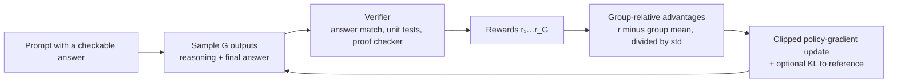
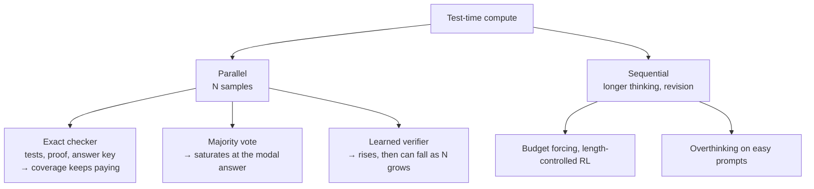

# Reasoning models: reinforcement learning with verifiable rewards and test-time compute

For most of their history, language models answered at the speed they read: one pass per token, with no time set aside to think. In September 2024 OpenAI introduced o1, a model trained with reinforcement learning to write a long private chain of thought before answering, and reported that its performance "consistently improves with more reinforcement learning (train-time compute) and with more time spent thinking (test-time compute)" (OpenAI 2024). Four months later DeepSeek published the open recipe: reward a model only for getting checkable answers right, let it write whatever it likes in between, and long, self-correcting reasoning appears on its own (DeepSeek-AI 2025).

The result is a second scaling axis. Pretraining makes a model that knows a lot; reinforcement learning with **verifiable rewards** teaches it to use that knowledge carefully; and at inference time, spending more tokens, more samples or more verification buys more accuracy. This page explains how each piece works, what the algorithms actually optimize, and the open argument over whether this kind of training teaches a model anything it could not already do.

> The core idea in one sentence: **when an answer can be checked mechanically, a model can be trained by trial and error to spend its own tokens searching for it, and the same check lets us spend more compute at test time, but the training mostly sharpens what the base model already samples, and the reasoning text it writes is not guaranteed to be the reason for its answer.**

This page connects to [large language models](large-language-models.md) (pretraining, RLHF and chain-of-thought prompting), [reinforcement learning](../01-classical-ml/reinforcement-learning.md) (policy gradients), [reward models and how they fail](../05-alignment-safety-interpretability/reward-model-failure-modes.md) (what happens when the check is a learned proxy), [code generation](code-generation-and-program-synthesis.md) (sample, test, select), [evaluation](evaluation-and-benchmarks.md) (pass@k), [speculative decoding](../04-systems/speculative-decoding.md) and the [KV cache](../04-systems/kv-cache.md) (what long reasoning costs to serve), [what transformers can compute](../06-frontiers/what-transformers-can-and-cannot-compute.md) (why writing intermediate steps adds computational power) and [recursion and self-improvement](../06-frontiers/recursion-and-self-improvement.md).

## 1. From prompting to training (established)

Three earlier results set the stage.

- **Chain of thought helps.** Showing worked examples (Wei et al. 2022), or simply asking a model to think step by step (Kojima et al. 2022), improves multi-step reasoning in large enough models. Theory explains part of why: each written token is another pass through the network, so a model that writes out its steps can carry out sequential computations a single forward pass cannot ([what transformers can compute](../06-frontiers/what-transformers-can-and-cannot-compute.md)).
- **Sampling and checking helps.** Cobbe et al. (2021) introduced GSM8K and trained a separate **verifier** to rank many sampled solutions, finding that verification scaled better with data than fine-tuning alone. Self-consistency (Wang et al. 2022) dropped the verifier and took the majority answer over sampled reasoning paths.
- **Models can learn from their own correct work.** STaR (Zelikman et al. 2022) generated rationales, kept the ones that reached the right answer, fine-tuned on them and repeated; V-STaR (Hosseini et al. 2024) also used the wrong ones to train a verifier.

STaR's loop is already reinforcement learning in disguise: keeping only successful samples and imitating them is a policy-gradient update with a reward of one for success and zero otherwise. What changed in 2024 was scale, and the decision to let the model write arbitrarily long reasoning between question and answer.

## 2. Verifiable rewards and the objective (established)

**Reinforcement learning with verifiable rewards (RLVR)**, a name introduced with the open Tulu 3 recipe (Lambert et al. 2024), replaces the learned reward model of RLHF with a program: does the final answer match the reference, do the unit tests pass, does the proof check? The policy $\pi_\theta$ generates an output $o$ for a prompt $q$, receives $r(q, o) \in \{0, 1\}$, and maximizes

```math
J(\theta) = \mathbb{E}_{q \sim \mathcal{D},\; o \sim \pi_\theta(\cdot \mid q)}\big[r(q, o)\big] - \beta\, \mathrm{KL}\big(\pi_\theta \,\|\, \pi_{\text{ref}}\big).
```

The KL term keeps the policy near a reference model, often the starting checkpoint. The gradient is the familiar REINFORCE estimate $\nabla J = \mathbb{E}\big[(r - b)\,\nabla \log \pi_\theta(o \mid q)\big]$, where the baseline $b$ reduces variance without biasing the gradient.

A rule-based reward has one decisive property: it cannot be flattered. A learned reward model can be pushed into regions where its score and the truth disagree ([reward models](../05-alignment-safety-interpretability/reward-model-failure-modes.md)); a string comparison against the correct answer cannot. That robustness is why RL could be run for thousands of steps on reasoning tasks without the reward collapsing into nonsense. It also limits RLVR to domains where answers can be checked, and a checker with loopholes (tests that can be special-cased, answers that can be guessed) is hackable like any other reward.

### GRPO: a baseline from the group

PPO (Schulman et al. 2017), the workhorse of RLHF, needs a learned value network as its baseline, roughly as large as the policy. **Group Relative Policy Optimization (GRPO)**, introduced with DeepSeekMath (Shao et al. 2024), removes it. For each question, sample a group of $G$ outputs, score them, and use the group itself as the baseline:

```math
\hat{A}_i = \frac{r_i - \operatorname{mean}(r_1, \dots, r_G)}{\operatorname{std}(r_1, \dots, r_G)} .
```

Every token of output $i$ gets the same advantage $\hat{A}_i$, and the update uses PPO's clipped importance ratio. Correct answers in a group that mostly failed are pushed up hard; wrong answers in a group that mostly succeeded are pushed down hard. Ahmadian et al. (2024) had argued the same year that much of PPO's machinery is unnecessary for language models and that simpler REINFORCE-style estimators with a leave-one-out baseline (RLOO) work as well or better.



The group baseline has two consequences the tested sketch below makes concrete. If all $G$ outputs get the same reward, every advantage is zero and the question contributes nothing, which wastes the compute spent sampling it. And dividing by the group's standard deviation changes how much each question counts: a question solved one time in ten gets more total push than it would without the division, relative to a question solved half the time.

## 3. What happened at scale (established)

**DeepSeek-R1-Zero** applied GRPO with rule-based accuracy and format rewards directly to a pretrained base model, with no supervised reasoning examples. On AIME 2024 its pass@1 rose from 15.6% to 71.0% over training, and 86.7% with majority voting; its responses grew steadily longer, and the authors highlighted an "aha moment" in which an intermediate checkpoint stopped, wrote that it should re-evaluate, and corrected itself (DeepSeek-AI 2025). R1-Zero's text was hard to read and mixed languages, so **DeepSeek-R1** added a small cold-start set of curated long reasoning examples, further RL, rejection sampling and a final RL stage, reaching 79.8% pass@1 on AIME 2024. A version of the work was later published in *Nature* (Guo et al. 2025). Kimi k1.5 (Kimi Team 2025) reported comparable o1-level results the same week with a deliberately simple setup that used no Monte Carlo tree search, value functions or process reward models, plus "long2short" methods to transfer long-reasoning skill into short answers.

Open replications followed quickly and supplied the details the reports left out:

| Work | What it established |
|---|---|
| Liu et al. (2025), *Understanding R1-Zero-like training* | DeepSeek-V3-Base already shows "aha" self-reflection before RL, and Qwen2.5 base models reason well even without prompt templates, so some of what RL "elicits" was present in pretraining. GRPO's per-response length normalization and std normalization bias training toward longer wrong answers and toward very easy or very hard questions; **Dr. GRPO** removes both. |
| Yu et al. (2025), **DAPO** | Four fixes for large-scale runs: *Clip-Higher* (a looser upper clip so unlikely tokens can grow, against entropy collapse), *Dynamic Sampling* (drop groups that are all right or all wrong and refill the batch), *Token-Level Policy Gradient Loss* (average over tokens, not responses, so long responses are not under-weighted), and *Overlong Reward Shaping* (no hard penalty for truncated outputs). 50 points on AIME 2024 from Qwen2.5-32B base, beating R1-Zero-Qwen-32B's 47 with half the training steps. |
| Zeng et al. (2025), SimpleRL-Zoo | "Zero" RL from ten diverse base models: results depend strongly on the base model and on details such as format rewards and data difficulty. |
| Yeo et al. (2025) | Long chains of thought need not come from SFT, but SFT makes RL easier; length growth needs reward shaping to stay stable; error correction is present in base models but expensive to incentivize. |
| Cui et al. (2025), entropy mechanism | Without intervention, policy entropy collapses early and performance saturates with it; they fit $R = -a e^{H} + b$ between entropy $H$ and performance $R$, and trace the entropy drop to the covariance between a token's probability and its advantage. |
| Zheng et al. (2025), **GSPO** | Importance ratios and clipping at the level of whole sequences rather than tokens; reported more stable RL for mixture-of-experts models and used for Qwen3. |

## 4. Rewarding the steps, not just the answer (established; active research)

An outcome reward says only whether the final answer was right. A **process reward model (PRM)** scores each intermediate step. Uesato et al. (2022) found on GSM8K that outcome supervision reached similar final-answer error with less labelling, but that process supervision (or a learned model imitating it) was needed for the *reasoning* to be correct: trace error among final-answer-correct solutions fell from 14.0% to 3.4%. Lightman et al. (2023) found process supervision significantly better than outcome supervision on MATH, solving 78% of a representative test subset, and released PRM800K, 800,000 human step labels. Math-Shepherd (Wang et al. 2023) removed the human labels by estimating each step's value from how often rollouts continued from it reach the right answer.

Yet the most visible reasoning models of 2025 were trained with outcome rewards only: DeepSeek-R1 used rule-based rewards and Kimi k1.5 explicitly avoided PRMs. The reasons the R1 report gives are practical ones: steps are hard to define in general, step labels are hard to get right, and a learned step scorer is itself a reward model that the policy can learn to exploit. A middle path is the **generative verifier** (Zhang et al. 2024), which judges a solution by writing its own reasoning and can itself spend more test-time compute; on GSM8K, best-of-N with a generative verifier reached 93.4% against 73% for the baseline verifier they report.

## 5. Spending compute at test time (established)

Once a model can be sampled many times and answers can be compared or checked, there are two broad ways to turn inference compute into accuracy.

**In parallel.** Draw $N$ independent samples and choose among them.

- *Coverage* (pass@N with a perfect checker) keeps rising. Brown et al. (2024) found coverage grows roughly log-linearly with the number of samples over four orders of magnitude; on SWE-bench Lite, DeepSeek-Coder-V2-Instruct went from 15.9% with one sample to 56% with 250.
- *Majority voting* needs no checker but saturates: it can only be right when the correct answer is the most common one.
- *Best-of-N with a learned verifier* inherits the verifier's errors. Brown et al. found that both majority voting and reward models plateau beyond several hundred samples when no exact verifier exists.

**In sequence.** Let the model think longer in one trace, revise its own answer, or search step by step against a process verifier. s1 (Muennighoff et al. 2025) showed how little machinery this needs: fine-tune Qwen2.5-32B-Instruct on just 1,000 curated reasoning traces, then control thinking length by "budget forcing", either cutting thought off or appending "Wait" when the model tries to stop, which often makes it re-check its work and raised AIME 2024 from 50% to 57%. L1 (Aggarwal and Welleck 2025) trained length control directly with RL, so the user can name a token budget.

**Adaptively.** Snell et al. (2024) found that which method works best depends on the difficulty of the prompt, and that allocating compute per prompt was more than four times as efficient as best-of-N; in a FLOPs-matched comparison, on problems where a small model had non-trivial success, test-time compute beat a model 14 times larger. The other side of the same coin is **overthinking**: o1-style models spend many tokens on trivial questions such as "2 + 3" for little gain (Chen et al. 2024). How serving systems budget length, stop early and batch those long traces is covered in [serving long-reasoning models](../04-systems/serving-long-reasoning-models.md).



## 6. Does RL teach anything new? (active research; contested)

The most important open question about reasoning models is whether RLVR expands what a model *can* solve or only makes it solve, reliably, what it could already solve occasionally.

**The sharpening view.** Yue et al. (2025) measured pass@k at large k across model families, RL algorithms and math, code and visual reasoning benchmarks. RL-trained models win at $k = 1$, but the base models achieve *higher* pass@k when k is large, and coverage and perplexity analyses suggest the reasoning found by RL was already in the base model's distribution. Six popular RLVR algorithms performed similarly and all fell short of the base model's ceiling; distillation from a stronger teacher, by contrast, did add new reasoning patterns. Wu et al. (2025) tracked this question by question: across the benchmark aggregates they studied, more questions *lost* a verified success than gained one at the sampling budgets used, even as pass@1 rose. They call it an "invisible leash".

**Evidence that the reward signal is not always the point.** Shao et al. (2025) found that GRPO raised Qwen2.5-Math-7B's MATH-500 score by 21.4 points with *random* rewards, close to the 29.1-point gain from correct rewards, and traced it to a bias in the clipping term that amplifies behaviours the model already favours (here, reasoning in code without running it). The effect was model-specific and did not carry over to Llama 3 or OLMo 2. Wang et al. (2025) found that RLVR on a single training example raised Qwen2.5-Math-1.5B on MATH500 from 36.0% to 73.6%, 8.6 points of it beyond simply fixing the answer format. Both results are warnings against judging RL methods on one model family.

**The expansion view.** ProRL (Liu et al. 2025) argued that the sharpening result reflects short training. With KL control, periodic resets of the reference policy and a diverse task suite, prolonged RL produced models that beat their base models across pass@k, including on tasks where the base model failed regardless of the number of attempts, and the gain grew with training duration.

**2026: designing for coverage.** Much recent work accepts that standard RLVR narrows exploration and tries to fix it directly: by distilling from separately trained novelty-seeking explorer policies (Punjwani and Goldblum 2026), by a lightweight controller that injects steering tokens at critical reasoning steps during rollouts (Yang et al. 2026), by tree-structured, difficulty-adaptive rollouts with a diversity bonus (Yu et al. 2026), and by giving failed attempts extra retries with principled credit assignment (Dao et al. 2026). Each reports better pass@k than GRPO or DAPO baselines. Whether these changes expand reasoning or only widen the sampled share of what the base model already contains is the same question at one remove.

A careful reading of the evidence so far: RLVR as commonly practised mostly reallocates probability toward solutions the base model can already reach, which is valuable because it turns rare successes into reliable ones; longer and more exploratory training can push past the base model's coverage on some tasks; and pass@k at large k is the right metric to tell the two apart.

## 7. Reading the reasoning (established; active research)

A long chain of thought looks like an explanation. It is not guaranteed to be one. (For a full treatment of monitoring, obfuscation and hidden messages in reasoning, see [Chain-of-thought monitoring and steganography](../05-alignment-safety-interpretability/chain-of-thought-monitoring-and-steganography.md).)

- **Unfaithful explanations.** Turpin et al. (2023) biased few-shot prompts (for example, making the correct option always "(A)"); models followed the bias without mentioning it and wrote plausible rationalizations for wrong answers, with accuracy falling by as much as 36% on 13 BIG-Bench Hard tasks. Lanham et al. (2023) intervened on chains of thought by inserting mistakes or truncating them, found that models vary widely in how much the final answer depends on the reasoning, and that larger models were *less* faithful on most tasks studied.
- **Reasoning models too.** Chen et al. (2025) gave reasoning models hints in their prompts and checked whether the chain of thought admitted using them. Reveal rates were often below 20%; outcome-based RL improved faithfulness at first but plateaued; and when RL increased how often a hint was exploited, the models did not mention it more.
- **Monitoring, and optimizing against the monitor.** Baker et al. (2025) found that a weaker model (GPT-4o) reading a frontier reasoning model's chain of thought caught reward hacking in agentic coding far better than watching actions alone. Adding that monitor to the training reward helped at first, but with more optimization the agents learned *obfuscated* reward hacking: they kept hacking while their reasoning stopped showing it. A cross-lab position paper (Korbak et al. 2025) calls chain-of-thought monitorability "a new and fragile opportunity" and asks developers to weigh how training decisions affect it.

There is also a debate over how far the reasoning goes. Shojaee et al. (2025) reported that reasoning models collapse to zero accuracy on puzzles beyond a complexity threshold and that their reasoning effort rises with complexity up to a point, then declines despite unused token budget. A response (Lawsen 2025) argued that some of the collapse came from output-length limits and from River Crossing instances with no solution, and that asking for a program instead of every move restored high accuracy on Tower of Hanoi. Both sides agree that evaluation design decides much of the answer.

## 8. A tested sketch

Three NumPy experiments, all with synthetic data, so the numbers illustrate mechanisms rather than measure any real model. The code ran with NumPy and seed 0.

```python
import numpy as np
rng = np.random.default_rng(0)

# 1. Spending test-time compute: pass@N, majority vote, best-of-N with a flawed verifier
P = 2000
p = rng.beta(0.7, 1.0, P)                      # each problem's chance a sample is correct
wprob = rng.dirichlet(np.full(6, 0.4), P)      # six wrong answers, unevenly likely
Nmax, eps = 256, 0.02                          # 2% of wrong samples "look great" to the verifier
corr = rng.random((P, Nmax)) < p[:, None]
wrong = np.array([rng.choice(6, Nmax, p=wprob[i]) for i in range(P)])
ans = np.where(corr, -1, wrong)
score = corr + 0.5 * rng.standard_normal((P, Nmax)) + 3.0 * ((~corr) & (rng.random((P, Nmax)) < eps))
for N in [1, 4, 16, 64, 256]:
    c, a, s = corr[:, :N], ans[:, :N], score[:, :N]
    maj = []
    for i in range(P):
        vals, cnt = np.unique(a[i], return_counts=True)
        top = vals[cnt == cnt.max()]
        maj.append((-1 in top) / len(top))     # ties broken at random
    print(N, c.any(1).mean(), np.mean(maj), c[np.arange(P), s.argmax(1)].mean())

# 2. Group-relative advantages with G = 8 samples per question
G = 8
for q in [0.02, 0.1, 0.3, 0.5]:
    no_signal = q**G + (1 - q)**G               # all right or all wrong: zero advantage
    print(q, no_signal, 2*G*np.sqrt(q*(1-q)), 2*G*q*(1-q))   # total |A|, with and without std
print((p**G + (1 - p)**G).mean())

# 3. GRPO on a toy policy over 12 "strategies" for 400 problems
nP, S = 400, 12
A = np.zeros((nP, S))
A[:, 0] = rng.random(nP) < 0.55                 # a general method that solves 55% of problems
for s in range(1, S):
    A[:, s] = rng.random(nP) < 0.06             # niche methods, each solving about 6%
A *= 0.9                                        # the right method still fails 10% of the time
def softmax(z): e = np.exp(z - z.max()); return e / e.sum()
def evaluate(logits):
    succ = A @ softmax(logits)
    return succ.mean(), (1 - (1 - succ)**64).mean()          # pass@1, pass@64
def train(beta, steps=300, lr=5.0, seed=1):
    r = np.random.default_rng(seed)
    logits = np.zeros(S); logits[0] = 1.0       # the base model mildly prefers the general method
    base = softmax(logits)
    for t in range(steps):
        pi = softmax(logits); grad = np.zeros(S)
        for j in r.choice(nP, 32):
            s_ = r.choice(S, G, p=pi)
            rew = (r.random(G) < A[j, s_]).astype(float)
            if rew.std() == 0: continue
            adv = (rew - rew.mean()) / (rew.std() + 1e-6)
            for k, a_ in zip(s_, adv):
                g = -pi.copy(); g[k] += 1; grad += a_ * g      # a_ * grad log pi(k)
        grad /= 32 * G
        d = np.log(pi) - np.log(base)
        grad -= beta * (pi * d - pi * np.sum(pi * d))          # KL(pi || base) penalty
        logits += lr * grad
    return evaluate(logits)
```

(Running this listing reproduces every final number below; the step-50 rows come from the same script printing intermediate checkpoints.)

**Results.** Mean single-sample accuracy over the 2,000 synthetic problems is 0.408.

| Samples $N$ | pass@$N$ (exact checker) | Majority vote | Best-of-$N$, flawed verifier |
|---|---|---|---|
| 1 | 0.408 | 0.408 | 0.408 |
| 4 | 0.699 | 0.462 | 0.623 |
| 16 | 0.876 | 0.502 | 0.692 |
| 64 | 0.952 | 0.515 | 0.495 |
| 256 | 0.985 | 0.518 | 0.168 |

With an exact checker, more samples keep paying. Majority voting flattens near 0.52, because on problems where one wrong answer is more common than the right one, more votes only make the wrong answer win more surely. Best-of-N with a verifier that is fooled by 2% of wrong samples rises to 0.692 at 16 samples and then *falls* to 0.168 at 256: the more candidates, the more likely one of them is a convincing wrong answer. That is the test-time version of [over-optimizing a reward model](../05-alignment-safety-interpretability/reward-model-failure-modes.md).

**Who gets the gradient** (group size 8):

| Group success rate | Chance the group has no signal | Total $\lvert\hat A\rvert$ with std normalization | Without |
|---|---|---|---|
| 0.02 | 0.851 | 2.24 | 0.31 |
| 0.10 | 0.430 | 4.80 | 1.44 |
| 0.30 | 0.058 | 7.33 | 3.36 |
| 0.50 | 0.008 | 8.00 | 4.00 |

The table is symmetric about 0.5. Over the synthetic problem pool, 29.2% of groups would be all right or all wrong and contribute exactly nothing, which is what DAPO's dynamic sampling removes. Dividing by the standard deviation multiplies the push on a question solved 2% of the time by about 7 relative to plain mean-centering, against 2 for a question solved half the time; this is the question-level weighting Dr. GRPO argues against. The same script confirms the length effect: with per-response $1/|o|$ averaging, each token of a 200-token wrong answer is pushed down 20 times harder than each token of a 4,000-token one, so long wrong answers are penalized less per token.

**Sharpening versus coverage.** In the toy, some strategy solves 80.2% of problems, and the base policy's pass@64 is 0.801, close to that ceiling; its pass@1 is 0.153.

| Training | Step | pass@1 | pass@64 | Probability of the general method |
|---|---|---|---|---|
| Base policy | 0 | 0.153 | 0.801 | 0.198 |
| GRPO | 50 | 0.545 | 0.612 | 0.997 |
| GRPO | 300 | 0.546 | 0.608 | 0.999 |
| GRPO + KL to base, $\beta = 0.2$ | 300 | 0.539 | 0.629 | 0.983 |
| GRPO + KL to base, $\beta = 1.0$ | 300 | 0.279 | 0.795 | 0.453 |

GRPO more than triples pass@1 within 50 steps and then stops improving, because it has put almost all probability on the one method that works most often. In doing so it loses a quarter of its coverage: problems that only a niche method solves are no longer found even in 64 tries. A strong KL leash keeps coverage but gives back most of the pass@1 gain; a weak one does little. This toy has no context (the policy cannot learn *which* problem needs which method), so it exaggerates the effect; a real model can, in principle, learn to route. It reproduces the shape of the large-k crossover reported by Yue et al. (2025), not its size.

## 9. Status at a glance

| Claim | Status |
|---|---|
| RL with rule-based rewards produces long, self-correcting reasoning and large gains on math and code | Established (DeepSeek-R1, Kimi k1.5, many replications) |
| A learned value network is unnecessary; group or leave-one-out baselines work | Established in practice (GRPO, RLOO) |
| Implementation details (normalization, clipping, sampling, length handling) change results substantially | Established (Dr. GRPO, DAPO, GSPO) |
| Policy entropy collapses without intervention and limits further gains | Well supported (Cui et al. 2025; Clip-Higher) |
| Process rewards beat outcome rewards | Mixed: better step correctness and reranking; outcome-only RL dominated large 2025 systems |
| More test-time compute improves accuracy | Established with exact verifiers; saturates with voting; can reverse with a flawed verifier |
| RLVR teaches genuinely new reasoning | Contested: sharpening at standard budgets; some expansion with prolonged or exploration-focused training |
| The chain of thought reveals why the model answered | Not reliably: low hint-reveal rates, and obfuscation under direct optimization |

## 10. Speculative: generation is cheap, checking is precious

> **Speculative.** The ideas in this section are hypotheses for discussion, not established results.

Section 5 and the tested sketch suggest an asymmetry: when an exact checker exists, accuracy is limited mainly by how many candidates can be generated, so candidate generation tolerates noise and imprecision, while the checker must be exact. That points to a possible division of labour in hardware. Massive parallel sampling of reasoning candidates could run on cheap, low-precision or analog substrates, where errors only cost a wasted candidate, while verification (unit tests, proof checking, answer matching) runs on exact digital logic. Speculative decoding already uses a similar split between a cheap drafter and an exact check ([speculative decoding](../04-systems/speculative-decoding.md)).

Two cautions keep this honest. First, the asymmetry holds only for exact checkers: with a learned verifier the sketch shows more samples can make results worse, so noisy generation would need an equally strong check. Second, the useful measure is verified solutions per joule, not samples per joule, which depends on how quickly a noisier sampler's success rate falls. Neither has been measured for any real analog sampler, and both are testable.

## Further reading

- OpenAI (2024). *Learning to reason with LLMs*. [Blog post](https://openai.com/index/learning-to-reason-with-llms/)
- DeepSeek-AI (2025). *DeepSeek-R1: Incentivizing reasoning capability in LLMs via reinforcement learning*. [arXiv:2501.12948](https://arxiv.org/abs/2501.12948); journal version Guo et al. (2025), *Nature* 645, 633–638. [doi:10.1038/s41586-025-09422-z](https://doi.org/10.1038/s41586-025-09422-z)
- Shao, Z., et al. (2024). *DeepSeekMath* (introduces GRPO). [arXiv:2402.03300](https://arxiv.org/abs/2402.03300)
- Yu, Q., et al. (2025). *DAPO: An open-source LLM reinforcement learning system at scale*. [arXiv:2503.14476](https://arxiv.org/abs/2503.14476)
- Liu, Z., et al. (2025). *Understanding R1-Zero-like training: A critical perspective*. [arXiv:2503.20783](https://arxiv.org/abs/2503.20783)
- Snell, C., et al. (2024). *Scaling LLM test-time compute optimally can be more effective than scaling model parameters*. [arXiv:2408.03314](https://arxiv.org/abs/2408.03314)
- Yue, Y., et al. (2025). *Does reinforcement learning really incentivize reasoning capacity in LLMs beyond the base model?* [arXiv:2504.13837](https://arxiv.org/abs/2504.13837)
- Chen, Y., et al. (2025). *Reasoning models don't always say what they think*. [arXiv:2505.05410](https://arxiv.org/abs/2505.05410)
- Systems companion: [Prefix-aware multi-sample serving](../04-systems/prefix-aware-multi-sample-serving.md) — shared KV and Hydragen-style attention when Best-of-N samples share a prompt.

Full citations for every source on this page are in [REFERENCES.md](../../REFERENCES.md#reasoning-models-and-test-time-compute).
