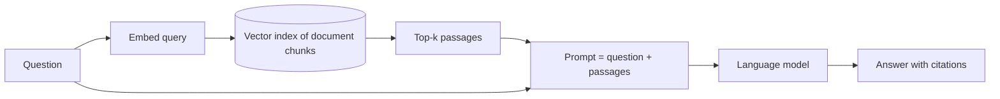

# Retrieval, tools and agents

A language model on its own knows only what was in its training data and can act only by producing text. Connecting it to **knowledge** (retrieval), **capabilities** (tools), and a **loop** (agents) turns it into a system that can look things up, compute, and take actions.

## Retrieval-augmented generation (RAG)

**Lewis et al. (2020)** combined a neural retriever with a sequence-to-sequence generator. The general pattern:



Design choices that matter in practice:

- **Chunking**: passage size trades context against precision.
- **Retrieval**: dense embeddings (cosine similarity), sparse keyword scoring (BM25), or a hybrid.
- **Reranking**: a second model rescores candidates.
- **Grounding and abstention**: require citations, and let the system say "not found" rather than guess.

RAG reduces hallucination and keeps answers current without retraining, but the model can still misread or over-generalize from the passages it is given.

## Tool use

Models can be trained or prompted to emit structured calls (search, calculator, code interpreter, APIs) whose results are fed back into the context. **Toolformer** (Schick et al. 2023) showed a model can learn, in a self-supervised way, when and how to call tools. Open protocols such as the **Model Context Protocol** ([modelcontextprotocol.io](https://modelcontextprotocol.io/)) standardize how tools and data sources are exposed to models.

## The agent loop

**ReAct** (Yao et al. 2022) interleaves *reasoning* traces with *actions*:

```text
Thought:  I need the population of the city first.
Action:   search("population of ...")
Observation: ...
Thought:  Now I can compute the ratio.
Action:   calculator(...)
...
Answer:   ...
```

A general agent repeats **observe → think → act** until a goal is met. Extensions add:

- **Memory**: summaries or retrieval over past interactions (e.g. *Generative Agents*, Park et al. 2023).
- **Reflection**: critique a failed attempt and retry (*Reflexion*, Shinn et al. 2023).
- **Skill libraries**: store working code for reuse (*Voyager*, Wang et al. 2023). Agents that write and repair code across whole repositories are covered on the [code generation page](code-generation-and-program-synthesis.md#6-from-functions-to-repositories-active-research).
- **Planning and search**: explore alternatives before committing (*Tree of Thoughts*, Yao et al. 2023).

## Multi-agent systems

Several model instances with different roles (planner, coder, critic) can collaborate or debate. Debate has also been proposed as an alignment technique (Irving, Christiano & Amodei 2018).

## Making agents dependable

Agents act in the world, so errors cost more than a wrong sentence. Engineering concerns include:

| Concern | Example safeguards |
|---|---|
| Budgets | Limits on time, tokens, money, and number of steps |
| Side effects | Human approval for irreversible actions; idempotent, reviewable writes |
| Prompt injection | Treat retrieved content as data, not instructions; least-privilege tools |
| Observability | Logs and receipts of every action for audit |
| Evaluation | Task suites with checkable outcomes rather than impressions |

## Key takeaways

- Retrieval supplies knowledge; tools supply capabilities; loops supply autonomy.
- The hard problems of agents are reliability, safety, and evaluation, not only intelligence.
