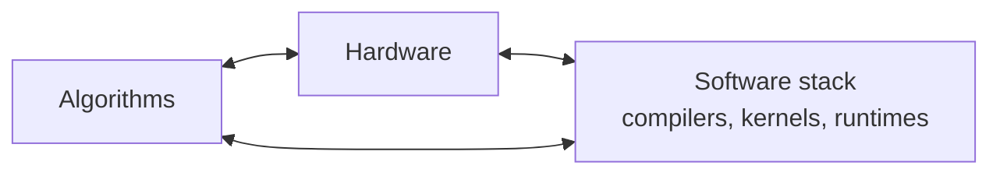

# 04 · Systems

Intelligence at scale is an engineering achievement. Frontier models are trained on thousands of accelerators for weeks and served to millions of users. This section covers the hardware and software that make that possible, and the physical limits that motivate the [hardware frontiers](../06-frontiers/README.md).

| Page | What you will learn |
|---|---|
| [Hardware and training at scale](hardware-and-training.md) | GPUs and TPUs, the roofline model, mixed precision, data/tensor/pipeline parallelism, ZeRO |
| [Low-precision training: FP8, microscaling and 4-bit pretraining](low-precision-training.md) | Float formats and where the bits go, per-tile and block scaling (MX, NVFP4), stochastic rounding, swamping and accumulator width, the FP4 recipes and their 2026 disagreements, precision-aware scaling laws, long-run stability (tested code) |
| [Inference and efficiency](inference-and-efficiency.md) | KV caching, batching, quantization, distillation, mixture-of-experts, speculative decoding |
| [The KV cache: paging, sharing and compression](kv-cache.md) | How big the cache gets and why decoding is memory-bound, paging and prefix sharing (tested code), prefill/decode disaggregation, MQA, GQA and latent caches, token eviction versus query-aware selection, 2- and 3-bit quantization, and what compression costs in multi-turn use |
| [Speculative decoding](speculative-decoding.md) | The draft-and-verify acceptance rule and its exactness proof, the speed-up formula and best draft length (tested code), drafters from small models to Medusa and EAGLE-3, token trees and optimal transport, when batching, long contexts and mixture-of-experts change the answer |
| [Serving long-reasoning models](serving-long-reasoning-models.md) | Why long CoT breaks classic serving, length budgets and truncation, early exit and overthinking mitigations, continuous batching of long variable outputs (tested code), KV growth, speculation and prefill/decode disaggregation for decode-heavy traffic |
| [Inference-time routing across model sizes](inference-time-routing.md) | RouteLLM-style routers and FrugalGPT-style cascades, PGR and CPT metrics, AutoMix and cascade routing, GPU-pool capacity under size mix (tested code), and co-optimised cascade serving |
| [Prefix-aware multi-sample serving](prefix-aware-multi-sample-serving.md) | Shared KV for Best-of-N and self-consistency, Hydragen-style prefix attention (tested code), BatchLLM group scheduling, Adaptive-Consistency sample budgets |
| [Serving tool-augmented agents](serving-tool-augmented-agents.md) | Why tool pauses break chat serving, InferCept's preserve/discard/swap choice, Continnum's KV TTL, program-level scheduling (Parrot, Autellix, Ayo), constrained tool JSON, sandbox pools (tested code) |
| [Compilers for machine learning](ml-compilers.md) | Fusion and tiling, IRs and lowering, Halide, TVM, XLA, Triton, MLIR, PyTorch 2, learned schedule search, LLM-written kernels |

Hooker (2020) calls this co-dependence **the hardware lottery**: research ideas succeed partly because they suit the hardware available, not only because they are better.
