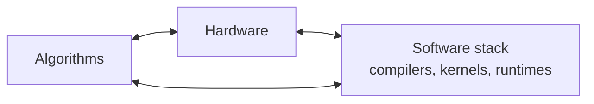

# 04 · Systems

Intelligence at scale is an engineering achievement. Frontier models are trained on thousands of accelerators for weeks and served to millions of users. This section covers the hardware and software that make that possible, and the physical limits that motivate the [hardware frontiers](../06-frontiers/README.md).

| Page | What you will learn |
|---|---|
| [Hardware and training at scale](hardware-and-training.md) | GPUs and TPUs, the roofline model, mixed precision, data/tensor/pipeline parallelism, ZeRO |
| [Inference and efficiency](inference-and-efficiency.md) | KV caching, batching, quantization, distillation, mixture-of-experts, speculative decoding |
| [Compilers for machine learning](ml-compilers.md) | Fusion and tiling, IRs and lowering, Halide, TVM, XLA, Triton, MLIR, PyTorch 2, learned schedule search, LLM-written kernels |

Hooker (2020) calls this co-dependence **the hardware lottery**: research ideas succeed partly because they suit the hardware available, not only because they are better.
