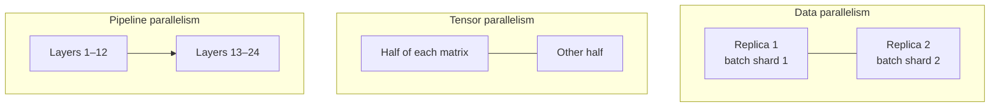

# Hardware and training at scale

## Why accelerators

Neural-network workloads are dominated by dense linear algebra ([matrix multiplication](../00-foundations/linear-algebra.md#cost-of-a-matrix-multiply)), which is massively parallel. **GPUs** run thousands of arithmetic units in parallel and include dedicated matrix units (tensor cores). Google's **TPU** (Jouppi et al. 2017) is built around a large **systolic array**, a grid of multiply–accumulate cells through which data flows rhythmically.

## The roofline model

Performance is limited either by arithmetic throughput or by memory bandwidth (Williams, Waterman & Patterson 2009). For a kernel with **arithmetic intensity** $I$ (FLOPs per byte moved):

```math
\text{attainable FLOP/s} = \min\big(\text{peak FLOP/s},\; I \times \text{memory bandwidth}\big)
```

Large matrix multiplications have high intensity and are compute-bound. Many other operations (elementwise ops, normalization, and token-by-token generation) are **memory-bound**. Much of AI systems engineering is about moving fewer bytes: fusing kernels, tiling into fast on-chip memory, and caching. FlashAttention (Dao et al. 2022) is a prime example.

> Data movement, not arithmetic, increasingly dominates the energy cost of computation. This is one of the main motivations for in-memory, analog, neuromorphic, and optical computing (see [Frontiers](../06-frontiers/README.md)).

## Numerical precision

| Format | Bits | Typical role |
|---|---|---|
| FP32 | 32 | Master weights, accumulation |
| BF16 / FP16 | 16 | Training compute (mixed precision) |
| FP8 | 8 | Training and inference on recent accelerators |
| INT8 / INT4 | 8 / 4 | Quantized inference |

**Mixed-precision training** (Micikevicius et al. 2017) computes in 16-bit while keeping an FP32 master copy of the weights and using loss scaling to avoid gradient underflow.

## Parallelism

A frontier model does not fit on one device, and training it on one would take far too long. Work is split along several axes:



- **Data parallelism**: each device holds a full model copy and processes different examples; gradients are averaged with an all-reduce.
- **Tensor (intra-layer) parallelism**: split individual weight matrices across devices (Megatron-LM; Shoeybi et al. 2019).
- **Pipeline parallelism**: assign consecutive layers to different devices and stream micro-batches through them (GPipe; Huang et al. 2019).
- **Sharded optimizer state**: **ZeRO** (Rajbhandari et al. 2020) partitions optimizer states, gradients, and parameters across data-parallel workers to remove redundancy.
- **Expert parallelism**: place different experts of a [mixture-of-experts](inference-and-efficiency.md#mixture-of-experts) model on different devices.

Real training runs combine these ("3D parallelism") and must also handle hardware failures, checkpointing, and network topology.

## Energy and cost

Strubell, Ganesh & McCallum (2019) and Patterson et al. (2021) drew attention to the energy and carbon cost of training large models, and showed that the choice of hardware, data-centre efficiency, and energy source changes it substantially. Efficiency gains at every layer of the stack, from algorithms to physics, compound.

## Key takeaways

- AI hardware is matrix-multiply hardware; memory bandwidth is often the real bottleneck.
- Lower precision trades accuracy for speed and memory, carefully.
- Scale requires combining data, tensor, pipeline, and sharded parallelism.
