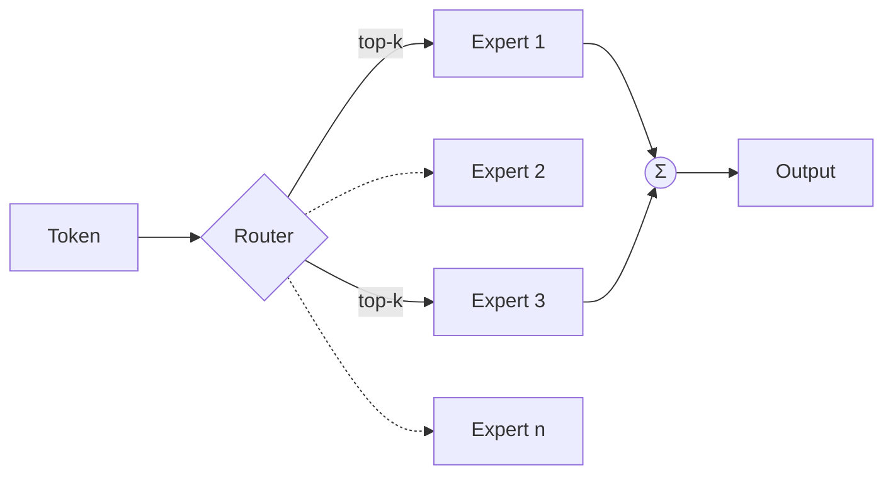

# Inference and efficiency

Training happens once; inference happens billions of times. Serving cost, latency, and energy are therefore central to deployed AI.

## Autoregressive generation and the KV cache

A decoder generates one token at a time. Recomputing attention over the whole prefix at each step would be wasteful, so keys and values for past tokens are stored in a **KV cache**. Generation then has two phases:

| Phase | Work | Bottleneck |
|---|---|---|
| **Prefill** | Process the whole prompt in parallel | Compute-bound |
| **Decode** | One token per step, reading all weights and the KV cache | Memory-bandwidth-bound |

The KV cache grows linearly with context length and batch size and often dominates memory. **PagedAttention** (Kwon et al. 2023, the vLLM system) manages it in fixed-size blocks, like virtual-memory pages, reducing fragmentation and enabling larger batches.

## Batching

Because decoding is memory-bound, serving many requests together amortizes the cost of reading weights. **Continuous batching** inserts new requests into the running batch as others finish, rather than waiting for a whole batch to complete.

## Quantization

Store weights (and sometimes activations) in fewer bits:

- **LLM.int8()** (Dettmers et al. 2022) handles rare large-magnitude outlier features in higher precision while quantizing the rest to 8 bits.
- **GPTQ** (Frantar et al. 2022) uses approximate second-order information to quantize weights to 3–4 bits after training with small accuracy loss.

Smaller weights mean fewer bytes moved per token, which directly speeds up memory-bound decoding.

## Distillation

**Knowledge distillation** (Hinton, Vinyals & Dean 2015) trains a small *student* to match the softened output distribution of a large *teacher*, transferring much of its capability at a fraction of the inference cost.

## Mixture of experts

A **mixture-of-experts (MoE)** layer contains many feed-forward "experts" and a router that sends each token to only a few of them (Shazeer et al. 2017). The **Switch Transformer** (Fedus, Zoph & Shazeer 2021) routes each token to a single expert. Total parameter count grows while compute per token stays roughly constant, decoupling capacity from cost (at the price of memory and communication).

## Speculative decoding

A small, fast **draft model** proposes several tokens; the large model verifies them in one parallel pass, accepting the longest agreeing prefix. With the acceptance rule of Leviathan, Kalman & Matias (2023), the output distribution is **exactly** that of the large model, while wall-clock time drops.

## Long context

Techniques for longer contexts include efficient attention kernels, positional schemes that extrapolate (such as RoPE scaling variants), and sub-quadratic architectures like [state-space models](../02-deep-learning/architectures.md#state-space-models).

## Key takeaways

- Decoding is limited by memory bandwidth, so reducing bytes per token (quantization, batching, caching) is the main lever.
- MoE and distillation decouple capability from per-token cost.
- Speculative decoding speeds up generation without changing the output distribution.
