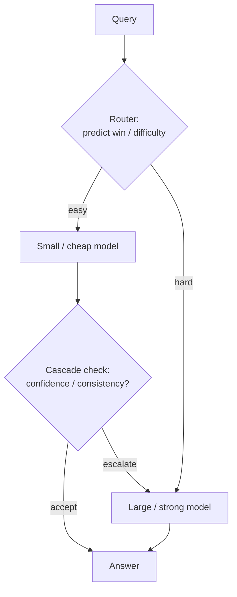

# Inference-time routing across model sizes

Not every query needs the biggest model in the fleet. A greeting, a format conversion and a hard multi-step proof sit on very different points of the quality–cost curve. **Inference-time routing** picks a model *before* generation; **cascading** runs a cheap model first and escalates only when a quality signal says so. Together they are how production stacks cut spend and free GPU slots without rewriting a single weight—orthogonal to [speculative decoding](speculative-decoding.md) (same model, faster tokens) and to [serving long-reasoning models](serving-long-reasoning-models.md) (same model, smarter stopping).

> The core idea in one sentence: **route easy queries to a small model and hard ones to a large one—either by predicting difficulty up front (routing) or by trying cheap first and escalating on low confidence (cascading)—and the quality–cost curve beats any single model.**

This page expands the short efficiency notes in [inference and efficiency](inference-and-efficiency.md). It connects to [hardware and training](hardware-and-training.md) (why model size maps to latency), [speculative decoding](speculative-decoding.md) (combine after you pick a target), and [reasoning models](../03-modern-ai/reasoning-models-and-test-time-compute.md) (when the "large" option is itself a long chain of thought).



## 1. The quality–cost dilemma (established)

Frontier APIs and open-weight families now span one to two orders of magnitude in price and latency for comparable token counts (Chen, Zaharia and Zou 2023). Sending every request to the strongest model maximises quality and wastes money on easy work; sending everything to a small model saves money and fails on hard work. The middle path is **model selection at inference**: decide, per query, which model (or sequence of models) should answer.

Two families dominate:

| Paradigm | Decision | Models invoked | Latency profile |
|---|---|---|---|
| **Routing** | Pick one model from the prompt alone | Exactly one | One generation; router overhead is small |
| **Cascading** | Run models in order until a stop rule fires | One or more, in sequence | Pays the cheap model always; pays the expensive one only on escalate |
| **Cascade routing** (Dekoninck, Baader and Vechev 2024) | At each step, choose *which* next model (or stop) | Flexible subset | Generalises both; larger search space |

LLM-Blender (Jiang, Ren and Lin 2023) sits nearby but is different: it *queries several models and ranks/fuses* their answers. That raises quality; it does not cut cost. Routing and cascading are the cost-saving side of the same multi-model idea.

## 2. Routing: pick one model from the prompt (established)

A router $R$ maps a query $q$ to a model (or a distribution over models). The binary case—strong versus weak—is the workhorse. RouteLLM (Ong et al. 2024) states it cleanly: learn $P(\text{win}_{\text{strong}} \mid q)$ from preference data, then threshold

$$
R^\alpha(q) =
\begin{cases}
\text{weak} & \text{if } P(\text{win}_{\text{strong}} \mid q) < \alpha, \\
\text{strong} & \text{otherwise.}
\end{cases}
$$

Raising $\alpha$ saves money (more traffic to the weak model); lowering it protects quality. Two metrics make the trade-off comparable across papers:

- **Performance gap recovered (PGR).** If $r_w$, $r_s$ and $r_R$ are average quality of weak, strong and router, then $\mathrm{PGR} = (r_R - r_w)/(r_s - r_w)$. Random routing at a given strong-call rate recovers that rate in expectation; anything above the diagonal is real skill.
- **Call–performance threshold (CPT).** $\mathrm{CPT}(x\%)$ is the smallest fraction of strong-model calls needed to recover $x\%$ of the gap. RouteLLM reports matrix-factorization and similarity-weighted routers that cut GPT-4 calls roughly in half versus random at CPT(50%) on MT Bench after preference-data augmentation, with cost savings above $2\times$ at matched quality on their pricing assumptions.

**How routers are trained.** Labels come from human preferences (Chatbot Arena battles in RouteLLM), golden answers (MMLU-style), LLM-as-judge comparisons, or reward models (Zooter; Lu et al. 2023). Architectures range from similarity-weighted Bradley–Terry ranking and matrix factorization over query embeddings, through BERT classifiers, to instruction-tuned causal LMs (Ong et al. 2024). Hybrid LLM (Ding et al. 2024) predicts a quality *gap* between small and large with an MLP on a Longformer embedding and reports up to **40% fewer large-model calls** at no quality drop, with a threshold that can be moved at serving time.

**What has to be true.** Routing only works when **ex-ante** quality estimates are informative: the router must guess, from the prompt alone, whether the small model will suffice. Out-of-domain prompts without augmentation collapse toward random (RouteLLM's MMLU and GSM8K tables before gold/judge augmentation). RouterBench (Hu et al. 2024) packages 400k+ precomputed (prompt, model, quality, cost) tuples so routers can be scored without live inference, and defines an Average Improvement in Quality (AIQ) over the cost–quality convex hull.

## 3. Cascading: try cheap, escalate on doubt (established)

A cascade runs models $m_1, \ldots, m_k$ (usually increasing in size) in order. After $m_j$ answers, a **stop rule** either accepts or escalates. FrugalGPT (Chen, Zaharia and Zou 2023) is the canonical API cascade: learn which sequence of APIs to try and which generation-quality thresholds to use; on their tasks it matched GPT-4 quality at up to **98% lower cost**, or beat GPT-4 by about **4%** at matched cost.

Stop signals in practice:

| Signal | Example | Notes |
|---|---|---|
| Learned quality scorer | FrugalGPT's DistilBERT judge on (query, answer) | Needs labelled or preference data |
| Answer consistency | Yue et al. (2024): majority vote / mixture-of-thoughts across CoT and PoT samples | ~40% of GPT-4 cost at matched reasoning accuracy in their setup |
| Self-verification | AutoMix (Aggarwal et al. 2024): few-shot entailment of answer against context, then a POMDP router | >50% cost cut at matched performance; works with ~50 examples |
| Model confidence / entropy | Logprob or entropy thresholds (Gupta et al. 2024 survey the design space) | Cheap; calibration varies by task |

Cascades pay the small model on *every* query and the large model on the escalate fraction $f$. Expected cost is roughly $c_{\text{small}} + f\, c_{\text{large}}$ (plus judge cost). That is strictly more generation than a perfect router that would have sent the easy queries to the small model only once—but the cascade observes the small model's answer, so its stop rule can use **post-hoc** information the router never sees. Dekoninck, Baader and Vechev (2024) prove that classical threshold cascades are optimal only under strong assumptions (cost independent of the query, future models' quality independent of $x$), and replace them with a sequential routing view over *supermodels* that is provably better when those assumptions fail.

## 4. Cascade routing and serving the cascade (active research)

**Cascade routing** (Dekoninck et al. 2024) removes the fixed order: at each step the system may stop, continue to a designated next model, or jump to a different one. On RouterBench it outperforms pure routing and pure cascading by several AUC points as the number of models grows; on SWE-Bench, where a perfect post-hoc check (run the tests) is available, gains reach about **14%** AUC over linear interpolation. The punchline of their analysis: **routing needs good ex-ante estimators; cascading needs good post-hoc estimators; cascade routing uses both.**

**Serving.** Algorithmic cascades assume the models are just API endpoints. Self-hosted fleets add GPU packing. CASCADIA (Jiang et al. 2025) co-optimises (i) how many GPUs and which parallelism each cascade stage gets and (ii) the routing thresholds that set each stage's load. On DeepSeek and Llama cascades it reports up to **4×** tighter latency SLOs (2.3× average) and up to **5×** higher throughput (2.4× average) versus single-model and prior cascade serving, at matched answer quality. The systems lesson matches [serving long-reasoning models](serving-long-reasoning-models.md): the router is also a **load balancer**. A 10% large-model fraction on a pool where a large replica costs 8× a small one multiplies concurrent capacity by several times versus all-large (see the sketch).

Composition with other systems tricks is mostly open but natural: route first, then [speculate](speculative-decoding.md) on the chosen target; cascade a draft model into a target as a *lossy* first stage only when the acceptance rule is allowed to change the distribution; prefer small non-reasoning models for easy chat and reserve long-CoT budgets for routed-hard queries.

## 5. Status at a glance

| Claim | Status |
|---|---|
| Strong and weak models differ enough in cost that selection can save >2× at near-parity quality | Established (FrugalGPT, RouteLLM, Hybrid LLM, AutoMix) |
| Preference- or gold-trained routers beat random on in-distribution prompts | Established (RouteLLM; RouterBench baselines) |
| Cascades with consistency or verification stop rules cut cost on reasoning tasks | Established (Yue et al.; AutoMix; FrugalGPT) |
| Ex-ante quality estimation is the binding constraint for pure routing | Established (RouteLLM OOD tables; Dekoninck et al.) |
| Post-hoc quality estimation is the binding constraint for pure cascading | Established (Dekoninck et al.; Gupta et al.) |
| Cascade routing dominates either alone when both estimators are decent | Strong evidence (Dekoninck et al. on RouterBench / SWE-Bench) |
| Joint routing + GPU deployment beats cascade-oblivious serving | Promising systems result (CASCADIA); fewer independent replications |
| One router or threshold transfers to every domain without adaptation | False |

## 6. A tested sketch

The code is a two-model quality–cost toy, not a language model. It measures oracle versus random versus a noisy difficulty router, cascade thresholds that always pay the small model, and GPU-pool capacity under a large/small size ratio. Running it with NumPy reproduces the numbers below in well under a second.

```python
import numpy as np

rng = np.random.default_rng(0)
N = 5000
diff = rng.beta(2, 5, N)                 # most queries easy
p_s = np.clip(0.95 - 0.7 * diff, 0.05, 0.99)
p_l = np.clip(0.92 - 0.25 * diff, 0.40, 0.995)
c_s, c_l = 1.0, 20.0
correct_s = rng.random(N) < p_s
correct_l = rng.random(N) < p_l

def evaluate(to_large):
    acc = np.where(to_large, correct_l, correct_s).mean()
    cost = np.where(to_large, c_l, c_s).mean()
    return float(acc), float(cost), float(to_large.mean())

acc_s, _, _ = evaluate(np.zeros(N, dtype=bool))
acc_l, _, _ = evaluate(np.ones(N, dtype=bool))

def pgr(acc):
    return (acc - acc_s) / (acc_l - acc_s)

print("baselines", evaluate(np.zeros(N, dtype=bool)),
      evaluate(np.ones(N, dtype=bool)),
      evaluate(rng.random(N) < 0.5))
oracle = correct_l & ~correct_s
print("oracle", evaluate(oracle), "PGR", pgr(evaluate(oracle)[0]))

score = diff + rng.normal(0, 0.15, N)
print("router")
for frac in [1.0, 0.5, 0.25, 0.1, 0.0]:
    thr = np.quantile(score, 1 - frac)
    acc, cost, f = evaluate(score >= thr)
    print(frac, acc, cost, f, pgr(acc))

print("cascade")
conf = np.clip(np.abs(2 * (p_s + rng.normal(0, 0.1, N)) - 1), 0, 1)
for t in [0.2, 0.4, 0.6, 0.8]:
    esc = conf < t
    acc = np.where(esc, correct_l, correct_s).mean()
    cost = c_s + esc.mean() * c_l
    print(t, float(acc), float(cost), float(esc.mean()), pgr(acc))

print("gpu pool")
for f in [0.0, 0.1, 0.25, 0.5, 1.0]:
    batch = 32 / (8 * f + 1 * (1 - f))
    print(f, batch, batch / 4)
```

**Part 1: baselines and oracle.** Small alone: accuracy **0.753**, cost **1.0**. Large alone: **0.851**, cost **20**. Random 50%: **0.809**, cost **10.4**. An oracle that escalates only when the large model uniquely succeeds reaches accuracy **0.960** at cost **4.94** (20.7% large calls)—better than large alone, because it avoids large-model errors on queries the small model already had right.

**Part 2: noisy difficulty router.** A score $=$ difficulty $+$ $\mathcal{N}(0, 0.15)$ thresholded to hit a target large-call fraction:

| Large-call fraction | Accuracy | Mean cost | PGR |
|---|---|---|---|
| 1.00 (always large) | 0.851 | 20.0 | 1.00 |
| 0.50 | 0.821 | 10.5 | 0.70 |
| 0.25 | 0.793 | 5.75 | 0.40 |
| 0.10 | 0.770 | 2.90 | 0.17 |
| 0.00 (always small) | 0.753 | 1.00 | 0.00 |

At 50% large calls the router recovers **70%** of the quality gap while random recovers ~50% by construction—the same CPT language RouteLLM uses. Cost at that point is about half of always-large.

**Part 3: cascade.** Always run small; escalate when a noisy confidence falls below $t$. Cost is $1 + f_{\text{esc}} \cdot 20$.

| Threshold $t$ | Accuracy | Mean cost | Escalate fraction | PGR |
|---|---|---|---|---|
| 0.2 | 0.779 | 4.02 | 0.15 | 0.27 |
| 0.4 | 0.804 | 8.18 | 0.36 | 0.52 |
| 0.6 | 0.827 | 13.4 | 0.62 | 0.76 |
| 0.8 | 0.842 | 18.0 | 0.85 | 0.91 |

Compared with the router at similar accuracy (~0.82), the cascade spends more (it always pays the small model). That is the post-hoc / ex-ante trade: cascades buy a better stop signal at the price of a mandatory first call.

**Part 4: GPU pool.** 32 GPUs; a large replica needs 8, a small needs 1. Concurrent batch size at large-traffic fraction $f$ is $32 / (8f + (1-f))$:

| Large fraction $f$ | Max concurrent | vs all-large ($f=1$) |
|---|---|---|
| 0.00 | 32 | 8.0× |
| 0.10 | 18.8 | 4.7× |
| 0.25 | 11.6 | 2.9× |
| 0.50 | 7.1 | 1.8× |
| 1.00 | 4 | 1.0× |

Routing 10% of traffic to large models is not a 10% capacity tax—it is a **4.7×** concurrency win over an all-large deployment on this size ratio. CASCADIA's co-optimisation is the production version of this arithmetic.

What the sketch does *not* show: real router generalisation across model pairs, judge bias, network latency of multi-hop cascades, or KV-cache sharing when several models serve the same prompt. It shows why the decision rule and the GPU mix dominate cost once two sizes exist.

## 7. Speculative: routing as a fleet control loop

> **Speculative.** The ideas in this section are hypotheses for discussion, not established results.

Routers today are mostly request-local. Serving cares about the *fleet*: queue depth on the large pool, P99 latency, and the fraction of traffic that still needs a long reasoning trace. A testable programme:

1. **Load-aware thresholds.** Move $\alpha$ (or cascade $t$) with measured large-pool utilisation, the way LASER moves early-exit thresholds under reasoning load. Prediction: goodput at fixed quality rises versus a static threshold; falsified if oscillations from delayed load signals cancel the gain.
2. **Route then speculate.** Run [speculative decoding](speculative-decoding.md) only on requests sent to the large model, with a drafter matched to that model. Prediction: tokens per joule improve at matched quality versus speculate-on-all; falsified if router mistakes send hard queries to a small model whose drafts the large model would have rejected cheaply anyway.
3. **Difficulty probes for calibration.** Keep a tiny labelled probe (short GSM8K vs AIME-style) and recalibrate $\alpha$ online. Prediction: CPT(80%) falls versus a frozen router after distribution shift; falsified if preference-trained routers already transfer (as RouteLLM sometimes does across model *pairs*) without probe data.

## Further reading

- Chen, Zaharia and Zou (2023), *FrugalGPT*: API cascades with learned thresholds.
- Ong et al. (2024), *RouteLLM*: preference-trained routers, PGR and CPT.
- Ding et al. (2024), *Hybrid LLM*; Aggarwal et al. (2024), *AutoMix*; Yue et al. (2024), mixture-of-thoughts cascades.
- Hu et al. (2024), *RouterBench*; Dekoninck, Baader and Vechev (2024), *cascade routing*.
- Jiang et al. (2025), *CASCADIA*: cascade serving with joint deployment and routing.
- Related pages: [Inference and efficiency](inference-and-efficiency.md), [Speculative decoding](speculative-decoding.md), [Serving long-reasoning models](serving-long-reasoning-models.md), [Prefix-aware multi-sample serving](prefix-aware-multi-sample-serving.md), [Reasoning models](../03-modern-ai/reasoning-models-and-test-time-compute.md).

Full citations for every source on this page are in [REFERENCES.md](../../REFERENCES.md#inference-time-routing).
