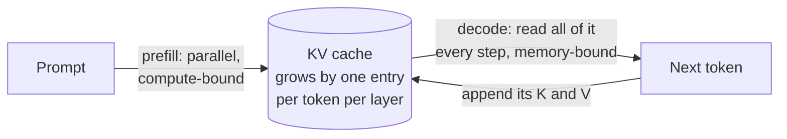

# The KV cache: paging, sharing and compression

When a language model writes its next token, it attends to every token before it. Recomputing the keys and values of that whole history at each step would be absurdly wasteful, so the model stores them in a **key-value (KV) cache** and appends one new entry per token. The cache turns generation from quadratic recomputation into a linear walk, but it moves the problem rather than removing it: the cache grows with every token of every conversation, it must be read in full at every step, and for long contexts it can outgrow the model itself (Liu et al. 2023 observe that the KV cache "can easily surpass the model size").

> The core idea in one sentence: **the KV cache is the working memory of a running language model, and almost every modern serving trick either stores it more cleverly (paging and sharing), keeps less of it (fewer heads, fewer tokens, fewer bits), or reads less of it per step (query-aware selection).**

This page expands the short section in [inference and efficiency](inference-and-efficiency.md). It connects to [speculative decoding](speculative-decoding.md), [prefix-aware multi-sample serving](prefix-aware-multi-sample-serving.md) (the other answer to memory-bound decoding), [serving tool-augmented agents](serving-tool-augmented-agents.md) (what to do with a cache that will be needed again after a tool returns), [hardware and training](hardware-and-training.md) (the roofline model), [attention gradients](../02-deep-learning/attention-gradients.md) (FlashAttention's tiling), [state-space models](../02-deep-learning/state-space-models.md) (models with a fixed-size state instead of a cache), [mixture of experts](../02-deep-learning/mixture-of-experts.md) and [diffusion language models](../03-modern-ai/diffusion-language-models.md).

## 1. What the cache holds and how big it gets (established)

In a decoder with $L$ layers, each layer stores one key vector and one value vector per KV head for each past token. With $h_{kv}$ KV heads of dimension $d_h$ stored at $b$ bytes per number, the cache for a batch of $B$ sequences of length $T$ occupies

```math
M_{\text{KV}} = 2 \cdot L \cdot h_{kv} \cdot d_h \cdot b \cdot T \cdot B \ \text{bytes}.
```

Every factor is a lever. $L$ and $d_h$ are fixed by the architecture; $h_{kv}$ can be cut by sharing heads (Section 3); $b$ by quantization (Section 5); $T$ by eviction (Section 4); and $B$ is the batch size that serving economics wants to push up. Generation then has two phases with different bottlenecks: **prefill** processes the prompt in parallel and fills the cache; **decode** produces one token per step and must read every weight and the entire cache to do so. Patel et al. (2023) characterize prefill as compute-intensive and token generation as memory-intensive, with generation underusing the GPU's compute "despite state-of-the-art batching and scheduling".

Two consequences follow. First, **memory capacity** caps the batch: a request that cannot fit its cache cannot be served alongside the others. Second, **memory bandwidth** caps the speed: with long contexts the cache, not the weights, dominates the bytes read per token. Liu et al. (2024a, KIVI) put it directly: loading the KV cache "causes the computational core to be idle". Pope et al. (2022), modelling inference for 500B-parameter models on TPU v4, found that the smaller cache of multi-query attention, with suitable partitioning, enabled up to 32× longer contexts.



## 2. Storing it well: paging, sharing and disaggregation (established)

**The fragmentation problem.** Early serving systems reserved one contiguous slab of memory per request, sized for the longest output it might produce. Since output length is unknown in advance, most of that reservation sits empty. Kwon et al. (2023) observed that when the cache is "managed inefficiently, this memory can be significantly wasted by fragmentation and redundant duplication, limiting the batch size."

**PagedAttention.** Their fix borrows the oldest idea in operating systems: virtual memory. The cache is cut into fixed-size *blocks* of a few tokens; a per-request *block table* maps logical positions to physical blocks anywhere in memory, and blocks are allocated only when a token needs one. Waste shrinks to the unfilled tail of the last block. Because blocks are referenced through a table, two requests can point at the *same* physical block, with copy-on-write when one of them diverges, which makes parallel sampling and beam search cheap. The resulting system, vLLM, reported 2–4× higher throughput than FasterTransformer and Orca at the same latency, with larger gains for longer sequences, larger models and more complex decoding.

**Prefix sharing.** Many requests begin with identical text: a long system prompt, a few-shot template, a document under discussion, the earlier turns of a chat. Their caches for that prefix are identical, so they need to be computed and stored only once.

- *Prompt Cache* (Gim et al. 2023) precomputes the attention states of reusable "prompt modules" with a schema that keeps positions consistent, reporting 8× (GPU) to 60× (CPU) lower time to first token on long prompts.
- *RadixAttention*, part of SGLang (Zheng et al. 2023), keeps finished requests' caches in a radix tree keyed by token sequence, so any new request automatically reuses its longest cached prefix; SGLang reported up to 6.4× higher throughput across agent, reasoning, JSON, retrieval and multi-turn workloads.
- *ChunkAttention* (Ye et al. 2024) builds the prefix tree into the attention kernel itself, reporting 3.2–4.8× faster self-attention with shared system prompts of 1,024 to 4,096 tokens.

Li et al. (2024b, SCBench) note that this kind of cache reuse is now widely adopted, in vLLM and SGLang and by major model providers, which is why they argue compression methods must be judged over the whole life of a shared cache rather than one request at a time (Section 6).

**Separating the phases.** Because prefill and decode stress different resources, running them on the same GPUs makes them interfere. *Sarathi-Serve* (Agrawal et al. 2024) splits prompts into chunks so prefills can be interleaved with ongoing decodes without stalling them, reporting 2.6× higher serving capacity for Mistral-7B on one A100 than vLLM. *Splitwise* (Patel et al. 2023) and *DistServe* (Zhong et al. 2024) go further and put the phases on different machines, shipping the cache between them over fast interconnects; Splitwise reported 1.4× throughput at 20% lower cost, and DistServe 7.4× more requests or 12.6× tighter latency targets. *Mooncake* (Qin et al. 2024), the serving platform behind Kimi, makes the cache the central object: a disaggregated pool of KV blocks built from the GPU cluster's underused CPU, DRAM and SSD resources, with a scheduler built around where caches live. Under real workloads it let the service handle 75% more requests.

That storage layer is itself still moving. FlatCake (Huang et al. 2026) argues that production reuse is bimodal, either one-shot blocks with long reuse distances or multi-gigabyte agentic sessions larger than host memory, so treating host DRAM as a cache in front of SSD fails. It places each immutable block directly on its final medium in session-contiguous order. On a production coding-agent trace it reports a 94% cache hit rate as load rises against 64% for Mooncake, and 1.6× lower mean time to first token at peak load.

## 3. Keeping less per token: sharing heads and latent caches (established)

The cheapest cache entry is one that is never stored. Several architectural changes shrink $h_{kv} \cdot d_h$, the size of each token's entry; unlike the methods in later sections, they are decided at training time.

| Design | What is shared or compressed | Reported effect |
|---|---|---|
| Multi-query attention, MQA (Shazeer 2019) | All query heads share one key head and one value head | "Much faster" decoding with "only minor quality degradation" |
| Grouped-query attention, GQA (Ainslie et al. 2023) | Groups of query heads share a KV head; existing checkpoints can be uptrained with 5% of pre-training compute | Quality close to full multi-head attention at speed comparable to MQA |
| Cross-layer attention, CLA (Brandon et al. 2024) | Adjacent layers also share KV heads | A further 2× smaller cache at nearly the accuracy of MQA, for 1B and 3B models trained from scratch |
| You Only Cache Once, YOCO (Sun et al. 2024) | A self-decoder produces one global cache that every layer of a cross-decoder reuses | Large memory and prefill savings; near-perfect needle retrieval at 1M tokens |
| Multi-head latent attention, MLA (DeepSeek-AI 2024) | Keys and values are reconstructed from a small per-token latent vector | 93.3% smaller cache and 5.76× higher maximum generation throughput than the earlier DeepSeek 67B |
| Dynamic memory compression, DMC (Nawrot et al. 2024) | The model learns, per head and layer, when to merge a new token into the last cache entry instead of appending | Up to 4× compression with original downstream performance, up to 7× throughput on an H100 |

Part 1 of the [sketch](#7-a-tested-sketch) works through the arithmetic for an illustrative 32-layer configuration with 128-dimensional heads at 16-bit precision: 512 KiB per token with 32 KV heads, 128 KiB with 8 (GQA), 16 KiB with one (MQA), and 36 KiB for a 512-dimensional latent plus a 64-dimensional positional part (an MLA-style layout). At 128,000 tokens that is the difference between 62.5 GiB and 2 to 4 GiB for a single sequence.

Two training-free cousins compress *across layers* of an existing model. MiniCache (Liu et al. 2024b) merges the caches of adjacent middle-to-deep layers, whose states it finds highly similar, by interpolating directions and keeping magnitudes. BellowsKV (Zhang and Chen 2026) reports the opposite finding for the caches themselves, that adjacent layers' keys and values are "quite different" while their *input hidden states* are highly similar. It stores one shared latent per token for several layers and lets each layer project its own keys and values from it, retaining about 99% of full-cache accuracy at 3.6× compression and 97–98% at 13–14× on three 7–8B models.

## 4. Keeping fewer tokens: eviction and selection (active research)

A softmax over thousands of keys is usually dominated by a few of them. If those could be identified, the rest could be dropped. The methods differ in *which* evidence they use and in *whether* they throw the rest away.

**Recency and sinks.** The simplest policy keeps only a recent window. Xiao et al. (2023) showed that this fails as soon as the text exceeds the window, and found why: models dump large attention weight on the first few tokens as an **attention sink**, whatever those tokens say. Keeping the first few tokens plus the window (StreamingLLM) let Llama-2, MPT, Falcon and Pythia run stable language modelling on up to 4 million tokens without fine-tuning.

**Accumulated importance.** H2O (Zhang et al. 2023) keeps "heavy hitters", tokens that have received the most attention so far, plus recent ones, and gives the eviction problem a submodular formulation with a guarantee under mild assumptions; with 20% heavy hitters it improved throughput up to 29× over three offloading-based systems. Scissorhands (Liu et al. 2023) rests on the *persistence of importance* hypothesis, that tokens which mattered once keep mattering, and reports up to 5× less cache memory without quality loss, 20× combined with 4-bit quantization. FastGen (Ge et al. 2023) profiles each head and keeps a different kind of cache for each: local windows for local heads, special tokens for heads that attend to them, the full cache only for heads that look everywhere. SnapKV (Li et al. 2024a) chooses what to keep from an observation window at the end of the prompt, reporting 3.6× faster generation and 8.2× better memory efficiency at 16K tokens. PyramidKV (Cai et al. 2024) gives lower layers larger budgets than higher ones and reports matching full-cache LongBench performance with 12% of the cache. Devoto et al. (2024) found that keys with a *small* L2 norm tend to receive high attention, and that pruning by key norm alone, which needs no attention scores and so works with FlashAttention, halves the cache on language modelling and needle tasks without losing accuracy.

**Query-aware selection.** Everything above decides *before* the future query is known. Tang et al. (2024) observed that which tokens are critical "highly depends on the query". Quest therefore keeps the whole cache, stores the per-channel minimum and maximum key of each page, bounds each page's best possible score against the current query, and loads only the top pages, reporting up to 2.23× faster self-attention and 7.03× lower latency with negligible accuracy loss on long-dependency tasks. The catch is structural: query-aware selection saves bandwidth, not capacity, because nothing is deleted.

**How small can a cache be in principle?** Chen et al. (2026a) study the space needed to approximate attention when queries cannot align too closely with any key, an assumption matching the measured anisotropy of real key and query geometry. They give a nearly space-optimal algorithm with a matching lower bound and show that simple uniform sampling of tokens is nearly optimal for a typical range of parameters, which they offer as an explanation of its "surprising effectiveness on real datasets".

## 5. Keeping fewer bits: quantization and lossless coding (active research)

Quantizing the cache attacks $b$. Keys and values turn out to need different treatment.

- **Keys have outlier channels; values do not.** KIVI (Liu et al. 2024a) found that keys should be quantized *per channel* (grouping each channel across tokens) and values *per token*. Its tuning-free 2-bit scheme kept quality almost unchanged on Llama, Falcon and Mistral while using 2.6× less peak memory, allowing up to 4× larger batches and 2.35–3.47× throughput.
- **Positions complicate keys.** KVQuant (Hooper et al. 2024) adds quantizing keys *before* the rotary position embedding, non-uniform per-layer datatypes and per-vector outlier isolation, reaching less than 0.1 perplexity degradation at 3 bits and serving LLaMA-7B at up to 1 million tokens on one A100-80GB and up to 10 million on eight GPUs.
- **Random projections remove the bookkeeping.** Ordinary quantizers store a scale and zero point per block, which Zandieh, Daliri and Han (2024) note can add 1 or 2 bits per number. QJL applies a Johnson–Lindenstrauss projection and keeps only sign bits, with an unbiased inner-product estimator; at 3 bits it cut KV memory more than fivefold without accuracy loss. TurboQuant (Zandieh et al. 2025) randomly rotates vectors so their coordinates become nearly independent, quantizes each coordinate optimally, and corrects the inner-product bias with a 1-bit QJL residual. It proves distortion within a factor of about 2.7 of an information-theoretic lower bound and reports quality neutrality at 3.5 bits per channel.
- **Lossless coding is possible but modest.** GAAC (Guo et al. 2026) exploits redundancy in BF16 exponents to compress caches bit-for-bit by 1.405–1.407× across five models, decoding tiles inside the attention kernel. ZipFusion (Chen et al. 2026b) likewise decodes compressed values directly in registers, reporting about 1.25× faster decode attention than FlashInfer on an H100 and up to 26.3% more decode throughput at 8K context under the same memory budget.

Quantization methods built for autoregressive models also assume that a cached entry is exact. In a [diffusion language model](../03-modern-ai/diffusion-language-models.md) attention is bidirectional, so reused states can drift as masked tokens are revealed; Tai et al. (2026) study quantization on top of that reuse error and calibrate on reconstructed reveal trajectories.

## 6. What compression costs (active research)

Reported compression ratios are measured on different models, tasks and baselines, and the methods are rarely compared head to head. Two benchmark efforts tried.

Yuan et al. (2024) evaluated more than ten approaches, including KV quantization, token dropping, prompt compression, linear-time sequence models and hybrids, across seven categories of long-context task in an aligned environment, and reported "numerous previously unknown phenomena". SCBench (Li et al. 2024b) followed the full life of a *shared* cache across multiple turns and requests and found that methods using less than linear memory "suffer in multi-turn scenarios", while methods that keep linear memory but compute sparsely during prefill hold up. Dynamic sparsity produced more expressive caches than static patterns.

The reason is the one the sketch makes concrete: **an eviction policy bets on what future queries will want**. If the second question in a conversation asks about something the first ignored, the tokens it needs may already be gone. A selection method such as Quest keeps them in memory and can find them, at the price of not saving memory.

Practicality is a cost too. Attention-score-based eviction needs the scores, which fused kernels like FlashAttention never write out (Devoto et al. 2024 make this point for their norm-based alternative). Compacted caches that add per-key logit biases do not fit standard kernels or vLLM's paged layout; Kanwat (2026) folds the bias into the keys along one fitted direction per head, so an unmodified vLLM serves the compacted cache, matching reference greedy output on 180 of 200 long-context samples for a 14B model.

## 7. A tested sketch

The code works through cache arithmetic, paging and prefix sharing, eviction against query-aware selection on a synthetic attention task, and key quantization with outlier channels. It runs as written with NumPy in about a second. Everything in it is synthetic; it illustrates mechanisms, not the performance of any real model or method.

```python
import numpy as np
rng=np.random.default_rng(0)

# Part 1: cache size per token for one illustrative 32-layer model, 16-bit storage
print("Part 1")
L,H,dh,b=32,32,128,2
for name,per_layer in [("MHA, 32 KV heads",2*32*dh),("GQA, 8 KV heads",2*8*dh),("MQA, 1 KV head",2*1*dh),("latent 512 + 64 rope dims",512+64)]:
    per_tok=L*per_layer*b
    print(f"{name:28s} {per_tok/1024:7.1f} KiB/token  {per_tok*128_000/2**30:6.2f} GiB at 128k tokens")

# Part 2: paging and prefix sharing
print("Part 2")
n=256; maxlen=4096
prompt=rng.integers(100,2000,n); out=rng.integers(10,1000,n); used=prompt+out
contig=n*maxlen
for B in [16,128]:
    blocks=np.ceil(used/B)*B
    print(f"block {B:3d}: utilization {used.sum()/blocks.sum():.3f} (contiguous reservation at max length: {used.sum()/contig:.3f})")
S=1500  # shared system prompt in tokens
tot=S+prompt
B=16
noshare=np.ceil(tot/B).sum()
share=np.ceil(S/B)+np.ceil((tot-np.floor(S/B)*B)/B).sum()   # full shared blocks counted once
print(f"shared {S}-token prefix across {n} requests: {noshare:.0f} blocks unshared vs {share:.0f} shared ({noshare/share:.2f}x less memory)")

# Part 3: which tokens to keep? eviction vs query-aware selection
print("Part 3")
d=64; N=4096; budget=256
def attn(q,K,V,idx=None):
    if idx is not None: K,V=K[idx],V[idx]
    s=K@q/np.sqrt(d); s-=s.max(); w=np.exp(s); w/=w.sum(); return w@V, w
def run(trials=40):
    res={k:[] for k in ["recent window","accumulated attention (H2O-like)","page top-k (Quest-like)","oracle top-k"]}
    res2={k:[] for k in res}
    for t in range(trials):
        K=rng.normal(size=(N,d)); V=rng.normal(size=(N,d))
        topicA=rng.normal(size=d); topicA/=np.linalg.norm(topicA)
        topicB=rng.normal(size=d); topicB/=np.linalg.norm(topicB)
        st=rng.choice(np.arange(0,N-512,16),6,replace=False)+rng.integers(0,8)   # relevant tokens come in short spans
        A=(st[:5,None]+np.arange(8)).ravel(); Bn=st[5]+np.arange(8)
        K[A]+=6.0*topicA; K[Bn]+=6.0*topicB
        past=[topicA*10+0.5*rng.normal(size=d) for _ in range(32)]   # prompt-phase queries about topic A
        acc=np.zeros(N)
        for q in past: acc+=attn(q,K,V)[1]
        for name,qtopic,store in [("same",topicA,res),("new",topicB,res2)]:
            q=qtopic*10+0.5*rng.normal(size=d)
            full,w=attn(q,K,V)
            sel={}
            sel["recent window"]=np.arange(N-budget,N)
            sel["accumulated attention (H2O-like)"]=np.r_[np.argsort(acc[:N-64])[-(budget-64):],np.arange(N-64,N)]
            P=16; Kp=K.reshape(-1,P,d); ub=np.maximum(Kp.max(1)*q,Kp.min(1)*q).sum(1)
            pages=np.argsort(ub)[-(budget//P):]; sel["page top-k (Quest-like)"]=(pages[:,None]*P+np.arange(P)).ravel()
            sel["oracle top-k"]=np.argsort(w)[-budget:]
            for k,idx in sel.items():
                o,_=attn(q,K,V,idx); store[k].append(np.linalg.norm(o-full)/np.linalg.norm(full))
    for k in res: print(f"{k:34s} rel. error, follow-up on same topic {np.mean(res[k]):.3f} | on a new topic {np.mean(res2[k]):.3f}")
run()

# Part 4: 2-bit keys: per-token vs per-channel groups, with outlier channels
print("Part 4")
def quant(X,bits,axis):
    lo=X.min(axis,keepdims=True); hi=X.max(axis,keepdims=True); s=(hi-lo)/(2**bits-1)+1e-12
    return np.round((X-lo)/s)*s+lo
N=2048
errs={}
for t in range(20):
    K=rng.normal(size=(N,d)); K[:,:4]+=rng.normal(size=4)*12  # a few channels with large fixed offsets (outlier channels)
    V=rng.normal(size=(N,d)); q=rng.normal(size=d)
    Q,_=np.linalg.qr(rng.normal(size=(d,d)))
    s_full=K@q
    def out_err(Kq):
        s=Kq@q/np.sqrt(d); w=np.exp(s-s.max()); w/=w.sum()
        sf=s_full/np.sqrt(d); wf=np.exp(sf-sf.max()); wf/=wf.sum()
        return 0.5*np.abs(w-wf).sum(), np.abs(s*np.sqrt(d)-s_full).mean()/np.abs(s_full).mean()
    G=32
    cases={}
    for bits in [2,4]:
        cases[f"{bits}-bit per-token"]=quant(K,bits,1)
        cases[f"{bits}-bit per-channel (groups of {G} tokens)"]=np.concatenate([quant(K[i:i+G],bits,0) for i in range(0,N,G)])
        Kr=K@Q; cases[f"{bits}-bit per-token after random rotation"]=quant(Kr,bits,1)@Q.T
    for k,Kq in cases.items(): errs.setdefault(k,[]).append(out_err(Kq))
for k,v in errs.items():
    v=np.array(v); print(f"{k:42s} rel. score error {v[:,1].mean():.3f}  attention TV {v[:,0].mean():.3f}")
```

Output:

```text
Part 1
MHA, 32 KV heads               512.0 KiB/token   62.50 GiB at 128k tokens
GQA, 8 KV heads                128.0 KiB/token   15.62 GiB at 128k tokens
MQA, 1 KV head                  16.0 KiB/token    1.95 GiB at 128k tokens
latent 512 + 64 rope dims       36.0 KiB/token    4.39 GiB at 128k tokens
Part 2
block  16: utilization 0.995 (contiguous reservation at max length: 0.394)
block 128: utilization 0.962 (contiguous reservation at max length: 0.394)
shared 1500-token prefix across 256 requests: 41546 blocks unshared vs 17832 shared (2.33x less memory)
Part 3
recent window                      rel. error, follow-up on same topic 1.114 | on a new topic 1.099
accumulated attention (H2O-like)   rel. error, follow-up on same topic 0.045 | on a new topic 1.281
page top-k (Quest-like)            rel. error, follow-up on same topic 0.061 | on a new topic 0.343
oracle top-k                       rel. error, follow-up on same topic 0.039 | on a new topic 0.186
Part 4
2-bit per-token                            rel. score error 1.608  attention TV 0.728
2-bit per-channel (groups of 32 tokens)    rel. score error 0.241  attention TV 0.157
2-bit per-token after random rotation      rel. score error 0.897  attention TV 0.494
4-bit per-token                            rel. score error 0.319  attention TV 0.206
4-bit per-channel (groups of 32 tokens)    rel. score error 0.048  attention TV 0.031
4-bit per-token after random rotation      rel. score error 0.182  attention TV 0.116
```

What it shows:

1. **Head sharing is the largest single lever.** For the illustrative configuration, one 128,000-token sequence needs 62.50 GiB of cache with 32 KV heads, 15.62 GiB with 8, 1.95 GiB with one, and 4.39 GiB with a 576-number latent. These are arithmetic, not measurements; real models differ in layers, head counts and dimensions.
2. **Paging nearly eliminates waste.** For 256 requests with random prompt and output lengths, reserving each request's maximum of 4,096 tokens up front uses only 39.4% of the reserved memory. Allocating 16-token blocks on demand uses 99.5%, and 128-token blocks 96.2%; the loss is just the unfilled last block. With a 1,500-token system prompt shared by all 256 requests, storing its full blocks once needs 17,832 blocks instead of 41,546, 2.33× less memory. The gain grows with the share of each request that is common prefix.
3. **Eviction bets on the future; selection does not.** The context has 4,096 random keys with a few short spans relevant to topic A and one span relevant to topic B; 32 earlier queries all asked about A, and the cache budget is 256 tokens. Errors are relative to full attention, so values above 1 are worse than outputting nothing. A recent window misses both (1.114 and 1.099). Accumulated attention, the H2O-style policy, is nearly perfect for a follow-up about A (0.045, close to the oracle's 0.039) but fails on a new question about B (1.281), because the B tokens were never attended and were evicted. Page-level query-aware selection, which keeps everything and loads 16 of 256 pages, stays usable on both (0.061 and 0.343). The oracle's 0.186 on B shows that 8 relevant tokens among 4,096 noisy ones are hard even with perfect selection.
4. **Group keys by channel.** Keys with four large-offset channels quantized *per token* at 2 bits have relative score error 1.608 and a total variation of 0.728 between the quantized and exact attention weights; grouping by channel over 32 tokens, as KIVI recommends, cuts these to 0.241 and 0.157. A random rotation before per-token quantization helps (0.897 and 0.494) by spreading the outliers across channels, but here does not match per-channel grouping. At 4 bits the ordering is the same (0.206, 0.116 and 0.031 in total variation).

## 8. Status at a glance

| Claim | Status |
|---|---|
| The KV cache, not the weights, dominates memory and bytes read for long contexts and large batches | Established (follows from the size formula; reported across the cited systems) |
| Paging with on-demand blocks removes most fragmentation and enables block sharing | Established; standard in serving systems |
| Shared prefixes can be cached and reused across requests | Established; widely deployed (Li et al. 2024b) |
| Sharing KV heads (MQA, GQA) or caching a latent (MLA) costs little quality for large memory savings | Established at the scales reported; trade-offs are architecture-specific |
| Separating prefill and decode improves goodput under latency targets | Established in reported systems; the benefit depends on workload and interconnect |
| Query-agnostic token eviction preserves quality | Contested: strong single-request results, weaker in multi-turn shared-context benchmarks |
| Keys need per-channel or pre-RoPE handling to quantize to 2–3 bits | Active research with consistent findings across several groups |
| Uniform token sampling is near-optimal under realistic key–query geometry | New theoretical result (Chen et al. 2026a); empirical scope still to be tested |

## 9. Speculative: the cache as the thing to move least

> **Speculative.** This section proposes ideas, not established results.

Two observations from this page fit together in a way that may matter for unconventional hardware. First, cached blocks are written once and then only read; FlatCake builds its storage design on exactly that write-once, immutable property. Write-once, read-many is the access pattern that suits memories which are slow or costly to write but cheap to read, such as the analog and nonvolatile devices on the [memristive crossbar](../06-frontiers/memristive-crossbars-in-memory-computing.md) page. Second, query-aware selection splits attention into a *coarse scoring* step (which pages could matter?) and an *exact* step on the few that do. The coarse step tolerates error in one direction only: overestimating a page costs bandwidth, underestimating it costs accuracy.

Combined, they suggest an arrangement worth testing: keep page summaries, or even the keys themselves, in a dense in-memory or [optical](../06-frontiers/photonic-computing.md) array that computes approximate query–key scores in place, and run exact digital attention only on the pages it nominates, much as an inexact drafter proposes and an exact model verifies in [speculative decoding](speculative-decoding.md). Unlike speculative decoding, this would not be lossless: a page the noisy scorer wrongly ranks low is simply missed. The open, measurable questions are how much analog noise widens the page bounds before recall drops, whether bounds can be made deliberately conservative to keep misses rare, and whether moving the selected pages to the exact unit erases the bandwidth saved.

## Further reading

- Shazeer, N. (2019). *Fast transformer decoding: One write-head is all you need*. [arXiv:1911.02150](https://arxiv.org/abs/1911.02150)
- Pope, R., Douglas, S., Chowdhery, A., Devlin, J., Bradbury, J., Levskaya, A., Heek, J., et al. (2022). *Efficiently scaling transformer inference*. [arXiv:2211.05102](https://arxiv.org/abs/2211.05102)
- Ainslie, J., Lee-Thorp, J., de Jong, M., Zemlyanskiy, Y., Lebrón, F., Sanghai, S. (2023). *GQA: Training generalized multi-query transformer models from multi-head checkpoints*. EMNLP. [arXiv:2305.13245](https://arxiv.org/abs/2305.13245)
- Liu, Z., Desai, A., Liao, F., Wang, W., Xie, V., Xu, Z., Kyrillidis, A., et al. (2023). *Scissorhands: Exploiting the persistence of importance hypothesis for LLM KV cache compression at test time*. [arXiv:2305.17118](https://arxiv.org/abs/2305.17118)
- Zhang, Z., Sheng, Y., Zhou, T., Chen, T., Zheng, L., Cai, R., Song, Z., et al. (2023). *H₂O: Heavy-hitter oracle for efficient generative inference of large language models*. [arXiv:2306.14048](https://arxiv.org/abs/2306.14048)
- Kwon, W., Li, Z., Zhuang, S., Sheng, Y., Zheng, L., Yu, C. H., Gonzalez, J. E., et al. (2023). *Efficient memory management for large language model serving with PagedAttention*. SOSP. [arXiv:2309.06180](https://arxiv.org/abs/2309.06180)
- Xiao, G., Tian, Y., Chen, B., Han, S., Lewis, M. (2023). *Efficient streaming language models with attention sinks*. ICLR 2024. [arXiv:2309.17453](https://arxiv.org/abs/2309.17453)
- Ge, S., Zhang, Y., Liu, L., Zhang, M., Han, J., Gao, J. (2023). *Model tells you what to discard: Adaptive KV cache compression for LLMs*. ICLR 2024. [arXiv:2310.01801](https://arxiv.org/abs/2310.01801)
- Gim, I., Chen, G., Lee, S., Sarda, N., Khandelwal, A., Zhong, L. (2023). *Prompt Cache: Modular attention reuse for low-latency inference*. MLSys 2024. [arXiv:2311.04934](https://arxiv.org/abs/2311.04934)
- Patel, P., Choukse, E., Zhang, C., Shah, A., Goiri, Í., Maleki, S., Bianchini, R. (2023). *Splitwise: Efficient generative LLM inference using phase splitting*. [arXiv:2311.18677](https://arxiv.org/abs/2311.18677)
- Zheng, L., Yin, L., Xie, Z., Sun, C., Huang, J., Yu, C. H., Cao, S., et al. (2023). *SGLang: Efficient execution of structured language model programs*. [arXiv:2312.07104](https://arxiv.org/abs/2312.07104)
- Zhong, Y., Liu, S., Chen, J., Hu, J., Zhu, Y., Liu, X., Jin, X., et al. (2024). *DistServe: Disaggregating prefill and decoding for goodput-optimized large language model serving*. OSDI. [arXiv:2401.09670](https://arxiv.org/abs/2401.09670)
- Hooper, C., Kim, S., Mohammadzadeh, H., Mahoney, M. W., Shao, Y. S., Keutzer, K., Gholami, A. (2024). *KVQuant: Towards 10 million context length LLM inference with KV cache quantization*. NeurIPS. [arXiv:2401.18079](https://arxiv.org/abs/2401.18079)
- Liu, Z., Yuan, J., Jin, H., Zhong, S., Xu, Z., Braverman, V., Chen, B., et al. (2024a). *KIVI: A tuning-free asymmetric 2bit quantization for KV cache*. ICML. [arXiv:2402.02750](https://arxiv.org/abs/2402.02750)
- Ye, L., Tao, Z., Huang, Y., Li, Y. (2024). *ChunkAttention: Efficient self-attention with prefix-aware KV cache and two-phase partition*. ACL. [arXiv:2402.15220](https://arxiv.org/abs/2402.15220)
- Agrawal, A., Kedia, N., Panwar, A., Mohan, J., Kwatra, N., Gulavani, B. S., Tumanov, A., et al. (2024). *Taming throughput-latency tradeoff in LLM inference with Sarathi-Serve*. [arXiv:2403.02310](https://arxiv.org/abs/2403.02310)
- Nawrot, P., Łańcucki, A., Chochowski, M., Tarjan, D., Ponti, E. M. (2024). *Dynamic memory compression: Retrofitting LLMs for accelerated inference*. [arXiv:2403.09636](https://arxiv.org/abs/2403.09636)
- Li, Y., Huang, Y., Yang, B., Venkitesh, B., Locatelli, A., Ye, H., Cai, T., et al. (2024a). *SnapKV: LLM knows what you are looking for before generation*. [arXiv:2404.14469](https://arxiv.org/abs/2404.14469)
- DeepSeek-AI, Liu, A., Feng, B., Wang, B., et al. (2024). *DeepSeek-V2: A strong, economical, and efficient mixture-of-experts language model*. [arXiv:2405.04434](https://arxiv.org/abs/2405.04434)
- Sun, Y., Dong, L., Zhu, Y., Huang, S., Wang, W., Ma, S., Zhang, Q., et al. (2024). *You only cache once: Decoder-decoder architectures for language models*. [arXiv:2405.05254](https://arxiv.org/abs/2405.05254)
- Brandon, W., Mishra, M., Nrusimha, A., Panda, R., Ragan Kelly, J. (2024). *Reducing transformer key-value cache size with cross-layer attention*. [arXiv:2405.12981](https://arxiv.org/abs/2405.12981)
- Liu, A., Liu, J., Pan, Z., He, Y., Haffari, G., Zhuang, B. (2024b). *MiniCache: KV cache compression in depth dimension for large language models*. [arXiv:2405.14366](https://arxiv.org/abs/2405.14366)
- Cai, Z., Zhang, Y., Gao, B., Liu, Y., Li, Y., Liu, T., Lu, K., et al. (2024). *PyramidKV: Dynamic KV cache compression based on pyramidal information funneling*. [arXiv:2406.02069](https://arxiv.org/abs/2406.02069)
- Zandieh, A., Daliri, M., Han, I. (2024). *QJL: 1-bit quantized JL transform for KV cache quantization with zero overhead*. [arXiv:2406.03482](https://arxiv.org/abs/2406.03482)
- Tang, J., Zhao, Y., Zhu, K., Xiao, G., Kasikci, B., Han, S. (2024). *Quest: Query-aware sparsity for efficient long-context LLM inference*. ICML. [arXiv:2406.10774](https://arxiv.org/abs/2406.10774)
- Devoto, A., Zhao, Y., Scardapane, S., Minervini, P. (2024). *A simple and effective L2 norm-based strategy for KV cache compression*. EMNLP. [arXiv:2406.11430](https://arxiv.org/abs/2406.11430)
- Qin, R., Li, Z., He, W., Zhang, M., Wu, Y., Zheng, W., Xu, X. (2024). *Mooncake: A KVCache-centric disaggregated architecture for LLM serving*. [arXiv:2407.00079](https://arxiv.org/abs/2407.00079)
- Yuan, J., Liu, H., Zhong, S., Chuang, Y.-N., Li, S., Wang, G., Le, D., et al. (2024). *KV cache compression, but what must we give in return? A comprehensive benchmark of long context capable approaches*. [arXiv:2407.01527](https://arxiv.org/abs/2407.01527)
- Li, Y., Jiang, H., Wu, Q., Luo, X., Ahn, S., Zhang, C., Abdi, A. H., et al. (2024b). *SCBench: A KV cache-centric analysis of long-context methods*. ICLR 2025. [arXiv:2412.10319](https://arxiv.org/abs/2412.10319)
- Zandieh, A., Daliri, M., Hadian, M., Mirrokni, V. (2025). *TurboQuant: Online vector quantization with near-optimal distortion rate*. [arXiv:2504.19874](https://arxiv.org/abs/2504.19874)
- Chen, Y., Wang, P., Xu, H. (2026b). *ZipFusion: Fusing lossless KV decompression with attention for efficient LLM decoding*. [arXiv:2610.33719](https://arxiv.org/abs/2610.33719)
- Chen, J. Y., Feng, Y., Indyk, P., Kapralov, M., Kochetkova, E., Prokhorov, B. (2026a). *Attention under bounded key-query similarity: Space complexity and transformer anisotropy*. [arXiv:2610.35020](https://arxiv.org/abs/2610.35020)
- Zhang, J., Chen, H. (2026). *BellowsKV: One latent for many layers, expanded on demand*. [arXiv:2610.35023](https://arxiv.org/abs/2610.35023)
- Kanwat, U. (2026). *Folding attention biases into keys makes compacted KV caches run on standard kernels*. [arXiv:2610.36520](https://arxiv.org/abs/2610.36520)
- Guo, Y., George, A. M., Joshi, S. (2026). *GAAC: Lossless KV compression for bandwidth-efficient LLM inference on personal devices*. [arXiv:2610.38210](https://arxiv.org/abs/2610.38210)
- Huang, X., Ma, T., Li, Z., Zhao, Y., Li, Z., Zhu, Q., Yang, W., et al. (2026). *FlatCake: A flat KVCache storage architecture for LLM serving*. [arXiv:2610.38355](https://arxiv.org/abs/2610.38355)
- Tai, Y., Ding, Y., Li, G., Luo, S., Zhang, C., Zhai, G., Guo, G., et al. (2026). *KV cache quantization for diffusion language models*. [arXiv:2610.39853](https://arxiv.org/abs/2610.39853)
- Dao, T., Fu, D. Y., Ermon, S., Rudra, A., Ré, C. (2022). *FlashAttention: Fast and memory-efficient exact attention with IO-awareness*. NeurIPS. [arXiv:2205.14135](https://arxiv.org/abs/2205.14135)
