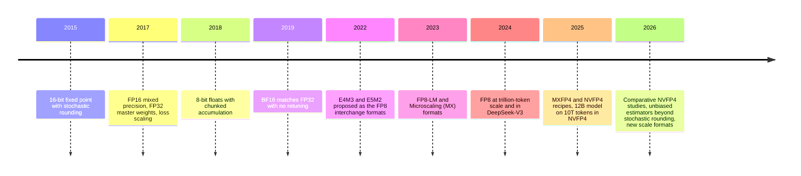
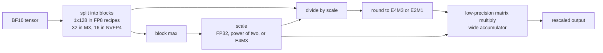

# Low-precision training: FP8, microscaling and 4-bit pretraining

A matrix multiply in 8 bits moves half the bytes of one in 16 bits, and on recent accelerators it also runs at twice the arithmetic rate. In 4 bits the factor doubles again: NVIDIA lists its Blackwell tensor cores at 2× BF16 throughput for MXFP8 and 4× (GB200) or 6× (GB300) for MXFP4 and NVFP4 (NVIDIA et al. 2025, Table 1). Those factors are the reason training has moved from FP32 to 16 bits, then to 8, and is now testing 4. The catch is that 4 bits can represent only fifteen distinct values, and a training run multiplies tensors whose entries span many orders of magnitude for trillions of tokens. This page explains how the field makes that work: where the bits go, why *scaling* matters more than the element format, why rounding has to be unbiased in the backward pass, and what is still unsettled.

> The core idea in one sentence: **a narrow number format is a ruler with very few marks, so low-precision training is mostly the art of choosing, block by block, where to put the ruler, and of rounding so that the errors cancel instead of accumulating.**

This page expands the short precision section of [hardware and training](hardware-and-training.md). It connects to [normalization, initialization and μP](../02-deep-learning/normalization-initialization-mup.md) (unit scaling), [scaling laws](../02-deep-learning/scaling-laws.md), [grokking](../02-deep-learning/grokking-and-delayed-generalization.md) (Softmax Collapse), [inference and efficiency](inference-and-efficiency.md) (post-training quantization) and [ML compilers](ml-compilers.md).

## 1. Where the bits go (established)

A floating-point number with $e$ exponent bits and $m$ mantissa bits stores $(-1)^s \, (1 + f/2^m) \, 2^{E - b}$, where $b = 2^{e-1} - 1$ is the exponent bias. Exponent bits buy **range** (how large and small a number can be); mantissa bits buy **resolution** (the relative gap between neighbouring values, about $2^{-m}$).

| Format | Exponent / mantissa | Largest finite value | Relative step | Typical role |
|---|---|---|---|---|
| FP32 | 8 / 23 | $\approx 3.4 \times 10^{38}$ | $2^{-23}$ | Master weights, accumulation, optimizer state |
| BF16 | 8 / 7 | $\approx 3.4 \times 10^{38}$ | $2^{-7}$ | Default training compute |
| FP16 | 5 / 10 | 65,504 | $2^{-10}$ | Mixed precision with loss scaling |
| FP8 E5M2 | 5 / 2 | 57,344 | $2^{-2}$ | Gradients in hybrid FP8 recipes |
| FP8 E4M3 | 4 / 3 | 448 | $2^{-3}$ | Weights and activations; all tensors in some recipes |
| FP4 E2M1 | 2 / 1 | 6 | $2^{-1}$ | Element type of MXFP4 and NVFP4 |

BF16 keeps FP32's eight exponent bits, so it has the same range and converting between them is simple. Kalamkar et al. (2019) showed that training with BF16 tensors matched FP32 results across image, speech, language, generative and recommendation models in the same number of iterations with no hyperparameter changes. FP16 has more resolution but far less range, which is why Micikevicius et al. (2017) needed **loss scaling** (multiplying the loss so small gradients do not underflow) alongside an FP32 master copy of the weights.

Micikevicius et al. (2022) proposed the two FP8 encodings now in hardware. E5M2 follows IEEE conventions; E4M3 drops infinities and keeps a single NaN pattern to stretch its range to 448. They matched 16-bit training quality on CNNs, RNNs and transformers up to 175B parameters with hyperparameters unchanged. FP4 E2M1 is coarser than any of these: its only non-negative values are $0, 0.5, 1, 1.5, 2, 3, 4, 6$.

## 2. A short history of going lower (established)

- **16-bit fixed point (2015).** Gupta et al. trained deep networks with 16-bit fixed-point numbers and found that the *rounding scheme* decided whether training worked: with stochastic rounding there was little or no accuracy loss.
- **Mixed precision (2017).** Micikevicius et al.: FP16 storage and arithmetic, an FP32 master copy that accumulates updates, and loss scaling. Nearly 2× less memory.
- **8-bit floats (2018–2022).** Wang et al. (2018) trained with 8-bit floats and cut the precision of additions to 16 bits using *chunk-based accumulation* and floating-point stochastic rounding. Noune et al. (2022) studied exponent and mantissa widths and exponent biases for 8-bit formats and found choices that trained without accuracy loss.
- **FP8 for large language models (2023–2024).** FP8-LM (Peng et al. 2023) extended FP8 to gradients, optimizer states and distributed communication, reporting 39% less memory and 75% faster training than BF16 Megatron-LM on GPT-175B on H100s. DeepSeek-V3 (DeepSeek-AI 2024) trained a 671B-parameter mixture-of-experts model with FP8 matrix multiplies; on smaller validation models trained for about 1 trillion tokens, its relative loss error versus BF16 stayed below 0.25%.
- **Microscaling and 4 bits (2023–2026).** Rouhani et al. (2023) evaluated the block-scaled MX formats across more than two dozen benchmarks and trained generative language models with sub-8-bit weights, activations and gradients. In 2025 three groups reported FP4 training recipes for billion-parameter models (Section 5), and NVIDIA trained a 12B model on 10 trillion tokens in NVFP4.



## 3. Scaling: putting the ruler in the right place (established)

A narrow format can only represent values near its sweet spot, so every tensor is divided by a **scale factor** $s$ before rounding and multiplied back afterwards:

```math
\hat{x} = s \cdot Q\!\left(\frac{x}{s}\right), \qquad s = \frac{\max_{i \in \text{block}} |x_i|}{q_{\max}},
```

where $Q$ rounds to the format and $q_{\max}$ is its largest value (448 for E4M3, 6 for E2M1). The question is how many values share one scale.

- **Per tensor.** One scale for the whole tensor. Early FP8 recipes used *delayed scaling*, inferring the scale from a history of maxima in previous iterations (DeepSeek-AI 2024 describes this as the approach of prior FP8 frameworks).
- **Per tile or block.** DeepSeek-V3 scales activations per $1 \times 128$ tile (one token, 128 channels) and weights per $128 \times 128$ block, computing each maximum online. The reason is **outliers**: language-model activations contain a few channels with very large values, and under a single scale they force every ordinary value into the bottom few steps of the format.
- **Microscaling (MX).** The Open Compute Project MX formats fix the block at 32 consecutive elements sharing one 8-bit power-of-two scale (UE8M0), with FP8, FP6, FP4 or INT8 elements (Rouhani et al. 2023).
- **NVFP4.** Blocks of 16 E2M1 elements share a scale stored in E4M3 rather than as a power of two, plus a second FP32 scale per tensor that keeps the block scales in range. Smaller blocks narrow the range each scale must cover, and E4M3 scales land closer to the true block maximum than a power of two can (NVIDIA et al. 2025).



Range explains why per-tensor scaling was often good enough in FP8 but fails in FP4. E4M3 spans about 17 binades (factors of two) between its smallest subnormal and 448, so an outlier 60 times larger than ordinary values still leaves them plenty of room. E2M1 spans fewer than four binades, so the same outlier rounds every ordinary value to zero. Part 1 of the sketch below shows exactly this.

## 4. Rounding and accumulation: where errors pile up (established)

Scaling decides *which* values a tensor can represent. Two other mechanisms decide whether the many small errors of a training run cancel or add up.

**Swamping.** Adding a small update $u$ to a weight $w$ does nothing if $u$ is less than half the gap between $w$ and its neighbour. In BF16 that gap at $w = 1$ is $2^{-7} \approx 0.0078$, so an update of $10^{-4}$ is lost every time, however many times it is applied. Master weights in FP32 avoid this (Micikevicius et al. 2017), which is why every recipe on this page keeps them.

**Stochastic rounding.** Rounding $x$ between neighbours $a < x < b$ up with probability $(x - a)/(b - a)$ makes the rounded value correct on average:

```math
\mathbb{E}[Q_{\mathrm{SR}}(x)] = a \cdot \frac{b - x}{b - a} + b \cdot \frac{x - a}{b - a} = x.
```

Round-to-nearest has lower error per value but a **bias** that depends on the data: values below half a step are always lost. Stochastic rounding trades extra variance for zero bias, which is what made Gupta et al.'s 16-bit fixed-point training work and is central to the 4-bit recipes below.

**Accumulation width.** A matrix multiply with inner dimension $K$ sums $K$ products. DeepSeek-AI (2024) reports that FP8 matrix multiplies on H800 tensor cores keep only about 14 bits when adding, and that for $K = 4096$ this limited precision gave a maximum relative error of nearly 2% in their test. Their fix is to copy partial sums to FP32 registers on the CUDA cores every $N_C = 128$ elements (four WGMMA instructions), which they found was the shortest interval that improved precision substantially without much overhead. Wang et al. (2018) used the same idea, chunk-based accumulation, to train with 16-bit additions. Because fine-grained scaling and promotion recovered enough accuracy, DeepSeek-V3 used E4M3 for all tensors rather than the hybrid E4M3 forward / E5M2 backward scheme of earlier work.

## 5. Four bits: what recipes need (active research)

Every FP4 training recipe so far keeps master weights, optimizer state and some layers in higher precision and puts the matrix multiplies (the GEMMs) of linear layers into FP4. A training step has three GEMMs per linear layer: the forward pass (Fprop), the activation gradient (Dgrad) and the weight gradient (Wgrad). The recipes differ in what they do to each.

| Work | Format | Key techniques | Scale reported |
|---|---|---|---|
| Wang et al. (2025) | FP4 | Differentiable quantization estimator; outlier clamping and compensation; vector-wise quantization; mixed precision | Up to 13B parameters, 100B tokens; comparable to BF16 and FP8 |
| Tseng, Yu and Park (2025) | MXFP4 | Stochastic rounding for unbiased gradients; random Hadamard transform to bound its variance | GPT models up to 6.7B; more than half of training FLOPs in MXFP4; estimated >1.3× over FP8 and >1.7× over BF16 in backpropagation |
| Castro et al. (2025), Quartet | FP4 on Blackwell | All linear-layer computations in FP4; a low-precision scaling law to pick the accuracy–compute trade-off | Llama-type models; argue fully FP4 training is competitive with FP16 and FP8 |
| Chmiel et al. (2025) | NVFP4 (found best among block and scale choices) | Stochastic rounding in backward and update passes, round-to-nearest forward | 7B parameters, 200B tokens on 256 Gaudi2; downstream comparable to BF16 |
| NVIDIA et al. (2025) | NVFP4 | 16 × 16 random Hadamard transforms on Wgrad inputs; 2D 16 × 16 weight scaling so forward and backward see the same quantized weights; stochastic rounding on gradients; about 15% of linear layers in BF16, mostly at the end | 12B hybrid Mamba-Transformer on 10T tokens; MMLU-Pro 62.58% vs 62.62% for FP8 |

Three findings recur.

**The forward pass wants low error; the backward pass wants no bias.** Panferov et al. (2026) summarize the emerging consensus: forward-pass quantization should minimize mean-squared error, while biased gradient estimators accumulate systematic error over many steps, so the backward pass needs unbiased (or carefully controlled) quantization. Chmiel et al. add a threshold: once the gradient norm falls below about $\sqrt{3}$ times the quantization noise, quantized training becomes less effective.

**Outliers inside a block are the enemy of stochastic rounding.** Stochastic rounding is unbiased but its variance grows with the block's scale, so one large value in a block makes every other value noisy. Tseng et al. apply a random Hadamard transform, an orthogonal rotation that spreads an outlier's energy across the block, and prove that this bounds the variance. NVIDIA's ablations on the 12B model found that removing stochastic rounding, the Hadamard transforms, 2D scaling or the BF16 layers each made convergence worse.

**NVFP4's small blocks and finer scales are worth real tokens.** In NVIDIA's comparison on an 8B model, MXFP4 reached a relative loss error of about 2.5% against 1.5% for NVFP4 and needed 36% more tokens (1.36T instead of 1T) to match NVFP4's loss.

### 2026: the recipes start to disagree

- **Better unbiased estimators.** Quartet II (Panferov et al. 2026) introduces MS-EDEN, an unbiased quantizer for micro-scaled formats with more than 2× lower error than stochastic rounding, and reports kernels up to 4.2× faster than BF16, validated on models up to 1.9B parameters and 38B tokens.
- **A systematic comparison.** Agrusa et al. (2026) compare NVFP4 recipes on dense 8B and 30B-A3B mixture-of-experts models trained to 1T tokens, keeping the last 15% of the network in BF16. On the dense model their recipe finished with less than a 1.2% relative training-loss gap to BF16, 0.24 percentage points better than the previous recipe. Selective high-precision layers were necessary, and not every backward-pass tensor benefited equally from de-biasing.
- **Which GEMM breaks.** Cim et al. (2026) trained Llama 3.1-8B on C4 with native MXFP4 on AMD MI355X GPUs and enabled FP4 one GEMM at a time. Relative to FP8, FP4 in Fprop cost 8–9% more tokens to reach the target perplexity, Fprop plus Dgrad 10–11%, and adding Wgrad 26–27%. In their setup stochastic rounding and *randomized* Hadamard rotations failed to converge once Wgrad was in FP4, while a *deterministic* Hadamard rotation restored stable training at an 8–9% overhead. That conflicts with Tseng et al.'s recipe; the authors note that FP4 behaviour varies across models, datasets and methods.
- **A different scale format.** Hu, Luschi and Balanca (2026) pair E2M1 elements with unsigned E5M3 block scales, whose wider range permits periodic rather than current tensor scaling. In software emulation on a Nemotron-H 8B model trained for nearly 190B tokens, their recipe omitted the Hadamard transform, put all 112 eligible internal linear layers in FP4, and finished with a lower training loss than the Transformer Engine NVFP4 recipe (2.3090 vs 2.3474). In a separate native NVFP4 ablation, removing both the Hadamard transform and the BF16 final-block exemption raised model-body token throughput by 21.2%, which is the cost those safeguards impose.

## 6. How many bits should training use? (active research)

Kumar et al. (2024) fit "precision-aware" scaling laws on more than 465 pretraining runs (validated up to 1.7B parameters and 26B tokens). Training in lower precision acts like reducing the model's **effective parameter count**, $N_{\text{eff}}$, so the Chinchilla-style loss becomes

```math
L(N, D, P_{\text{train}}, P_{\text{post}}) = A\, N_{\text{eff}}^{-\alpha} + B\, D^{-\beta} + E + \delta_{\text{PTQ}},
```

where $\delta_{\text{PTQ}}$ is the extra loss from quantizing after training. Two consequences. First, when model size, data and precision are chosen together, their fits put compute-optimal training precision at about **7–8 bits** (with integer-type quantization), independent of the compute budget: 16 bits wastes bits, and 4 bits needs a disproportionately larger model. Second, the damage from post-training quantization *grows* with the amount of training data, so for a model that will be quantized afterwards, more pretraining data can eventually make it worse.

These laws were fit on integer quantization at small scale, before the block-scaled FP4 recipes above existed. Castro et al. (2025) fit their own low-precision scaling law for FP4 training and use it to argue that fully FP4 training can be the better accuracy–compute trade-off. Which one describes trillion-token runs is not settled.

## 7. Stability over long runs (established and active research)

Short runs hide problems that long runs reveal.

- **Outliers that grow.** Fishman et al. (2024) trained FP8 models on up to 2 trillion tokens and found instabilities that shorter runs never showed: a divergence after about 220B tokens. They traced it to SwiGLU amplifying outliers, linked to a weight-alignment process under $\ell_2$ regularization that appears only after prolonged training, and fixed it with **Smooth-SwiGLU**, which leaves the function unchanged. They also quantized both Adam moments to FP8 and reached BF16 quality on a 7B model with up to about 34% higher throughput.
- **Keeping magnitudes small by design.** Wortsman et al. (2023) trained CLIP ViT-Huge with an int8 linear layer (SwitchBack), 13–25% faster and within 0.1 percentage points of BF16. They found that standard float8 techniques also work if the network is initialized to discourage large feature magnitudes, using layer-scale initialized at zero. Unit scaling and u-μP (Blake et al. 2024) push the same idea into the parametrization, so that activations, weights and gradients start at scale one and models work in FP8 out of the box.
- **Late-phase drift.** In NVIDIA's 12B run, NVFP4's relative loss error stayed below 1% through the stable phase of training and widened to slightly above 1.5% as the learning rate was decayed at the end. A small late divergence like this is consistent with Chmiel et al.'s threshold: late in training, gradients shrink towards the quantization noise.

## 8. A tested sketch

The code simulates the formats from Section 1 in NumPy and isolates the mechanisms from Sections 3–5. All data is synthetic; the point is the mechanisms, not the numbers.

- **Part 1** quantizes a $1024 \times 4096$ activation matrix in which 16 channels (0.4%) are 60× larger than the rest, and reports relative RMS error separately for ordinary and outlier channels, plus the share of ordinary values that become zero.
- **Part 2** adds an update of $10^{-4}$ to a weight of 1.0 ten thousand times, stored in BF16 with round-to-nearest, in FP32, and in BF16 with stochastic rounding (1,000 copies).
- **Part 3** sums $K = 4096$ products of E4M3 inputs with a toy accumulator that truncates to 14 significant bits after every addition, with and without promoting the partial sum to FP32 every 128 elements. The truncating accumulator is a simplification of DeepSeek-AI's description of the hardware, not a model of it.
- **Part 4** computes a weight-gradient-like average $x^\top \delta / T$ where $\delta$ contains a small signal correlated with $x$ plus rare large values that are not, quantized in NVFP4 blocks of 16 along the token axis with round-to-nearest or stochastic rounding.

```python
import numpy as np
rng = np.random.default_rng(0)

def fp_grid(e, m, maxval):
    """Non-negative values of a float format with e exponent and m mantissa bits."""
    bias = 2 ** (e - 1) - 1
    vals = set()
    for E in range(2 ** e):
        for M in range(2 ** m):
            vals.add((M / 2 ** m) * 2.0 ** (1 - bias) if E == 0 else (1 + M / 2 ** m) * 2.0 ** (E - bias))
    vals = np.array(sorted(vals))
    return vals[vals <= maxval]
E4M3 = fp_grid(4, 3, 448.0)
E2M1 = fp_grid(2, 1, 6.0)          # 0, 0.5, 1, 1.5, 2, 3, 4, 6

def _neighbours(x, grid):
    a = np.minimum(np.abs(x), grid[-1])
    idx = np.clip(np.searchsorted(grid, a), 1, len(grid) - 1)
    return a, grid[idx - 1], grid[idx]
def q_rtn(x, grid):
    a, lo, hi = _neighbours(x, grid)
    return np.sign(x) * np.where(a - lo <= hi - a, lo, hi)
def q_sr(x, grid, rng):
    a, lo, hi = _neighbours(x, grid)
    return np.sign(x) * np.where(rng.random(a.shape) < (a - lo) / (hi - lo), hi, lo)

def blockq(x, grid, B, scale_kind, sr=False, rng=None):
    """Quantize blocks of B along the last axis. scale_kind: 'fp32', 'pow2' (MX), 'e4m3' (NVFP4)."""
    R, K = x.shape
    xb = x.reshape(R, K // B, B)
    amax = np.abs(xb).max(-1, keepdims=True) + 1e-30
    if scale_kind == 'pow2':
        s = 2.0 ** (np.floor(np.log2(amax)) - np.floor(np.log2(grid[-1])))
    elif scale_kind == 'e4m3':
        ts = np.abs(x).max() / (grid[-1] * 448.0)           # per-tensor FP32 scale
        s = q_rtn(amax / grid[-1] / ts, E4M3) * ts           # block scale stored in E4M3
        s = np.where(s == 0, amax / grid[-1], s)
    else:
        s = amax / grid[-1]
    y = xb / s
    return ((q_sr(y, grid, rng) if sr else q_rtn(y, grid)) * s).reshape(R, K)

def rel_rmse(a, b): return np.sqrt(np.mean((a - b) ** 2) / np.mean(b ** 2))
def hadamard(n):
    H = np.array([[1.0]])
    while H.shape[0] < n: H = np.block([[H, H], [H, -H]])
    return H / np.sqrt(n)

# ---------- Part 1: scale granularity with outlier channels ----------
T, K = 1024, 4096
X = rng.standard_normal((T, K))
out = rng.choice(K, size=16, replace=False); X[:, out] *= 60.0
ordinary = np.ones(K, bool); ordinary[out] = False
def report(name, Q):
    print(f"{name:30s} ordinary {rel_rmse(Q[:, ordinary], X[:, ordinary]):.3f}  "
          f"outlier {rel_rmse(Q[:, out], X[:, out]):.3f}  ordinary->0 {np.mean(Q[:, ordinary] == 0):.3f}")
report('E4M3, one scale per tensor', blockq(X.reshape(1, -1), E4M3, T * K, 'fp32').reshape(T, K))
report('E4M3, 1x128 tiles', blockq(X, E4M3, 128, 'fp32'))
report('E2M1, one scale per tensor', blockq(X.reshape(1, -1), E2M1, T * K, 'fp32').reshape(T, K))
report('MXFP4 (32, power-of-two)', blockq(X, E2M1, 32, 'pow2'))
report('NVFP4 (16, E4M3 + FP32)', blockq(X, E2M1, 16, 'e4m3'))
RH = np.diag(rng.choice([-1.0, 1.0], 16)) @ hadamard(16)
Xr = (X.reshape(T, K // 16, 16) @ RH).reshape(T, K)
report('NVFP4 + random Hadamard (16)', (blockq(Xr, E2M1, 16, 'e4m3').reshape(T, K // 16, 16) @ RH.T).reshape(T, K))
G = rng.standard_normal((T, K))
print(f"no outliers: MXFP4 {rel_rmse(blockq(G, E2M1, 32, 'pow2'), G):.3f}  NVFP4 {rel_rmse(blockq(G, E2M1, 16, 'e4m3'), G):.3f}")

# ---------- Part 2: swamping and stochastic rounding ----------
def to_bf16(x):                      # round-to-nearest-even FP32 -> BF16
    i = np.asarray(x, np.float32).view(np.uint32).astype(np.uint64)
    return (((i + 0x7FFF + ((i >> 16) & 1)) >> 16) << 16).astype(np.uint32).view(np.float32)
def bf16_sr(x, rng):                 # stochastic rounding FP32 -> BF16
    i = np.asarray(x, np.float32).view(np.uint32).astype(np.uint64)
    i = (i + rng.integers(0, 1 << 16, size=i.shape, dtype=np.uint64)) >> 16 << 16
    return i.astype(np.uint32).view(np.float32)
u = np.float32(1e-4)
w_rn, w_master, w_sr = np.float32(1.0), np.float32(1.0), np.ones(1000, np.float32)
for _ in range(10000):
    w_rn = to_bf16(w_rn + u); w_master = np.float32(w_master + u); w_sr = bf16_sr(w_sr + u, rng)
print(f"target 2.0000 | BF16 nearest {float(w_rn):.4f} | FP32 {float(w_master):.4f} | "
      f"BF16 stochastic mean {w_sr.mean():.4f} sd {w_sr.std():.4f}")

# ---------- Part 3: accumulator width ----------
def trunc_bits(x, b):
    m, e = np.frexp(x); return np.ldexp(np.trunc(m * 2 ** b) / 2 ** b, e)
K = 4096; errs = {'14-bit accumulator': [], 'promote every 128': []}
for t in range(100):
    a = q_rtn(np.abs(rng.standard_normal(K)) * rng.choice([1, 1, 1, -1], K), E4M3)
    b = q_rtn(np.abs(rng.standard_normal(K)), E4M3)
    p = a * b; exact = p.astype(np.float64).sum()
    acc = 0.0
    for x in p: acc = trunc_bits(acc + x, 14)
    errs['14-bit accumulator'].append(abs(acc - exact) / abs(exact))
    tot = np.float32(0)
    for c in range(0, K, 128):
        acc = 0.0
        for x in p[c:c + 128]: acc = trunc_bits(acc + x, 14)
        tot = np.float32(tot + np.float32(acc))
    errs['promote every 128'].append(abs(float(tot) - exact) / abs(exact))
for k, v in errs.items():
    v = np.array(v); print(f"{k:20s} mean rel. error {v.mean()*100:.3f}%  max {v.max()*100:.3f}%")

# ---------- Part 4: bias in a quantized weight gradient ----------
dout = 64
for T in [1024, 16384, 65536]:
    x = rng.standard_normal((T, 1))
    sig = 0.05 * x @ np.ones((1, dout))                                       # small, consistent signal
    spikes = (rng.random((T, dout)) < 1 / 16) * rng.standard_normal((T, dout)) * 3.0   # rare large values
    dY = sig + spikes
    true = (x.T @ sig / T).mean()
    q = lambda m, sr: blockq(m.T, E2M1, 16, 'e4m3', sr=sr, rng=rng).T         # NVFP4 blocks along tokens
    line = f"T={T:6d}  unquantized {(x.T @ dY / T).mean() / true:.3f}"
    for name, sr in [('round-to-nearest', False), ('stochastic', True)]:
        line += f"  {name} {(x.T @ q(dY, sr) / T).mean() / true:.3f}"
    print(line)
```

Output (NumPy, seed 0; runs in a few seconds):

```text
E4M3, one scale per tensor     ordinary 0.026  outlier 0.027  ordinary->0 0.000
E4M3, 1x128 tiles              ordinary 0.026  outlier 0.006  ordinary->0 0.000
E2M1, one scale per tensor     ordinary 1.000  outlier 0.126  ordinary->0 1.000
MXFP4 (32, power-of-two)       ordinary 0.297  outlier 0.132  ordinary->0 0.171
NVFP4 (16, E4M3 + FP32)        ordinary 0.212  outlier 0.027  ordinary->0 0.109
NVFP4 + random Hadamard (16)   ordinary 0.285  outlier 0.061  ordinary->0 0.025
no outliers: MXFP4 0.115  NVFP4 0.095
target 2.0000 | BF16 nearest 1.0000 | FP32 2.0002 | BF16 stochastic mean 2.0036 sd 0.0925
14-bit accumulator   mean rel. error 6.953%  max 7.597%
promote every 128    mean rel. error 0.061%  max 0.069%
T=  1024  unquantized 0.910  round-to-nearest 0.590  stochastic 0.902
T= 16384  unquantized 0.985  round-to-nearest 0.664  stochastic 0.986
T= 65536  unquantized 1.004  round-to-nearest 0.684  stochastic 1.001
```

### Reading the results

- **Range decides whether a single scale survives an outlier.** In E4M3 a per-tensor scale costs the ordinary channels nothing in this example (relative error 0.026 either way); tiles only help the outlier channels (0.027 → 0.006). In E2M1 the same per-tensor scale rounds **every** ordinary value to zero (error 1.000). Block scaling rescues FP4: MXFP4 brings ordinary-channel error to 0.297 and NVFP4's smaller blocks and E4M3 scales to **0.212**, with NVFP4 also better without outliers (0.095 vs 0.115).
- **A rotation is not free.** The random Hadamard transform cuts the share of ordinary values flushed to zero from 0.109 to 0.025, but raises the forward-pass error in this example (0.212 → 0.285) because every value in a block with an outlier now shares the outlier's magnitude. That fits the recipes' choice to apply rotations to the weight-gradient GEMM, where the goal is bounding stochastic-rounding variance rather than minimizing forward error, though this toy does not test that use.
- **Swamping is total.** Ten thousand updates of $10^{-4}$ leave a BF16 weight at exactly **1.0000**, while FP32 reaches 2.0002. Stochastic rounding recovers the right value on average (2.0036) at the cost of a spread of 0.0925 across copies.
- **Promotion fixes accumulation.** The truncating 14-bit accumulator is off by **6.95%** on average for these positive-leaning sums; promoting every 128 elements brings the error to **0.061%**. The toy's error is larger than DeepSeek-AI's nearly 2% maximum because it truncates every addition and uses inputs that do not cancel; only the direction of the effect carries over.
- **Bias does not average away.** With round-to-nearest, the quantized gradient recovers only **0.59–0.68** of the true signal no matter how many tokens are averaged, because small values that share a block with a large one are rounded to zero every time. Stochastic rounding tracks the unquantized estimate (0.902 vs 0.910, 0.986 vs 0.985, 1.001 vs 1.004). This is the reason the 4-bit recipes use unbiased quantization on gradients.

## 9. Status at a glance

| Question | Status |
|---|---|
| BF16 matches FP32 for training without retuning | Established (Kalamkar et al. 2019) |
| FP8 matrix multiplies match 16-bit quality at frontier scale | Established with fine-grained scaling and wide accumulation (Micikevicius et al. 2022; DeepSeek-AI 2024) |
| FP8 stays stable over trillions of tokens | Established with fixes for late outlier growth (Fishman et al. 2024) |
| FP4 pretraining close to FP8 at 10T tokens | Demonstrated once at 12B with about 15% of layers in BF16 (NVIDIA et al. 2025) |
| NVFP4 beats MXFP4 | Supported by direct comparisons (NVIDIA et al. 2025; Chmiel et al. 2025) |
| Stochastic rounding and random rotations are the right backward-pass fix | Contested (Tseng et al. 2025 vs Cim et al. 2026); better unbiased estimators are emerging (Panferov et al. 2026) |
| Which layers must stay in high precision | Open; recipes keep 15–16%, while Hu et al. (2026) remove the exemption with a wider scale format |
| Compute-optimal training precision | Open: about 7–8 bits in integer-quantization fits (Kumar et al. 2024), more optimistic for FP4 in Castro et al. (2025) |
| Whether precision changes *what* a model learns late in training | Open (Section 10) |

## 10. Speculative: precision and late-phase learning

*These are hypotheses, not results.*

- **Precision as a late-phase hyperparameter.** NVIDIA's NVFP4 gap widened during learning-rate decay, and Chmiel et al. tie quantized training's effectiveness to the ratio of gradient norm to quantization noise. Late training is exactly when gradients are small and, in [grokking](../02-deep-learning/grokking-and-delayed-generalization.md), when slow generalizing structure forms. A testable hypothesis: lower training precision shortens or suppresses grokking-like late generalization unless the final phase is run at higher precision. Switching precision on a schedule, the way learning rate is scheduled, is a cheap experiment.
- **Logit saturation in narrow formats.** Prieto et al. (2025) showed that float32 softmax can return exactly zero gradient once logits grow large (Softmax Collapse). If logits or attention scores were ever computed in 8-bit or narrower formats, the same failure would arrive far earlier; every recipe on this page keeps these in higher precision, and whether stable softmax variants would let them move lower is untested.
- **Noise as a feature.** Stochastic rounding injects zero-mean noise into every update. Whether that noise acts like the minibatch noise of SGD, with its own implicit regularization, or only adds variance, has not been measured at scale.
- **Analog and optical hardware.** Physical substrates such as [memristive crossbars](../06-frontiers/memristive-crossbars-in-memory-computing.md) and [photonic processors](../06-frontiers/photonic-computing.md) have an effective precision of a few bits plus noise. The digital recipes here (block scaling, unbiased rounding, wide accumulation, a few protected layers) are a plausible template for training on them, with the block scale replaced by a calibrated gain.

## Further reading

- Gupta, S., Agrawal, A., Gopalakrishnan, K., Narayanan, P. (2015). *Deep learning with limited numerical precision*. ICML. [arXiv:1502.02551](https://arxiv.org/abs/1502.02551)
- Micikevicius, P., et al. (2017). *Mixed precision training*. ICLR 2018. [arXiv:1710.03740](https://arxiv.org/abs/1710.03740)
- Wang, N., Choi, J., Brand, D., Chen, C.-Y., Gopalakrishnan, K. (2018). *Training deep neural networks with 8-bit floating point numbers*. NeurIPS. [arXiv:1812.08011](https://arxiv.org/abs/1812.08011)
- Kalamkar, D., et al. (2019). *A study of BFLOAT16 for deep learning training*. [arXiv:1905.12322](https://arxiv.org/abs/1905.12322)
- Noune, B., Jones, P., Justus, D., Masters, D., Luschi, C. (2022). *8-bit numerical formats for deep neural networks*. [arXiv:2206.02915](https://arxiv.org/abs/2206.02915)
- Micikevicius, P., et al. (2022). *FP8 formats for deep learning*. [arXiv:2209.05433](https://arxiv.org/abs/2209.05433)
- Wortsman, M., Dettmers, T., Zettlemoyer, L., Morcos, A., Farhadi, A., Schmidt, L. (2023). *Stable and low-precision training for large-scale vision-language models*. NeurIPS. [arXiv:2304.13013](https://arxiv.org/abs/2304.13013)
- Rouhani, B. D., et al. (2023). *Microscaling data formats for deep learning*. [arXiv:2310.10537](https://arxiv.org/abs/2310.10537)
- Peng, H., et al. (2023). *FP8-LM: Training FP8 large language models*. [arXiv:2310.18313](https://arxiv.org/abs/2310.18313)
- Blake, C., et al. (2024). *u-μP: The unit-scaled maximal update parametrization*. [arXiv:2407.17465](https://arxiv.org/abs/2407.17465)
- Fishman, M., Chmiel, B., Banner, R., Soudry, D. (2024). *Scaling FP8 training to trillion-token LLMs*. ICLR 2025. [arXiv:2409.12517](https://arxiv.org/abs/2409.12517)
- Kumar, T., et al. (2024). *Scaling laws for precision*. ICLR 2025. [arXiv:2411.04330](https://arxiv.org/abs/2411.04330)
- DeepSeek-AI (2024). *DeepSeek-V3 technical report*. [arXiv:2412.19437](https://arxiv.org/abs/2412.19437)
- Prieto, L., Barsbey, M., Mediano, P. A. M., Birdal, T. (2025). *Grokking at the edge of numerical stability*. ICLR. [arXiv:2501.04697](https://arxiv.org/abs/2501.04697)
- Wang, R., et al. (2025). *Optimizing large language model training using FP4 quantization*. [arXiv:2501.17116](https://arxiv.org/abs/2501.17116)
- Tseng, A., Yu, T., Park, Y. (2025). *Training LLMs with MXFP4*. [arXiv:2502.20586](https://arxiv.org/abs/2502.20586)
- Castro, R. L., et al. (2025). *Quartet: Native FP4 training can be optimal for large language models*. [arXiv:2505.14669](https://arxiv.org/abs/2505.14669)
- Chmiel, B., Fishman, M., Banner, R., Soudry, D. (2025). *FP4 all the way: Fully quantized training of LLMs*. [arXiv:2505.19115](https://arxiv.org/abs/2505.19115)
- NVIDIA, Abecassis, F., et al. (2025). *Pretraining large language models with NVFP4*. [arXiv:2509.25149](https://arxiv.org/abs/2509.25149)
- Panferov, A., Schultheis, E., Tabesh, S., Alistarh, D. (2026). *Quartet II: Accurate LLM pre-training in NVFP4 by improved unbiased gradient estimation*. [arXiv:2601.22813](https://arxiv.org/abs/2601.22813)
- Cim, M., et al. (2026). *Pretraining large language models with MXFP4 on native FP4 hardware*. [arXiv:2605.09825](https://arxiv.org/abs/2605.09825)
- Hu, R., Luschi, C., Balanca, P. (2026). *UE5M3 FP4 block scaling for stable language model pretraining*. [arXiv:2609.02846](https://arxiv.org/abs/2609.02846)
- Agrusa, A., et al. (2026). *What matters for NVFP4 training? A comparative study of low-precision pretraining recipes*. [arXiv:2610.24343](https://arxiv.org/abs/2610.24343)
