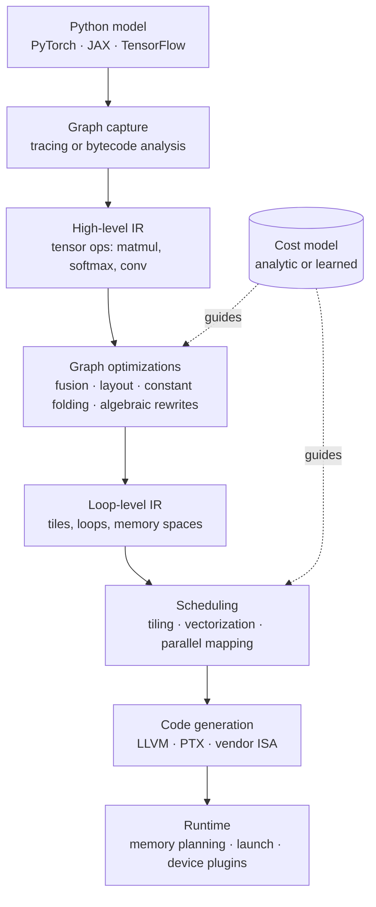

# Compilers for machine learning

A neural network is written once, in a few lines of Python. It then has to run on CPUs, GPUs, TPUs, phones, and increasingly exotic accelerators, each with its own memory hierarchy, instruction set, and numerical formats. The piece of software that closes this gap is the **ML compiler**. It is quiet, unglamorous, and one of the main reasons modern models are affordable to train and serve.

> The core idea in one sentence: **describe *what* to compute as a graph of tensor operations, then let a compiler decide *how*: which operations to merge, how to tile them into fast memory, and which hardware instructions to emit.**

## Why a compiler at all (established)

The [roofline model](hardware-and-training.md#the-roofline-model) says a kernel is limited either by arithmetic or by memory bandwidth. Most operations in a transformer other than the large matrix multiplies are memory-bound, so the dominant cost is **moving bytes**, not doing arithmetic. A framework that runs each operation as a separate kernel writes every intermediate result to off-chip memory and reads it back. A compiler that sees the whole graph can avoid that.

### Fusion, quantified

Take a chain of $k$ elementwise operations on a tensor of $N$ half-precision values (2 bytes each), for example `bias → GELU → scale → dropout`. Run as separate kernels, each reads and writes the full tensor:

```math
\text{bytes}_{\text{unfused}} = k \cdot (2N + 2N) = 4kN
```

Fused into one kernel, the tensor is read once and written once, with intermediates kept in registers:

```math
\text{bytes}_{\text{fused}} = 4N
```

The arithmetic is identical, so arithmetic intensity rises by a factor of $k$ and a memory-bound chain runs up to $k$ times faster. **Operator fusion** is the single most important optimization ML compilers perform.

### Tiling, quantified

For a matrix product $C = AB$ with $n \times n$ matrices, suppose a fast on-chip memory holds blocks of size $b \times b$. Computing $C$ one output tile at a time, each of the $(n/b)^2$ tiles streams $n/b$ tiles of $A$ and of $B$ through fast memory, so off-chip traffic is about

```math
\Big(\tfrac{n}{b}\Big)^2 \cdot 2\,\tfrac{n}{b} \cdot b^2 = \frac{2n^3}{b} \text{ elements},
```

against $2n^3$ floating-point operations. Intensity grows linearly with the tile size $b$. Choosing $b$, the loop order, and how tiles map onto threads, warps, and memory banks is exactly the decision a compiler (or a kernel author) must make for every operator and every chip. [FlashAttention](inference-and-efficiency.md) (Dao et al. 2022) applies the same reasoning to attention, tiling it so the full attention matrix is never written to off-chip memory.

## The anatomy of an ML compiler

Almost every ML compiler follows the same shape: capture a graph, optimize it at a high level, lower it step by step toward the hardware, and generate code.



**Intermediate representations (IRs)** are the key design choice. A high-level IR keeps the meaning of each operation (this is a softmax), which makes algebraic rewrites easy. A low-level IR exposes loops and memory, which makes scheduling possible. The compiler's job is **progressive lowering** from one to the other without losing the information each stage needs.

## The landmark systems

| System | Year | Key idea | Source |
|---|---|---|---|
| **Halide** | 2013 | Separate the *algorithm* (what to compute) from the *schedule* (loop order, tiling, parallelism) | Ragan-Kelley et al. 2013 |
| **TVM** | 2018 | End-to-end compiler from framework graphs to many hardware targets, with automated schedule search | Chen et al. 2018 |
| **AutoTVM** | 2018 | A learned statistical cost model guides search over billions of program variants | Chen et al. 2018b |
| **Relay** | 2019 | A functional, typed high-level IR for whole deep-learning programs | Roesch et al. 2019 |
| **TASO** | 2019 | Automatically generate and verify graph substitutions instead of hand-writing rewrite rules | Jia et al. 2019 |
| **Triton** | 2019 | Program GPUs at the level of *tiles*; the compiler handles what happens inside each tile | Tillet, Kung & Cox 2019 |
| **MLIR** | 2020 | Reusable compiler infrastructure built from extensible *dialects* at many levels of abstraction | Lattner et al. 2020 |
| **Ansor** | 2020 | Sample complete programs from a hierarchical search space, then fine-tune with a learned cost model | Zheng et al. 2020 |
| **PyTorch 2** | 2024 | Capture graphs from Python bytecode (TorchDynamo) and generate fused kernels (TorchInductor) | Ansel et al. 2024 |

### Algorithm versus schedule

Halide's insight underlies most of what followed. The *algorithm* for a blur or a matrix multiply is fixed; the *schedule* (tile sizes, loop order, which stages to fuse, what to parallelize) is a separate choice that changes performance by orders of magnitude without changing the result. Once the two are separate, the schedule becomes a search problem, and search can be automated.

### XLA and the JAX/TensorFlow path

**XLA** (Accelerated Linear Algebra) compiles graphs expressed in its HLO operation set, performing fusion and layout assignment before emitting code for CPUs, GPUs, and TPUs. JAX compiles through XLA by default. The [OpenXLA project](https://openxla.org/xla) now develops XLA in the open, together with **StableHLO**, a portable operation set that frameworks can target, and **PJRT**, a plugin interface through which a new hardware backend can plug into the frameworks without forking them.

### Triton: tiles as the unit of thought

Writing fast GPU code by hand means reasoning about individual threads, shared memory, and synchronization. Triton raises the abstraction to blocks of data. The programmer writes what happens to a tile; the compiler handles memory coalescing, shared-memory allocation, and scheduling within it. A fused add-and-ReLU kernel looks like this:

```python
import triton
import triton.language as tl

@triton.jit
def add_relu_kernel(x_ptr, y_ptr, out_ptr, n, BLOCK: tl.constexpr):
    pid = tl.program_id(axis=0)                 # which tile this program instance owns
    offs = pid * BLOCK + tl.arange(0, BLOCK)    # the indices in that tile
    mask = offs < n                             # guard the ragged last tile
    x = tl.load(x_ptr + offs, mask=mask)
    y = tl.load(y_ptr + offs, mask=mask)
    tl.store(out_ptr + offs, tl.maximum(x + y, 0.0), mask=mask)  # one read, one write
```

Triton matters beyond its own users: PyTorch 2's TorchInductor generates Triton code for GPUs, so many models compiled with `torch.compile` run on Triton kernels without their authors writing any. Ansel et al. (2024) report that TorchInductor gave a **2.27× inference and 1.41× training geometric-mean speedup** on an NVIDIA A100 across more than 180 real-world models.

### MLIR: a compiler for building compilers

Every new accelerator used to need its own compiler stack, re-implementing the same passes. MLIR (Lattner et al. 2020) instead provides a common framework in which each level of abstraction is a **dialect** (tensor operations, affine loops, GPU kernels, LLVM IR) and lowering is a sequence of dialect-to-dialect conversions. Its stated aim is to reduce software fragmentation and the cost of building domain-specific compilers for heterogeneous hardware, which is exactly the situation the [hardware frontiers](../06-frontiers/README.md) create.

## Searching for fast programs

The space of valid schedules for one operator is enormous, and the fastest choice depends on shapes and hardware. Learned search treats this as optimization:

```math
s^\star = \arg\min_{s \in \mathcal{S}} \; \hat{t}_\theta(s), \qquad \hat{t}_\theta \approx \text{measured runtime}
```

where $\mathcal{S}$ is the space of schedules and $\hat{t}_\theta$ is a cost model trained on measurements of programs already run on the device. AutoTVM (Chen et al. 2018b) showed that such a model, combined with transfer across workloads, could match hand-tuned vendor libraries on low-power CPUs, mobile GPUs, and server GPUs. Ansor (Zheng et al. 2020) widened the search by sampling whole programs from a hierarchical space rather than filling templates written by experts.

## Recent developments (active research)

- **Hand-written kernels still set the ceiling.** FlashAttention-3 (Shah et al. 2024) hand-tunes attention for newer GPUs using asynchrony and low precision, and ThunderKittens (Spector et al. 2024) argues that a few tile-based abstractions mapped to the warp, block, and grid levels of the GPU are enough to match or beat strong baselines.
- **Language models as kernel engineers.** KernelBench (Ouyang et al. 2025) evaluates models on writing correct, fast kernels for 250 PyTorch workloads. Out of the box, frontier reasoning models matched the PyTorch baseline in **fewer than 20% of cases**; results improved with execution and profiling feedback in an iterative loop. This is a concrete instance of the grounded [self-improvement loops](../06-frontiers/recursion-and-self-improvement.md) that work best when an external verifier (here a test harness and a profiler) supplies the signal.

## Compiling for unconventional hardware

Today's compilers assume digital hardware that computes exactly in a known number format. Analog, [photonic](../06-frontiers/photonic-computing.md), and [neuromorphic](../06-frontiers/neuromorphic-computing.md) accelerators break that assumption, and their software problems map directly onto compiler stages:

| Compiler stage | Digital accelerator | Analog or optical accelerator |
|---|---|---|
| Graph partitioning | Which ops go to which device | Which ops the physical core can execute at all, with a digital fallback for the rest |
| Tiling | Fit tiles into SRAM | Fit matrices onto a fixed-size physical array |
| Numerics | Pick FP16, BF16, FP8, INT8 | Treat effective precision and noise as properties of the hardware that must be measured |
| Code generation | Emit instructions | Emit device settings (for example phase values) valid for the current calibration |
| Verification | Bit-exact against a reference | Statistical agreement against a reference within an error budget |

> [!WARNING]
> **Speculative.** The ideas below are research directions, not established practice.

- **Noise and precision as types.** A compiler for analog hardware could carry an error budget through the graph the way a type system carries shapes, refusing or rerouting any lowering that would exceed it.
- **Calibration-aware runtimes.** Because physical devices drift, the "binary" for an analog accelerator may need to be re-derived from fresh calibration data at run time rather than compiled once.
- **Plugin interfaces as the on-ramp.** Interfaces such as PJRT and the device-extension mechanisms in PyTorch suggest that new hardware will win users by plugging into existing frameworks rather than asking people to rewrite models. Whether that is enough to overcome the [hardware lottery](README.md) (Hooker 2020) remains to be seen.

## Key takeaways

- ML compilers turn a hardware-independent graph into fast, hardware-specific code; their biggest lever is cutting memory traffic through **fusion** and **tiling**.
- Separating the algorithm from the schedule (Halide) turned performance tuning into a search problem that learned cost models (AutoTVM, Ansor) can automate.
- Triton, XLA, MLIR, and PyTorch 2 are today's mainstream stack; MLIR and plugin interfaces lower the cost of supporting new hardware.
- Language models can now write some kernels, but only reliably when a test harness and profiler keep them honest.
- Unconventional hardware turns precision, noise, and calibration into compiler problems, an open and fast-moving area.

All sources are listed under [Systems in REFERENCES.md](../../REFERENCES.md#systems).
