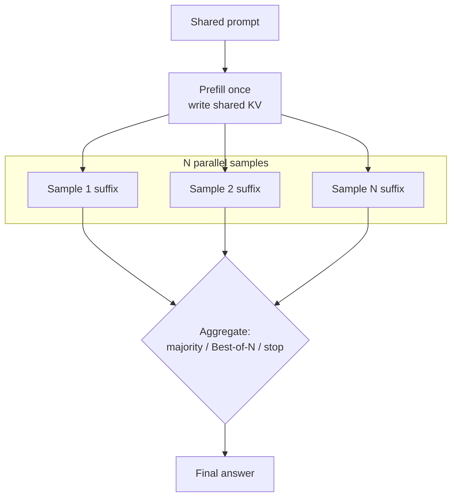

# Prefix-aware multi-sample reasoning serving

Self-consistency and Best-of-N do not ask a model to think once. They ask it to think *N* times from the same prompt and keep the answer that wins a vote or a verifier. That is a quality win—and a systems tax. Naively, *N* samples mean *N* prefills of the same prompt and *N* growing KV caches. **Prefix-aware multi-sample serving** collapses that redundancy: store the shared prompt once, schedule the *N* branches together, and (when the kernel allows) read the shared prefix once per decode step instead of *N* times. It sits next to [serving long-reasoning models](serving-long-reasoning-models.md) (one long trace) and [inference-time routing](inference-time-routing.md) (pick a model); here the model is fixed and the *sample fan-out* is the load.

> The core idea in one sentence: **when *N* reasoning traces share a prompt, share the KV of that prompt in memory *and* in the attention kernel, schedule the *N* branches as a group, and stop sampling once a majority is stable—so coverage and majority vote get cheaper without changing the model's distribution.**

This page expands the short notes on prefix sharing in [the KV cache](kv-cache.md) and on repeated sampling in [reasoning models](../03-modern-ai/reasoning-models-and-test-time-compute.md). It connects to [speculative decoding](speculative-decoding.md) (drafts from other paths), [serving long-reasoning models](serving-long-reasoning-models.md) (early exit on branches), and [inference and efficiency](inference-and-efficiency.md).



## 1. Why multi-sample reasoning is a serving problem (established)

Wang et al. (2022) introduced **self-consistency**: sample diverse chains of thought, parse each final answer, and take a majority vote. On GSM8K that raised accuracy by about 18 points over greedy CoT for PaLM-540B in their tables. **Best-of-N** instead ranks the *N* candidates with a verifier or reward model (Cobbe et al. 2021; Brown et al. 2024). **Large Language Monkeys** (Brown et al. 2024) measured the coverage side: with an exact checker, the fraction of problems solved by *at least one* sample grows roughly log-linearly with *N* over several orders of magnitude (DeepSeek-Coder-V2-Instruct on SWE-bench Lite: 15.9% at *N*=1 to 56% at *N*=250). Tree-of-Thoughts and similar search procedures (Yao et al. 2023) push the same pattern further: many branches share ancestors.

From a serving view the request is not one sequence. It is a **star** (one prompt, *N* independent completions) or a **tree** (shared prefixes that fork). Three costs dominate:

1. **Prefill.** Without sharing, the prompt is encoded *N* times.
2. **KV memory.** Without sharing, the prompt's keys and values are stored *N* times, so the number of concurrent multi-sample jobs that fit on a GPU falls by roughly the prompt's share of each sequence.
3. **Decode attention.** Even with shared *storage*, a naive kernel still *reads* the prefix KV once per sample per step—matrix–vector work that does not use tensor cores.

Those three are exactly what prefix-aware serving attacks. The aggregation rule (vote, verifier, early stop) is orthogonal and covered in §5.

## 2. Shared storage: one prompt, many suffixes (established)

Causal attention makes prefix KV identical across samples that share a token prefix. Systems exploit that at the memory layer:

| System | Mechanism | What it buys |
|---|---|---|
| **PagedAttention** (Kwon et al. 2023) | Block tables; copy-on-write when a sample diverges | Parallel sampling and beam search share physical blocks of the prompt |
| **Prompt Cache** (Gim et al. 2023) | Schema for reusable prompt modules with consistent positions | 8× (GPU) to 60× (CPU) lower time-to-first-token on long reusable prompts |
| **RadixAttention / SGLang** (Zheng et al. 2023) | Radix tree of finished caches; automatic longest-prefix match; LRU leaves | Up to 6.4× throughput across agent, reasoning, JSON and multi-turn workloads; natural fit for fork-style multi-sample programs |
| **ChunkAttention** (Ye et al. 2024) | Prefix tree inside the attention kernel | 3.2–4.8× faster self-attention with shared system prompts of 1,024–4,096 tokens |

For Best-of-N the win is mechanical: prefilling a 2,048-token prompt once instead of 64 times saves 63 prefills, and storing it once instead of 64 times cuts prompt KV by 64×. In the [tested sketch](#6-a-tested-sketch) below, with prompt 2,048 and generation 512, sharing drops relative KV footprint from 163,840 to 34,816 token-units (**4.7×**) and raises how many *N*=64 jobs fit in a fixed KV capacity by the same factor.

Sharing storage does **not** by itself fix decode attention: FlashAttention and PagedAttention still issue one matrix–vector product per sample over the shared prefix, re-reading the same bytes *N* times.

## 3. Shared compute: Hydragen and tree attention (established; active research)

**Hydragen** (Juravsky et al. 2024) attacks the read. It decomposes attention into a shared-prefix part and a per-sample suffix part, then **batches the *N* queries** against the single prefix KV:

$$
\mathrm{SDP}(Q, K, V)
=
\frac{
\mathrm{SDP}(Q,K_{\mathrm{pre}},V_{\mathrm{pre}})\,e^{\mathrm{LSE}(Q,K_{\mathrm{pre}})}
+
\mathrm{SDP}(Q,K_{\mathrm{suf}},V_{\mathrm{suf}})\,e^{\mathrm{LSE}(Q,K_{\mathrm{suf}})}
}{
e^{\mathrm{LSE}(Q,K_{\mathrm{pre}})} + e^{\mathrm{LSE}(Q,K_{\mathrm{suf}})}
}.
$$

The combination is exact (the same blocked-softmax identity FlashAttention uses). Inter-sequence batching turns *N* matrix–vector products over the prefix into one matrix–matrix product—tensor-core friendly and one HBM read of the prefix per step. On CodeLlama-13B, Hydragen reports up to **32×** end-to-end decode throughput versus vLLM when many completions share a long prompt; growing the shared prefix from 1K to 16K tokens cuts Hydragen throughput by less than 15% while vLLM drops by more than 90%. Hierarchical sharing (few-shot prompt shared globally, problem text shared per problem's candidates) cut APPS evaluation time by an extra **55%** over single-level sharing in their experiment.

**DeFT** (Yao et al. 2024) generalises the idea to deeper trees (Tree-of-Thoughts, speculative token trees): KV-guided grouping so a prefix is loaded once for all descendant queries, plus flattened tree splits for load balance. Against RadixAttention it reports up to **3.59×** attention and **2.23×** decode speedups on speculative-decoding workloads. The systems lesson is the same as Hydragen's: **sharing storage is necessary; sharing the prefix *read* is what unlocks large-*N* decode.**

Caveat that every status table should carry: suffix attention stays memory-bound, so as completions lengthen the Hydragen/DeFT advantage shrinks (visible in the sketch's suffix-length sweep).

## 4. Schedule the *N* together (active research)

Even with shared blocks, a first-come-first-served continuous batcher can interleave unrelated requests so that (a) a reusable prefix is evicted before its siblings arrive, and (b) the *N* samples never sit in the same decode batch. **BatchLLM** (Zheng et al. 2024) makes the batch's global prefix structure explicit: identify shared prefixes ahead of time, schedule **prefix-sharing groups** together so the shared KV's lifetime shrinks to the group's lifetime, reorder groups for better prefill/decode mixing, and form memory-centric token batches. On microbenchmarks and an industry snippet-generation workload it reports **1.3× to 10.8×** throughput over vLLM and SGLang, with the largest gains when many requests share a long prefix (e.g. 16K shared, share-degree 16).

The serving rule of thumb: **admit the *N* samples of one multi-sample job as a unit**, keep their shared prefix pinned until the group finishes or early-stops, and prefer packing those *N* into the same decode iteration so Hydragen-style kernels see a real shared prefix.

## 5. Adaptive budgets and multi-sample speculation (active research)

Fixed *N*=40 is simple and often wasteful. **Adaptive-Consistency** (Aggarwal et al. 2023) stops sampling when a Beta posterior on the leading versus runner-up vote says the leader will stay the majority with confidence $C_{\mathrm{thresh}}$ (typically 0.95). Across 17 reasoning and coding datasets and three LLMs it cut sample count by about **3.3×** on average (up to 7.9×) with under 0.1% average accuracy drop. Path-consistency and difficulty-adaptive variants shrink *N* further by guiding later branches from confident early prefixes.

**SART** (Wang, Jiang, Cui and Fu 2025) attacks the multi-*branch* long-reasoning case: sample more branches than you will keep, stop once *M* short good ones finish, and prune low-quality branches with a process reward model—so the slowest overthinking branch no longer sets latency.

**Speculative decoding for multi-sample inference** (Li et al. 2025) turns the *N* paths into each other's drafters: consensus subsequences across parallel traces become draft tokens for the others, with no auxiliary draft model. On GSM8K and MATH with Llama-3-8B and Qwen2.5-7B they report higher accept lengths than REST and EAGLE-2 at matched draft length, because drafts come from the same model distribution.

Composition that production stacks already approximate: share the prompt KV → pack the *N* → Hydragen-style prefix attention → Adaptive-Consistency (or SART) to cut *N* → optional cross-path speculation on the remaining steps.

## 6. Status at a glance

| Claim | Status |
|---|---|
| Self-consistency / Best-of-N / coverage improve with *N* when answers are checkable | Established (Wang et al.; Cobbe et al.; Brown et al.) |
| Prompt KV can be stored once across *N* samples without changing outputs | Established (PagedAttention; RadixAttention; Prompt Cache) |
| Batching *N* queries against one prefix KV is exact and much faster at large *N* and long prefixes | Established (Hydragen); tree generalisation promising (DeFT) |
| Scheduling shared-prefix groups together beats LRU prefix caches on large offline batches | Strong systems evidence (BatchLLM); fewer independent replications |
| Adaptive stopping of majority vote cuts *N* several-fold at near-matched accuracy | Established (Adaptive-Consistency) |
| Cross-path speculative decoding raises accept length without a draft model | Early evidence (Li et al. 2025); batch-size interaction still open |
| Sharing helps equally when suffixes are as long as the prompt | False—suffix reads dominate |

## 7. A tested sketch

The code is a multi-sample serving toy, not a language model. It measures shared versus naive KV footprint, a Hydragen-style decode-read proxy, Beta-confidence early stopping of majority vote, and how many concurrent *N*-sample jobs fit in a fixed KV pool. Running it with NumPy reproduces the numbers below in well under a second.

```python
import numpy as np
from math import comb

rng = np.random.default_rng(0)

def beta_conf(v1, v2):
    """P(X > 0.5) for X ~ Beta(v1+1, v2+1); exact via binomial at 1/2."""
    a, b = v1 + 1, v2 + 1
    n = a + b - 1
    return 1.0 - sum(comb(n, j) for j in range(a, n + 1)) / (2 ** n)

# Part 1: KV footprint
Lp, Lg, N = 2048, 512, 64
naive = N * (Lp + Lg)
shared = Lp + N * Lg
print("memory", naive, shared, naive / shared)

# Part 2: decode attention reads over T steps
T = 128
cost_naive = sum(N * (Lp + t) for t in range(1, T + 1))
cost_hyd = sum(Lp + N * t for t in range(1, T + 1))
print("reads", cost_naive, cost_hyd, cost_naive / cost_hyd)

print("sweep N")
for n in [8, 32, 64, 128, 256]:
    cn = sum(n * (Lp + t) for t in range(1, T + 1))
    ch = sum(Lp + n * t for t in range(1, T + 1))
    print(n, cn / ch)

print("sweep suffix T @ N=64")
for TT in [32, 64, 128, 256, 512]:
    cn = sum(N * (Lp + t) for t in range(1, TT + 1))
    ch = sum(Lp + N * t for t in range(1, TT + 1))
    print(TT, cn / ch)

# Part 3: Adaptive-Consistency-style early stop
K, n_problems, max_n, thresh = 5, 2000, 40, 0.95
p_correct = rng.beta(3, 2, n_problems)
n_adapt, acc_fixed, acc_adapt = [], [], []
for p in p_correct:
    votes = {}
    maj_adapt, stopped = None, max_n
    for n in range(1, max_n + 1):
        ans = "A" if rng.random() < p else f"W{int(rng.integers(0, K))}"
        votes[ans] = votes.get(ans, 0) + 1
        items = sorted(votes.items(), key=lambda x: -x[1])
        v1, v2 = items[0][1], (items[1][1] if len(items) > 1 else 0)
        if maj_adapt is None and beta_conf(v1, v2) >= thresh:
            maj_adapt, stopped = items[0][0], n
    maj_fixed = max(votes, key=votes.get)
    if maj_adapt is None:
        maj_adapt, stopped = maj_fixed, max_n
    n_adapt.append(stopped)
    acc_fixed.append(maj_fixed == "A")
    acc_adapt.append(maj_adapt == "A")
print("vote", max_n, float(np.mean(acc_fixed)),
      float(np.mean(n_adapt)), float(np.mean(acc_adapt)),
      max_n / float(np.mean(n_adapt)))

# Part 4: concurrent jobs in a 1M-token KV pool
C = 1_000_000
print("capacity")
for n in [1, 8, 16, 32, 64]:
    j_naive, j_shared = n * (Lp + Lg), Lp + n * Lg
    print(n, C / j_naive, C / j_shared, (C / j_shared) / (C / j_naive))
```

**Part 1: memory.** Naive *N*=64: **163,840** token-units of KV. Shared prompt: **34,816** (**4.7×** less). The prompt is 80% of each naive sequence, so sharing it dominates.

**Part 2: decode reads.** Proxy = sum over *T*=128 steps of KV length read. Naive: each of 64 samples reads prompt+suffix every step. Hydragen-style: one batched prompt read + per-sample suffix.

| *N* (Lp=2048, T=128) | Read reduction |
|---|---|
| 8 | 6.6× |
| 32 | 16.4× |
| 64 | **21.9×** |
| 128 | 26.2× |
| 256 | 29.1× |

| Suffix steps *T* (*N*=64, Lp=2048) | Read reduction |
|---|---|
| 32 | 42.6× |
| 128 | 21.9× |
| 512 | 8.0× |

Speedup grows with *N* and shared length, and shrinks as suffixes catch the prompt—matching Hydragen's microbenchmarks.

**Part 3: adaptive vote.** 2,000 problems; correct answer probability ~ Beta(3,2); five distractors; stop when $P(\text{leader}>0.5)\ge 0.95$ under Beta$(v_1+1,v_2+1)$.

| Policy | Mean samples | Accuracy |
|---|---|---|
| Fixed *N*=40 | 40.0 | 0.939 |
| Adaptive ($C$=0.95) | **16.7** | 0.939 |

**2.4×** fewer samples at matched accuracy on this draw—the Adaptive-Consistency pattern in miniature.

**Part 4: capacity.** 1M-token KV pool; prompt 2,048 + gen 512.

| *N* per job | Naive concurrent jobs | Shared concurrent jobs | Ratio |
|---|---|---|---|
| 1 | 391 | 391 | 1.0× |
| 8 | 49 | 163 | 3.3× |
| 16 | 24 | 98 | 4.0× |
| 32 | 12 | 54 | 4.4× |
| 64 | 6 | 29 | **4.7×** |

Sharing the prompt does not just save bytes inside one job—it multiplies how many multi-sample jobs the same GPU can hold.

What the sketch does *not* show: real attention kernels, LRU eviction races, network KV under disaggregation, or verifier error under Best-of-N. It shows why **shared storage, shared prefix reads, group scheduling and adaptive *N*** compound once multi-sample reasoning is the default.

## 8. Speculative: multi-sample jobs as first-class requests

> **Speculative.** The ideas in this section are hypotheses for discussion, not established results.

Serving APIs still treat Best-of-N as *N* independent completions. A testable programme:

1. **Multi-sample request type.** Admit `{prompt, N, stop_rule}` as one schedulable object with a pinned shared-prefix lease. Prediction: p95 latency at matched coverage falls versus *N* independent requests under the same KV budget; falsified if continuous batching already packs them tightly enough that the lease adds only queueing delay.
2. **Hydragen inside paged runtimes.** Attach inter-sequence batched prefix attention to RadixAttention/PagedAttention block tables. Prediction: decode tokens/s at *N*≥64 and Lp≥2K beats storage-only sharing by >2×; falsified if suffix traffic already saturates HBM.
3. **Fleet-level adaptive *N*.** Move $C_{\mathrm{thresh}}$ (or max *N*) with decode-pool utilisation, as LASER moves early-exit thresholds. Prediction: goodput at fixed accuracy rises versus a static budget; falsified if load oscillations from delayed signals cancel the gain.

## Further reading

- Wang et al. (2022), *Self-Consistency*; Brown et al. (2024), *Large Language Monkeys*: why *N*>1 pays.
- Kwon et al. (2023), *PagedAttention*; Zheng et al. (2023), *SGLang / RadixAttention*; Gim et al. (2023), *Prompt Cache*; Ye et al. (2024), *ChunkAttention*: shared storage.
- Juravsky et al. (2024), *Hydragen*; Yao et al. (2024), *DeFT*: shared prefix compute.
- Zheng et al. (2024), *BatchLLM*: schedule shared-prefix groups.
- Aggarwal et al. (2023), *Adaptive-Consistency*; Wang et al. (2025), *SART*; Li et al. (2025), multi-sample speculative decoding: fewer samples, faster samples.
- Related pages: [KV cache](kv-cache.md), [Speculative decoding](speculative-decoding.md), [Serving long-reasoning models](serving-long-reasoning-models.md), [Inference-time routing](inference-time-routing.md), [Reasoning models](../03-modern-ai/reasoning-models-and-test-time-compute.md).

Full citations for every source on this page are in [REFERENCES.md](../../REFERENCES.md#prefix-aware-multi-sample-serving).
