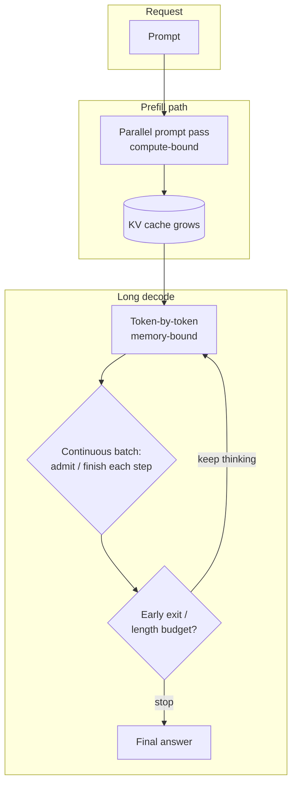

# Serving long-reasoning models

A chat model that answers in a few dozen tokens is one serving problem. A reasoning model that thinks for thousands of tokens before it answers is another. Prefill is a short burst; decode is a long, memory-bound walk whose length is unknown until it ends. Classic assumptions—predictable output length, a small KV cache, a batch that finishes together—break under that load. Length budgets, early exit, continuous batching and prefill/decode disaggregation are the systems answers; they sit beside, and do not replace, the training and test-time-compute story on [reasoning models](../03-modern-ai/reasoning-models-and-test-time-compute.md).

> The core idea in one sentence: **serving a long chain of thought is a decode-heavy, heavy-tailed scheduling and memory problem—cut tokens that do not help (budgets and early exit), pack the ones that remain without head-of-line blocking (continuous batching), and keep the growing KV cache from starving the batch (paging and disaggregation).**

This page expands the short notes on batching and the KV cache in [inference and efficiency](inference-and-efficiency.md). It connects to [the KV cache](kv-cache.md) (paging, chunked prefill, prefill/decode split), [speculative decoding](speculative-decoding.md) (when drafting still helps on long traces), [hardware and training](hardware-and-training.md), and [reasoning models](../03-modern-ai/reasoning-models-and-test-time-compute.md) (RLVR, overthinking, budget forcing). Liu et al. (2025) survey the broader algorithmic side of efficient reasoning inference; this page stays on the serving systems.



## 1. Why long CoT breaks classic serving (established)

Autoregressive generation has two phases with different bottlenecks ([KV cache](kv-cache.md); Patel et al. 2023): **prefill** processes the prompt in parallel and is usually compute-bound; **decode** emits one token per step and is memory-bound, because every step re-reads the weights and the growing cache. Chat workloads often have short outputs, so a request's lifetime is dominated by queueing and prefill. Reasoning workloads reverse that: DeepSeek-R1-style traces and o1-like models routinely emit thousands of tokens (DeepSeek-AI 2025; Chen et al. 2024), so almost all of the latency and almost all of the KV footprint is in decode.

Three concrete breaks follow.

1. **Unknown, heavy-tailed length.** Output length is not known when the request is admitted. Under a mixture of easy and hard prompts the distribution is heavy-tailed: many short traces, a long right tail. A scheduler that sizes memory for the maximum, or that holds a whole batch until the slowest request finishes, wastes capacity and creates head-of-line blocking. Orca (Yu et al. 2022) named the fix for the second problem **iteration-level scheduling** (continuous batching): after every decode step, finished requests leave and new ones enter. FastServe (Wu et al. 2023) added token-level preemption so a long decode cannot indefinitely block short ones.

2. **KV growth with reasoning length.** Cache bytes scale as $2 L h_{kv} d_h b \cdot T$ per sequence ([KV cache](kv-cache.md)). At long $T$, the cache—not the weights—sets how many concurrent decodes fit on a GPU, and every extra reasoning token is another read on the memory-bandwidth path. PagedAttention (Kwon et al. 2023) stops the *reservation* waste; it does not stop the *growth*.

3. **Latency SLO versus throughput.** Time-to-first-token (TTFT) is a prefill problem; time-per-output-token (TPOT) and end-to-end latency are decode problems. A reasoning request that runs for 4,000 decode steps at 30 ms/token already spends two minutes in decode alone. Raising batch size amortizes weight reads and helps throughput, but lengthens the critical path for every concurrent request. DistServe (Zhong et al. 2024) and Splitwise (Patel et al. 2023) therefore **disaggregate** prefill and decode onto different machines so the two SLOs stop fighting; Sarathi-Serve (Agrawal et al. 2024) softens the fight on one machine with chunked prefill. Reasoning shifts the mix toward decode-heavy traffic, so the decode pool becomes the scarce resource (Wang et al. 2025, STAR; Wu et al. 2025, Arrow).

## 2. Length budgets and truncation risk (established; active research)

The simplest control is a hard cap: `max_tokens` / a thinking budget $B$. Everything generated after $B$ is truncated. That is also the most dangerous control, because a reasoning model may not have written the answer yet.

| Control | What it does | Risk |
|---|---|---|
| Hard `max_tokens` | Stops generation at $B$ | Truncates mid-reasoning; answer may be missing or wrong |
| Budget forcing (Muennighoff et al. 2025, s1) | Suppresses end-of-thinking and optionally appends "Wait" to *extend* thinking | Raises cost; does not by itself teach short thinking |
| Length-controlled RL (Aggarwal and Welleck 2025, L1 / LCPO) | Trains the model to hit an exact or maximum length named in the prompt | Needs RL; control quality varies by task |
| Global length penalty in RL | Rewards shorter traces during post-training | Can over-compress hard steps (SmartThinker / step-level critiques) |

Chen et al. (2024) documented **overthinking**: o1-like models spend large token budgets on trivial questions (their running example is "2 + 3") with little accuracy gain and sometimes more wrong self-revisions. So a larger $B$ is not monotonically better. In the [tested sketch](#7-a-tested-sketch) below, on a synthetic "answer appears at $T^\star$, then overthink" population, accuracy rises with $B$ until the budget covers most $T^\star$ values, then flattens while tokens keep being spent; an oracle that stops at $T^\star$ uses about half the unbounded token count.

Serving consequence: the API's default `max_tokens` for a reasoning model is both a product decision and a capacity decision. Set it too low and you serve wrong answers; set it too high and every easy request reserves (or eventually occupies) a long decode slot.

## 3. Early exit and adaptive stopping (active research)

Early exit asks a softer question than a fixed budget: *has this request already converged?* Methods differ in the signal and in whether they need training.

| Method | Signal | Training? | Reported effect (authors' numbers) |
|---|---|---|---|
| DEER (Yang et al. 2025) | At reasoning-transition markers, induce a trial answer and exit on high confidence | No | 19–80% shorter CoT on 11 reasoning models; accuracy +0.3 to +5.0 points |
| EAT (Wang et al. 2025) | Entropy of the next token after a stop-thinking delimiter; exit when the trajectory stabilizes | No | 12–22% fewer tokens on MATH500 / AIME2025 without harming accuracy |
| REFRAIN (Sun et al. 2025) | Reflective-redundancy detector + sliding-window UCB threshold | No | 20–55% fewer tokens; accuracy maintained or improved |
| PUMA (Min et al. 2026) | Semantic redundancy of successive steps + answer verification | No | 26.2% average token cut with accuracy and CoT quality preserved |
| TRACE (Li et al. 2026) | Temporal aggregation of answer consistency and confidence | No | 25–30% fewer tokens; within 1–2% accuracy of full length |
| LayerSkip / AdaInfer (Elhoushi et al. 2024; Fan et al. 2024) | Exit *layers* early inside one forward pass (different axis) | Varies | Speeds a single step; does not by itself shorten the trace |
| LASER (Tang et al. 2026) | Confidence threshold and reasoning budget adapted to *system load* | No | 17–38% lower latency; +3–6% SLO attainment at ~1% accuracy cost on edge deployments |

The serving-relevant pattern is: **per-request early exit frees KV slots and decode steps for everyone else**, and load-aware thresholds (LASER) turn that into a scheduler knob rather than a fixed quality knob. SART (Wang, Jiang, Cui and Fu 2025) goes further for multi-branch test-time compute: redundant sampling with early stopping on short good branches, plus pruning of low-quality branches, reporting large efficiency gains at matched accuracy when many reasoning branches would otherwise overthink in parallel.

Caveats that belong in any status table: confidence and entropy are proxies; they can fire before self-correction finishes (PUMA's motivation) or too late if the model is calmly wrong. The sketch below shows the threshold trade-off on a noisy confidence signal: a low bar saves ~46% tokens but halves accuracy; a high bar keeps accuracy near unbounded while still saving ~31%.

## 4. Batching long, variable-length outputs (established; active research)

**Continuous batching** (Orca's iteration-level scheduling; now standard in vLLM, TensorRT-LLM, SGLang and peers) is the baseline. After each decode step:

1. Drop finished sequences and free their KV blocks.
2. Admit waiting sequences that fit in the remaining KV budget.
3. Run one decode step on the new set.

Selective batching (also Orca) batches the non-attention ops token-wise while running attention per sequence, so sequences at different positions can share a step. Chunked prefill ([KV cache](kv-cache.md); Sarathi-Serve) keeps new prefills from stalling ongoing long decodes.

What long reasoning adds on top:

- **Admission must plan for growth.** Admitting a request whose prompt fits but whose reasoning may run to 8k tokens can OOMs the decode pool later. Practical systems keep headroom, estimate remaining length, or migrate (STAR predicts remaining length from hidden states and reschedules across decode instances, reporting large P99 TPOT cuts and up to 2.24× goodput on long-output workloads).
- **Multi-sample reasoning is a fan-out.** Best-of-$N$, self-consistency and tree-style test-time compute multiply KV by $N$. SART's branch pruning and shared-prefix caching ([prefix caching](kv-cache.md)) are how serving absorbs that fan-out.
- **Goodput, not raw tokens/s.** DistServe's goodput framing—requests that meet both TTFT and TPOT SLOs—matters more when a single miss is a two-minute reasoning job. Arrow (Wu et al. 2025) and DynaServe (Ruan et al. 2025) elastically rebalance prefill and decode pools as the mix shifts.

In the sketch, under a 70/30 short/long length mixture and a fixed KV token budget, continuous batching reaches **16.2×** the throughput of request-level static batches sized for `max_tokens = 4096`, because the static policy can keep only 16 concurrent reservations while continuous packing follows actual occupancy.

## 5. Memory, speculation and disaggregation under long decode (established; active research)

**Memory.** For an illustrative 32-layer GQA model at 16-bit with 8 KV heads of dimension 128, each token costs $2 \cdot 32 \cdot 8 \cdot 128 \cdot 2 = 128$ KiB of cache. On an 80 GiB GPU with ~14 GiB of weights, raising average context from 512 to 16,384 tokens drops the maximum batch from about 1,056 to 33 (sketch Part 4). Reserving every in-flight request at `max_tokens` wastes roughly **4×** memory against paged allocation on the same heavy-tailed mix—capacity that continuous batching then turns into concurrency.

**Speculative decoding.** Draft-and-verify still applies ([speculative decoding](speculative-decoding.md)), but long reasoning changes the economics: acceptance on reflection tokens can be the failure mode; tree drafts multiply verification cost; at large decode batches the chip is less idle so speculation's energy case weakens (Ma et al. 2026, discussed on the speculative page). LongSpec-style results show speculation can still cut wall-clock time on reasoning benchmarks when the drafter is matched to the workload.

**Disaggregation.** Prefill/decode disaggregation (Splitwise, DistServe, Mooncake) is a natural fit for decode-heavy reasoning: size the decode pool for TPOT and KV, the prefill pool for TTFT, and ship KV blocks between them. The new failure mode is **decode imbalance**—one decode worker stuck with several 8k traces while another idles—which STAR, Arrow and related 2025–2026 schedulers attack with length prediction and elastic P/D ratios.

## 6. Status at a glance

| Claim | Status |
|---|---|
| Long CoT makes serving decode-heavy and length-heavy-tailed | Established (workload measurements; R1/o1-style traces) |
| Iteration-level / continuous batching beats request-level batching under variable lengths | Established (Orca; production vLLM/SGLang stacks) |
| Paging beats max-length KV reservation | Established (PagedAttention / vLLM) |
| Prefill/decode disaggregation improves goodput under competing TTFT/TPOT SLOs | Established (DistServe, Splitwise; production adoption) |
| Overthinking wastes tokens on easy items; fixed large budgets are not free | Established as a phenomenon (Chen et al. 2024); mitigations vary |
| Confidence / entropy / redundancy early-exit cuts tokens at small accuracy cost | Strong emerging evidence (DEER, EAT, REFRAIN, PUMA, TRACE); signals still proxies |
| Load-aware exit thresholds and decode rescheduling improve SLOs under reasoning traffic | Promising systems results (LASER, SART, STAR, Arrow); fewer independent replications |
| One universal length budget or exit threshold fits all prompts | False |

## 7. A tested sketch

The code is a scheduler and stopping toy, not a language model. It measures continuous versus static batching under heavy-tailed lengths, the accuracy–token curve of hard length budgets, confidence-threshold early exit with noisy signals, and KV batch capacity. Running it with NumPy reproduces the numbers below in well under a second.

```python
import numpy as np
rng = np.random.default_rng(0)

# Part 1: static request-level batches vs continuous (iteration-level) batching
print("Part 1")
N = 2000
easy = rng.integers(32, 128, size=int(0.7 * N))
hard = rng.integers(800, 4096, size=N - len(easy))
L = np.concatenate([easy, hard]); rng.shuffle(L)
prompt = rng.integers(64, 512, size=N)
max_out, slots_budget = 4096, 64 * 1024
n_static = slots_budget // max_out

def sim_static(lengths, batch_size):
    t, finished, idx = 0, [], 0
    while idx < len(lengths):
        batch = lengths[idx:idx + batch_size]
        dur = int(batch.max())
        finished.extend([t + dur] * len(batch))
        t += dur; idx += len(batch)
    finished = np.asarray(finished, float)
    return t, float(finished.mean()), float(np.percentile(finished, 99)), len(lengths) / t

def sim_continuous(lengths, prompt_len, capacity):
    t = i = used = 0; active, finished = [], []
    while i < len(lengths) or active:
        while i < len(lengths) and used + int(prompt_len[i]) <= capacity:
            active.append([int(lengths[i]), t, int(prompt_len[i]), 0])
            used += int(prompt_len[i]); i += 1
        if not active:
            break
        t += 1; nxt = []
        for rem, arr, pl, gen in active:
            rem -= 1; gen += 1; used += 1
            if rem == 0:
                finished.append(t - arr); used -= (pl + gen)
            else:
                nxt.append([rem, arr, pl, gen])
        active = nxt
    finished = np.asarray(finished, float)
    return t, float(finished.mean()), float(np.percentile(finished, 99)), len(lengths) / t

ms, ml, p99, tp = sim_static(L, n_static)
mc, mlc, p99c, tpc = sim_continuous(L, prompt, slots_budget)
print("n_static", n_static)
print("length mean/median/p90/p99", L.mean(), np.median(L), np.percentile(L, 90), np.percentile(L, 99))
print("static", ms, ml, p99, tp)
print("continuous", mc, mlc, p99c, tpc)
print("throughput ratio", tpc / tp, "latency ratio", ml / mlc)

# Part 2: hard length budgets on a 'answer at T*, then overthink' population
print("Part 2")
M = 5000
difficulty = rng.uniform(0, 1, M)
Tstar = (50 + 3500 * difficulty**2).astype(int)
Lfull = Tstar + rng.integers(100, 2000, M)

def acc_at_budget(B, flip_rate=0.02):
    correct = (B >= Tstar).astype(float)
    flips = (B > Tstar + 500) & (rng.random(M) < flip_rate)
    correct = np.where(flips, 0.0, correct)
    return float(correct.mean()), float(np.minimum(Lfull, B).mean())

for B in [128, 256, 512, 1024, 2048, 4096, 8192]:
    print("budget", B, acc_at_budget(B))
print("oracle tokens", float(Tstar.mean()), "unbounded", acc_at_budget(10**9))

# Part 3: noisy confidence early exit
print("Part 3")
scale, noise_std = 80.0, 120.0
base = float(Lfull.mean())

def run_exit(tau, flip_rate=0.02):
    logit_tau = np.log(tau / (1 - tau))
    t_exit = np.clip(Tstar + scale * logit_tau + rng.normal(0, noise_std, M), 1, Lfull).astype(int)
    t_exit = np.minimum(t_exit, Lfull)
    correct = (t_exit >= Tstar).astype(float)
    flips = (t_exit > Tstar + 500) & (rng.random(M) < flip_rate)
    correct = np.where(flips | (t_exit < Tstar), 0.0, correct)
    return float(correct.mean()), float(t_exit.mean())

for tau in [0.5, 0.7, 0.85, 0.9, 0.95, 0.99]:
    a, tok = run_exit(tau)
    print(tau, a, tok, (1 - tok / base) * 100)

# Part 4: KV capacity vs average reasoning length
print("Part 4")
per_tok = 128 * 1024
kv_budget = 80 * (1024**3) - 14 * (1024**3)
for avg in [512, 1024, 2048, 4096, 8192, 16384]:
    print(avg, int(kv_budget // (per_tok * avg)), 8 * avg * per_tok / 2**30)
utils = []
for _ in range(500):
    idx = rng.choice(N, 32, replace=False)
    utils.append((prompt[idx] + L[idx]).sum() / (prompt[idx] + max_out).sum())
print("reserved util", float(np.mean(utils)), "ratio", float(1 / np.mean(utils)))
```

**Part 1: continuous versus static batching.** Length mix: 70% short ($32$–$128$) and 30% long ($800$–$4096$); mean $805$, median $101$, p90 $3053$. KV budget $65{,}536$ tokens. Static batches reserve `max_tokens = 4096`, so only $16$ requests fit; continuous admits by current occupancy.

| Policy | Makespan (steps) | Mean latency | p99 latency | Throughput (req/step) |
|---|---|---|---|---|
| Static request-level | 428,324 | 214,901 | 425,562 | 0.00467 |
| Continuous (iteration-level) | 26,445 | 805 | 3,976 | 0.0756 |

Throughput ratio **16.2×**. Continuous mean latency equals mean length (ideal once admitted). Static mean latency is huge because every short request waits for the longest member of its batch and later batches wait behind earlier ones—the head-of-line pathology Orca described. (The absolute latency numbers assume a unit-time decode step and a cold start with all 2,000 requests queued; real arrivals change the level, not the ranking.)

**Part 2: hard budgets.** Synthetic problems whose correct answer first appears at $T^\star$ (easy short, hard long). Unbounded generation overthinks past $T^\star$ and occasionally flips a correct answer.

| Budget $B$ | Accuracy | Mean tokens used |
|---|---|---|
| 128 | 0.157 | 128 |
| 512 | 0.369 | 506 |
| 1,024 | 0.516 | 968 |
| 2,048 | 0.742 | 1,666 |
| 4,096 | 0.984 | 2,220 |
| 8,192 | 0.980 | 2,260 |
| Oracle stop at $T^\star$ | 1.000 | 1,214 |
| Unbounded | 0.981 | 2,260 |

Raising $B$ from 4,096 to 8,192 spends more tokens for no accuracy gain (slightly worse once overthinking flips are allowed). The oracle uses **46%** fewer tokens than unbounded.

**Part 3: noisy confidence exit.** Exit at the first step where a noisy sigmoid confidence crosses threshold $\tau$.

| $\tau$ | Accuracy | Mean tokens | Token save vs unbounded |
|---|---|---|---|
| 0.50 | 0.497 | 1,217 | 46.2% |
| 0.70 | 0.726 | 1,284 | 43.2% |
| 0.85 | 0.874 | 1,350 | 40.3% |
| 0.90 | 0.927 | 1,384 | 38.8% |
| 0.95 | 0.977 | 1,439 | 36.3% |
| 0.99 | 0.997 | 1,559 | 31.0% |

The bar is the product knob: low $\tau$ matches the oracle's token count but throws away hard problems whose confidence is late; high $\tau$ recovers nearly all accuracy and still beats unbounded length by about a third. Load-aware systems (LASER) move $\tau$ with queue depth along this curve.

**Part 4: KV arithmetic.** Same 128 KiB/token GQA layout as above, 80 GiB GPU, 14 GiB weights.

| Average context | Max concurrent sequences | KV for batch of 8 |
|---|---|---|
| 512 | 1,056 | 0.50 GiB |
| 2,048 | 264 | 2.00 GiB |
| 8,192 | 66 | 8.00 GiB |
| 16,384 | 33 | 16.00 GiB |

On the Part-1 length mix, reserving each of 32 in-flight requests at `max_tokens` uses only **25%** of the memory that paged allocation needs for the same actual lengths—about **4.0×** over-reservation.

What the sketch does *not* show: real transformer kernels, network transfer of KV under disaggregation, drafter acceptance rates, or calibrated confidence on a live model. It shows why the scheduler and the stopping rule dominate cost once traces are long.

## 8. Speculative: stopping as a cluster-wide control loop

> **Speculative.** The ideas in this section are hypotheses for discussion, not established results.

Early-exit papers mostly optimize one request. Serving cares about the *fleet*: decode-pool utilization, P99 TPOT, and the fraction of requests that still need long traces. A testable programme:

1. **Joint threshold and admission.** Treat $(\tau, \text{headroom})$ as a controller on measured decode utilization. Prediction: a load-aware $\tau$ (as in LASER) plus residual-length-aware admission (as in STAR) should dominate either alone on goodput at fixed accuracy; falsified if the combination matches the better of the two within error bars.
2. **Per-difficulty calibration.** Fit exit thresholds on a held-out difficulty probe (short GSM8K vs AIME-style) rather than one global $\tau$. Prediction: calibrated thresholds cut more tokens at the same accuracy than a global bar; falsified if a well-tuned global $\tau$ matches them.
3. **Speculation only on the short mode.** Run speculative decoding on requests predicted short (or already high-confidence) and plain decode on deep reasoning, where acceptance is spikier. Prediction: energy per token falls at matched latency versus speculation-on-all; falsified if the classifier's mistakes cost more than the savings.

## Further reading

- Yu et al. (2022), *Orca*: iteration-level scheduling and selective batching.
- Kwon et al. (2023), *PagedAttention / vLLM*; Zhong et al. (2024), *DistServe*; Agrawal et al. (2024), *Sarathi-Serve*.
- Chen et al. (2024), *Do NOT Think That Much for 2+3=?*: overthinking as a measured failure mode.
- Aggarwal and Welleck (2025), *L1*; Muennighoff et al. (2025), *s1*: length control from the training / test-time side.
- Yang et al. (2025), *DEER*; Wang et al. (2025), *EAT* and *SART*; Sun et al. (2025), *REFRAIN*: inference-time early exit.
- Wang et al. (2025), *STAR*; Wu et al. (2025), *Arrow*; Tang et al. (2026), *LASER*: decode scheduling and load-aware exit.
- Liu et al. (2025), *Efficient Inference for Large Reasoning Models*: survey.
- Related pages: [Reasoning models](../03-modern-ai/reasoning-models-and-test-time-compute.md), [KV cache](kv-cache.md), [Speculative decoding](speculative-decoding.md), [Inference and efficiency](inference-and-efficiency.md).

Full citations for every source on this page are in [REFERENCES.md](../../REFERENCES.md#serving-long-reasoning-models).
