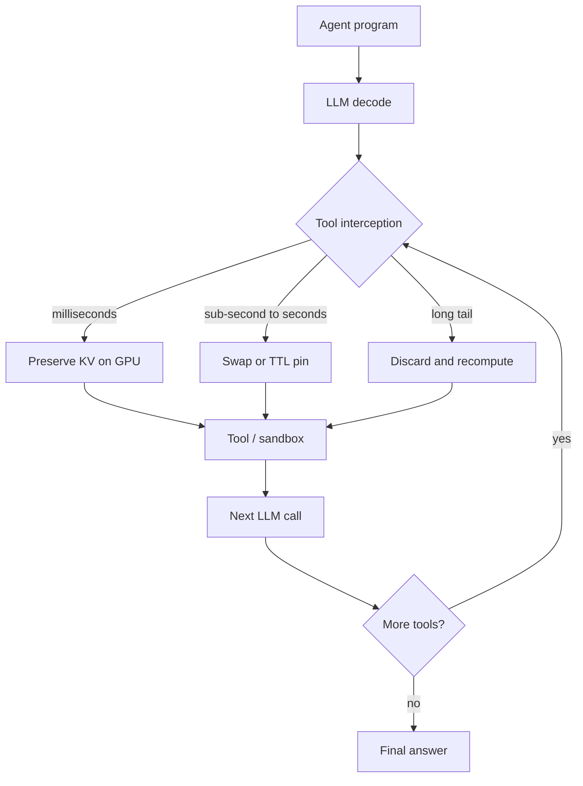

# Serving tool-augmented agents

Chat serving assumes a request arrives, prefills, decodes to an end-of-sequence token, and frees its [KV cache](kv-cache.md). A tool-using agent does something different: it decodes until it emits a tool call, *pauses* while a calculator, search API, code sandbox or human replies, then resumes with the observation appended. That pause—an **interception**—is not the end of the job. Treating it as one is how today's engines spend a large fraction of GPU time recomputing context they already had (Abhyankar et al. 2024). This page is the systems counterpart of [retrieval, tools and agents](../03-modern-ai/retrieval-tools-and-agents.md), which covers *what* agents do; here the question is how to serve the loop without wasting memory, breaking fairness, or paying a cold start on every sandbox.

> The core idea in one sentence: **treat the agent program as the unit of work—pin, swap or drop its KV cache for the duration of each tool wait, schedule later calls by how much service the program has already received, share the tool-schema prefix, constrain the call to valid structure, and keep a warm pool of sandboxes—so a multi-turn tool loop is not billed as a sequence of unrelated chat requests.**

This page expands the short efficiency notes in [inference and efficiency](inference-and-efficiency.md). It is about performance, not security: what happens when a tool output or tool description contains instructions is covered in [prompt injection and tool-use security](../05-alignment-safety-interpretability/prompt-injection-and-tool-use-security.md). It sits next to [serving long-reasoning models](serving-long-reasoning-models.md) (one long decode) and [prefix-aware multi-sample serving](prefix-aware-multi-sample-serving.md) (many samples of one prompt): here the model pauses, leaves the GPU, and comes back.



## 1. Why agents break chat serving (established)

A chat completion is one prefill and one decode. An agent program is a DAG of LLM calls interleaved with **external interrupts**—tool APIs, code execution, retrieval, or a human (Luo et al. 2025; Yao et al. 2022). InferCept (Abhyankar et al. 2024) measured six representative augmentations and found interception times that span six orders of magnitude:

| Augmentation | Mean interception time | Typical cause |
|---|---|---|
| Calculator (math) | $9 \times 10^{-5}$ s | Local arithmetic |
| Virtual environment | 0.09 s | Local text environment |
| Knowledge QA | 0.69 s | Networked retrieval |
| Text-to-speech | 17.24 s | Another model, plus a human |
| Image generation | 20.03 s | Diffusion model, plus a human |
| Chatbot (human turn) | 28.6 s | Reading and typing |

Those pauses are not rare. On SWE-Bench coding-agent traces, Continnum (Li et al. 2025; the paper's own spelling) reports a mean of **10.9 turns** per program, a mean tool time of **925 ms** (standard deviation 3,550 ms), and about **70k tokens** of cumulative context. On BFCL v4, the means are **6.3 turns** and **1,923 ms** of tool time. Autellix's BFCL programs average **10.75 LLM calls**, with about 735 prefill tokens and only 34 decode tokens per call; its Language Agent Tree Search (LATS) programs average about **160 calls** (Luo et al. 2025). Serving that mix with a chat engine creates three failures at once:

1. **Recomputation.** If the engine treats the tool call as the end of the request and starts a new one when the tool returns, it prefills the entire conversation again. InferCept found this recomputation was **37–40%** of total model-forwarding time on a mixed augmentation workload.
2. **Pinned memory.** Holding the KV cache on the GPU for the whole wait avoids recomputation, but a 20-second image-generation pause occupies memory that could have served other requests. InferCept measured nearly half the GPU memory held by interrupted requests more than 60% of the time under a naïve preserve policy.
3. **Head-of-line blocking at two levels.** Long decodes delay short ones (call-level HoL). And when a scheduler such as a multi-level feedback queue promotes *new* calls to the highest priority, a long program's later calls jump the queue and delay short programs that have barely started (program-level HoL; Luo et al. 2025).

A request-level first-come-first-served engine such as vLLM (Kwon et al. 2023) sees none of this structure. Continuous batching (Yu et al. 2022) still helps *inside* a call; it does not decide what to do with a cache that will be needed again in 90 milliseconds—or 28 seconds.

## 2. What to do with the KV cache during a tool wait (established / active research)

InferCept frames the choice as minimizing GPU memory-time waste. For a paused request whose context is $C$ tokens, with other running requests occupying $C_{\mathrm{other}}$ tokens and $M$ bytes per token:

```math
\begin{aligned}
\mathrm{WastePreserve} &= T_{\mathrm{int}} \cdot C \cdot M, \\
\mathrm{WasteDiscard} &= T_{\mathrm{fwd}}(C)\cdot(C + C_{\mathrm{other}})\cdot M, \\
\mathrm{WasteSwap}    &= 2\, T_{\mathrm{swap}}(C)\cdot(C + C_{\mathrm{other}})\cdot M.
\end{aligned}
```

Preserve wins when the tool is faster than a recompute (about 650 ms in the sketch below, at $C=2000$). Swap wins sooner if the PCIe transfer can be hidden: InferCept pipelines swap with layer-wise forwarding and chunks it across iterations so the link stays inside a per-iteration budget, driving reported swap waste toward zero. Discard is improved by *chunked* recomputation that fills unused decode compute. The engine then sorts intercepted requests by potential waste, spends the swap budget on the most expensive ones, and preserves or discards the rest. On GPT-J 6B, Vicuna 13B and Llama 3 70B, InferCept sustains **1.6–2×** higher request rate than vLLM at matched normalized latency and completes **2×** more requests per second.

That decision is still per interception. Continnum (Li et al. 2025) observes a second cost that InferCept's preserve-versus-reload comparison does not model: **per-turn queueing**. Even when the KV cache can be reloaded quickly from CPU memory, an evicted program re-enters the waiting queue and waits for GPU space held by whoever was admitted in the meantime. Across a 10-turn coding agent that delay compounds. Continnum therefore pins a finished-but-not-done cache with a **time-to-live** (TTL) $\tau$, chosen to maximize expected benefit minus occupancy:

```math
\tau^\star = \arg\max_{\tau}\; \mathcal{P}(\tau, f)\cdot\bigl(\mathcal{T}\,\eta + T_{\mathrm{reload}}\bigr) - \tau.
```

Here $\mathcal{P}(\tau, f)$ is the chance that tool $f$ finishes within $\tau$ (estimated from an empirical CDF), $T_{\mathrm{reload}}$ is the prefill or CPU-reload time, $\mathcal{T}$ is the observed per-turn queueing delay after an eviction, and $\eta$ is a *memoryfulness* factor: how strongly progress so far predicts that less work remains (the correlation between completed and remaining turns). A geometric number of turns is memoryless ($\eta = 0$); a roughly fixed horizon, as in Continnum's SWE-Bench traces, is closer to $\eta = 1$. When the TTL expires the cache is evicted automatically, so a long-tailed tool cannot pin the GPU forever.

On emulated SWE-Bench and BFCL workloads Continnum reports **1.12–3.66×** lower delay and **1.10–3.22×** higher throughput than prior schedulers; on an internal SWE-agent testbed, job-completion time improved by up to **8.18×** (the abstract rounds this to “over 8×”). The sketch in §7 shows why a finite TTL can beat both always-preserve and always-discard: under a heavy-tailed mix of tool times, a two-second pin captures most of the benefit without paying occupancy on the long tail.

## 3. Schedule programs, not requests (active research)

KV policy answers *what to hold*. Scheduling answers *who runs next* when a program's next call arrives.

**Parrot** (Lin et al. 2024) exposes the missing application graph to a public LLM service through **Semantic Variables**: named input and output regions of a prompt that also act as the edges connecting successive LLM calls. The service can then skip the client round-trip between dependent calls, deduce whether a stage should be packed for throughput (the map side of a summary) or run at low latency (the reduce), and de-duplicate a shared system prompt. In a production chat-search application Parrot measured **94%** of request tokens repeated across users. On a MetaGPT-style multi-agent coding workflow it reports up to **11.7×** end-to-end speedup against a latency-centric baseline; map-reduce document summary improved by about **2.4×** once the map stage was allowed a larger batch.

**Autellix** (Luo et al. 2025) treats fully dynamic programs—whose DAG is not known ahead of time—as first-class citizens. **Program-level attained service (PLAS)** prioritizes a call by the total GPU time its program has already received, so a long program's later calls sink in priority and short programs finish. **ATLAS** generalizes this to multi-threaded DAGs by tracking the longest observed critical path. Across ShareGPT conversations, BFCL function-calling and LATS search, Autellix reports **4–15×** higher program throughput than vLLM at the same program-level latency. The sketch in §7 does *not* reproduce that factor: on a work-bound burst, first-come-first-served and PLAS coincide, while a “newest call first” stand-in for multilevel feedback (every new call enters the highest queue) makes short programs wait **4.66×** longer. The large published gains are a latency-SLO effect under real decode-length tails, not a makespan win on a saturated cluster.

**Ayo** (Tan, Jiang, Yang and Xu 2025; the preprint is titled *Teola*) goes one level finer for workflows that *can* be declared up front. It decomposes modules into primitives—partial prefill, partial decode, embed, search—and rewrites the primitive dataflow for parallelization and pipelining. End-to-end latency improves by up to **2.09×** against module-chained baselines on search-augmented generation and RAG variants. Continnum notes that Ayo, Parrot and similar systems assume more static graphs than a ReAct agent whose next tool is chosen at runtime; they complement, rather than replace, TTL pins and program-level priorities.

## 4. Share the tool schema, constrain the call (established / active research)

Even before scheduling, agent prompts waste work. A system prompt plus a catalogue of tool JSON schemas is long, mostly static, and shared across sessions. SGLang's RadixAttention (Zheng et al. 2023) already stores finished caches in a prefix tree so a new call reuses its longest cached prefix; Parrot's 94% repetition figure is the same phenomenon seen from the application side. The sketch in §7 puts numbers on the decay: sharing an 1,800-token tool-schema prefix across 32 sessions saves **10.89×** KV at the first turn and **4.31×** at the second, falling to **1.32×** by turn 16 as each session's unique history grows.

The *output* of those calls has to be valid tool JSON, not merely fluent text. Unconstrained generation of function calls is brittle: XGrammar (Dong et al. 2025) reports syntactic accuracy of **62%** without grammar constraints and **100%** with them on its function-calling evaluation. The systems cost of enforcing a grammar used to be a full vocabulary scan per token. Willard and Louf (2023) reformulate regular-expression guidance as an FSM over the vocabulary and precompute, for each machine state, the tokens that are legal from that state—an index lookup that is $O(1)$ on average instead of $O(N)$ in vocabulary size (the Outlines library). XGrammar extends the idea to context-free grammars with a pushdown automaton, splitting tokens into a large precomputed context-independent set and a small runtime-checked context-dependent set. It reports up to **100×** lower per-token mask-generation latency than prior CFG engines and up to **80×** higher end-to-end structured-output serving throughput on an H100 when overlapped with GPU decode.

Constrained decoding does not pick *which* tool to call; it only guarantees that whatever is called is parseable. Combined with prefix sharing, it is why an agent server can spend its HBM on conversation state rather than on repeatedly prefilling the same schema and rejecting malformed calls after the fact.

## 5. The sandbox is on the critical path too (active research)

Code-execution and browser tools do not run inside the LLM process. They run in isolated sandboxes, increasingly reached through protocols such as the Model Context Protocol. SpecBox (Zhang et al. 2026) measures typical sandbox cold starts of **2–4 seconds**, and about **20 seconds** for heavyweight environments. A reactive runtime starts that clock only after the model finishes emitting the tool call, so every turn pays the cold start on the critical path.

SpecBox overlaps preparation with decode: a keyword router and a semantic router inspect the *streaming* token prefix and prewarm candidate sandboxes before the call is complete, then prefetch likely *next*-step sandboxes from a dependency graph while the current tool runs. On multi-turn traces it cuts P99 end-to-end latency by up to **2.9×** versus on-demand instantiation and peak memory by **45.9%** versus permanently reserved sandboxes; cumulative provisioning time fell by **4.53×**. The sketch in §7 is a simpler pool model, not SpecBox's predictor: an undersized warm pool of two still cuts mean provisioning from 3.00 s to 0.54 s but leaves a 3.00 s tail, while a pool of four hides the tail (p99 = 0.10 s) at six memory units against 64 for a reserved fleet.

## 6. Status at a glance

| Claim | Status |
|---|---|
| Treating a tool call as the end of a request wastes a large fraction of GPU time on recomputation | Established (InferCept: 37–40% of forwarding time) |
| No single KV policy (always preserve, always discard, always swap) is best across interception times | Established (InferCept waste model and mixed-workload results) |
| A bounded TTL plus program-level FCFS reduces compounded per-turn queueing for multi-turn agents | Strong systems evidence (Continnum; fewer independent replications so far) |
| Scheduling by a program's attained service reduces program-level head-of-line blocking | Strong systems evidence (Autellix, 4–15× vs vLLM at matched latency) |
| Exposing request dependencies (Semantic Variables, primitive dataflow) speeds static or declarable workflows | Established for those graphs (Parrot, Ayo); does not by itself handle open-ended ReAct |
| Shared system-prompt and tool-schema prefixes should be stored once | Established (SGLang, Parrot, PagedAttention prefix sharing) |
| Constrained decoding can make structured tool calls reliable at near-zero extra decode cost | Established (Outlines, XGrammar) |
| Sandbox cold starts of several seconds are large enough to hide behind decode if predicted early | Promising systems result (SpecBox); depends on intent prediction |
| One retention and scheduling policy transfers to every tool mix without adaptation | False |

## 7. A tested sketch

The code is not a language-model server. It measures InferCept-style memory-time waste, a Continnum-style TTL extra-cost, a three-way comparison of request-level FIFO, newest-call-first and PLAS, prefix-sharing arithmetic, and a warm sandbox pool. Running it with NumPy reproduces the numbers below in well under a second.

```python
import numpy as np
from collections import deque

rng = np.random.default_rng(0)

# --- Part 1: InferCept-style waste ---
C, C_other, M = 2000.0, 8000.0, 1.0

def T_fwd(n):
    return 0.04 + 4.5e-5 * n          # 0.130 s at 2000 tokens

def T_swap(n):
    return n * 128 * 1024 / 16e9      # 0.0164 s at 2000 tokens

wd = T_fwd(C) * (C + C_other) * M
ws = 2 * T_swap(C) * (C + C_other) * M
print(f"T_fwd={T_fwd(C):.4f}s  T_swap={T_swap(C):.4f}s")
print(f"WasteDiscard={wd:.1f}  WasteSwap={ws:.1f}")
print(f"Preserve=Discard at {wd/C:.4f}s; Preserve=Swap at {ws/C:.4f}s")
for name, T in [("Math", 9e-5), ("VE", 0.09), ("QA", 0.69),
                ("TTS", 17.24), ("Image", 20.03), ("Chatbot", 28.6)]:
    wp = T * C * M
    best = "Preserve" if wp <= min(wd, ws) else ("Discard" if wd <= ws else "Swap")
    print(name, T, wp, best)

# --- Part 2: TTL extras (agent-scale context, load-aware queueing) ---
C_agt, C_gpu = 8192.0, 16384.0
w = C_agt / C_gpu
T_recomp = 0.08 + 1.2e-4 * C_agt      # 1.063 s
Q, eta = 2.00, 0.70
Benefit = T_recomp + eta * Q          # 2.463 s
N = 8000
is_long = rng.random(N) < 0.30
T_short = np.clip(rng.lognormal(np.log(0.45), 0.75, N), 0.002, 20)
T_long = np.clip(rng.lognormal(np.log(6.0), 0.95, N), 0.4, 90)
T_int = np.where(is_long, T_long, T_short)
print(f"tool mean={T_int.mean():.3f} p50={np.median(T_int):.3f} "
      f"p90={np.quantile(T_int,0.9):.3f} p99={np.quantile(T_int,0.99):.3f}")
print(f"T_recomp={T_recomp:.3f}s Benefit={Benefit:.3f}s w={w:.2f}")

def ttl_total(tau):
    held = T_int if tau is None else np.minimum(T_int, tau)
    missed = np.zeros(N, dtype=bool) if tau is None else (T_int > tau)
    return float((held * w + missed * Benefit).mean())

for label, tau in [("discard", 0.0), ("TTL 0.5s", 0.5), ("TTL 1s", 1.0),
                   ("TTL 2s", 2.0), ("TTL 3s", 3.0), ("TTL 5s", 5.0),
                   ("TTL 8s", 8.0), ("preserve", None)]:
    print(label, ttl_total(tau))

# --- Part 3: FIFO vs newest-first vs PLAS ---
def simulate(policy, n_long=24, n_short=24, n_servers=2):
    programs = ([{"id": i, "kind": "long", "lens": [20.0] * 5, "gap": 0.5,
                  "next": 0, "service": 0.0, "wait": 0.0, "finish": None,
                  "_ready": 0.0} for i in range(n_long)]
                + [{"id": n_long + i, "kind": "short", "lens": [4.0], "gap": 0.0,
                    "next": 0, "service": 0.0, "wait": 0.0, "finish": None,
                    "_ready": 0.0} for i in range(n_short)])
    fifo, ready, pending = deque(range(len(programs))), set(range(len(programs))), []
    t, servers = 0.0, [0.0] * n_servers
    unfinished = set(range(len(programs)))

    def pick():
        if not ready:
            return None
        if policy == "fcfs":
            while fifo:
                i = fifo.popleft()
                if i in ready:
                    return i
            return None
        if policy == "newfirst":
            return min(ready, key=lambda i: (-programs[i]["_ready"], programs[i]["id"]))
        return min(ready, key=lambda i: (programs[i]["service"], programs[i]["id"]))

    safety = 0
    while unfinished and safety < 200000:
        safety += 1
        server = int(np.argmin(servers))
        if not ready:
            pending.sort()
            wt, wi = pending.pop(0)
            t = max(t, wt)
            ready.add(wi)
            programs[wi]["_ready"] = wt
            if policy == "fcfs":
                fifo.append(wi)
            continue
        t = max(t, servers[server])
        still = []
        for pt, wi in pending:
            if pt <= t + 1e-12:
                ready.add(wi)
                programs[wi]["_ready"] = pt
                if policy == "fcfs":
                    fifo.append(wi)
            else:
                still.append((pt, wi))
        pending = still
        i = pick()
        if i is None:
            continue
        ready.remove(i)
        p = programs[i]
        start = t
        end = start + p["lens"][p["next"]]
        p["wait"] += start - p["_ready"]
        p["service"] += p["lens"][p["next"]]
        servers[server] = end
        p["next"] += 1
        if p["next"] >= len(p["lens"]):
            p["finish"] = end
            unfinished.remove(i)
        else:
            pending.append((end + p["gap"], i))

    waits = np.array([p["wait"] for p in programs])
    finishes = np.array([p["finish"] for p in programs], dtype=float)
    sl = np.array([p["kind"] == "short" for p in programs])
    return waits.mean(), waits[sl].mean(), waits[~sl].mean(), finishes.mean(), finishes.max(), finishes[sl].mean()

for pol in ["fcfs", "newfirst", "plas"]:
    print(pol, simulate(pol))

# --- Part 4a: shared tool-schema prefix ---
P, U0, uniq, N_sess = 1800, 120, 350, 32
for k in [1, 2, 4, 8, 16]:
    unique = U0 + (k - 1) * uniq
    naive, shared = N_sess * (P + unique), P + N_sess * unique
    print(k, naive / shared, P / (P + unique))

# --- Part 4b: sandbox pool ---
n_jobs, arrival_rate, cold, warm = 1200, 8.0, 3.0, 0.10
arrivals = np.cumsum(rng.exponential(1 / arrival_rate, n_jobs))

def sandbox_sim(n_warm, reserved=False, on_demand=False):
    if reserved:
        return np.zeros(n_jobs), 64
    if on_demand:
        return np.full(n_jobs, cold), 0
    free_at, delays, extra_live, peak_extra = np.zeros(n_warm), np.zeros(n_jobs), [], 0
    for i, a in enumerate(arrivals):
        extra_live = [e for e in extra_live if e > a]
        j = int(np.argmin(free_at))
        if free_at[j] <= a:
            delays[i] = warm
            free_at[j] = a + warm
        else:
            delays[i] = cold
            extra_live.append(a + cold)
        peak_extra = max(peak_extra, len(extra_live))
    return delays, n_warm + peak_extra

for label, kw in [("on-demand", dict(n_warm=0, on_demand=True)),
                  ("pool W=2", dict(n_warm=2)), ("pool W=4", dict(n_warm=4)),
                  ("pool W=8", dict(n_warm=8)),
                  ("reserved 64", dict(n_warm=64, reserved=True))]:
    d, mem = sandbox_sim(**kw)
    print(label, d.mean(), np.quantile(d, 0.99), mem)
```

**Part 1: waste.** At $C=2000$ and $C_{\mathrm{other}}=8000$, $T_{\mathrm{fwd}}=0.1300$ s and $T_{\mathrm{swap}}=0.0164$ s, so discard wastes **1,300** token-seconds and pipelined-style swap wastes **327.7**. Preserve matches discard at an interception of **0.6500 s** and swap at **0.1638 s**. Using InferCept's Table 1 means, a calculator ($9\times 10^{-5}$ s) and a virtual-environment step (0.09 s) should be preserved; a 0.69 s QA call and the long human or multi-model waits (TTS 17.24 s, image 20.03 s, chatbot 28.6 s) should be swapped. That is InferCept's qualitative rule: short automated tools keep the cache hot; anything longer than a couple of hundred milliseconds should leave the GPU.

**Part 2: TTL.** Mid-session context is 8,192 tokens (half of a 16,384-token KV pool), recompute takes 1.063 s, and eviction under load adds a 2.00 s queue multiplied by memoryfulness $\eta=0.70$, for a hit benefit of **2.463 s**. Tool times are a 70/30 mix of short and long lognormals (mean 3.288 s, median 0.693 s, p90 8.955 s, p99 36.422 s):

| Policy | Extra cost (s / interception) |
|---|---|
| Always discard | 2.463 |
| TTL 0.5 s | 1.720 |
| TTL 1 s | 1.295 |
| **TTL 2 s** | **1.185** |
| TTL 3 s | 1.207 |
| TTL 5 s | 1.257 |
| TTL 8 s | 1.322 |
| Always preserve | 1.644 |

A two-second TTL is best: always-discard is **2.08×** more expensive and always-preserve is **1.39×** more expensive. The sketch is a cost model, not Continnum's full simulator—it illustrates why a bounded pin exists, and why “just keep everything” fails on a heavy tail.

**Part 3: program-level scheduling.** Twenty-four long programs (five calls of length 20, gap 0.5) are submitted first, then twenty-four short programs (one call of length 4), onto two servers, all at time 0. Total work is 2,496 time units, so the makespan lower bound on two servers is 1,248; every policy hits it. Request-level FIFO and PLAS coincide: short-program wait **262**, short finish **266**, long finish **1,138**, mean finish **702**. Newest-call-first—the multilevel-feedback behaviour Autellix diagnoses, where every new call (including a long program's later calls) enters the highest queue—inflates short-program wait to **1,222** (**4.66×**) and mean finish to **958** (**1.36×**), while longs finish earlier (690) by cutting in line. This sketch isolates fairness, not cluster throughput. Autellix's **4–15×** program-throughput result is measured at a matched latency SLO, where starving shorts fail their SLO and effective throughput drops; it should not be read off this makespan.

**Part 4a: shared tool-schema prefix.** An 1,800-token schema is shared by 32 sessions; each session starts with 120 unique tokens and adds 350 per later turn.

| Turns | KV if stored per session | KV if prefix is shared | Saving | Prefix fraction |
|---|---|---|---|---|
| 1 | 61,440 | 5,640 | **10.89×** | 0.938 |
| 2 | 72,640 | 16,840 | **4.31×** | 0.793 |
| 4 | 95,040 | 39,240 | **2.42×** | 0.606 |
| 8 | 139,840 | 84,040 | **1.66×** | 0.412 |
| 16 | 229,440 | 173,640 | **1.32×** | 0.251 |

The first call is almost all shared schema; by turn 16 most of the cache is per-session history. Prefix sharing still pays, but it is not a substitute for paging or compression on long agent traces.

**Part 4b: sandbox pool.** 1,200 jobs arrive at 8 per second; a cold start is 3.00 s and a warm attach is 0.10 s.

| Policy | Mean provision | p99 | Memory units |
|---|---|---|---|
| On-demand | 3.000 s | 3.000 s | 0 |
| Pool of 2 | 0.537 s | 3.000 s | 12 |
| Pool of 4 | 0.122 s | 0.100 s | 6 |
| Pool of 8 | 0.100 s | 0.100 s | 8 |
| Reserved 64 | 0.000 s | 0.000 s | 64 |

A pool of four cuts mean provisioning **24.6×** versus on-demand and hides the cold-start tail; reserved capacity uses **8×** the memory of a pool of eight (and **10.7×** that of the pool of four) to drive provisioning delay to zero by construction. SpecBox's published **2.9×** P99 and **45.9%** memory figures come from a predictor that overlaps warm-up with decode; this pool model only shows why a small warm set beats both extremes.

What the sketch does *not* show: PCIe contention in real swap pipelines, Continnum's online CDF of per-tool times, Autellix's decode-length tails, XGrammar's automaton preprocessing, or SpecBox's intent routers. It shows why the four levers—KV policy, program priority, shared prefixes and sandbox pooling—move different parts of the same bill.

## 8. Speculative: one control loop for tokens, caches and sandboxes

> **Speculative.** The ideas in this section are hypotheses for discussion, not established results.

Today's systems optimize the GPU scheduler, the KV store and the sandbox fleet in separate papers. An agent turn couples all three: the next token decides whether a cache should be pinned and whether a container should already be warm. A testable programme:

1. **Joint TTL and pool admission.** Set $\tau$ and the sandbox warm-set size from the same tool-time CDF, shrinking the pin and the pool together when the tail is long. Prediction: job-completion time at fixed HBM-plus-host memory beats independently tuned InferCept-style and SpecBox-style policies; falsified if GPU occupancy and host-container memory are not substitutes.
2. **Load-aware attained-service thresholds.** Raise the PLAS quantum (or Continnum's $\eta$-weighted queue term) when decode-pool utilisation is high, the way LASER moves early-exit thresholds under reasoning load. Prediction: goodput at a fixed program-latency SLO rises versus static priorities; falsified if delayed load signals oscillate.
3. **Grammar-aware prefix leases.** Treat `{system + tool schema}` as a pinned, reference-counted prefix and constrain only the argument suffix with XGrammar. Prediction: structured-output tokens per second at matched validity beat schema-in-every-prompt generation; falsified if argument suffixes already dominate decode traffic.

## Further reading

- Abhyankar et al. (2024), *InferCept*: preserve, discard or swap at a tool interception.
- Li et al. (2025), *Continnum*: KV-cache TTL and program-level FCFS for multi-turn agents.
- Luo et al. (2025), *Autellix*: programs as first-class citizens; PLAS and ATLAS.
- Lin et al. (2024), *Parrot*: Semantic Variables and application-level scheduling.
- Tan, Jiang, Yang and Xu (2025), *Ayo* (preprint titled *Teola*): primitive-level dataflow for declarable LLM apps.
- Willard and Louf (2023), *Efficient Guided Generation* (Outlines); Dong et al. (2025), *XGrammar*: constrained decoding for tool JSON.
- Zhang et al. (2026), *SpecBox*: speculative sandbox prewarming.
- Related pages: [Retrieval, tools and agents](../03-modern-ai/retrieval-tools-and-agents.md), [Prompt injection and tool-use security](../05-alignment-safety-interpretability/prompt-injection-and-tool-use-security.md), [KV cache](kv-cache.md), [Serving long-reasoning models](serving-long-reasoning-models.md), [Prefix-aware multi-sample serving](prefix-aware-multi-sample-serving.md), [Inference-time routing](inference-time-routing.md), [Inference and efficiency](inference-and-efficiency.md).

Full citations for every source on this page are in [REFERENCES.md](../../REFERENCES.md#serving-tool-augmented-agents).
