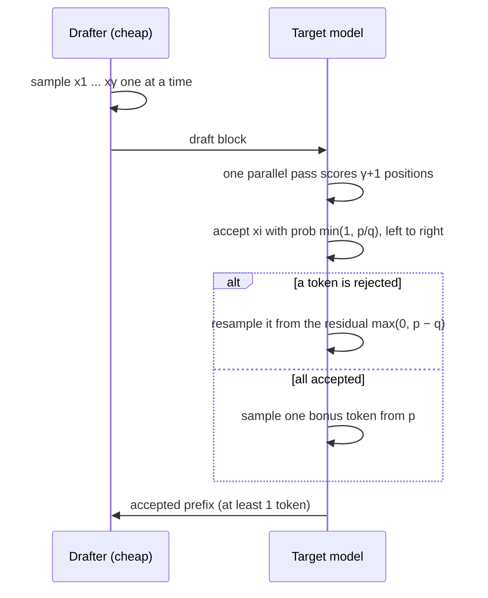

# Speculative decoding: several tokens per step, the same answer

A large language model writes one token at a time, and each token needs a full forward pass. At small batch sizes that pass is limited not by arithmetic but by memory: every weight has to be read from memory for every token (the starting observation of both Medusa, Cai et al. 2024, and Lookahead decoding, Fu et al. 2024). Checking five tokens costs about as much as generating one, because the weights are read once either way. **Speculative decoding** exploits that gap. A cheap drafter guesses several tokens ahead, the large model checks all of them in one pass, and a carefully designed acceptance rule makes the result *exactly* as if the large model had generated every token itself.

> The core idea in one sentence: **guess cheaply, verify in parallel, and accept with a rejection-sampling rule that provably leaves the target model's output distribution unchanged.**

This page expands the short section in [inference and efficiency](inference-and-efficiency.md). It connects to [hardware and training](hardware-and-training.md) (the roofline model), [attention gradients](../02-deep-learning/attention-gradients.md) (FlashAttention and the memory hierarchy), [mixture of experts](../02-deep-learning/mixture-of-experts.md), [state-space models](../02-deep-learning/state-space-models.md), and [code generation](../03-modern-ai/code-generation-and-program-synthesis.md).

## 1. Why decoding wastes the hardware (established)

During decoding, a dense model with $P$ parameters performs about $2P$ floating-point operations per token but must also move all $P$ weights from high-bandwidth memory to the chip. With one sequence in flight, the arithmetic finishes long before the weights arrive, so the chip mostly waits. Batching many users shares each weight read across them and raises throughput, but it does not make any single user faster. Speculative decoding attacks per-user latency instead: it verifies several of *one* user's future tokens with *one* weight read.

Ma et al. (2026) state the trade-off precisely in an energy study on H100 and H200 GPUs: every drafted token must be verified whether or not it is accepted, so the saving depends on how many drafted tokens are accepted, and it shrinks as batch size grows because batching has already shared the weight read.

The idea is older than large language models. Stern, Shazeer and Uszkoreit (2018) proposed **blockwise parallel decoding**: predict several future positions at once, then keep the longest prefix that the model itself would have produced greedily. They reported up to 2× fewer decoding iterations with no loss in quality and real-time speed-ups of up to 4× on translation and image super-resolution.

## 2. The acceptance rule and why it is exact (established)

Leviathan, Kalman and Matias (2023) and, independently, Chen et al. (2023) extended the idea from greedy decoding to *sampling*. Let $p$ be the target model's next-token distribution and $q$ the drafter's. The drafter samples $x \sim q$. Then:

1. Accept $x$ with probability $\min\left(1, p(x)/q(x)\right)$.
2. If rejected, sample a replacement from the **residual distribution**

```math
r(x) = \frac{\max\big(0,\; p(x) - q(x)\big)}{\sum_y \max\big(0,\; p(y) - q(y)\big)}.
```

**Why the output is exactly $p$.** The probability of emitting $x$ by acceptance is $q(x)\min(1, p(x)/q(x)) = \min(p(x), q(x))$. The total rejection probability is $1 - \sum_y \min(p(y), q(y)) = \sum_y \max(0, p(y) - q(y))$, so the probability of emitting $x$ through the residual is exactly $\max(0, p(x) - q(x))$. The two paths add up to $\min(p, q) + \max(0, p - q) = p$. Nothing about the drafter survives in the final distribution; a bad drafter only wastes time.

**How often a guess is accepted.** The acceptance probability is

```math
\alpha = \sum_x \min\big(p(x), q(x)\big) = 1 - \operatorname{TV}(p, q),
```

one minus the total variation distance between the two distributions. In greedy decoding the rule reduces to "accept if the drafter's token equals the target's argmax".

For a block of $\gamma$ drafted tokens, the target model scores all $\gamma$ positions plus one more in a single pass. Tokens are accepted left to right until the first rejection, which is replaced by a residual sample; if all $\gamma$ survive, the extra position yields a bonus token from $p$. Every target call therefore produces at least one token.



## 3. How much faster? (established)

If each drafted token is accepted independently with probability $\alpha$, the expected number of tokens produced per target call is (Leviathan et al. 2023)

```math
\mathbb{E}[\text{tokens per call}] = \frac{1 - \alpha^{\gamma+1}}{1 - \alpha},
```

which saturates at $1/(1-\alpha)$ as $\gamma$ grows. If one drafter step costs a fraction $c$ of a target step, and verifying $\gamma + 1$ positions costs about as much as one ordinary step (the memory-bound regime), the expected wall-clock speed-up is

```math
S(\gamma) = \frac{1 - \alpha^{\gamma+1}}{(1 - \alpha)(\gamma c + 1)}.
```

Two levers follow: make the drafter agree with the target more often (raise $\alpha$), and make it cheaper (lower $c$). Draft length has an optimum, because each extra guess costs $c$ but is less and less likely to be reached. Leviathan et al. reported 2–3× on T5-XXL with identical outputs; Chen et al. reported 2–2.5× on the 70B-parameter Chinchilla in a distributed setup.

## 4. A tested sketch

The code checks the acceptance rule's exactness, runs full speculative decoding on a toy bigram "language", computes the best draft length, and tests a multi-draft variant. It runs as written with NumPy in about 15 seconds.

```python
import numpy as np
rng=np.random.default_rng(0)
def softmax(z): z=z-z.max(-1,keepdims=True); e=np.exp(z); return e/e.sum(-1,keepdims=True)
def tv(a,b): return 0.5*np.abs(a-b).sum()

# Part 1: one-token speculative sampling is exact; acceptance = 1 - TV
V=50; N=400_000
zt=rng.normal(size=V)*1.5
print("Part 1")
for noise in [0.3,1.0,2.0]:
    p=softmax(zt); q=softmax(zt+rng.normal(size=V)*noise)
    x=rng.choice(V,size=N,p=q); u=rng.random(N)
    acc=u< np.minimum(1,p[x]/q[x])
    res=np.maximum(p-q,0); res/=res.sum()
    out=np.where(acc,x,rng.choice(V,size=N,p=res))
    emp=np.bincount(out,minlength=V)/N
    base=np.bincount(rng.choice(V,size=N,p=p),minlength=V)/N
    print(f"noise {noise}: TV(p,q)={tv(p,q):.3f} accept emp={acc.mean():.3f} theory={1-tv(p,q):.3f} | TV(out,p)={tv(emp,p):.4f} TV(direct,p)={tv(base,p):.4f}")

# Part 2: full speculative decoding on a bigram 'language'
print("Part 2")
V=30
T=softmax(rng.normal(size=(V,V))*2.0)              # target bigram
D=softmax(np.log(T)+rng.normal(size=(V,V))*0.7)    # draft: perturbed
alpha_ctx=1-0.5*np.abs(T-D).sum(1)
# stationary distribution of target
w,vec=np.linalg.eig(T.T); pi=np.real(vec[:,np.argmax(np.real(w))]); pi/=pi.sum()
alpha_bar=(pi*alpha_ctx).sum()
print(f"per-context acceptance range {alpha_ctx.min():.3f}-{alpha_ctx.max():.3f}, stationary mean {alpha_bar:.3f}")
def spec_decode(L,gamma):
    seq=[0]; calls=0
    while len(seq)<L+1:
        ctx=seq[-1]; drafts=[]; c=ctx
        for _ in range(gamma):
            x=rng.choice(V,p=D[c]); drafts.append(x); c=x
        calls+=1; c=ctx; ok=True
        for x in drafts:
            if rng.random()<min(1,T[c,x]/D[c,x]): seq.append(x); c=x
            else:
                r=np.maximum(T[c]-D[c],0); r/=r.sum(); seq.append(rng.choice(V,p=r)); ok=False; break
        if ok: seq.append(rng.choice(V,p=T[c]))
    return np.array(seq[:L+1]),calls
for gamma in [1,2,4,8]:
    L=60000; s,calls=spec_decode(L,gamma)
    big=np.zeros((V,V)); np.add.at(big,(s[:-1],s[1:]),1)
    cond=big/big.sum(1,keepdims=True)
    err=(pi*0.5*np.abs(cond-T).sum(1)).sum()
    tok=L/calls
    pred=(1-alpha_bar**(gamma+1))/(1-alpha_bar)
    print(f"gamma {gamma}: tokens/target call {tok:.3f} (mean-alpha formula {pred:.3f}); weighted TV of empirical bigram vs target {err:.4f}")
# reference noise level: plain autoregressive sampling, same length
s=[0]
for _ in range(60000): s.append(rng.choice(V,p=T[s[-1]]))
s=np.array(s); big=np.zeros((V,V)); np.add.at(big,(s[:-1],s[1:]),1); cond=big/big.sum(1,keepdims=True)
print(f"plain sampling weighted TV {(pi*0.5*np.abs(cond-T).sum(1)).sum():.4f}")

# Part 2b: best draft length under cost ratio c
print("Part 2b")
for c in [0.05,0.2]:
    for a in [0.6,0.8,0.9]:
        g=np.arange(1,21); sp=(1-a**(g+1))/((1-a)*(g*c+1)); i=sp.argmax()
        print(f"c={c} alpha={a}: best gamma {g[i]}, speedup {sp[i]:.2f}x")

# Part 3: k independent drafts with recursive rejection (SpecInfer-style) stays exact
print("Part 3")
V=50; p=softmax(zt); q=softmax(zt+rng.normal(size=V)*2.0); N=200_000
print(f"1-TV(p,q) for this pair {1-tv(p,q):.3f}")
for k in [1,2,4]:
    out=np.empty(N,int); first=np.zeros(N,bool)
    for n in range(N):
        r=p.copy(); done=False
        for j in range(k):
            x=rng.choice(V,p=q)
            if rng.random()<min(1,r[x]/q[x]): out[n]=x; first[n]=True; done=True; break
            r=np.maximum(r-q,0); r/=r.sum()
        if not done: out[n]=rng.choice(V,p=r)
    emp=np.bincount(out,minlength=V)/N
    print(f"k={k}: P(some draft accepted)={first.mean():.3f}  TV(out,p)={tv(emp,p):.4f}")
```

Output:

```text
Part 1
noise 0.3: TV(p,q)=0.141 accept emp=0.858 theory=0.859 | TV(out,p)=0.0039 TV(direct,p)=0.0033
noise 1.0: TV(p,q)=0.325 accept emp=0.675 theory=0.675 | TV(out,p)=0.0037 TV(direct,p)=0.0046
noise 2.0: TV(p,q)=0.660 accept emp=0.340 theory=0.340 | TV(out,p)=0.0034 TV(direct,p)=0.0039
Part 2
per-context acceptance range 0.538-0.902, stationary mean 0.775
gamma 1: tokens/target call 1.776 (mean-alpha formula 1.775); weighted TV of empirical bigram vs target 0.0323
gamma 2: tokens/target call 2.382 (mean-alpha formula 2.376); weighted TV of empirical bigram vs target 0.0312
gamma 4: tokens/target call 3.196 (mean-alpha formula 3.202); weighted TV of empirical bigram vs target 0.0284
gamma 8: tokens/target call 4.016 (mean-alpha formula 3.996); weighted TV of empirical bigram vs target 0.0281
plain sampling weighted TV 0.0299
Part 2b
c=0.05 alpha=0.6: best gamma 4, speedup 1.92x
c=0.05 alpha=0.8: best gamma 8, speedup 3.09x
c=0.05 alpha=0.9: best gamma 13, speedup 4.67x
c=0.2 alpha=0.6: best gamma 2, speedup 1.40x
c=0.2 alpha=0.8: best gamma 4, speedup 1.87x
c=0.2 alpha=0.9: best gamma 7, speedup 2.37x
Part 3
1-TV(p,q) for this pair 0.409
k=1: P(some draft accepted)=0.411  TV(out,p)=0.0048
k=2: P(some draft accepted)=0.466  TV(out,p)=0.0062
k=4: P(some draft accepted)=0.519  TV(out,p)=0.0043
```

What it shows:

1. **Exact, at any drafter quality.** Over 400,000 samples, the output of the acceptance rule is as close to the target distribution (total variation 0.0034 to 0.0039) as direct sampling from the target (0.0033 to 0.0046), whether the drafter is close (acceptance 0.858) or poor (0.340). The measured acceptance rates match $1 - \operatorname{TV}(p, q)$ to within 0.001.
2. **Whole sequences stay exact, and the formula predicts the yield.** With a drafter whose acceptance varies from 0.538 to 0.902 across contexts, speculative decoding of 60,000 tokens gives bigram statistics as close to the target (0.028 to 0.032) as plain sampling (0.030), while producing 1.78, 2.38, 3.20 and 4.02 tokens per target call at $\gamma$ = 1, 2, 4 and 8. The formula with the average acceptance (0.775) predicts 1.78, 2.38, 3.20 and 4.00. That close agreement is a property of this toy; when acceptance varies strongly and persistently between contexts, the mean-$\alpha$ formula is only an approximation.
3. **The best draft length depends on cost and agreement.** With a drafter costing 5% of the target, the optimum moves from $\gamma$ = 4 (1.92×) at $\alpha = 0.6$ to $\gamma$ = 13 (4.67×) at $\alpha = 0.9$. At 20% cost the same agreement levels give only 1.40× to 2.37×. A cheap drafter matters as much as an accurate one.
4. **More drafts, still exact.** Drawing up to $k$ independent drafts and applying the rejection rule to each in turn against the updated residual (the scheme SpecInfer uses for token trees) keeps the output exact (0.0043 to 0.0062) and raises the chance that some draft is accepted from 0.411 (matching $1 - \operatorname{TV} = 0.409$) to 0.466 at $k = 2$ and 0.519 at $k = 4$. The gain is modest here because independent samples from the same poor drafter often repeat each other; better tree methods choose diverse candidates.

## 5. Where the drafts come from (established and active research)

The acceptance rule is fixed; most of the research is about cheap, well-aligned drafts. All figures are as reported by the authors, on their own hardware and baselines.

| Drafter | Idea | Reported result |
|---|---|---|
| Small separate model (Leviathan et al. 2023; Chen et al. 2023) | A smaller model from the same family | 2–3× on T5-XXL; 2–2.5× on Chinchilla 70B |
| DistillSpec (Zhou et al. 2023) | Distill the drafter toward the target with on-policy data | 10–45% faster than standard speculative decoding |
| Online speculative decoding (Liu et al. 2023) | Keep updating the drafter on live queries | Acceptance up 0.1–0.65; 1.42–2.17× lower latency |
| Medusa (Cai et al. 2024) | Extra decoding heads on the target predict tokens further ahead, verified with tree attention | Over 2.2× with a frozen backbone (lossless); 2.3–3.6× with joint fine-tuning |
| Hydra (Ankner et al. 2024) | Draft heads that condition on earlier drafted tokens | Up to 1.31× over Medusa, 2.70× over autoregressive decoding |
| EAGLE (Li et al. 2024a) | Autoregress on the target's second-to-top-layer features, shifted by one token | 2.7–3.5× on LLaMA2-Chat 70B |
| EAGLE-2 (Li et al. 2024b) | Context-dependent draft trees built from the drafter's calibrated confidence | 3.05–4.26× |
| EAGLE-3 (Li et al. 2025) | Direct token prediction with multi-layer feature fusion ("training-time test") | Up to 6.5×; 1.38× throughput at batch 64 in SGLang |
| Draft & Verify (Zhang et al. 2023) | Draft with the same model by skipping layers | Up to 1.99× on LLaMA-2, no extra model |
| LayerSkip (Elhoushi et al. 2024) | Train with layer dropout and a shared early exit; draft from early layers | Up to 2.16× on summarization |
| REST (He et al. 2023); LLMA (Yang et al. 2023) | Copy draft spans from a datastore or from reference text in the context | 1.62–2.36× (REST); over 2× when outputs overlap references (LLMA) |
| Lookahead decoding (Fu et al. 2024) | No drafter: Jacobi-style parallel iteration proposes n-grams to verify | Up to 1.8× on MT-bench; 4× on code with several GPUs |
| Multi-token prediction (Gloeckle et al. 2024) | Pretrain with heads predicting $n$ future tokens | 4-token models up to 3× faster at inference |

Multi-token prediction has since become a pretraining ingredient: DeepSeek-V3 (DeepSeek-AI 2024) adopted a multi-token prediction training objective. Teoh (2026) decomposed the multi-token loss gradient into a self-distillation term, which helps speculative decoding, and a noisy residual, and reported that dropping the residual gave faster speculative decoding at every scale tested from 167M to 1.2B parameters.

**Parallel decoding as fixed-point iteration.** Greedy decoding of $n$ tokens is the solution of a system of $n$ equations, each token being the argmax given the ones before it. Santilli et al. (2023) solved that system with Jacobi and Gauss–Seidel iteration, reporting up to 38% faster translation and nearly 2× with more parallel resources. Plain Jacobi decoding rarely fixes more than one token per iteration; consistency LLMs (Kou et al. 2024) fine-tune the model to jump to the fixed point from any state, reporting 2.4–3.4× faster generation.

## 6. Trees, transport and verification (established)

Verifying a *tree* of candidates instead of one chain raises the expected accepted length per pass, because tree attention lets a single forward pass score many branches. SpecInfer (Miao et al. 2023) organizes drafts as a token tree verified in parallel and reports 1.5–2.8× for distributed serving and 2.6–3.5× for offloading. Spector and Ré (2023) combined trees with a second stage of speculation, a drafter for the drafter, for 3.16× lower single-batch latency on a 762M-parameter GPT-2-L. Sequoia (Chen et al. 2024) chooses the tree shape by dynamic programming and adapts it to the hardware, reporting up to 4.04× on Llama2-7B on an A100.

Sun et al. (2023) placed verification in the language of **optimal transport**. The single-draft rule above is the classical *maximal coupling*, which achieves the largest possible acceptance, $1 - \operatorname{TV}(p, q)$. With $k$ candidates the optimal draft selection is a linear program whose best-known runtime is exponential in $k$; their SpecTr algorithm reaches within a factor $(1 - 1/e)$ of the optimal acceptance in nearly linear time and gave a 2.13× wall-clock speed-up, 1.37× over standard speculative decoding.

**Lossless versus lossy.** Everything above preserves the target distribution exactly, up to floating-point effects (Chen et al. say "within hardware numerics"). Some methods relax this for speed. Big Little Decoder (Kim et al. 2023) lets the small model generate and calls the large one only to correct it, reporting up to 2.12× with minimal quality loss; Medusa's optional "typical acceptance" accepts plausible tokens instead of applying the exact rule. A lossy method changes what the model says, so its quality has to be measured, not assumed.

## 7. When it helps and when it doesn't (active research)

- **Batch size.** Speculation trades idle compute for latency. At large batches the chip is no longer idle and every rejected token is real wasted work. Ma et al. (2026) found that on dense models verification, not drafting, dominates the energy cost, and that at large batch sizes block drafters push verification into the compute-bound regime, "where the saving becomes a loss"; a low-acceptance drafter then raises energy per token. EAGLE-3's 1.38× throughput gain at batch 64 shows a strong drafter can still help.
- **Long contexts.** With long contexts the bottleneck shifts from weights to the KV cache. MagicDec (Sadhukhan et al. 2024) drafted with a sparse KV cache and reported up to 2.51× for Llama3.1-8B at batch sizes from 32 to 256, against the conventional wisdom that speculation only helps small batches. TriForce (Sun et al. 2024) drafts with the target's own weights over a retrieved sparse cache, itself sped up by a smaller model, for up to 2.31× on Llama2-7B-128K. LongSpec (Yang et al. 2025) reported up to 3.26× on long-context tasks and 2.25× lower wall-clock time on AIME24 reasoning with QwQ.
- **Mixture of experts.** Verifying several tokens can activate many different experts, so more weights must be read. Ranjan et al. (2026), across 10 sparse MoE models from 30B to 1T parameters, found that recent fine-grained models give *higher* speed-ups at low batch size than earlier analyses predicted, partly because draft tokens tend to route to the same experts. Lan (2026) derived when reading each shared expert only once per pass pays off, and found that on the engines tested it helps only at 5 to 8 tokens per pass, or never.
- **Reasoning traces.** Meng (2026) measured acceptance over about 1.78 million verification rounds on all 500 MATH-500 problems with a 7B reasoning model and found that acceptance does *not* decay with position, contrary to a common claim; rejections concentrate on reflection tokens such as "wait", "however" and "check".
- **What is being served.** Ma et al. (2026) found that every drafter they tested accepted fewer tokens on conversation than on code, and every trained drafter fewer on Romansh, a low-resource language, than on English. A speed-up measured on one workload does not transfer automatically.

Xia et al. (2024) survey the field and compare leading methods in a shared third-party test environment, which matters because reported speed-ups depend heavily on hardware, batch size and baseline implementation.

## 8. What we know and what we don't

| Claim | Status |
|---|---|
| The acceptance rule preserves the target distribution exactly and accepts with probability $1 - \operatorname{TV}(p, q)$ | Established (a two-line proof; reproduced above) |
| Single-user latency improves about 2–4× with good drafters on current GPUs | Established across many groups and models |
| Head-based and feature-level drafters beat separate small models | Supported (Medusa, Hydra, EAGLE), under each paper's own setup |
| Speculation also saves throughput or energy at large batch sizes | Contested; depends on acceptance, model family and hardware |
| Multi-token prediction pretraining improves models as well as speed | Supported at the scales tested; recent |
| Acceptance decays over long reasoning traces | Not supported for independent drafters in one 2026 study |

## 9. Verification as a division of labour (speculative)

> [!WARNING]
> **Speculative.** This section is a hypothesis, not a reported result. We cite no study that tests it.

The acceptance rule asks only two things of the target: its probabilities on the drafted tokens, computed in one parallel pass, and the ability to sample from the residual. Nothing requires the drafter to be digital, deterministic or accurate; its errors cost speed, never correctness. That suggests a division of labour for unusual hardware. A fast but imprecise substrate, such as the analog and optical accelerators on the [photonic computing](../06-frontiers/photonic-computing.md) and [memristive crossbar](../06-frontiers/memristive-crossbars-in-memory-computing.md) pages, could serve as the drafter while an exact digital model verifies. The output guarantee would hold however noisy the drafter is, and Section 3 says how good it must be to help: at a relative cost of 5%, an agreement rate of 0.6 already gives a modelled speed-up near 1.9×. The open questions are measurable: how much does analog noise lower $\alpha$ compared with a digital drafter of similar size, and does moving drafts between devices erase the gain?

## Further reading

- Stern, M., Shazeer, N., Uszkoreit, J. (2018). *Blockwise parallel decoding for deep autoregressive models*. NeurIPS. [arXiv:1811.03115](https://arxiv.org/abs/1811.03115)
- Leviathan, Y., Kalman, M., Matias, Y. (2023). *Fast inference from transformers via speculative decoding*. ICML. [arXiv:2211.17192](https://arxiv.org/abs/2211.17192)
- Chen, C., Borgeaud, S., Irving, G., Lespiau, J.-B., Sifre, L., Jumper, J. (2023). *Accelerating large language model decoding with speculative sampling*. [arXiv:2302.01318](https://arxiv.org/abs/2302.01318)
- Kim, S., Mangalam, K., Moon, S., Malik, J., Mahoney, M. W., Gholami, A., Keutzer, K. (2023). *Speculative decoding with big little decoder*. NeurIPS. [arXiv:2302.07863](https://arxiv.org/abs/2302.07863)
- Yang, N., Ge, T., Wang, L., Jiao, B., Jiang, D., Yang, L., Majumder, R., et al. (2023). *Inference with reference: Lossless acceleration of large language models*. [arXiv:2304.04487](https://arxiv.org/abs/2304.04487)
- Santilli, A., Severino, S., Postolache, E., Maiorca, V., Mancusi, M., Marin, R., Rodolà, E. (2023). *Accelerating transformer inference for translation via parallel decoding*. ACL. [arXiv:2305.10427](https://arxiv.org/abs/2305.10427)
- Miao, X., Oliaro, G., Zhang, Z., Cheng, X., Wang, Z., Zhang, Z., et al. (2023). *SpecInfer: Accelerating generative large language model serving with tree-based speculative inference and verification*. ASPLOS 2024. [arXiv:2305.09781](https://arxiv.org/abs/2305.09781)
- Spector, B., Ré, C. (2023). *Accelerating LLM inference with staged speculative decoding*. ES-FOMO workshop at ICML. [arXiv:2308.04623](https://arxiv.org/abs/2308.04623)
- Zhang, J., Wang, J., Li, H., Shou, L., Chen, K., Chen, G., Mehrotra, S. (2023). *Draft & verify: Lossless large language model acceleration via self-speculative decoding*. ACL 2024. [arXiv:2309.08168](https://arxiv.org/abs/2309.08168)
- Liu, X., Hu, L., Bailis, P., Cheung, A., Deng, Z., Stoica, I., Zhang, H. (2023). *Online speculative decoding*. [arXiv:2310.07177](https://arxiv.org/abs/2310.07177)
- Zhou, Y., Lyu, K., Rawat, A. S., Menon, A. K., Rostamizadeh, A., Kumar, S., et al. (2023). *DistillSpec: Improving speculative decoding via knowledge distillation*. [arXiv:2310.08461](https://arxiv.org/abs/2310.08461)
- Sun, Z., Suresh, A. T., Ro, J. H., Beirami, A., Jain, H., Yu, F. (2023). *SpecTr: Fast speculative decoding via optimal transport*. NeurIPS. [arXiv:2310.15141](https://arxiv.org/abs/2310.15141)
- He, Z., Zhong, Z., Cai, T., Lee, J. D., He, D. (2023). *REST: Retrieval-based speculative decoding*. NAACL 2024. [arXiv:2311.08252](https://arxiv.org/abs/2311.08252)
- Xia, H., Yang, Z., Dong, Q., Wang, P., Li, Y., Ge, T., et al. (2024). *Unlocking efficiency in large language model inference: A comprehensive survey of speculative decoding*. Findings of ACL. [arXiv:2401.07851](https://arxiv.org/abs/2401.07851)
- Cai, T., Li, Y., Geng, Z., Peng, H., Lee, J. D., Chen, D., Dao, T. (2024). *Medusa: Simple LLM inference acceleration framework with multiple decoding heads*. [arXiv:2401.10774](https://arxiv.org/abs/2401.10774)
- Li, Y., Wei, F., Zhang, C., Zhang, H. (2024a). *EAGLE: Speculative sampling requires rethinking feature uncertainty*. [arXiv:2401.15077](https://arxiv.org/abs/2401.15077)
- Fu, Y., Bailis, P., Stoica, I., Zhang, H. (2024). *Break the sequential dependency of LLM inference using lookahead decoding*. [arXiv:2402.02057](https://arxiv.org/abs/2402.02057)
- Ankner, Z., Parthasarathy, R., Nrusimha, A., Rinard, C., Ragan-Kelley, J., Brandon, W. (2024). *Hydra: Sequentially-dependent draft heads for Medusa decoding*. [arXiv:2402.05109](https://arxiv.org/abs/2402.05109)
- Chen, Z., May, A., Svirschevski, R., Huang, Y., Ryabinin, M., Jia, Z., Chen, B. (2024). *Sequoia: Scalable, robust, and hardware-aware speculative decoding*. [arXiv:2402.12374](https://arxiv.org/abs/2402.12374)
- Kou, S., Hu, L., He, Z., Deng, Z., Zhang, H. (2024). *CLLMs: Consistency large language models*. ICML. [arXiv:2403.00835](https://arxiv.org/abs/2403.00835)
- Sun, H., Chen, Z., Yang, X., Tian, Y., Chen, B. (2024). *TriForce: Lossless acceleration of long sequence generation with hierarchical speculative decoding*. COLM. [arXiv:2404.11912](https://arxiv.org/abs/2404.11912)
- Elhoushi, M., Shrivastava, A., Liskovich, D., Hosmer, B., Wasti, B., Lai, L., et al. (2024). *LayerSkip: Enabling early exit inference and self-speculative decoding*. ACL. [arXiv:2404.16710](https://arxiv.org/abs/2404.16710)
- Gloeckle, F., Youbi Idrissi, B., Rozière, B., Lopez-Paz, D., Synnaeve, G. (2024). *Better & faster large language models via multi-token prediction*. [arXiv:2404.19737](https://arxiv.org/abs/2404.19737)
- Li, Y., Wei, F., Zhang, C., Zhang, H. (2024b). *EAGLE-2: Faster inference of language models with dynamic draft trees*. [arXiv:2406.16858](https://arxiv.org/abs/2406.16858)
- Sadhukhan, R., Chen, J., Chen, Z., Tiwari, V., Lai, R., Shi, J., et al. (2024). *MagicDec: Breaking the latency-throughput tradeoff for long context generation with speculative decoding*. [arXiv:2408.11049](https://arxiv.org/abs/2408.11049)
- DeepSeek-AI, Liu, A., Feng, B., Xue, B., et al. (2024). *DeepSeek-V3 technical report*. [arXiv:2412.19437](https://arxiv.org/abs/2412.19437)
- Yang, P., Du, C., Zhang, F., Wang, H., Pang, T., Du, C., An, B. (2025). *LongSpec: Long-context lossless speculative decoding with efficient drafting and verification*. ACL. [arXiv:2502.17421](https://arxiv.org/abs/2502.17421)
- Li, Y., Wei, F., Zhang, C., Zhang, H. (2025). *EAGLE-3: Scaling up inference acceleration of large language models via training-time test*. [arXiv:2503.01840](https://arxiv.org/abs/2503.01840)
- Meng, Z. (2026). *Speculative acceptance does not decay with position: A full-length diagnostic on long chain-of-thought with independent drafts*. [arXiv:2610.30644](https://arxiv.org/abs/2610.30644)
- Lan, Y. (2026). *Speculative decoding for mixture-of-experts models: Expert bytes, kernel bandwidth and the best draft length*. [arXiv:2610.34440](https://arxiv.org/abs/2610.34440)
- Teoh, J. (2026). *Multi-token prediction done right*. [arXiv:2610.38331](https://arxiv.org/abs/2610.38331)
- Ranjan, E., Teru, K. K., Venkitesh, B., Locatelli, A. (2026). *Why speculative decoding works better than predicted on sparse MoE models*. [arXiv:2610.38981](https://arxiv.org/abs/2610.38981)
- Ma, B., Afzal, A., Eitzinger, J., Koestler, H., Wellein, G. (2026). *Only accepted tokens count: An energy accounting of speculative decoding under latency targets*. [arXiv:2610.40287](https://arxiv.org/abs/2610.40287)
