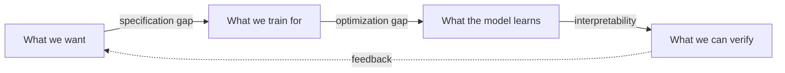

# 05 · Alignment, safety and interpretability

As AI systems become more capable and autonomous, three questions grow in importance:

1. **Alignment**: does the system pursue the goals we actually intend?
2. **Safety and robustness**: does it behave acceptably under pressure, attack, or novel conditions?
3. **Interpretability**: can we understand *why* it does what it does?

| Page | What you will learn |
|---|---|
| [Alignment and safety](alignment.md) | Specification problems, reward hacking, RLHF limits, scalable oversight, adversarial robustness, evaluation, control |
| [Reward models and how they fail](reward-model-failure-modes.md) | Bradley–Terry reward models, over-optimization curves, length bias, sycophancy, sophistry, reward tampering, and the mitigations that help |
| [Interpretability](interpretability.md) | Attribution, probing, circuits, superposition, sparse autoencoders, model editing |
| [Sparse autoencoders and the dictionary of features](sparse-autoencoders.md) | Dictionary learning against superposition, L1 to TopK and JumpReLU, Golden Gate Claude, transcoders and attribution graphs, and the 2025 evidence on what SAEs cannot tell you |

A broad framing of open problems is given by Amodei et al. (2016), *Concrete Problems in AI Safety*, and Ngo, Chan & Mindermann (2022), *The Alignment Problem from a Deep Learning Perspective*.
