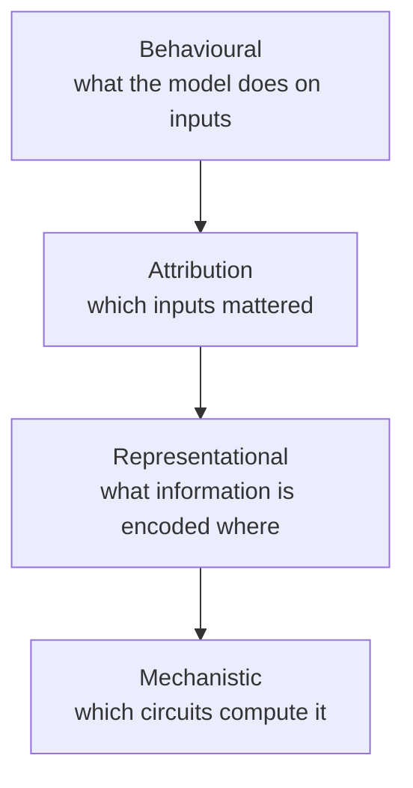

# Interpretability

Neural networks are not black boxes by necessity; they are black boxes because we have not finished reading them. Interpretability research tries to explain model behaviour in terms humans can check.

## Levels of explanation



## Attribution

Which parts of the input drove an output?

- **Gradient saliency**: $\partial y / \partial \mathbf{x}$.
- **Integrated gradients** (Sundararajan, Taly & Yan 2017): integrate gradients along a path from a baseline $\mathbf{x}'$ to the input,

```math
\mathrm{IG}_i(\mathbf{x}) = (x_i - x_i') \int_0^1 \frac{\partial f\big(\mathbf{x}' + \alpha(\mathbf{x} - \mathbf{x}')\big)}{\partial x_i}\, d\alpha
```

  which satisfies useful axioms such as *completeness* (attributions sum to $f(\mathbf{x}) - f(\mathbf{x}')$).

Attribution maps are a starting point, but they can be noisy and can look plausible without being faithful.

## Probing

Train a simple (often linear) classifier on a model's internal activations to test whether some property is decodable there, such as part of speech, sentiment, or board state. A striking example: a transformer trained only on Othello move sequences develops an internal representation of the board that can be read out and even edited to change its predictions (Li et al. 2023). Probing shows information is *present*, not that the model *uses* it.

## Mechanistic interpretability

The goal is to reverse-engineer networks into understandable algorithms.

- **Circuits** (Olah et al. 2020): in vision models, individual neurons and their connections implement recognizable features such as curve detectors.
- **Transformer circuits** (Elhage et al. 2021): a mathematical framework that treats attention heads as reading from and writing to a shared *residual stream*.
- **Induction heads** (Olsson et al. 2022): two-head circuits that implement pattern completion and appear abruptly during training, coinciding with a jump in in-context learning ability.
- **Grokking** analyses: in modular-arithmetic models that grok (Power et al. 2022), the learned algorithm can be read out of the weights; Nanda et al. (2023) found it uses discrete Fourier transforms and trigonometric identities.

## Superposition and sparse features

Why are many neurons *polysemantic*, responding to several unrelated concepts? **Elhage et al. (2022)** showed in toy models that networks can represent **more features than they have dimensions** by storing them as nearly orthogonal directions, provided features are sparse. This is **superposition**.

To undo it, **sparse autoencoders** (SAEs) learn an overcomplete dictionary of sparsely active directions:

```math
\mathbf{f} = \mathrm{ReLU}(W_e \mathbf{h} + \mathbf{b}_e), \qquad \hat{\mathbf{h}} = W_d \mathbf{f} + \mathbf{b}_d, \qquad
\mathcal{L} = \lVert \mathbf{h} - \hat{\mathbf{h}} \rVert^2 + \lambda \lVert \mathbf{f} \rVert_1
```

Bricken et al. (2023) found that SAE features in a small transformer were far more interpretable (monosemantic) than individual neurons.

## Locating and editing knowledge

**ROME** (Meng et al. 2022) used causal tracing to locate where factual associations are stored in GPT-style models (largely mid-layer MLPs) and edited single facts with a rank-one weight update. Model editing remains imperfect: edits can fail to generalize or have side effects.

## Why it matters

- **Safety**: detect deception, backdoors, or unwanted goals that behavioural tests miss (see [Alignment](alignment.md)).
- **Science**: understand what models have learned about language, vision, and the world.
- **Engineering**: debug failures and steer behaviour by intervening on known features.

## Open problems

- Scaling mechanistic methods from toy models to frontier models.
- Measuring whether an explanation is *faithful*, not just plausible.
- Connecting features and circuits to high-level behaviours such as planning.
