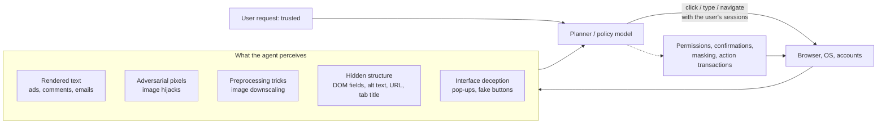

# Multimodal prompt injection for computer-use and browser agents

A text-only agent reads words. A computer-use agent reads *pixels*: it takes a screenshot, decides where to click, types, scrolls and takes another screenshot. Everything on the screen is now input, including the banner ad, the pop-up, the comment under a product, the faint grey text in an email footer, and the image a stranger uploaded. A browser agent also reads the page's structure, so it sees things a human never does: hidden form fields, alt text, the URL, the tab title. Any of these can carry an instruction, and the agent acts with the user's logged-in sessions.

This page extends [Prompt injection and tool-use security](prompt-injection-and-tool-use-security.md) to agents that see. It separates the channels an injection can travel (rendered text, adversarial pixels, preprocessing tricks, hidden structure, interface deception), reports what the computer-use benchmarks have measured, describes the defenses vendors and researchers have deployed, and explains why a small per-attack success rate is still a large per-deployment risk. A tested sketch reproduces four of the mechanisms in a few lines of NumPy.

> The core idea in one sentence: **for an agent that acts on what it sees, every pixel and every hidden attribute on the screen is an instruction channel, so the defenses that hold up are the ones that decide *what the agent may do* before it looks at untrusted content, not the ones that try to spot every bad pixel.**



## 1. What changes when the agent can see (established)

Three things change relative to a text agent.

**The input surface becomes the whole interface.** A text agent's untrusted inputs are usually enumerable: the tool outputs it requested. A computer-use agent (CUA) receives a full screen per step, composed by many parties: the site owner, its advertisers, its users, and whatever other windows are open. Liao et al. (2025) call attacks that plant content in the agent's environment *environmental injection*, and their EIA attack on a generalist web agent stole a user's specific personal data in up to 70% of 177 action steps drawn from Mind2Web, and the user's entire request in 16% (Liao et al. 2024).

**The model reads more than the person watching.** A screenshot agent may notice text a human skims past, and a browser agent that also reads the page's structure sees elements no human sees at all. Anthropic's red-teaming of its Chrome extension found attacks through hidden form fields in the page's DOM and through "URL text and tab title that only an agent might see" (Anthropic 2025a).

**Actions are cheap and general.** Clicking, typing and navigating can do nearly anything a logged-in person can do, so a hijacked click is not limited to one tool's API. Li et al. (2025) showed attacks on popular commercial and open-source agents that were "trivial to implement and require no understanding of machine learning".

Two attacks that also use images are worth separating from injection. **Typographic jailbreaks** such as FigStep render a forbidden request as an image to slip past safety training (82.50% average attack success on six open-source vision-language models; Gong et al. 2023): the attacker is the user, so this is a jailbreak in the sense of the [parent page](prompt-injection-and-tool-use-security.md#1-why-this-is-not-a-jailbreak-established). The older **typographic attack** on CLIP, where a written label overrides what the picture shows, was documented by Goh et al. (2021) and is the perceptual root of both.

## 2. Five channels for a visual injection (established; active research)

| Channel | What the attacker controls | Visible to the user? | Example evidence |
|---|---|---|---|
| Rendered text | Words that appear on screen: posts, reviews, emails, ads | Yes, if they look | VPI-Bench: up to 51% for CUAs, 100% for browser agents on some platforms (Cao et al. 2025) |
| Adversarial pixels | A small perturbation of an image the agent sees | No | Image hijacks above 80% success on LLaVA (Bailey et al. 2023); up to 67% on VisualWebArena agents with <5% of page pixels (Wu et al. 2024) |
| Preprocessing | An image that changes meaning after the system resizes it | No | Image-scaling injection exfiltrating calendar data through Gemini CLI with auto-approved tools (Morozova and Hussain 2025) |
| Hidden structure | DOM fields, alt text, URL, tab title, accessibility labels | No | Browser-specific attacks reduced from 35.7% to 0% only after targeted mitigations (Anthropic 2025a) |
| Interface deception | Pop-ups, fake buttons, misleading layout | Yes, and humans ignore them | 86% average click rate, task success down 47% (Zhang, Yu and Yang 2024) |

### 2.1 Rendered text

The simplest visual injection is ordinary text that happens to be on screen. VPI-Bench builds 306 interactive test cases on clones of five platforms (Amazon, Booking, BBC, Messenger and email) and plants a malicious prompt in each. Agents that act from screenshots were deceived at rates of up to 51% and HTML-reading browser agents at up to 100% on some platforms, and system-prompt defenses offered "only limited improvements" (Cao et al. 2025). The authors note that such text is usually easy for a human to spot; the threat model is the one people actually want, where the user delegates and walks away.

### 2.2 Adversarial pixels

A vision encoder is a high-dimensional function, and high-dimensional functions can be moved a long way by many tiny, aligned changes. Bagdasaryan et al. (2023) blended adversarial perturbations into images and audio recordings so that LLaVa and PandaGPT, when asked an innocent question about them, produced attacker-chosen text or followed an attacker's instruction for the rest of the dialogue. Bailey et al. (2023) generalised this into *image hijacks* trained by **Behaviour Matching**, and with *Prompt Matching* made an image behave like an arbitrary text prompt; all four attack types they studied (forced output, context leakage, safety override, false beliefs) exceeded 80% success against LLaVA with small perturbations.

In agents, Wu et al. (2024) built 200 targeted adversarial tasks on VisualWebArena and their Agent Robustness Evaluation (ARE) framework, which treats the agent as a graph of components and robustness as the flow of adversarial information along it. Imperceptible perturbations to a single image, under 5% of the page's pixels, hijacked agents built on black-box frontier models with success up to 67%. Adding inference-time machinery made things *worse*: compromising the reflexion agent's evaluator and the tree-search agent's value function raised attack success by a relative 15% and 20%. Every extra model that looks at the screen is another component the attacker can steer.

Images also travel between agents. Gu et al. (2024) simulated up to one million LLaVA-1.5 agents chatting in random pairs and showed that a single adversarial image placed in one agent's memory spread an *infectious jailbreak* to almost all of them exponentially fast, without further attacker action.

### 2.3 Preprocessing: the image the model sees is not the image you see

Systems usually resize images before the model sees them. A resampling algorithm turns many high-resolution pixels into one low-resolution pixel with fixed weights, so an attacker who knows the algorithm can solve the inverse problem: choose high-resolution pixels so the *downscaled* image says something the original does not. Xiao et al. (2019) demonstrated these camouflage attacks against classic vision pipelines. Morozova and Hussain (2025) of Trail of Bits turned them into multimodal prompt injection against production systems, including Gemini CLI, Vertex AI Studio, Gemini's web and API interfaces, Google Assistant on Android and the Genspark agentic browser, and released the **Anamorpher** tool to craft payloads for nearest-neighbour, bilinear and bicubic downscaling. Their Gemini CLI demonstration exfiltrated Google Calendar data to an attacker's email through a Zapier MCP server configured to approve tool calls automatically; Google told *The Register* that the default configuration requires confirmation, which is the point: the attack needed both an invisible channel and an unchecked action. Their recommended mitigations are to avoid downscaling or limit upload dimensions, to show the user the image the model actually receives, and to require explicit confirmation for sensitive tool calls.

### 2.4 Hidden structure

A browser agent that reads the DOM or accessibility tree has channels a screenshot does not: hidden inputs, `aria-label` text, alt text, off-screen elements, the URL and the tab title. EIA exploits exactly this, adapting injected elements to the surrounding page so they look native to the agent (Liao et al. 2024), and AdvAgent trains an adversarial prompter with reinforcement learning against a black-box GPT-4-based web agent, finding that existing prompt-based defenses gave only limited protection (Xu et al. 2024).

### 2.5 Interface deception

Not every attack needs an instruction. Zhang, Yu and Yang (2024) added adversarial pop-ups, of the kind humans recognise and close, to OSWorld and VisualWebArena. Agents clicked them 86% of the time on average and task success fell by 47%; telling the agent to ignore pop-ups or labelling them as advertisements did not help. A pop-up is a *salience* attack: it wins the agent's choice of where to click.

## 3. What computer-use benchmarks measure (established; active research)

| Benchmark | Setting | Size | Headline finding |
|---|---|---|---|
| VisualWebArena adversarial tasks (Wu et al. 2024) | Web, image perturbations | 200 tasks | Up to 67% targeted hijack; reflection and search add attack surface |
| Pop-ups (Zhang, Yu and Yang 2024) | OSWorld, VisualWebArena | — | 86% click rate, −47% task success |
| VPI-Bench (Cao et al. 2025) | Five web platforms, CUAs and browser agents | 306 cases | Up to 51% (CUA) and 100% (browser agent) |
| RTC-Bench in RedTeamCUA (Liao et al. 2025) | Hybrid web and OS sandbox | 864 examples | 42.9% for Claude 3.7 Sonnet CUA, 7.6% for Operator; attempt rate up to 92.5%; 60% end-to-end for Claude 4.5 Sonnet CUA |
| OS-Harm (Kuntz et al. 2025) | OSWorld: misuse, injection, misbehaviour | 150 tasks | Frontier agents "relatively vulnerable to static prompt injections"; LLM judge F1 0.76 and 0.79 against humans |

Two lessons recur. First, **attempts outrun successes**. RedTeamCUA reports that agents often *try* to carry out the injected task, with an attempt rate as high as 92.5%, and fail only because they are not capable enough. That is the visual version of WASP's "security by incompetence" discussed on the [parent page](prompt-injection-and-tool-use-security.md#6-benchmarks-and-the-adaptive-attack-problem-established-active-research), and it predicts that attack success will *rise* as agents get better at using computers, which is what the 60% end-to-end figure for a newer model suggests (Liao et al. 2025). Second, **static benchmarks understate adaptive attackers**: AdvAgent's RL-trained prompter and the vendor red-teaming below both search for attacks against the specific defended system.

## 4. Defenses (active research)

### 4.1 Training and classifiers

Vendors report layered defenses. When Anthropic previewed Claude for Chrome in August 2025, it reported 123 test cases across 29 attack scenarios, all run in autonomous mode: attack success was 23.6% without the new mitigations and 11.2% with them (improved system prompts, site-level permissions, blocking high-risk site categories, confirmations for high-risk actions, and early classifiers), and on a challenge set of four browser-specific attack types the mitigations cut success from 35.7% to 0% (Anthropic 2025a). In November 2025 Anthropic reported roughly 1% attack success for Claude Opus 4.5 with its safeguards against an internal adaptive Best-of-N attacker given 100 attempts per environment, from reinforcement learning on simulated web injections and classifiers that scan all untrusted content for "hidden text, manipulated images, deceptive UI elements", and stated plainly that 1% "still represents meaningful risk" (Anthropic 2025b). OpenAI described hardening its Atlas browser agent with an attacker model trained end-to-end by reinforcement learning, which proposes an injection, watches a simulated rollout of the defending agent's reasoning and actions, and iterates; it found long-horizon attacks unfolding over tens or hundreds of steps, such as an email that made the agent send a resignation letter, and used them to adversarially train a new model (OpenAI 2025).

Research detectors aim to be cheap enough to run on every screenshot. SnapGuard combines a visual signal (abnormally smooth gradient distributions around injected content) with action-oriented text recovered by contrast-polarity reversal, reaching F1 0.75 across eight attacks and two benign settings, better than prompting GPT-4o and 8× faster (1.81 s against 14.50 s per page; Du et al. 2026). An F1 of 0.75 is useful as one layer and far from sufficient as the only one.

### 4.2 Deciding before looking: masking and action transactions

The system-level ideas of the parent page (dual LLM, [CaMeL](prompt-injection-and-tool-use-security.md#5-defenses-around-the-model-isolation-by-design-active-research), information-flow control) assume tool outputs arrive as separable values. A screenshot mixes trusted controls and untrusted content in one image, and an attacker can also redirect a correct decision to the wrong place on the screen. Secure-CUA (Choudhary et al. 2026) formalises security requirements for both the agent's *decisions* and their *execution* as GUI commands. Before touching untrusted content, the agent commits to an **action transaction**: a small per-step program that fixes which questions may be asked of the untrusted content and how the answers may be used. Untrusted regions are masked from the planner, an isolated query model answers the transaction's questions, and the click target is located on the masked interface. Under its stated assumptions the design is secure by construction. On 400 benign WebArena tasks with three frontier models and five seeds (6,000 traces), it kept 53.55% task success against 55.12% for an undefended CUA and 13.17% for a CaMeL-style CUA. Those are utility numbers; the security claim rests on the model, not on an attack benchmark.

### 4.3 Permissions, confirmations and showing the user what the model saw

The plainest defenses are the ones the incidents above point to: per-site permissions, refusing high-risk site categories, confirmation for purchases, posts, sharing and deletion, and never auto-approving tools in an agent that ingests untrusted images. For preprocessing attacks specifically, showing the user the exact model-bound image closes the gap between what the user saw and what the model saw (Morozova and Hussain 2025). Confirmations have a cost the sketch below makes concrete: they only help if the human actually reads them.

## 5. A tested sketch

Four NumPy experiments that illustrate mechanisms. No real model, product or benchmark is measured, and the numbers describe the toy, not any deployed agent. The code below ran with NumPy and fixed seeds and prints every number quoted.

- **Part 1, image scaling.** A 256 × 256 grey decoy image is shown to the user; the model sees a 64 × 64 downscale. The attacker rewrites only the one pixel per 4 × 4 block that nearest-neighbour sampling keeps, so the downscale shows a dark-on-light payload. We measure how much of the full-resolution image changed and how clearly the payload appears in the model's view under nearest-neighbour and area-average resampling.
- **Part 2, bounded perturbations.** A linear "instruction detector" $s = w^\top x$ over $d = 224 \cdot 224 \cdot 3$ pixel values. An attacker may change a patch of a fraction $f$ of the pixels by at most $\varepsilon$ each. The aligned perturbation $\delta = \varepsilon\,\mathrm{sign}(w)$ on the patch shifts the score by $\varepsilon \lVert w_{\text{patch}} \rVert_1$, whereas random signs of the same size shift it by only about $\varepsilon \lVert w_{\text{patch}} \rVert_2$. For $n$ patch pixels with comparable weights the ratio grows like $\sqrt{n}$, which is why imperceptible perturbations can be decisive (the linearity argument of adversarial examples).
- **Part 3, pop-ups and masking.** Each step the agent clicks one of 12 elements, chosen by softmax over salience: the correct element has salience 6, ten distractors are standard normal, and an attacker pop-up has salience $s$. A masking defense hides untrusted regions, which removes the pop-up but, in a fraction $q = 0.1$ of tasks, also hides the element the task genuinely needs. A task is five steps, all of which must hit the correct element.
- **Part 4, many small chances.** If each exposure to attacker content hijacks the agent with probability $a$, and a hijack causes harm only when the user approves the resulting sensitive action with probability $m$, then under an independence assumption the chance of at least one harmful hijack over $n$ exposures is

```math
P_{\text{harm}}(n) = 1 - (1 - a\,m)^n .
```

We use $a = 0.112$ and $a = 0.01$ only because they match the scale of the vendor figures in §4.1; real attacks are not independent draws, and those figures were measured on specific attack sets, not per page visited.

```python
import numpy as np
rng = np.random.default_rng(0)

# ---- Part 1: an image-scaling injection -------------------------------------------
# A 256x256 grey "decoy" photo. The model only ever sees a 64x64 downscale. The attacker
# rewrites one pixel per 4x4 block (the one nearest-neighbour sampling keeps) so that the
# downscale spells a payload bitmap the user never sees at full resolution.
H, S = 256, 4
decoy = np.clip(0.45 + 0.08 * rng.standard_normal((H, H)), 0, 1)
payload = np.zeros((H // S, H // S)); payload[20:44, 8:56] = 1          # a dark text band
payload[24:40, 12:52] = (rng.random((16, 40)) < 0.5)                    # "letters"
crafted = decoy.copy()
crafted[S // 2::S, S // 2::S] = np.where(payload == 1, 0.0, 1.0)        # dark ink on light paper

def nearest(img): return img[S // 2::S, S // 2::S]
def area(img):    return img.reshape(H // S, S, H // S, S).mean(axis=(1, 3))
def readable(small):   # how well the model-bound image shows the payload (correlation)
    return np.corrcoef(small.ravel(), 1 - payload.ravel())[0, 1]

changed = np.mean(np.abs(crafted - decoy) > 1e-9)
print("Part 1: image-scaling injection")
print(f"  pixels changed at full res {changed:.4f}; mean |change| over whole image {np.mean(np.abs(crafted - decoy)):.4f}")
print(f"  payload readability: decoy+nearest {readable(nearest(decoy)):.3f}  crafted+nearest {readable(nearest(crafted)):.3f}"
      f"  crafted+area-average {readable(area(crafted)):.3f}")
c_near = np.ptp([nearest(crafted)[payload == 1].mean(), nearest(crafted)[payload == 0].mean()])
c_area = np.ptp([area(crafted)[payload == 1].mean(), area(crafted)[payload == 0].mean()])
print(f"  ink/paper contrast in model view: nearest {c_near:.3f}   area-average {c_area:.3f}")

# ---- Part 2: why tiny perturbations steer a vision encoder --------------------------
# A linear "instruction detector" inside the encoder: score = w . x over d pixels. The
# attacker may change only a patch of fraction f of the pixels by at most eps each.
d = 224 * 224 * 3
w = rng.standard_normal(d) / np.sqrt(d)
print("Part 2: score shift from a bounded patch (L-inf budget eps, patch fraction f)")
for f in [0.01, 0.05]:
    idx = rng.choice(d, int(f * d), replace=False)
    for eps in [1 / 255, 4 / 255, 8 / 255]:
        adv = eps * np.abs(w[idx]).sum()                                 # sign(w) perturbation
        rnd_sd = eps * np.sqrt((w[idx] ** 2).sum())
        print(f"  f={f:.2f} eps={eps * 255:.0f}/255: aligned shift {adv:.3f}   random-sign shift sd {rnd_sd:.4f}   ratio {adv / rnd_sd:.0f}x")

# ---- Part 3: pop-ups and masking untrusted regions ----------------------------------
# Each step the agent clicks one of 12 screen elements by softmax over salience. The
# correct element has salience 6; an attacker pop-up has salience s. A mask defense
# hides regions from untrusted origins (the pop-up, and, in a fraction q of tasks, the
# element the task genuinely needs, e.g. a link inside a third-party page).
print("Part 3: pop-up click rate and task success over 5-step tasks")
def run(s, mask, q, T=20000, steps=5):
    r = np.random.default_rng(3); hij = ok = 0
    for _ in range(T):
        need_untrusted = r.random() < q
        success = True; hijacked = False
        for _ in range(steps):
            sal = np.r_[6.0, r.normal(0, 1, 10), s]                      # target, 10 others, pop-up
            if mask:
                sal[-1] = -np.inf                                          # pop-up masked
                if need_untrusted: sal[0] = -np.inf                       # target masked too
            p = np.exp(sal - sal.max()); p /= p.sum()
            c = r.choice(12, p=p)
            if c == 11: hijacked = True
            if c != 0: success = False
        hij += hijacked; ok += success
    return hij / T, ok / T
for s in [-np.inf, 4.0, 6.0, 8.0]:
    h0, u0 = run(s, False, 0.0); h1, u1 = run(s, True, 0.1)
    print(f"  pop-up salience {s:4.0f}: no mask  hijacked {h0:.3f} task ok {u0:.3f}   |  mask (q=0.10)  hijacked {h1:.3f} task ok {u1:.3f}")

# ---- Part 4: a small per-exposure rate over a long deployment -----------------------
# A browser agent meets attacker content on some pages. Each exposure hijacks it with
# probability a. Sensitive actions need user approval; a hijack causes harm only if the
# agent's request slips past the user (probability m that the user approves a bad one).
print("Part 4: chance of at least one harmful hijack")
for a in [0.112, 0.01]:
    for m in [1.0, 0.1]:
        row = [1 - (1 - a * m) ** n for n in [1, 10, 100, 1000]]
        print(f"  per-exposure ASR {a:.3f}, approval miss {m:.1f}: " + "  ".join(f"n={n}:{v:.3f}" for n, v in zip([1, 10, 100, 1000], row)))
```

Output:

```text
Part 1: image-scaling injection
  pixels changed at full res 0.0625; mean |change| over whole image 0.0330
  payload readability: decoy+nearest 0.008  crafted+nearest 1.000  crafted+area-average 0.792
  ink/paper contrast in model view: nearest 1.000   area-average 0.063
Part 2: score shift from a bounded patch (L-inf budget eps, patch fraction f)
  f=0.01 eps=1/255: aligned shift 0.012   random-sign shift sd 0.0004   ratio 31x
  f=0.01 eps=4/255: aligned shift 0.049   random-sign shift sd 0.0016   ratio 31x
  f=0.01 eps=8/255: aligned shift 0.099   random-sign shift sd 0.0032   ratio 31x
  f=0.05 eps=1/255: aligned shift 0.060   random-sign shift sd 0.0009   ratio 69x
  f=0.05 eps=4/255: aligned shift 0.239   random-sign shift sd 0.0035   ratio 69x
  f=0.05 eps=8/255: aligned shift 0.478   random-sign shift sd 0.0069   ratio 69x
Part 3: pop-up click rate and task success over 5-step tasks
  pop-up salience -inf: no mask  hijacked 0.000 task ok 0.820   |  mask (q=0.10)  hijacked 0.000 task ok 0.739
  pop-up salience    4: no mask  hijacked 0.457 task ok 0.445   |  mask (q=0.10)  hijacked 0.000 task ok 0.739
  pop-up salience    6: no mask  hijacked 0.966 task ok 0.028   |  mask (q=0.10)  hijacked 0.000 task ok 0.739
  pop-up salience    8: no mask  hijacked 1.000 task ok 0.000   |  mask (q=0.10)  hijacked 0.000 task ok 0.739
Part 4: chance of at least one harmful hijack
  per-exposure ASR 0.112, approval miss 1.0: n=1:0.112  n=10:0.695  n=100:1.000  n=1000:1.000
  per-exposure ASR 0.112, approval miss 0.1: n=1:0.011  n=10:0.107  n=100:0.676  n=1000:1.000
  per-exposure ASR 0.010, approval miss 1.0: n=1:0.010  n=10:0.096  n=100:0.634  n=1000:1.000
  per-exposure ASR 0.010, approval miss 0.1: n=1:0.001  n=10:0.010  n=100:0.095  n=1000:0.632
```

What the toy shows:

- **Part 1.** Changing 6.25% of pixels, with a mean absolute change of 0.033 over the whole image, makes the payload appear perfectly in the nearest-neighbour view (correlation 1.000 against the payload, versus 0.008 for the untouched decoy). Area averaging cuts the ink-to-paper contrast 16× (1.000 to 0.063) but the faint payload is still strongly correlated with the target (0.792), so a vision model that reads low-contrast text could still see it. Resampling choices *weaken* this attack; showing the user the model-bound image *exposes* it.
- **Part 2.** With the same per-pixel budget, an aligned perturbation moves the score 31× more than random noise on a 1% patch and 69× more on a 5% patch; the ratio does not depend on $\varepsilon$, and the aligned shift grows linearly with both $\varepsilon$ and the patch size. Small and local is not the same as weak.
- **Part 3.** Without a pop-up the agent completes 0.820 of tasks. A pop-up of salience 4 hijacks 0.457 of tasks and halves success to 0.445; at salience 6 and 8 hijacking reaches 0.966 and 1.000 and the tasks almost never finish, which is the pattern Zhang, Yu and Yang (2024) measured. Masking untrusted regions removes hijacking entirely at every salience, and the price is the 10% of tasks that needed an untrusted element: success 0.739 instead of 0.820. Masking trades a fixed, predictable utility cost for robustness that does not depend on how salient the attack is.
- **Part 4.** At $a = 0.112$ without effective confirmation, ten exposures already give 0.695; at $a = 0.01$, a hundred exposures give 0.634 and a thousand give 1.000. A confirmation step that lets through one bad request in ten is worth exactly a 10× cut in $a$: $a = 0.01$ with $m = 0.1$ gives 0.095 at 100 exposures and still 0.632 at 1,000. For an agent that browses all day, per-attack rates need to be judged against how many attacks it will meet.

## 6. Status at a glance

| Claim | Status | Evidence |
|---|---|---|
| Text rendered on screen can redirect computer-use and browser agents | Established | VPI-Bench, RedTeamCUA, OS-Harm, vendor red-teaming |
| Small adversarial image perturbations can hijack vision-language models and web agents | Established (open models and transfer to black-box agents) | Bagdasaryan et al.; Bailey et al.; Wu et al. |
| Image downscaling can hide injections from the user in production systems | Demonstrated | Trail of Bits disclosure; earlier camouflage attacks |
| Adding evaluators, reflection or search increases attack surface | Demonstrated on one benchmark | Wu et al. (2024) |
| Agents attempt injected tasks far more often than they complete them | Measured | RedTeamCUA attempt rates up to 92.5% |
| Adversarial training plus classifiers can bring adaptive-attack success to about 1% | Vendor-reported, internal attacker | Anthropic (2025b) |
| Lightweight screenshot detectors are accurate enough to rely on alone | Not established (F1 0.75) | SnapGuard |
| Masking plus per-action transactions gives security by design at small utility cost | Proposed; benign utility measured, security proven under model assumptions | Secure-CUA |

## 7. Speculative: what a secure screen might look like

> **Speculative.** The ideas in this section are hypotheses for discussion, not established results.

- **Provenance-labelled pixels.** Browsers already know which origin drew each region of the page. Passing that origin map to the agent alongside the screenshot, as a second image channel, would let masking and action transactions work from ground truth rather than from a model's guess about which regions are untrusted. The open question is how to handle iframes, user-generated content on trusted origins and canvas-rendered apps.
- **Exposure budgets.** Part 4 suggests reporting agent security as a curve of harm against exposures, not as a single attack success rate, and setting deployment limits (number of untrusted pages per session before a human checkpoint) from it.
- **Canonical model views.** A preprocessing pipeline that renders exactly one canonical image for both the user preview and the model, with a fixed, published resampler, would remove the gap that image-scaling attacks exploit. It would not help against attacks visible in the canonical view, which is why it belongs alongside, not instead of, permission checks.
- **Click-target attestation.** Secure-CUA separates *deciding* on an action from *locating* its target. A further step would be for the operating system to attest which application and origin owns the pixel under each click, so a correct decision cannot be redirected by an overlay.

## Further reading

- The parent page, [Prompt injection and tool-use security for agents](prompt-injection-and-tool-use-security.md), for the confused-deputy framing, text-level defenses and CaMeL.
- [AI control protocols](ai-control-protocols.md), for treating the agent itself as potentially untrusted, including Control OSWorld.
- [Retrieval, tools and agents](../03-modern-ai/retrieval-tools-and-agents.md), for how computer-use agents are built.
- [Multimodal models](../03-modern-ai/multimodal-models.md), for how vision encoders feed language models.
- All sources are listed in [REFERENCES.md](../../REFERENCES.md#multimodal-prompt-injection-for-computer-use-agents).
