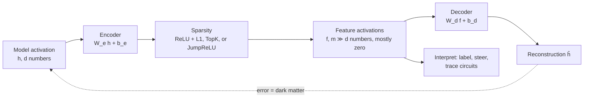
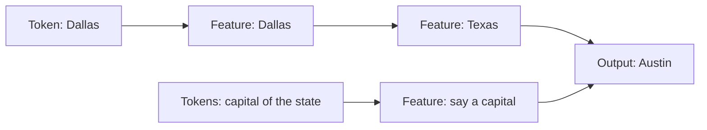

# Sparse autoencoders and the dictionary of features

Open up a language model and look at a single neuron, and you often find a mess: the same unit fires for several unrelated things. Between 2022 and 2025 one idea did more than any other to change that picture. Instead of reading neurons, train a second, much wider network to rewrite each activation vector as a **sparse sum of directions** drawn from a learned dictionary, and read *those* directions instead. The tool is the **sparse autoencoder** (SAE). It turned a one-layer toy result into maps of millions of concepts inside production models, made "turn this concept up" a literal operation, and became the building block for tracing whole circuits.

It also became the first interpretability method to be stress-tested hard enough to show its limits. This page covers both halves: what dictionary learning is, why it works, how the architecture evolved, and what the 2025 negative results say about how far to trust it. It goes deeper than the overview in [Interpretability](interpretability.md#superposition-and-sparse-features).

> The core idea in one sentence: **if a network stores more concepts than it has neurons by overlapping them, a wide and sparse re-encoding can pull them apart again, but the result is a useful decomposition of activation space, not a certified list of what the model "really" uses.**



## 1. The problem: superposition (established)

A neuron is **monosemantic** if it responds to one concept and **polysemantic** if it responds to several unrelated ones. Elhage et al. (2022) explained why polysemanticity is the default in toy models. If a network must represent $m$ features in $d < m$ dimensions, and each feature is rarely active, it can assign every feature its own direction $\mathbf{u}_i \in \mathbb{R}^d$ and accept a little interference:

```math
\mathbf{h} \;\approx\; \sum_{i=1}^{m} a_i\, \mathbf{u}_i, \qquad a_i \ge 0,\quad \text{most } a_i = 0 .
```

Because random directions in high dimensions are nearly orthogonal, many more than $d$ of them fit with small overlaps, and because few features are on at once, the overlaps rarely collide. Elhage et al. called this **superposition**. Its consequence for interpretability is blunt: if the features are stored along directions that are not aligned with any neuron, then no amount of staring at neurons will recover them. You have to find the directions.

## 2. Dictionary learning, the old idea (established)

Recovering sparse codes over an overcomplete dictionary is a classical problem. Olshausen and Field (1996) trained a sparse code on patches of natural images and found that the learned dictionary looked like the oriented, localized receptive fields of simple cells in the visual cortex, a founding result of computational neuroscience. Makhzani and Frey (2013) proposed the **$k$-sparse autoencoder**, which keeps only the $k$ largest hidden units, an idea that would return a decade later.

The modern SAE applies the same recipe to a network's activations. With encoder $W_e \in \mathbb{R}^{m \times d}$, decoder $W_d \in \mathbb{R}^{d \times m}$ and $m \gg d$:

```math
\mathbf{f} = \sigma(W_e(\mathbf{h} - \mathbf{b}_d) + \mathbf{b}_e), \qquad
\hat{\mathbf{h}} = W_d \mathbf{f} + \mathbf{b}_d, \qquad
\mathcal{L} = \lVert \mathbf{h} - \hat{\mathbf{h}} \rVert_2^2 + \lambda\, \mathcal{S}(\mathbf{f}),
```

where $\sigma$ is a nonnegative activation and $\mathcal{S}$ a sparsity penalty. Each column of $W_d$ (kept at unit norm) is a candidate feature direction, and $f_i$ says how strongly feature $i$ is present. Two numbers summarize a trained SAE: **L0**, the average number of active features per input, and the **fraction of variance unexplained** (FVU) or, better, the increase in the language model's loss when $\hat{\mathbf{h}}$ is spliced in place of $\mathbf{h}$.

## 3. From one layer to a frontier model (established)

Two groups published the first convincing results on language models in the autumn of 2023. Cunningham, Ewart, Riggs, Huben and Sharkey (2023) showed that SAE features in a language model were more interpretable and monosemantic, by automated scoring, than directions found by alternative methods, and pinpointed the features causally responsible for behaviour on the indirect-object-identification task more finely than earlier decompositions. Bricken et al. (2023) trained SAEs on the 512-neuron MLP layer of a one-layer transformer, with dictionaries from 512 up to 131,072 features, and documented features for Arabic script, DNA sequences, base64 and Hebrew, plus **feature splitting**: as the dictionary grows, one broad feature splits into a family of finer ones.

The scale-up came fast:

| Work | Model | Largest dictionary | What it showed |
|---|---|---|---|
| Templeton et al. (May 2024) | Claude 3 Sonnet, middle layer | about 34 million features | Abstract, multilingual and multimodal features, including safety-relevant ones (deception, sycophancy, unsafe code); steering by clamping features |
| Gao et al. (June 2024) | GPT-4 | 16 million latents, trained on 40 billion tokens | TopK SAEs, few dead latents, clean scaling laws in dictionary size and sparsity |
| Lieberum et al., *Gemma Scope* (Aug 2024) | Gemma 2 2B, 9B, select layers of 27B | Open JumpReLU SAEs on every layer and sub-layer of 2B and 9B | Made SAE research possible outside large labs |
| He et al., *Llama Scope* (Oct 2024) | Llama-3.1-8B | 256 SAEs with 32K and 128K features | Open TopK-variant SAEs; tests of transfer to long contexts and fine-tuned models |

The most memorable demonstration was **Golden Gate Claude** (Anthropic, May 2024): with the Golden Gate Bridge feature clamped high, the model steered almost every answer toward the bridge. It was online for 24 hours as a research demo, and it made a point that years of attribution maps had not: at least some SAE features are causal handles on behaviour, not just correlations.

## 4. The sparsity penalty, and why it kept changing (established)

The original penalty was the L1 norm, $\mathcal{S}(\mathbf{f}) = \lVert \mathbf{f} \rVert_1$, the convex surrogate for counting nonzeros familiar from the lasso. It has a known side effect, **shrinkage**: L1 punishes the *size* of an activation, not just whether it is on, so the SAE systematically under-reports how strongly a feature is present and trades reconstruction for small numbers. Most architectural progress in 2024 was about getting closer to the quantity we actually want, the L0 count.

| Variant | Idea | Source |
|---|---|---|
| **ReLU + L1** | Convex penalty on magnitudes | Cunningham et al. 2023; Bricken et al. 2023 |
| **Gated SAE** | Separate "is it on?" and "how much?" paths, with the penalty only on the gate | Rajamanoharan et al. (Apr 2024) |
| **TopK** | Keep the $k$ largest pre-activations; L0 is fixed at $k$, no penalty term | Makhzani & Frey 2013; Gao et al. 2024 |
| **JumpReLU** | A learned threshold per feature, $f_i = z_i \cdot \mathbf{1}[z_i > \theta_i]$, trained with straight-through estimators to penalize L0 directly | Rajamanoharan et al. (Jul 2024) |
| **BatchTopK** | Keep the top $k \times B$ activations across a batch of $B$ inputs, so busy inputs get more features and quiet ones fewer | Bussmann, Leask & Nanda (Dec 2024) |
| **Matryoshka SAE** | Nested dictionaries trained so that every prefix reconstructs well on its own, aiming at features at several levels of abstraction | Bussmann et al. (Mar 2025) |
| **End-to-end SAE** | Train to preserve the model's output distribution (KL) instead of reconstructing the activation | Braun et al. (May 2024) |

Each reported a better reconstruction-versus-sparsity frontier than its predecessors on the models it was tested on. Whether that frontier is the right target is the subject of Section 7.

### A tested sketch

The script below plants 128 known feature directions in a 32-dimensional space (each active with probability 0.03, so about 3.8 per input), then trains a 256-latent SAE with either an L1 penalty or TopK and asks three questions: how much variance is unexplained, what fraction of the planted features has a dictionary atom within cosine similarity 0.9, and how big the SAE's activation is relative to the true magnitude (a ratio of 1 means no shrinkage). It needs only NumPy and runs in about 80 seconds on a laptop CPU.

```python
import numpy as np
rng = np.random.default_rng(0)
d, m, p = 32, 128, 0.03          # dims, true features, activation prob
F = rng.normal(size=(m, d)); F /= np.linalg.norm(F, axis=1, keepdims=True)
def sample(n):
    on = rng.random((n, m)) < p
    mag = rng.uniform(0.5, 1.5, (n, m)) * on
    return mag @ F, mag
def train(kind, k=4, lam=3e-3, steps=6000, n_dict=256, lr=2e-3, bs=512):
    We = rng.normal(size=(d, n_dict)) / np.sqrt(d); Wd = We.T.copy()
    Wd /= np.linalg.norm(Wd, axis=1, keepdims=True); be = np.zeros(n_dict); bd = np.zeros(d)
    mom = [np.zeros_like(x) for x in (We, be, Wd, bd)]; vs = [np.zeros_like(x) for x in mom]
    for t in range(1, steps + 1):
        x, _ = sample(bs)
        pre = (x - bd) @ We + be
        f = np.maximum(pre, 0)
        if kind == 'topk':
            thr = -np.partition(-f, k - 1, axis=1)[:, k - 1:k]
            f = np.where(f >= thr, f, 0); f = np.where(pre > 0, f, 0)
        xh = f @ Wd + bd; err = xh - x
        g_xh = 2 * err / bs
        g_Wd = f.T @ g_xh; g_bd = g_xh.sum(0)
        g_f = g_xh @ Wd.T
        if kind == 'l1': g_f = g_f + lam * np.sign(f) / bs  # L1 penalty, averaged over the batch
        g_pre = g_f * (f > 0)
        g_We = (x - bd).T @ g_pre; g_be = g_pre.sum(0); g_bd = g_bd - (g_pre @ We.T).sum(0)
        for i, (P, G) in enumerate(zip((We, be, Wd, bd), (g_We, g_be, g_Wd, g_bd))):  # Adam
            mom[i] = 0.9 * mom[i] + 0.1 * G; vs[i] = 0.999 * vs[i] + 0.001 * G * G
            P -= lr * (mom[i] / (1 - 0.9**t)) / (np.sqrt(vs[i] / (1 - 0.999**t)) + 1e-8)
        Wd /= np.linalg.norm(Wd, axis=1, keepdims=True)   # unit-norm dictionary atoms
    x, mag = sample(20000)
    pre = (x - bd) @ We + be; f = np.maximum(pre, 0)
    if kind == 'topk':
        thr = -np.partition(-f, k - 1, axis=1)[:, k - 1:k]; f = np.where(f >= thr, f, 0)
    xh = f @ Wd + bd
    fvu = ((xh - x)**2).sum() / ((x - x.mean(0))**2).sum()
    cos = np.abs(F @ Wd.T)              # planted features vs dictionary atoms
    rec = (cos.max(1) > 0.9).mean()
    l0 = (f > 0).sum(1).mean()
    best = cos.argmax(1); ratios = []
    for j in range(m):
        if cos[j, best[j]] > 0.9:
            act = mag[:, j] > 0
            ratios.append(np.median(f[act, best[j]] / mag[act, j]))
    return fvu, rec, l0, np.median(ratios) if ratios else float('nan')
neur = np.abs(F).max(1)  # best single neuron (basis axis) for each planted feature
print('expected active features per input', m * p)
print('basis-neuron match >0.9:', (neur > 0.9).mean())
for kind, kw in [('l1', dict(lam=0.3)), ('l1', dict(lam=1.0)), ('topk', dict(k=4)), ('topk', dict(k=8))]:
    print(kind, kw, 'FVU %.3f recovered %.3f L0 %.2f median act/true %.3f' % train(kind, **kw))
```

Output (NumPy, seed 0):

```text
expected active features per input 3.84
basis-neuron match >0.9: 0.0
l1 {'lam': 0.3} FVU 0.130 recovered 0.828 L0 25.94 median act/true 0.334
l1 {'lam': 1.0} FVU 0.383 recovered 0.977 L0 6.61 median act/true 0.220
topk {'k': 4} FVU 0.186 recovered 1.000 L0 4.00 median act/true 0.690
topk {'k': 8} FVU 0.128 recovered 1.000 L0 8.00 median act/true 0.576
```

Four things are visible even in a toy. First, **no neuron is monosemantic**: none of the 128 planted features lines up with any of the 32 axes, which is superposition by construction. Second, **the SAE finds them anyway**: TopK recovers every planted direction, and L1 recovers 97.7% once its penalty is strong enough. Third, **L1 pays for sparsity in two currencies**: pushing L0 from 26 down to 6.6 raised the unexplained variance from 13% to 38%, and the activations it reports are a third or less of the true magnitudes. Fourth, **TopK reaches L0 = 4 with FVU 0.19 and much less shrinkage**. Even TopK reads below 1 here; we did not isolate why, and a 256-atom dictionary for 128 features leaves room for near-duplicate atoms to share a feature. The toy is deliberately easy (features really are sparse, linear and independent), which is exactly the assumption Section 7 questions for real models.

## 5. From features to circuits (active research)

Features at one layer describe *what* is represented. To explain *how* a model computes, you need the connections between features across layers.

- **Sparse feature circuits.** Marks et al. (2024) used SAE features as the nodes of causal graphs found by attribution patching, and introduced SHIFT, which improves a classifier's generalization by ablating features that a human judges irrelevant to the task.
- **Transcoders.** An SAE reconstructs an activation from itself; a transcoder instead predicts an MLP's *output* from its *input* through a wide, sparse hidden layer, so the MLP can be swapped for something readable. Dunefsky, Chlenski and Nanda (2024) found transcoders at least on par with SAEs in sparsity, faithfulness and human interpretability, and used them to analyze the "greater-than" circuit in GPT-2 small.
- **Crosscoders.** Lindsey et al. (Oct 2024, a preliminary research update) introduced dictionaries that read and write across several layers, or across two models, which allows features that persist through the residual stream to be counted once and supports **model diffing** between a base and a fine-tuned model.
- **Attribution graphs.** Ameisen et al. (Mar 2025) replaced every MLP of a model with a **cross-layer transcoder**, giving a "replacement model" whose computation on a given prompt can be drawn as a graph of feature-to-feature effects. The companion paper (Lindsey et al. 2025) applied it to Claude 3.5 Haiku and reported, among other case studies, two-hop reasoning ("the capital of the state containing Dallas" passes through an internal "Texas" step that can be edited) and **planning in poetry**, where candidate rhyme words are represented before the line that ends in them is written.

The authors are candid about the limits: the graphs describe a replacement model that "incompletely and imperfectly captures the original", and they report satisfying insight for about a quarter of the prompts they tried.



*A simplified sketch of the two-hop example described by Lindsey et al. (2025); the real graph has many more nodes and weights.*

## 6. How features get labelled at scale (established)

Nobody can read 34 million features. Bills et al. (2023) proposed **automated interpretability**: one language model writes an explanation of a unit from its top activating examples, and another tries to predict the unit's activations from that explanation alone; the agreement is the explanation's score. Paulo et al. (2024) built an open pipeline for millions of SAE features with five cheaper scoring techniques, including intervention scoring, which judges a feature by the effect of turning it up rather than by when it fires. These scores are now the default way SAE papers report interpretability, which is why the result in the next section matters.

## 7. The reckoning: what SAEs do not give you (active research)

From late 2024, a series of careful papers asked whether SAE features are *the model's* features, and whether they help on tasks where we can check the answer.

| Finding | Evidence |
|---|---|
| **Dictionaries depend on the random seed** | In a 131K-latent SAE on a Llama 3 8B feed-forward layer, only 30% of features were shared across seeds; TopK SAEs were more seed-dependent than L1 ones (Paulo & Belrose 2025) |
| **Hierarchies get absorbed** | When features form a hierarchy, sparsity rewards folding a parent ("starts with S") into its children, so a seemingly clean feature silently fails to fire on some cases; changing size or sparsity did not fix it (Chanin et al. 2024) |
| **Not every feature is a line** | Some features in GPT-2 and Mistral 7B are irreducibly multi-dimensional, such as circles representing days of the week and months of the year, used for modular arithmetic on them (Engels et al. 2024) |
| **Dark matter is structured** | About half of the SAE error vector, and over 90% of its norm, can be linearly predicted from the input activation, and larger SAEs mostly fail on the same contexts as smaller ones (Engels, Riggs & Tegmark 2024) |
| **Random networks look interpretable too** | SAEs trained on randomly initialized Pythia transformers can score similarly to trained ones on common reconstruction and auto-interpretability metrics (Heap et al. 2025) |
| **Proxy metrics do not predict usefulness** | Across 200+ SAEs and eight metrics, gains on proxy metrics did not reliably translate to practical tasks; Matryoshka SAEs did best on disentanglement despite slightly worse proxies (Karvonen et al. 2025, SAEBench) |
| **Probes beat SAEs on a real task** | For detecting harmful intent out of distribution, SAE-based probes underperformed plain linear probes, and the Google DeepMind interpretability team announced it was deprioritising fundamental SAE research (Smith et al., Mar 2025); a parallel study across data scarcity, class imbalance, label noise and covariate shift found no consistent gain from adding SAEs to strong baselines (Kantamneni et al. 2025) |

Read together, these results do not say SAEs are useless. They say an SAE is a **lens with its own optics**. Paulo and Belrose put it well: the features it finds are "a pragmatically useful decomposition of activation space, rather than an exhaustive and universal list of features 'truly used' by the model." For safety, that distinction matters. An auditor who finds no "deception" feature in an SAE has learned something about the SAE, not a proof about the model. Sharkey et al. (2025) list the open problems, from defining a feature at all to validating explanations against ground truth.

## 8. Status

| Claim | Status |
|---|---|
| Networks store more features than neurons via superposition | Established in toy models; strongly supported in language models |
| SAEs recover many human-interpretable, causally steerable directions | Established at frontier scale (Claude 3 Sonnet, GPT-4, open Gemma and Llama suites) |
| TopK, JumpReLU and BatchTopK improve reconstruction at fixed sparsity over L1 | Well supported on the models tested |
| SAE features are a unique, canonical set of the model's features | Not supported: seed dependence, absorption and multi-dimensional features argue against it |
| SAEs beat simple baselines on downstream tasks such as probing | Mostly not, in 2025 tests; exceptions are task-specific |
| Feature circuits and attribution graphs explain real behaviours | Active research; compelling case studies on a replacement model, partial coverage |

## 9. Sparse codes as a hardware interface (speculative)

> [!WARNING]
> **Speculative.** This section sketches a research direction. It is not an established result, and no system is claimed to work this way.

An SAE turns a dense vector into a short list of (index, value) pairs over a fixed set of directions. That is also a description of what low-power and analog hardware likes: few active channels, each driven by a stored, reusable vector. One could imagine using dictionary features as the unit of communication between a digital controller and an analog or optical accelerator, sending only the handful of active features rather than the full activation, or using a feature's decoder norm and activation statistics to decide how much precision its channel deserves. The open questions are the ones in Section 7, made sharper by physics: whether a dictionary learned on clean digital activations stays stable when the activations carry analog noise, how much of the "dark matter" error a downstream layer can tolerate, and whether the sparsity of real activations is high enough to pay for the encoding. Each could be tested in simulation before any hardware is involved.

## Further reading

- Olshausen, B. A., Field, D. J. (1996). *Emergence of simple-cell receptive field properties by learning a sparse code for natural images*. Nature 381, 607–609. [doi:10.1038/381607a0](https://doi.org/10.1038/381607a0)
- Makhzani, A., Frey, B. (2013). *k-Sparse autoencoders*. [arXiv:1312.5663](https://arxiv.org/abs/1312.5663)
- Elhage, N., et al. (2022). *Toy models of superposition*. Transformer Circuits Thread. [arXiv:2209.10652](https://arxiv.org/abs/2209.10652)
- Bills, S., et al. (2023). *Language models can explain neurons in language models*. OpenAI. [Link](https://openaipublic.blob.core.windows.net/neuron-explainer/paper/index.html)
- Cunningham, H., Ewart, A., Riggs, L., Huben, R., Sharkey, L. (2023). *Sparse autoencoders find highly interpretable features in language models*. [arXiv:2309.08600](https://arxiv.org/abs/2309.08600)
- Bricken, T., Templeton, A., Batson, J., Chen, B., Jermyn, A., et al. (2023). *Towards monosemanticity: Decomposing language models with dictionary learning*. Transformer Circuits Thread. [Link](https://transformer-circuits.pub/2023/monosemantic-features/index.html)
- Marks, S., Rager, C., Michaud, E. J., Belinkov, Y., Bau, D., Mueller, A. (2024). *Sparse feature circuits: Discovering and editing interpretable causal graphs in language models*. [arXiv:2403.19647](https://arxiv.org/abs/2403.19647)
- Rajamanoharan, S., Conmy, A., Smith, L., Lieberum, T., Varma, V., Kramár, J., Shah, R., Nanda, N. (2024). *Improving dictionary learning with gated sparse autoencoders*. [arXiv:2404.16014](https://arxiv.org/abs/2404.16014)
- Braun, D., Taylor, J., Goldowsky-Dill, N., Sharkey, L. (2024). *Identifying functionally important features with end-to-end sparse dictionary learning*. [arXiv:2405.12241](https://arxiv.org/abs/2405.12241)
- Templeton, A., Conerly, T., Marcus, J., Lindsey, J., Bricken, T., Chen, B., et al. (2024). *Scaling monosemanticity: Extracting interpretable features from Claude 3 Sonnet*. Transformer Circuits Thread. [Link](https://transformer-circuits.pub/2024/scaling-monosemanticity/index.html)
- Anthropic (2024). *Golden Gate Claude*. May 23, 2024. [Link](https://www.anthropic.com/news/golden-gate-claude)
- Engels, J., Michaud, E. J., Liao, I., Gurnee, W., Tegmark, M. (2024). *Not all language model features are one-dimensionally linear*. [arXiv:2405.14860](https://arxiv.org/abs/2405.14860)
- Gao, L., Dupré la Tour, T., Tillman, H., Goh, G., Troll, R., Radford, A., Sutskever, I., Leike, J., Wu, J. (2024). *Scaling and evaluating sparse autoencoders*. [arXiv:2406.04093](https://arxiv.org/abs/2406.04093)
- Dunefsky, J., Chlenski, P., Nanda, N. (2024). *Transcoders find interpretable LLM feature circuits*. [arXiv:2406.11944](https://arxiv.org/abs/2406.11944)
- Rajamanoharan, S., Lieberum, T., Sonnerat, N., Conmy, A., Varma, V., Kramár, J., Nanda, N. (2024). *Jumping ahead: Improving reconstruction fidelity with JumpReLU sparse autoencoders*. [arXiv:2407.14435](https://arxiv.org/abs/2407.14435)
- Lieberum, T., Rajamanoharan, S., Conmy, A., Smith, L., Sonnerat, N., Varma, V., Kramár, J., Dragan, A., Shah, R., Nanda, N. (2024). *Gemma Scope: Open sparse autoencoders everywhere all at once on Gemma 2*. [arXiv:2408.05147](https://arxiv.org/abs/2408.05147)
- Chanin, D., Wilken-Smith, J., Dulka, T., Bhatnagar, H., Golechha, S., Bloom, J. (2024). *A is for absorption: Studying feature splitting and absorption in sparse autoencoders*. [arXiv:2409.14507](https://arxiv.org/abs/2409.14507)
- Paulo, G., Mallen, A., Juang, C., Belrose, N. (2024). *Automatically interpreting millions of features in large language models*. [arXiv:2410.13928](https://arxiv.org/abs/2410.13928)
- Engels, J., Riggs, L., Tegmark, M. (2024). *Decomposing the dark matter of sparse autoencoders*. [arXiv:2410.14670](https://arxiv.org/abs/2410.14670)
- Lindsey, J., Templeton, A., Marcus, J., Conerly, T., Batson, J., Olah, C. (2024). *Sparse crosscoders for cross-layer features and model diffing*. Transformer Circuits Thread (research update). [Link](https://transformer-circuits.pub/2024/crosscoders/index.html)
- He, Z., Shu, W., Ge, X., Chen, L., Wang, J., Zhou, Y., Liu, F., Guo, Q., Huang, X., et al. (2024). *Llama Scope: Extracting millions of features from Llama-3.1-8B with sparse autoencoders*. [arXiv:2410.20526](https://arxiv.org/abs/2410.20526)
- Bussmann, B., Leask, P., Nanda, N. (2024). *BatchTopK sparse autoencoders*. [arXiv:2412.06410](https://arxiv.org/abs/2412.06410)
- Sharkey, L., Chughtai, B., Batson, J., Lindsey, J., Wu, J., Bushnaq, L., Goldowsky-Dill, N., Heimersheim, S., Ortega, A., et al. (2025). *Open problems in mechanistic interpretability*. [arXiv:2501.16496](https://arxiv.org/abs/2501.16496)
- Paulo, G., Belrose, N. (2025). *Sparse autoencoders trained on the same data learn different features*. [arXiv:2501.16615](https://arxiv.org/abs/2501.16615)
- Heap, T., Lawson, T., Farnik, L., Aitchison, L. (2025). *Automated interpretability metrics do not distinguish trained and random transformers* (first released as *Sparse autoencoders can interpret randomly initialized transformers*). [arXiv:2501.17727](https://arxiv.org/abs/2501.17727)
- Kantamneni, S., Engels, J., Rajamanoharan, S., Tegmark, M., Nanda, N. (2025). *Are sparse autoencoders useful? A case study in sparse probing*. [arXiv:2502.16681](https://arxiv.org/abs/2502.16681)
- Karvonen, A., Rager, C., Lin, J., Tigges, C., Bloom, J., Chanin, D., Lau, Y.-T., Farrell, E., McDougall, C., et al. (2025). *SAEBench: A comprehensive benchmark for sparse autoencoders in language model interpretability*. [arXiv:2503.09532](https://arxiv.org/abs/2503.09532)
- Bussmann, B., Nabeshima, N., Karvonen, A., Nanda, N. (2025). *Learning multi-level features with Matryoshka sparse autoencoders*. [arXiv:2503.17547](https://arxiv.org/abs/2503.17547)
- Smith, L., Rajamanoharan, S., Conmy, A., McDougall, C., Kramár, J., Lieberum, T., Shah, R., Nanda, N. (2025). *Negative results for SAEs on downstream tasks and deprioritising SAE research (GDM Mech Interp Team Progress Update #2)*. AI Alignment Forum, March 26, 2025. [Link](https://www.alignmentforum.org/posts/4uXCAJNuPKtKBsi28/negative-results-for-saes-on-downstream-tasks)
- Ameisen, E., Lindsey, J., Pearce, A., Gurnee, W., Turner, N. L., Chen, B., Citro, C., et al. (2025). *Circuit tracing: Revealing computational graphs in language models*. Transformer Circuits Thread. [Link](https://transformer-circuits.pub/2025/attribution-graphs/methods.html)
- Lindsey, J., Gurnee, W., Ameisen, E., Chen, B., Pearce, A., Turner, N. L., Citro, C., et al. (2025). *On the biology of a large language model*. Transformer Circuits Thread. [Link](https://transformer-circuits.pub/2025/attribution-graphs/biology.html)
