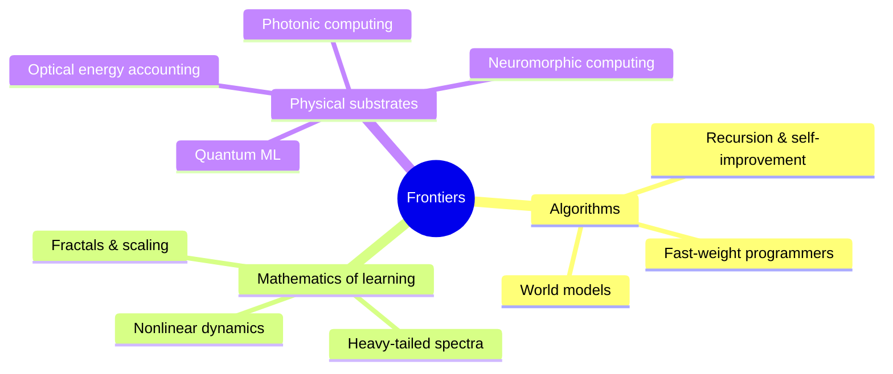

# 06 · Frontiers

This is where the map runs out and the territory is still being surveyed. Each page separates three things clearly:

- **Established**: demonstrated results with citations.
- **Active research**: promising directions with mixed or early evidence.
- **Speculative**: open hypotheses, marked with a warning callout.

| Page | The question it asks |
|---|---|
| [Recursion and self-improvement](recursion-and-self-improvement.md) | Can AI systems improve the process that produces them, and what limits that loop? |
| [Fast-weight programmers and self-referential networks](fast-weight-programmers.md) | What happens when a network writes another network's weights, or its own, while it runs, and why is that the same thing as linear attention? |
| [Fractal and self-similar structure](fractal-and-self-similar-structure.md) | Why do power laws, scale invariance, and fractal boundaries keep appearing in learning? |
| [Heavy-tailed weight spectra](heavy-tailed-weight-spectra.md) | Why do trained weight matrices develop power-law eigenvalue spectra, and can that predict how well a model generalizes without any data? |
| [Non-linearity and dynamical systems](nonlinearity-and-dynamical-systems.md) | What can chaos theory, the edge of chaos, and differential equations tell us about networks? |
| [Photonic and optical computing](photonic-computing.md) | Can light do the matrix multiplications of AI faster and with less energy? |
| [Optical energy and nonlinearity](optical-energy-and-nonlinearity.md) | Where does the energy of an optical neural network actually go, what physics sets the floor, and why is the nonlinearity the hard part? |
| [Neuromorphic computing](neuromorphic-computing.md) | What happens when hardware computes with spikes and local memory, like brains? |
| [Quantum machine learning](quantum-machine-learning.md) | Where, if anywhere, do quantum computers offer real advantages for learning? |
| [World models](world-models.md) | Can systems learn internal simulators of their environment and plan with them? |

These threads interlock. Nonlinear dynamics explains why physical systems can compute; photonic and neuromorphic hardware are physical dynamical systems pressed into computing; scaling laws hint at self-similar structure in data; and self-improving systems need world models to plan their own improvements.
