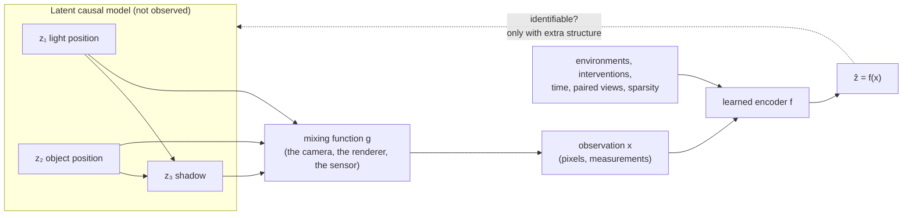

# Causal representation learning

A model trained on photographs learns that cows stand on grass. Show it a cow on a beach and it may call the cow something else. Nothing in the training objective asked the model to separate *what causes the label* from *what happens to appear next to it*. **Causal representation learning** is the attempt to make models discover the variables of the world (objects, positions, forces, light sources) in a form where causal reasoning about them is possible: where you can ask what happens if one of them is changed while the others stay put. This page covers the causal language the field borrows, the surprising theorem that unsupervised disentanglement is impossible, the kinds of extra signal that make it possible again, how invariance across environments links to robustness, what large language models can and cannot do with causality, and how badly current methods still do on a real physical system.

> **The core idea.** Observations $x$ are produced by a mixing function $x = g(z)$ from a few latent causal variables $z$ that influence each other through a structural causal model. From observational data alone, $g$ and $z$ are not identifiable: many different latent models produce exactly the same data. Identification becomes possible only with extra structure, such as several environments, interventions, time, paired views, or restrictions on $g$. Every method on this page is a choice of which extra structure to assume.



## 1. The causal vocabulary (established)

A **structural causal model (SCM)** writes each variable as a function of its direct causes and an independent noise term, $z_i := f_i(\mathrm{pa}(z_i), \varepsilon_i)$, with the parent relation forming a directed acyclic graph (Pearl, 2009). An **intervention** $\mathrm{do}(z_i = a)$ replaces one of these assignments by a constant (a *perfect* or *hard* intervention) or by a different mechanism (a *soft* intervention), and leaves all the others alone. Pearl's framework separates three kinds of question:

| Level | Question | Example | Needs |
|---|---|---|---|
| Association | What does seeing $x$ tell me about $y$? | Patients who take the drug recover more often | The joint distribution |
| Intervention | What happens to $y$ if I set $x$? | Would recovery go up if everyone took the drug? | The causal graph, or experiments |
| Counterfactual | What would have happened to *this* unit had $x$ been different? | Would this patient have recovered without the drug? | The full structural model |

Two ideas from this literature matter most for machine learning. The first is the **independent causal mechanisms** principle: the mechanism producing each variable from its causes does not inform or influence the others, so a change in the world tends to change *one* mechanism while the rest stay the same (Schölkopf et al., 2021). This is the "sparse mechanism shift" intuition behind most of the field. The second is the difference between **causal and anticausal learning** (Schölkopf et al., 2012). Predicting an effect from its cause (a protein's shape from its sequence) is causal; predicting a cause from its effect (a digit's label from its image, since the writer chose the digit before drawing it) is anticausal. They argued that semi-supervised learning can help only in the anticausal direction, because only there does the distribution of inputs carry information about the mechanism that produces the label.

### Finding the arrows between observed variables

Classic **causal discovery** starts from variables that are already measured. From observational data alone, conditional-independence tests can only recover the graph up to its **Markov equivalence class**: $X \to Y$ and $Y \to X$ are indistinguishable from two variables. The symmetry breaks with assumptions about the noise. If the relation is linear and the noise is non-Gaussian, the direction is identifiable (LiNGAM; Shimizu et al., 2006); if the relation is nonlinear with additive noise, it generically is too (Hoyer et al., 2008). Section 5 tests the linear version. NOTEARS turned structure learning into continuous optimization with a smooth acyclicity constraint (Zheng et al., 2018), but Reisach et al. (2021) showed that on standard simulated benchmarks, marginal variance tends to grow along the causal order. Their measure of this, **varsortability**, explains much of the strong benchmark performance; a simple baseline that sorts variables by variance matches it, and on standardized data the same algorithms fail to recover the graph. It is a recurring lesson on this page: benchmarks quietly leak the answer.

## 2. Why representations are the hard part: identifiability (established)

In vision, robotics, or language, nobody hands you $z_1, z_2, z_3$. You get pixels. The question becomes whether an encoder $f$ can recover the latent causal variables from $x = g(z)$, and in what sense. A representation is **identifiable** up to some ambiguity (permutation, rescaling, elementwise transformation) if every model that fits the data equally well recovers the same latents up to that ambiguity.

**The linear case already shows the problem.** Take independent Gaussian sources $z \sim \mathcal N(0, I)$ and observations $x = Az$. For any rotation $R$, the sources $Rz$ are also independent standard Gaussians, and $x = (AR^\top)(Rz)$. The two models give *exactly* the same distribution of $x$, so no amount of data can tell them apart. **Independent component analysis (ICA)** escapes this when the sources are non-Gaussian: Comon (1994) showed that if at most one source is Gaussian, the mixing matrix is identifiable up to permutation and scaling of its columns. FastICA (Hyvärinen and Oja, 2000) is the standard algorithm.

**The nonlinear case is far worse.** Hyvärinen and Pajunen (1999) showed that for a general nonlinear mixing, solutions to nonlinear ICA always exist and are highly non-unique: one can build infinitely many nonlinear transformations of $x$ whose outputs are statistically independent and still mix the true sources. Statistical independence alone does not pin down the factors.

**Disentanglement hit the same wall.** By 2018 a large literature trained variational autoencoders with extra pressure toward factorized latents (for example $\beta$-TCVAE, which isolates a total-correlation term in the VAE objective; Chen et al., 2018) and measured how well each latent matched one ground-truth factor. Locatello et al. (2019) proved that unsupervised learning of disentangled representations is fundamentally impossible without inductive biases on both models and data, then trained more than 12,000 models covering the main methods and metrics on seven datasets. The methods did enforce the properties their losses encouraged, but well-disentangled models could not be identified without supervision, and more disentanglement did not obviously reduce the samples needed for downstream tasks. The paper received the ICML 2019 best paper award and reset the field's agenda: the question stopped being "which loss disentangles?" and became "which *assumptions* make the factors identifiable, and are those assumptions true of the data?"

## 3. Routes back to identifiability (established theory, active research in practice)

Every positive result adds information that breaks the symmetries of section 2. The table groups the main families. All of them are proofs about idealized settings: infinite data, a correct model class, and assumptions that hold exactly.

| Extra structure | Idea | Representative result |
|---|---|---|
| **Auxiliary variable** (time segment, environment, class label) | Latents are conditionally independent given an observed $u$ whose changes modulate them | Time-contrastive learning (Hyvärinen and Morioka, 2016); generalized contrastive learning (Hyvärinen et al., 2019); identifiable VAE, iVAE (Khemakhem et al., 2020) |
| **Paired views** (augmentations, before/after) | Two observations share some latents and differ in others | Contrastive learning inverts the generative process under its assumptions (Zimmermann et al., 2021); augmentations isolate shared *content* from *style* (von Kügelgen et al., 2021); weak supervision from pairs (Locatello et al., 2020b; Brehmer et al., 2022) |
| **Interventions** on latents | Data from perfect or soft interventions on individual latent variables | Perfect do-interventions identify latents up to permutation and scaling (Ahuja et al., 2023); in the linear case, one intervention per latent is both necessary and sufficient (Squires et al., 2022); nonparametric results with unknown targets (von Kügelgen et al., 2023) |
| **Time and actions** | Interventions observed in temporal sequences, or sparse dependence of latents on past latents and actions | CITRIS (Lippe et al., 2022); mechanism sparsity regularization (Lachapelle et al., 2021) |
| **Restrictions on the mixing** | Rule out the "spurious" nonlinear solutions by constraining $g$ | Independent mechanism analysis (Gresele et al., 2021) |

Hyvärinen et al. (2023) review how the identifiability results connect, from linear ICA through structural-equation models to nonlinear ICA. Yao et al. (2024) proposed a unifying reading: many CRL methods do not really climb Pearl's hierarchy, they align representations with **invariances** in the data (which parts stay fixed across views, environments, or interventions), and those invariances need not be causal at all. That reframing matters in practice, because it lets one method mix causal and non-causal assumptions to fit the problem.

The interventional results deserve a closer look because they are the cleanest. Ahuja et al. (2023) observe that a perfect intervention on $z_i$ breaks the dependence between $z_i$'s support and that of its ancestors, a geometric signature an encoder can detect; with perfect interventions the latents are identified up to permutation and scaling with no assumptions on their distribution. Squires et al. (2022) proved the matching lower bound for linear latent models: if even one latent lacks an intervention, distinct models exist that cannot be told apart. A practical reading: identification needs roughly one *experiment* per variable you hope to recover.

## 4. Invariance, environments and shortcut learning (established problem, contested fixes)

A causal mechanism $p(y \mid \text{causes of } y)$ should stay the same across environments that change other things; the correlation between $y$ and its effects or confounders need not. **Invariant causal prediction (ICP)** turns this into a test: among subsets of features, accept those for which the residuals of predicting $y$ have the same distribution in every training environment, and report their intersection with confidence guarantees (Peters et al., 2016). **Invariant risk minimization (IRM)** tried to carry the idea into deep networks by seeking a representation on which a single classifier is optimal in every environment (Arjovsky et al., 2019).

The deep-learning versions have struggled. Rosenfeld et al. (2020) showed that in a simple linear setting IRM can fail to recover the invariant predictor when there are too few environments, and that in the nonlinear regime it can fail badly in ways that ordinary training would too. Gulrajani and Lopez-Paz (2021) built DomainBed, seven multi-domain datasets with nine algorithms and three model-selection rules, and found that carefully tuned **empirical risk minimization** (plain pooled training) matched or beat the domain-generalization methods on every dataset. They also argued that a method without a model-selection rule is incomplete, since choosing hyperparameters on test-domain data quietly leaks the answer.

Meanwhile the failure that motivates all this keeps turning up. Geirhos et al. (2020) collected examples under the name **shortcut learning**: decision rules that do well on standard benchmarks and fail under small changes, such as relying on texture or background rather than shape. Beery et al. (2018) showed animal classifiers trained on camera-trap images generalizing poorly to new camera locations. Zech et al. (2018) trained pneumonia detectors on chest X-rays from several hospital systems and found that performance was often significantly lower on hospitals not seen in training. The networks could also identify which hospital system and department an image came from, and because pneumonia prevalence differed sharply between sites, hospital identity alone was a strong predictor of the label. The open problem is not to *notice* such failures but to learn representations that avoid them without being told which features are spurious.

## 5. A tested sketch: four small demonstrations

Four NumPy experiments, run before publication with the script in the appendix (20,000 samples each, fixed seeds; about 7 seconds on a laptop CPU).

**(1) Gaussian sources are not identifiable; non-Gaussian ones are.** Two sources are mixed by a fixed $2\times2$ matrix $A$, then whitened and unmixed with symmetric FastICA from 10 random starts. Recovery is the mean, over true sources, of the best absolute correlation with a recovered component (1 is perfect).

| Sources | Min | Mean | Max |
|---|---|---|---|
| Laplace | 1.000 | 1.000 | 1.000 |
| Uniform | 1.000 | 1.000 | 1.000 |
| Gaussian | 0.720 | 0.908 | 0.999 |

For Gaussian sources the answer depends on the random start: the algorithm returns an arbitrary rotation. The script also checks the exact argument of section 2 with a rotation by $\pi/5$: the latents $Rz$ with mixing $AR^\top$ reproduce *the same samples* of $x$ to $8.9\times10^{-16}$, yet the first rotated latent has correlation only 0.811 with the first true one.

**(2) Environments rescue identifiability, but only if they change things differently.** Keep Gaussian sources and the same mixing, but add a second environment where the source variances change. The generalized eigenvectors of the two observed covariance matrices then unmix the data (the linear core of the auxiliary-variable idea in section 3).

| Second environment | Recovery | Generalized eigenvalues |
|---|---|---|
| Variances scaled by 3 and 0.5 | 1.000 | 0.51 and 3.03 (true 0.5 and 3) |
| Both variances doubled | 0.928 | 2.00 and 2.05 (a near tie) |

When both sources change by the same factor, the eigenvalues tie and any rotation fits again; the 0.928 is an arbitrary answer, not a partial success. Environments help only when they move different latents differently, which is the content of the "sufficiently diverse environments" conditions in the iVAE and interventional theorems.

**(3) Non-Gaussian noise reveals the causal direction.** With $Y = X + 0.8N$, regress each variable on the other and measure the dependence between regressor and residual with the Hilbert–Schmidt independence criterion (HSIC, Gaussian kernels, median bandwidth, 2,000 points).

| Noise | HSIC, causal direction | HSIC, backward direction | Ratio |
|---|---|---|---|
| Uniform | 0.00005 | 0.00739 | 136.6 |
| Gaussian | 0.00014 | 0.00012 | 0.9 |

With uniform noise, only the true direction leaves a residual independent of the regressor (the LiNGAM principle). With Gaussian noise the two directions look the same, which is the Markov-equivalence barrier of section 1 in its simplest form.

**(4) A spurious feature that flips.** $X_1$ causes $Y$; $X_2$ is an effect of $Y$ that is a cleaner predictor in training, with noise 0.3 in one environment and 0.6 in another. At test time the sign of $Y$'s effect on $X_2$ flips.

| Predictor | Weights | Residual variance in the two training environments | Test MSE |
|---|---|---|---|
| Pooled least squares on $X_1, X_2$ | 0.470, 0.526 | 0.081, 0.155 | 1.738 |
| $X_2$ only | 0.846 | 0.093, 0.283 | 4.374 |
| $X_1$ only (the cause) | 0.999 | 0.251, 0.246 | 0.252 |

Ordinary pooled regression puts more than half its weight on the effect and does worst-but-one at test. The causal predictor is worse in training but has *the same residual variance in both environments*, which is the signal ICP tests for, and its test error stays at the irreducible noise level of 0.25. The demonstration is generous to invariance: the environments differ in exactly the right way, and the causal feature is observed directly rather than buried in pixels.

## 6. Large language models and causality (active research, contested)

Language models learned from text that is full of causal claims, so they can often *state* causal facts. Kıcıman et al. (2023) found that GPT-3.5 and GPT-4 based methods outperformed existing algorithms on a pairwise causal-direction benchmark (97%, a 13-point gain), counterfactual reasoning (92%, a 20-point gain) and judging necessary and sufficient causes in vignettes (86%), with checks suggesting this is not memorization alone, while also documenting unpredictable failures. These tasks use variable *names*, not data: the model is drawing on world knowledge, which is useful for setting up an analysis but is not inference from data.

When the task is formal inference, results are much worse. Corr2Cause asks models to decide causal relations from sets of correlational statements; across more than 200,000 samples and 17 LLMs, performance was close to random, and fine-tuned models failed when variable names and wording were perturbed (Jin et al., 2024). CLadder poses associational, interventional and counterfactual queries generated from known graphs and found them highly challenging (Jin et al., 2023). Zečević et al. (2023) argued that where LLMs succeed they may be reciting causal facts present in training text, calling them "causal parrots".

Two other threads connect causality to what is inside networks. **Causal abstraction** tests whether a network implements a hypothesized high-level causal model by swapping internal activations between inputs and checking that outputs change as the high-level model predicts (Geiger et al., 2021); it is now a standard tool in [interpretability](../05-alignment-safety-interpretability/interpretability.md). The **linear representation hypothesis** asks when high-level concepts correspond to directions in a model's representation space, and Park et al. (2024) used counterfactual pairs to formalize it. Finally, Richens and Everitt (2024) proved that any agent that satisfies a regret bound under a large set of distributional shifts must have learned an approximate causal model of the data-generating process, converging to the true one for optimal agents. If that holds in practice, robust generalization and causal modelling are not separate goals.

## 7. The reality check: real systems with known causes (active research)

Synthetic benchmarks such as rendered shapes are easy to control but, as with varsortability, can leak the answer. Causal Triplet introduced visually richer scenes with actionable counterfactuals and found that models with disentangled or object-centric representations beat distributed ones, but recent CRL methods still struggled to identify the latent structure (Liu et al., 2023).

The sharpest test so far uses physics. Gamella, Peters and Bühlmann (2025) built **causal chambers**, two computer-controlled laboratories built from well-understood physical systems, in which variables can be manipulated and measured to give real data with a known causal ground truth. Gamella, Bing and Runge (2025) then ran representative CRL methods on a controlled optical experiment where the true causal factors are the known control inputs. All methods failed to consistently recover them. When the real data were replaced by a simpler synthetic equivalent, most methods *already failed on the synthetic version*, which points to a reproducibility problem, and mixing-function assumptions that some methods rely on did not hold in the real data. CausalVerse (Chen et al., 2025) adds configurable high-fidelity simulations, about 200,000 images and 3 million video frames over 24 sub-scenes in four domains, so that assumptions can be varied deliberately.

The pattern is consistent: identifiability theory has matured quickly, and methods that deliver it on data nobody designed for them have not yet caught up.

## 8. Connection to world models (active research)

A [world model](world-models.md) that only predicts the next frame can be accurate and still useless for planning if it confuses causes with correlates: it would predict that moving the shadow moves the object. Kori and Russo (2026) argue that useful world models must capture entity properties and interactions that explain the dynamics, define **causal world models** by the tasks they must support, and connect their components to identifiability results. CITRIS and mechanism sparsity are early methods in exactly this setting, where an agent's own actions provide interventions for free. This is one reason the field expects progress from embodied and interactive data rather than from passive image collections.

## 9. Status at a glance

| Claim | Status |
|---|---|
| Causal structure among observed variables is identifiable only up to Markov equivalence from observational data alone | Established |
| Linear non-Gaussian or nonlinear additive-noise models make the direction identifiable | Established |
| Unsupervised disentanglement is impossible without inductive biases | Established (theorem plus 12,000-model study) |
| Auxiliary variables, paired views, interventions, time, or mixing restrictions restore identifiability | Established as theory under each paper's assumptions |
| One intervention per latent is necessary and sufficient (linear latent models) | Established |
| Invariance-based training beats tuned ERM on standard domain-generalization benchmarks | Not shown; DomainBed found ERM state of the art |
| Current CRL methods recover true causal factors on real data | Not yet; they failed on a simple real optical system |
| LLMs perform formal causal inference from correlations | Not shown; near random on Corr2Cause |
| Robust agents must learn causal models | Proved under the paper's regret-bound assumptions |

## 10. Speculative: experiments as the missing ingredient

> [!WARNING]
> **Speculative.** The ideas in this section are hypotheses for discussion, not established results.

1. **Control knobs as free interventions.** Every theorem in section 3 needs some form of intervention or environment. Instruments, simulators, and robots already come with control inputs whose values are logged. The causal chambers show this is buildable. A testable bet is that "learn the representation in which the controls act sparsely" is a more productive training signal than any purely observational loss, and that its benefit shows up first in scientific instruments, where the controls are cleanly recorded.
2. **Hardware variation as natural environments.** Analog accelerators, sensors and optical systems drift with temperature, aging and calibration. Experiment (2) suggests such drift is not only a nuisance: if different physical causes drift in different ways, logged drift could act as an auxiliary variable that helps separate them. Whether real drift is diverse enough to satisfy the identifiability conditions is unknown.
3. **Invariance may be the practical form.** If the reading of Yao et al. (2024) is right, the field may end up valuing *which invariances to keep* over full causal graphs. A falsifiable version: on tasks that require prediction under intervention, models trained to preserve the right invariances will match models that recover explicit causal graphs, at much lower cost.
4. **Language models as priors, not engines.** Kıcıman et al. and Corr2Cause together suggest LLMs know many causal *facts* while doing poor causal *inference*. A natural hybrid uses an LLM to propose candidate graphs and variables and a statistical method to test them on data; whether this beats either alone on held-out real systems has not been established.

## Appendix: the sketch script

```python
import numpy as np
rng = np.random.default_rng(0)

def whiten(X):
    X = X - X.mean(0)
    C = np.cov(X.T); d, E = np.linalg.eigh(C)
    return X @ E @ np.diag(d ** -0.5) @ E.T

def fastica(X, n_iter=500, seed=0):
    """Symmetric FastICA with the log-cosh contrast on whitened data."""
    r = np.random.default_rng(seed); k = X.shape[1]
    W = np.linalg.qr(r.standard_normal((k, k)))[0]
    for _ in range(n_iter):
        Y = X @ W.T; g = np.tanh(Y); gp = 1 - g ** 2
        W = (g.T @ X) / len(X) - np.diag(gp.mean(0)) @ W
        U, _, Vt = np.linalg.svd(W); W = U @ Vt          # symmetric decorrelation
    return X @ W.T

def recovery(S, Shat):
    """Mean over true sources of the best absolute correlation with a recovered one."""
    C = np.abs(np.corrcoef(S.T, Shat.T)[:S.shape[1], S.shape[1]:])
    return C.max(1).mean()

n = 20000
A = np.array([[1.0, 0.6], [0.4, 1.0]])                 # fixed linear mixing
print('1. Linear ICA: can the two sources be recovered from x = A s?')
for name, draw in [('Laplace sources', lambda r: r.laplace(size=(n, 2))),
                   ('Uniform sources', lambda r: r.uniform(-1, 1, (n, 2))),
                   ('Gaussian sources', lambda r: r.standard_normal((n, 2)))]:
    scores = []
    for seed in range(10):
        r = np.random.default_rng(100 + seed); S = draw(r); X = S @ A.T
        scores.append(recovery(S, fastica(whiten(X), seed=seed)))
    print(f'  {name:17s} recovery over 10 seeds: min {min(scores):.3f}  mean {np.mean(scores):.3f}  max {max(scores):.3f}')
# rotating Gaussian latents leaves the observed distribution unchanged
S = rng.standard_normal((n, 2)); th = np.pi / 5
R = np.array([[np.cos(th), -np.sin(th)], [np.sin(th), np.cos(th)]])
X1, X2 = S @ A.T, (S @ R.T) @ (A @ R.T).T             # latents R s, mixing A R^T
print(f'  Gaussian: x from (s, A) vs from (R s, A R^T): same samples, max diff {np.abs(X1 - X2).max():.1e}; '
      f'but corr(s_1, (R s)_1) = {np.corrcoef(S[:, 0], (S @ R.T)[:, 0])[0, 1]:.3f}')

print('\n2. Environments rescue Gaussian sources (variance shifts, joint diagonalization)')
# two environments in which each source has a different variance; mixing is shared
v1, v2 = np.array([1.0, 1.0]), np.array([3.0, 0.5])
S1 = rng.standard_normal((n, 2)) * np.sqrt(v1); S2 = rng.standard_normal((n, 2)) * np.sqrt(v2)
C1, C2 = np.cov((S1 @ A.T).T), np.cov((S2 @ A.T).T)
evals, V = np.linalg.eig(np.linalg.solve(C1, C2))     # generalized eigenvectors unmix
Shat = np.vstack([S1 @ A.T, S2 @ A.T]) @ np.real(V)
print(f'  recovery from two environments: {recovery(np.vstack([S1, S2]), Shat):.3f}; '
      f'variance ratios found {np.sort(np.real(evals)).round(2)} (true {np.sort(v2 / v1)})')
v2b = np.array([2.0, 2.0])                            # both sources shift by the same factor
S2b = rng.standard_normal((n, 2)) * np.sqrt(v2b); C2b = np.cov((S2b @ A.T).T)
evb, Vb = np.linalg.eig(np.linalg.solve(C1, C2b))
Shb = np.vstack([S1 @ A.T, S2b @ A.T]) @ np.real(Vb)
print(f'  same check when both variances double together: recovery {recovery(np.vstack([S1, S2b]), Shb):.3f} '
      f'(eigenvalues {np.real(evb).round(2)}, a tie, so any rotation fits)')

print('\n3. Which way does the arrow point? (cause X -> effect Y, Y = X + noise)')
def dep(u, v):
    """HSIC with Gaussian kernels (median heuristic), on a 2,000-point subsample."""
    u, v = u[:2000], v[:2000]
    def K(z):
        D = (z[:, None] - z[None, :]) ** 2; return np.exp(-D / np.median(D[D > 0]))
    m = len(u); H = np.eye(m) - 1 / m
    return np.trace(K(u) @ H @ K(v) @ H) / (m - 1) ** 2
def resid(a, b):                                       # residual of regressing b on a
    a, b = a - a.mean(), b - b.mean(); return b - (a @ b / (a @ a)) * a
for name, draw in [('uniform noise', lambda: rng.uniform(-1, 1, n)), ('Gaussian noise', lambda: rng.standard_normal(n))]:
    X = draw(); Y = X + 0.8 * draw()
    f, b = dep(X, resid(X, Y)), dep(Y, resid(Y, X))
    print(f'  {name:14s}: HSIC(cause, residual) = {f:.5f}   HSIC(effect, backward residual) = {b:.5f}   '
          f'ratio {b / f:5.1f}')

print('\n4. A spurious feature that flips at test time')
def env(m, beta2, s):
    X1 = rng.standard_normal(m); Y = X1 + 0.5 * rng.standard_normal(m)   # X1 causes Y
    X2 = beta2 * Y + s * rng.standard_normal(m)                          # X2 is caused by Y
    return np.c_[X1, X2], Y
train = [env(n, 1.0, 0.3), env(n, 1.0, 0.6)]
test = env(n, -1.0, 0.3)
Xtr = np.vstack([e[0] for e in train]); Ytr = np.concatenate([e[1] for e in train])
def fit(cols):
    w, *_ = np.linalg.lstsq(Xtr[:, cols], Ytr, rcond=None); return w
def mse(cols, w, data): return np.mean((data[1] - data[0][:, cols] @ w) ** 2)
for cols, label in [([0, 1], 'all features (pooled least squares)'), ([1], 'X2 only'), ([0], 'X1 only (the cause)')]:
    w = fit(cols)
    res_var = [mse(cols, w, e) for e in train]
    print(f'  {label:37s} weights {np.round(w, 3)}  train-env residual variance {np.round(res_var, 3)}  '
          f'test MSE {mse(cols, w, test):.3f}')
```

## Further reading

- Ahuja, K., Mahajan, D., Wang, Y., Bengio, Y. (2023). *Interventional Causal Representation Learning*. ICML 2023. [arXiv:2209.11924](https://arxiv.org/abs/2209.11924)
- Arjovsky, M., Bottou, L., Gulrajani, I., Lopez-Paz, D. (2019). *Invariant Risk Minimization*. [arXiv:1907.02893](https://arxiv.org/abs/1907.02893)
- Beery, S., Van Horn, G., Perona, P. (2018). *Recognition in Terra Incognita*. ECCV 2018. [arXiv:1807.04975](https://arxiv.org/abs/1807.04975)
- Brehmer, J., de Haan, P., Lippe, P., Cohen, T. (2022). *Weakly supervised causal representation learning*. NeurIPS 2022. [arXiv:2203.16437](https://arxiv.org/abs/2203.16437)
- Chen, G., Deng, Y., Zhu, P., Li, Y., Shen, Y., Li, Z., Zhang, K. (2025). *CausalVerse: Benchmarking Causal Representation Learning with Configurable High-Fidelity Simulations*. [arXiv:2510.14049](https://arxiv.org/abs/2510.14049)
- Chen, R. T. Q., Li, X., Grosse, R., Duvenaud, D. (2018). *Isolating Sources of Disentanglement in Variational Autoencoders*. NeurIPS 2018. [arXiv:1802.04942](https://arxiv.org/abs/1802.04942)
- Comon, P. (1994). *Independent component analysis, a new concept?* Signal Processing 36(3), 287–314. [doi:10.1016/0165-1684(94)90029-9](https://doi.org/10.1016/0165-1684(94)90029-9)
- Gamella, J. L., Bing, S., Runge, J. (2025). *Sanity Checking Causal Representation Learning on a Simple Real-World System*. [arXiv:2502.20099](https://arxiv.org/abs/2502.20099)
- Gamella, J. L., Peters, J., Bühlmann, P. (2025). *The Causal Chambers: Real Physical Systems as a Testbed for AI Methodology*. Published as *Causal chambers as a real-world physical testbed for AI methodology*, Nature Machine Intelligence 7, 107–118 (2025) [doi:10.1038/s42256-024-00964-x](https://doi.org/10.1038/s42256-024-00964-x); preprint: [arXiv:2404.11341](https://arxiv.org/abs/2404.11341)
- Geiger, A., Lu, H., Icard, T., Potts, C. (2021). *Causal Abstractions of Neural Networks*. NeurIPS 2021. [arXiv:2106.02997](https://arxiv.org/abs/2106.02997)
- Geirhos, R., Jacobsen, J.-H., Michaelis, C., Zemel, R., Brendel, W., Bethge, M., Wichmann, F. A. (2020). *Shortcut Learning in Deep Neural Networks*. Nature Machine Intelligence 2, 665–673 (2020) [doi:10.1038/s42256-020-00257-z](https://doi.org/10.1038/s42256-020-00257-z); preprint: [arXiv:2004.07780](https://arxiv.org/abs/2004.07780)
- Gresele, L., von Kügelgen, J., Stimper, V., Schölkopf, B., Besserve, M. (2021). *Independent mechanism analysis, a new concept?* NeurIPS 2021. [arXiv:2106.05200](https://arxiv.org/abs/2106.05200)
- Gulrajani, I., Lopez-Paz, D. (2021). *In Search of Lost Domain Generalization*. ICLR 2021. [arXiv:2007.01434](https://arxiv.org/abs/2007.01434)
- Hoyer, P. O., Janzing, D., Mooij, J. M., Peters, J., Schölkopf, B. (2008). *Nonlinear causal discovery with additive noise models*. NeurIPS 2008. [Proceedings](https://papers.nips.cc/paper_files/paper/2008/hash/f7664060cc52bc6f3d620bcedc94a4b6-Abstract.html)
- Hyvärinen, A., Khemakhem, I., Monti, R. (2023). *Identifiability of latent-variable and structural-equation models: from linear to nonlinear*. [arXiv:2302.02672](https://arxiv.org/abs/2302.02672)
- Hyvärinen, A., Morioka, H. (2016). *Unsupervised Feature Extraction by Time-Contrastive Learning and Nonlinear ICA*. NeurIPS 2016. [arXiv:1605.06336](https://arxiv.org/abs/1605.06336)
- Hyvärinen, A., Oja, E. (2000). *Independent component analysis: Algorithms and applications*. Neural Networks 13(4–5), 411–430. [doi:10.1016/S0893-6080(00)00026-5](https://doi.org/10.1016/S0893-6080(00)00026-5)
- Hyvärinen, A., Pajunen, P. (1999). *Nonlinear independent component analysis: Existence and uniqueness results*. Neural Networks 12(3), 429–439. [doi:10.1016/S0893-6080(98)00140-3](https://doi.org/10.1016/S0893-6080(98)00140-3)
- Hyvärinen, A., Sasaki, H., Turner, R. E. (2019). *Nonlinear ICA Using Auxiliary Variables and Generalized Contrastive Learning*. AISTATS 2019. [arXiv:1805.08651](https://arxiv.org/abs/1805.08651)
- Jin, Z., Chen, Y., Leeb, F., Gresele, L., Kamal, O., Lyu, Z., Blin, K., Gonzalez Adauto, F., et al. (2023). *CLadder: Assessing Causal Reasoning in Language Models*. NeurIPS 2023. [arXiv:2312.04350](https://arxiv.org/abs/2312.04350)
- Jin, Z., Liu, J., Lyu, Z., Poff, S., Sachan, M., Mihalcea, R., Diab, M., Schölkopf, B. (2024). *Can Large Language Models Infer Causation from Correlation?* ICLR 2024. [arXiv:2306.05836](https://arxiv.org/abs/2306.05836)
- Kaddour, J., Lynch, A., Liu, Q., Kusner, M. J., Silva, R. (2022). *Causal Machine Learning: A Survey and Open Problems*. [arXiv:2206.15475](https://arxiv.org/abs/2206.15475)
- Khemakhem, I., Kingma, D. P., Monti, R. P., Hyvärinen, A. (2020). *Variational Autoencoders and Nonlinear ICA: A Unifying Framework*. AISTATS 2020. [arXiv:1907.04809](https://arxiv.org/abs/1907.04809)
- Kıcıman, E., Ness, R., Sharma, A., Tan, C. (2023). *Causal Reasoning and Large Language Models: Opening a New Frontier for Causality*. [arXiv:2305.00050](https://arxiv.org/abs/2305.00050)
- Kori, A., Russo, F. (2026). *A Unifying Perspective on Causal World Models: From Observations to Representations to Structure*. [arXiv:2608.13456](https://arxiv.org/abs/2608.13456)
- Lachapelle, S., Rodríguez López, P., Sharma, Y., Everett, K., Le Priol, R., Lacoste, A., Lacoste-Julien, S. (2021). *Disentanglement via Mechanism Sparsity Regularization: A New Principle for Nonlinear ICA*. [arXiv:2107.10098](https://arxiv.org/abs/2107.10098)
- Lippe, P., Magliacane, S., Löwe, S., Asano, Y. M., Cohen, T., Gavves, E. (2022). *CITRIS: Causal Identifiability from Temporal Intervened Sequences*. ICML 2022. [arXiv:2202.03169](https://arxiv.org/abs/2202.03169)
- Liu, Y., Alahi, A., Russell, C., Horn, M., Zietlow, D., Schölkopf, B., Locatello, F. (2023). *Causal Triplet: An Open Challenge for Intervention-centric Causal Representation Learning*. [arXiv:2301.05169](https://arxiv.org/abs/2301.05169)
- Locatello, F., Bauer, S., Lucic, M., Rätsch, G., Gelly, S., Schölkopf, B., Bachem, O. (2019). *Challenging Common Assumptions in the Unsupervised Learning of Disentangled Representations*. ICML 2019. [arXiv:1811.12359](https://arxiv.org/abs/1811.12359)
- Locatello, F., Bauer, S., Lucic, M., Rätsch, G., Gelly, S., Schölkopf, B., Bachem, O. (2020). *A Sober Look at the Unsupervised Learning of Disentangled Representations and their Evaluation*. JMLR 21. [arXiv:2010.14766](https://arxiv.org/abs/2010.14766)
- Locatello, F., Poole, B., Rätsch, G., Schölkopf, B., Bachem, O., Tschannen, M. (2020). *Weakly-Supervised Disentanglement Without Compromises*. ICML 2020. [arXiv:2002.02886](https://arxiv.org/abs/2002.02886)
- Park, K., Choe, Y. J., Veitch, V. (2024). *The Linear Representation Hypothesis and the Geometry of Large Language Models*. ICML 2024. [arXiv:2311.03658](https://arxiv.org/abs/2311.03658)
- Pearl, J. (2009). *Causality: Models, Reasoning, and Inference* (2nd ed.). Cambridge University Press. [doi:10.1017/CBO9780511803161](https://doi.org/10.1017/CBO9780511803161)
- Peters, J., Bühlmann, P., Meinshausen, N. (2016). *Causal inference using invariant prediction: identification and confidence intervals*. Journal of the Royal Statistical Society B 78(5), 947–1012 (2016) [doi:10.1111/rssb.12167](https://doi.org/10.1111/rssb.12167); preprint: [arXiv:1501.01332](https://arxiv.org/abs/1501.01332)
- Reisach, A. G., Seiler, C., Weichwald, S. (2021). *Beware of the Simulated DAG! Causal Discovery Benchmarks May Be Easy To Game*. NeurIPS 2021. [arXiv:2102.13647](https://arxiv.org/abs/2102.13647)
- Richens, J., Everitt, T. (2024). *Robust agents learn causal world models*. [arXiv:2402.10877](https://arxiv.org/abs/2402.10877)
- Rosenfeld, E., Ravikumar, P., Risteski, A. (2020). *The Risks of Invariant Risk Minimization*. [arXiv:2010.05761](https://arxiv.org/abs/2010.05761)
- Schölkopf, B., Janzing, D., Peters, J., Sgouritsa, E., Zhang, K., Mooij, J. (2012). *On Causal and Anticausal Learning*. ICML 2012. [arXiv:1206.6471](https://arxiv.org/abs/1206.6471)
- Schölkopf, B., Locatello, F., Bauer, S., Ke, N. R., Kalchbrenner, N., Goyal, A., Bengio, Y. (2021). *Towards Causal Representation Learning*. Proceedings of the IEEE 109(5), 612–634 (2021) [doi:10.1109/JPROC.2021.3058954](https://doi.org/10.1109/JPROC.2021.3058954); preprint: [arXiv:2102.11107](https://arxiv.org/abs/2102.11107)
- Shimizu, S., Hoyer, P. O., Hyvärinen, A., Kerminen, A. (2006). *A linear non-Gaussian acyclic model for causal discovery*. JMLR 7, 2003–2030. [JMLR](https://jmlr.org/papers/v7/shimizu06a.html)
- Squires, C., Seigal, A., Bhate, S., Uhler, C. (2022). *Linear Causal Disentanglement via Interventions*. [arXiv:2211.16467](https://arxiv.org/abs/2211.16467)
- von Kügelgen, J., Besserve, M., Liang, W., Gresele, L., Kekić, A., Bareinboim, E., Blei, D. M., Schölkopf, B. (2023). *Nonparametric Identifiability of Causal Representations from Unknown Interventions*. NeurIPS 2023. [arXiv:2306.00542](https://arxiv.org/abs/2306.00542)
- von Kügelgen, J., Sharma, Y., Gresele, L., Brendel, W., Schölkopf, B., Besserve, M., Locatello, F. (2021). *Self-Supervised Learning with Data Augmentations Provably Isolates Content from Style*. NeurIPS 2021. [arXiv:2106.04619](https://arxiv.org/abs/2106.04619)
- Yang, M., Liu, F., Chen, Z., Shen, X., Hao, J., Wang, J. (2020). *CausalVAE: Structured Causal Disentanglement in Variational Autoencoder*. CVPR 2021. [arXiv:2004.08697](https://arxiv.org/abs/2004.08697)
- Yao, D., Rancati, D., Cadei, R., Fumero, M., Locatello, F. (2024). *Unifying Causal Representation Learning with the Invariance Principle*. [arXiv:2409.02772](https://arxiv.org/abs/2409.02772)
- Zečević, M., Willig, M., Dhami, D. S., Kersting, K. (2023). *Causal Parrots: Large Language Models May Talk Causality But Are Not Causal*. TMLR. [arXiv:2308.13067](https://arxiv.org/abs/2308.13067)
- Zech, J. R., Badgeley, M. A., Liu, M., Costa, A. B., Titano, J. J., Oermann, E. K. (2018). *Variable generalization performance of a deep learning model to detect pneumonia in chest radiographs: A cross-sectional study*. PLOS Medicine 15(11), e1002683. [doi:10.1371/journal.pmed.1002683](https://doi.org/10.1371/journal.pmed.1002683)
- Zheng, X., Aragam, B., Ravikumar, P., Xing, E. P. (2018). *DAGs with NO TEARS: Continuous Optimization for Structure Learning*. NeurIPS 2018. [arXiv:1803.01422](https://arxiv.org/abs/1803.01422)
- Zimmermann, R. S., Sharma, Y., Schneider, S., Bethge, M., Brendel, W. (2021). *Contrastive Learning Inverts the Data Generating Process*. ICML 2021. [arXiv:2102.08850](https://arxiv.org/abs/2102.08850)
